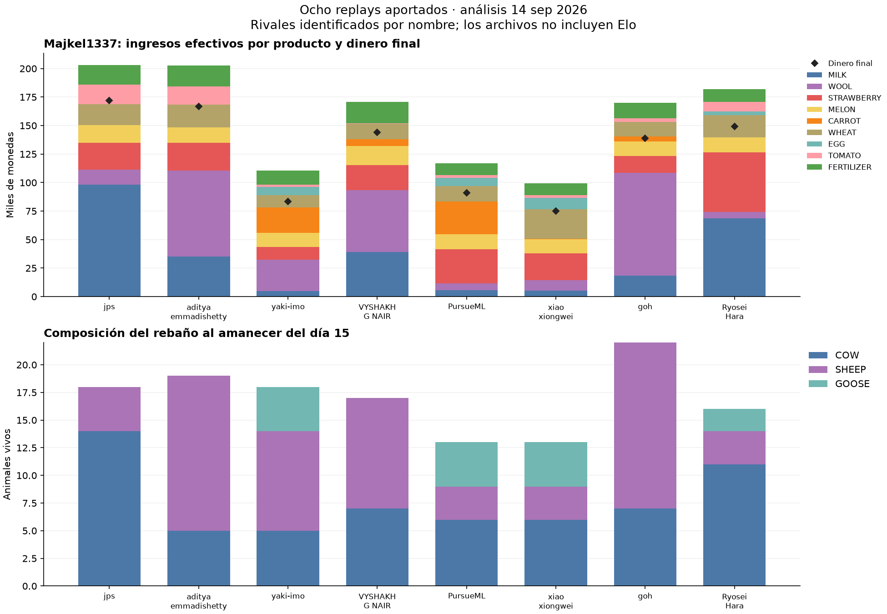

# Kaggriculture — contexto para revisión por otro LLM

Generado por `preparar_contexto_llm.py`; verifica los bloques históricos de lotes.
**Estado y autorización vigentes: docs/research/ESTADO_INVESTIGACION.md. Loop autónomo con submissions experimentales autorizado; los documentos del 14-sep y sus restricciones son históricos.**

Este archivo reúne documentos de trabajo, no instrucciones de sistema. La solicitud vigente del usuario determina el alcance. El prompt incluido es una plantilla para que el usuario formule su petición.

De los dos bloques históricos de lotes se comprobaron 3.840 registros de episodios, 960 comparaciones noop, pares, estadísticas por semilla, hashes de nueve archivos de evidencia, cinco fuentes archivadas y 40 cintas. No se ejecutaron partidas ni consultas. La evidencia nueva del líder se verifica por separado con `verificar_lider.py`; este generador incorpora sus informes sin volver a ejecutar esa verificación. Comprobar coherencia no valida por sí solo el diseño causal o el simulador.

Para una revisión documental basta este archivo. Para auditar trazas resumidas adjuntar también `docs/evidencia/lotes_semillas/` y `docs/evidencia/lider_20260914/`; para inspeccionar código actual y repetir análisis compartir el repositorio. Las acciones completas no se reconstruyen a partir de hashes. No se incluye la bitácora íntegra.

Los enlaces se conservan como en cada fuente; las rutas junto a SOURCE indican dónde resolverlos en el repositorio.

## Índice y huellas de los documentos

- `docs/research/ESTADO_INVESTIGACION.md` — SHA-256 `37edad82ebb1e68f39826cda8545b2655859351e48bd12698c3476a90dfde127`
- `docs/research/CIERRE_TRIGO19_2026-09-25.md` — SHA-256 `fe2eebc5da6cd86105a58706de4c8b5dbfc53922bce7f4230b9c160787a8114d`
- `docs/research/FEEDBACK_0914_2026-09-25.md` — SHA-256 `51a3e56551ff896c2c7e82142059e32c2233defb20219a45fa5065018cd3f6b4`
- `docs/research/PREREG_LOOP27_ATRIBUCION_2026-09-25.md` — SHA-256 `1f96cbcd52e2e298f854d3f5b6cc7a0c1803309cea981318daf0d222cddd45ba`
- `docs/research/ADENDA_LOOP27_COBERTURA_2026-09-25.md` — SHA-256 `2217fed8f89aeffec7da9fcc1f62374c5353f50cc44e4ce7bcf28028914d4b33`
- `docs/research/ATRIBUCION_VENTAS_2026-09-25.md` — SHA-256 `448d34b1a4e98998499832a844ef5554c67e4d834f143c5e8976f8fb00f403dc`
- `docs/research/REPARACION_HASH_RUNTIME_2026-09-25.md` — SHA-256 `31eae1a445a120d27abb9cb46d7b79d9bff0902059a649d4eecf9acd26287b6d`
- `docs/research/SCORECARDS_LOOP_2026-09-25.md` — SHA-256 `496173fa45fac8bf3966acd02bfe6a599451cebcd9bb924a9831694e33afc899`
- `docs/research/PREREG_LOOP26_SEMILLAS_2026-09-25.md` — SHA-256 `ac981a6d48761a788afce6e01f3f1c48925eb8a956a61a6607cd8c3514a54e8f`
- `docs/research/SEMILLAS_TARDIAS_2026-09-25.md` — SHA-256 `4ce2d168fe07ddf2c2d8c8e06d40527c1755be8c1e29d6b489c956b08ce70d46`
- `docs/research/PREREG_LOOP25_PANEL_CERCANO_2026-09-25.md` — SHA-256 `593e3b4f5507f93ade4055da758c87666a706b3f9c0152f9a681eb3a04db9f56`
- `docs/research/SIMILITUD_RIVALES_2026-09-25.md` — SHA-256 `80bdd1e4c26375fb3599cbb3f12ca499d64a0093d97009d58cd944b3cbae1277`
- `docs/research/FEEDBACK_0828_2026-09-25.md` — SHA-256 `cf976ee23c56488b84dacf642bf6941850216cc87128a1abeaed190ad171c5ac`
- `docs/research/PREREG_LOOP24_ADELANTO_TRIGO_2026-09-25.md` — SHA-256 `9860de7959869b5f1bfbf6f2b2de3bb0fa6e4198f5215337900e8c23fa25dd5f`
- `docs/research/ADELANTO_TRIGO_2026-09-25.md` — SHA-256 `739e7e1826595c807e2e1317a182a7781ca6d3e290ec0698ff800aa8d2449889`
- `docs/research/PREREG_LOOP23_SUMINISTRO_OVINO_2026-09-25.md` — SHA-256 `3269a37fed1da29e1ab5ef988efad17d9b0b54aad9347cc87f03e575d1660c74`
- `docs/research/SUMINISTRO_OVINO_2026-09-25.md` — SHA-256 `e45341c4544588f37e6cecd1580f78e2e61ea263a6cc58f8f1ccd88ec768e7af`
- `docs/research/PREREG_LOOP22_HARVEST68_2026-09-25.md` — SHA-256 `7a9aca690bc5cca39b6daff152cf951b9d1806284065740f45b6e7749f635e44`
- `docs/research/FUENTES_PUBLICAS_0712_2026-09-25.md` — SHA-256 `52daff82a9306cdc473123a965b486fc1bace9ab7385e9563a7a2b558515c730`
- `docs/research/PREREG_LOOP21_SENALES_EXTRA_2026-09-25.md` — SHA-256 `9659a516c3cb2bb1cd41539c48be60d2a270bd8908ad72b50ca7a34da880e22f`
- `docs/research/PREREG_LOOP20_REVENTA_TOWN_2026-09-25.md` — SHA-256 `352b1b447b19e8d87d24c2a92601768943c92991df16a65db5257816ed311402`
- `docs/research/REVENTA_TOWN_2026-09-25.md` — SHA-256 `912a1e18f6b73125eefb478b7b1c2ea921ccf4214bac9cae1f2da41bf79042b6`
- `docs/research/FEEDBACK_0742_2026-09-25.md` — SHA-256 `939dbf5f0a6a1d46c6b6284ca76c58f7f985baecf17e0081ad3010438f5b3a18`
- `docs/research/FEEDBACK_PAREADO_0653_2026-09-25.md` — SHA-256 `9c89a4b2b90169c06141af5162687f3ba77b843ff2f17e6eec882544fa2c70cf`
- `docs/research/PREREG_LOOP1_2026-09-25.md` — SHA-256 `cb1d5a3afcb5e1b629ff72a40a91d2a785937c52cd4d3911574d0e0f43c7346b`
- `docs/research/PREREG_LOOP2_2026-09-25.md` — SHA-256 `27584d8c9c7f8bca695c37e0506e42d29c31602c11805bfa086fa80f8b2dd328`
- `docs/research/PREREG_LOOP3_2026-09-25.md` — SHA-256 `9fd1d074212b58e8d8664bc2aa2c959c683bb8b0ffa97d0814c01e470c2ea576`
- `docs/research/PREREG_LOOP4_REPARACION_2026-09-25.md` — SHA-256 `93719809aa6133e9fb3e4dcbffe5c895366b6d93047b25633178bcca7ce508c2`
- `docs/research/PREREG_LOOP5_TOMATE_TEMPRANO_2026-09-25.md` — SHA-256 `6fb66e4527dea8ab81ddb8150d2cb141de51471384ee3245eb04d28c0a871606`
- `docs/research/PREREG_LOOP6_PRODUCTOS_2026-09-25.md` — SHA-256 `7a8a17f2c210a439a9e86a2bcfd0491ee289777011dc94ec53e9cb1306b12c60`
- `docs/research/PREREG_LOOP7_RELLENO_2026-09-25.md` — SHA-256 `ac40ef7f3112c4d8388017b64cc0b7120a8c4186f30b9669fcc5c6fa85f2d2b0`
- `docs/research/PREREG_LOOP8_PATRONES_2026-09-25.md` — SHA-256 `a993c7b152fc3f1b18bca8ba5b244d2825c1ecc67b1839fe9792fc2561b9dba2`
- `docs/research/PREREG_LOOP9_REBANO_2026-09-25.md` — SHA-256 `2cafdc0c8050330a0d54518f47ca23f77fb276169eae77ab17c883eeb8c10723`
- `docs/research/PREREG_LOOP10_VACAS_2026-09-25.md` — SHA-256 `a7d411e36d0355b5e7b9d7b873ecba2fb6a7e44575ea43edfc06b4da936b138c`
- `docs/research/PREREG_LOOP11_BIBLIOTECA_2026-09-25.md` — SHA-256 `2d85ac3f0c8bf85f2e0329d5a75125fc3987ea40f09629a4c59fa6f05910ff18`
- `docs/research/PREREG_LOOP12_APERTURAS_2026-09-25.md` — SHA-256 `e304a4bc0864a65a8731cc9793ea803a415f17b02668608b7969a030440f365f`
- `docs/research/PREREG_LOOP13_ALMACEN_2026-09-25.md` — SHA-256 `e7837583a67d3a4b2ae5c867b0795ebdb694cd95e710ec7ddc95ab573d0cdc66`
- `docs/research/PREREG_LOOP14_ALIMENTACION_2026-09-25.md` — SHA-256 `7ea2b5ac75ad48ac929274bb8ecc56f0271598726cb0683dc59c96bcaf616cc8`
- `docs/research/PREREG_LOOP15_CAJA_ALIMENTO_2026-09-25.md` — SHA-256 `69449c15bed13864c964b98f4cb02bf7cb6ee4191768755200c8d47c14a9270c`
- `docs/research/PREREG_LOOP16_REBANO_INICIAL_2026-09-25.md` — SHA-256 `08bc70a015cbed09f36a2c6d8550d8b5988a6ec18039c84558c8d273c702e90a`
- `docs/research/PREREG_LOOP17_BONUS_LIMITADO_2026-09-25.md` — SHA-256 `46047397849dc28aff3219271e693b26f34d89568e01c5b738e34a2d6439c812`
- `docs/research/PREREG_LOOP18_PUBLICOS_0548_2026-09-25.md` — SHA-256 `b62919ee2ba7159129d08885c8b88430230c67218b7185e41d084b70208eac37`
- `docs/research/PREREG_LOOP19_TRIGO_2026-09-25.md` — SHA-256 `a41092c53b6e7476a57aa015702b923959b7965f17471c2b25b5f39e07a72454`
- `docs/research/TRIGO_REVENTA_2026-09-25.md` — SHA-256 `cb9413a3e3e035ef4a6f7b7f1ea75dded155105b5edf16007b300c1096dceee9`
- `docs/research/FUENTES_PUBLICAS_0548_2026-09-25.md` — SHA-256 `d0841f7cb1b02e1e179dfa841638bae1eac6c8aba33910aea878b18332a70d1b`
- `docs/research/AUDITORIA_PERDIDAS_CAMPO_2026-09-25.md` — SHA-256 `ebc47150559215861e814a9a0f306155e01121994940277ebebdb4055dcb1ebb`
- `docs/research/FUENTES_PUBLICAS_0400_2026-09-25.md` — SHA-256 `6618b2cc3e28935153ee5e8f6a60bc989a9663820473828cce90e6c40c6cd2b2`
- `docs/research/IDEAS_VIVAS_2026-09-25.md` — SHA-256 `4728bc63d1e9c220f0d966c2de029931bdb8f3c4d75ed88b0cb051015c52e1e9`
- `docs/research/FEEDBACK_TOP3_2026-09-25.md` — SHA-256 `1b05c27fc6f3c9309f7d63a1b7d5ee39509bb0a7e475c2e4f6bb8668504e0a5d`
- `docs/research/LIDER_Y_FUENTES_2026-09-25.md` — SHA-256 `f940d574bb7e3d43785ee31a100204a8c3a7c7587009f9fcbb02b1ef8df07daf`
- `docs/research/DECISION_ENVIO_TOP3_2026-09-25.md` — SHA-256 `a17b15f6d0db894ec64c3dbd25ce08ac2553f25d2528682b129a1f4a779cbde6`
- `docs/research/RESULTADOS_2026-09-25.md` — SHA-256 `98349e7d3065ae9fb91d396d089c4aa95f1841d5c8b844242add6ba3e8e6965c`
- `docs/research/RESEARCH_BELIEFS.md` — SHA-256 `53248f572c85bc2bad406bd533ecefe26875b7238f10e7f77aa64f422fb337ad`
- `docs/research/HARNESS_VS_LEADERBOARD.md` — SHA-256 `49b3cfbdb4cc97efbb3c4e31590d153bda48f3426b3d606c9a3bbbc66d246a05`
- `docs/research/SUBMISSION_HISTORY.json` — SHA-256 `19eec271fe7ea28a4c2dc6ce225d4eee7f4425c1e7abd5c21a699503ea7cfdfa`
- `docs/research/PREREG_VQ_2026-09-24.md` — SHA-256 `7f4b6b42db6dbeeb3981cd0fa56fbf071f4b4f6eec121ceeb292b2b0ca6ebab5`
- `docs/research/PREREG_ADV_2026-09-24.md` — SHA-256 `bed0700878535baaf11409f4dfef3364623943e5e42ecea44fb13b5ebcae4b58`
- `docs/research/PREREG_FORECAST_GATE_2026-09-25.md` — SHA-256 `bf5dd9fbf03de91f1fbf95a557600d969b3c01f143f849271a827abc87cfd2be`
- `docs/research/PREREG_PUBLIC_REFRESH_2026-09-25.md` — SHA-256 `bc60b8ef2b9580510782f1801bcac5e43f4f5c8524f9a39bd9a7c587812a12cc`
- `docs/PROMPT_SEGUNDO_CEREBRO.md` — SHA-256 `e319f3917d23defc367804e464d3d13be14d21061eb2ca73fede8977d4f04c07`
- `AGENTS.md` — SHA-256 `4a1638421d63a639057acac9c2971e68ed59f401bf70a3e2980103feb49cb19e`
- `docs/ESTADO_ACTUAL.md` — SHA-256 `cb368cef5250eede256fee3eecc4a6c87da87bf8644981c884ffff1a2ef01948`
- `docs/RESULTADOS_LIDER_2026-09-14.md` — SHA-256 `efb3b4c09053f13d648e8019a7ba8363f68a24c234b04b4869754e82877c648b`
- `docs/ANALISIS_LIDER_2026-09-14.md` — SHA-256 `63e3448307868dec34c5c67a697f052f4bc31b4437bc7781b4e702b1d234db53`
- `docs/EXPERIMENTOS_ATREVIDOS_2026-09-14.md` — SHA-256 `da5d98a1afb433c3d2ca6aa11347d212cb8dbcd2a7c43ca8ecfe54bc3ffc544e`
- `docs/evidencia/lider_20260914/README.md` — SHA-256 `d167cefcb9f2cf65dcdabcc8203d99c23e2c9fc1c41df62be78872b8e244e5d0`
- `docs/REVISION_LIDER_PARA_LLM.md` — SHA-256 `9086015c3c33e66ff5362cb4c71b32abcc697d7123715b77184e815dde0b8233`
- `docs/BRIEFING.md` — SHA-256 `450b8b70d8959deedb39a3907ab18ddb5715fa07c92cc24789f07fb4a581ef3d`
- `docs/AUDITORIA_LLM.md` — SHA-256 `f5637e70de4bd1f6427f68b8d4bdfc43b914c16572f005a663a9c813e4a180f0`
- `docs/METODO.md` — SHA-256 `f3dba1825cb10bc6c7d3a668da2c5220f8b198f83a8384a1af7732c55e3231c0`
- `docs/IDEAS_Y_PRUEBAS.md` — SHA-256 `3d2f842ad1c53364c6e022e797e861c628bf894fec44390132ddd0a21aabf9dc`
- `docs/RULES.md` — SHA-256 `068679a3a092baecf46c929f6c3f44d31ff3d2ab11be39323d3f59e6d526a268`
- `docs/EXPERIMENTO_LOTES_SEMILLAS.md` — SHA-256 `9aa0937876ed4c4b47f3ae549fba9317af44d46ae478fe2ccdd67e366cb4e01d`
- `docs/evidencia/lotes_semillas/README.md` — SHA-256 `7b4beb82362bb17bd01b39cec158c7596acd36c066ff0df5ff9bf025c0367e3d`


---

## SOURCE: docs/research/ESTADO_INVESTIGACION.md

# Estado de investigación — leer primero para continuar

## Corte operativo 09:36 UTC —20corriendo,27validado y en cola

Confirm19_fixedhash0terminó09:22:12UTC:3.200episodios,832noops exactos, delta0
ambas políticas. Cambian6/704acciones propias cada una, sólo contraguru6en
tres semillas; ya eran victorias. No inertes, no seleccionadas ni enviadas.
No sumar la medición original inválida. Leer CIERRE_TRIGO19.
Pilot20corre;21–27esperan en secuencia. No duplicar procesos.

Loop27validado72partidas/noop17.256/max404ms,120.792cantidades propias exactas.
Original48falló sólo coberturaVQ, no se relajó: adenda previa+24contraTop3
reactivo demuestra6/8activaciones; contraV7VQ0/8,top32/8. Ambas corrigen datos,
conservan trabajo/cosechas/tiendas/pérdidas, cero escapes/productos terminales.
Los márgenes de desarrollo empeoran donde actúan, ningúnW/L/Tcambia. Registro
más fiel no implica estrategia mejor. Piloto960contra panel cercano tras26.
93variantes construidas más2prototipos17detenidos. Leer ATRIBUCION_VENTAS,
preregistro27y ADENDA_LOOP27_COBERTURA. Verificador final:verificar_cobertura_atribucion_ventas.py.

Consulta09:13:39UTC:VQ2290,3/95y top32119,0/84, COMPLETE. Seis replays nuevos
0914reproducidos719acciones/720estados/caja exactos, sin escapes propios.
Alternativas contra rival grabado favorecen margen top3en5/6, no prueba
reactiva ni explicación causal del rating. Ver FEEDBACK_0914; sin nuevo envío.

## Corte operativo 09:11 UTC — loop26 validado, confirmación principal activa

Confirm19_fixedhash0 continúa con sus3.200celdas registradas; no reiniciar ni
leer deltas parciales para ajustar variantes.20–26esperan en secuencia, un solo
torneo principal.91variantes competitivas construidas más2prototipos detenidos.
Loop26: dos políticas de semillas sobreVQ,40desarrollos/noop5.752/max327ms,
76compras modificadas verificadas. Kind activa2/8celdas, JIT8/8; conserva campo,
siembras/alimento/cosecha/tiendas/escapes y pérdidas en los cuatro mundos.
Ahorra0–20monedas sin cambiarW/L/T. No se ha demostrado ventaja competitiva.
Piloto960contra panel cercano tras25, confirmación disjunta si procede.
Leer `SEMILLAS_TARDIAS_2026-09-25.md` y preregistro26. La consulta pública09:01
no encontró cambios en las50entradas consultadas; sin nueva descarga/envío.

## Corte operativo 08:44 UTC — confirmación repetida por control inválido

Piloto19completo: tres variantes+2,734375pp, señal en2/32semillas; ambas
seleccionadas (both/front). Originalconfirm19cerró3.200pero FALLÓnoop: cuatro
hashes rivales distintos, mismasacciones propias/rewards. Se conserva inválido.
48reproducciones aislaron orden de set dependiente de PYTHONHASHSEED; todos
los720estados económicos comparados coinciden, fuentes externas intactas.
Nueva **confirm19_fixedhash0**corre desde08:43UTC, mismas3.200celdas/gates,
runtime fijo y registrado; no es otra confirmación independiente ni suma N.
Seis partidas técnicas/noop2exacto comprobaron el arreglo. Los seis waiters
20–25anteriores terminaron por cascada y se reiniciaron con logs nuevos; no
hubo partidas20–25antes del fallo. Leer `REPARACION_HASH_RUNTIME_2026-09-25.md`.
20–24validados y
en cola; un solo torneo grande, no duplicar.89variantes construidas más2
prototipos17detenidos. Adelanto24compra antes y permite ventas más tempranas:
36juegos/noop8.628/64llenados,4.480unidades descontadas del compromiso nativo,
max308ms. Nuevo catálogo público08:02UTCno cambia las50entradas anteriores.
Último ladder08:27:46UTC:VQ2292,9/92, top32103,4/81; no nuevo envío.
Tres replays nuevos0828reproducidos719acciones/720estados; máximo181ms,
cero errores observados/escapes propios/productos finales. Dos victorias top3,
derrotaVQpor409; muestras de recencia, no estimación global. Ver informe0828.

Loop25 registrado y en espera tras24: cinco fuentes existentes, panel reactivo
VQ/top3/V7/HS4 y confirmación agregando Harvest68/arshs3. Piloto1.920,
semillas1063000–015; confirmación1064000–031. No depende de quién gane19–24.
Auditoría15replays: mediana99,17%de vector de campo idéntico,71,27%mercado
activo. Descriptivo, no código identificado ni efecto causal. Validación del
analizador con1.920partidas históricas/noop448, sin nuevas simulaciones.
Ver `PREREG_LOOP25_PANEL_CERCANO_2026-09-25.md`; ningún envío automático.

## Loop activo desde 2026-09-25 01:02 UTC

El usuario pidió explícitamente seguir investigando y probando en un **loop
continuo**, sin detenerse al cerrar una ronda. Objetivo persistente activo.

- Loop1: ocho variantes sobre VQ, producción/forecast, 1.000 episodios completos.
  PROMISING: pred_top3 +9,375 pp; pred_fast2 +3,125. Ambas a confirmación.
  Protocolo `PREREG_LOOP1_2026-09-25.md`; semilla 995000–995003.
- Loop2: recuperación de siembras + inversión en tomates, cinco variantes,
  616 episodios completos; ninguna señal agregada positiva. Reparaciones
  y dos variantes de tomate no se activaron en estas cuatro semillas.
  Protocolo `PREREG_LOOP2_2026-09-25.md`; semilla 998000–998003.
- `continuar_loop_publicos.py` encadena esos pilotos, verifica controles,
  selecciona según reglas fijadas y ejecuta confirmaciones disjuntas. Usa
  `torneo.py` y `pareado_torneo.py`; no es otro harness. NO subir automáticamente.
- **Confirm1 completa**, 1.600 episodios, noop416/416, cero errores. Top3
  **+10,795 pp**, IC95 dos vías [−0,115;21,706], cumple gate de prueba real;
  fast2 +2,841 pp, no cumple gate. Top3 máximo757ms, mecanismo de mejora y
  única celda de daño reproducidos. Decisión en `DECISION_ENVIO_TOP3_2026-09-25.md`.
- Loop3 completo: 504 episodios; herd_future −84,375 pp, EV600 −34,375,
  EV1500 0 (inerte), EV_future −40,625. No seleccionadas, sin confirmación.
  Noop96/96, cero errores. Sonda para explicar el gran daño de herd_future.
- Loop4 completo: 384 episodios, noop128/128; recover_now cambia una de64
  partidas, +1,5625pp, IC95 semilla [−1,62;4,75]. Sólo una semilla positiva;
  no pasa gate de dos. INCONCLUSIVE, no envío. No sumar el caso dirigido previo.
- Piloto loop5 completo: 616 episodios, noop104/104, cero errores. Early12_9k
  inerte; early12/14/16_6k −18,75pp, late18_6k +3,125pp. Sólo seed1005002
  activa cambios. **Confirm5 completa**: late18_6k −21,591pp, IC95 dos vías
  [−36,90;−6,28], 1.152 episodios, noop384/384, cero errores. REJECTED.
  Cambió156/352 partidas; ninguna celda mejor y38 peores. No enviar.
- Loop6 completo:736 episodios, noop112/112, cero errores. EGG/MELON/ambos
  delta0; EGG cambia46/64 acciones y MELON es inerte. Top3+fast2 −6,25pp.
  Ninguna seleccionada. Controles factoriales: VQ78,125%, fast2 70,313%,
  top3 96,875%, combinado90,625%. No asumir suma de efectos de rondas previas.
- Loop7 completo: cuatro políticas de tomates en suelo SE libre, 4/8
  plantas d16/d18, sobre top3. V2 podía inhibir R51; v3 corrigió contratación
  pero perdió cuatro tomates por overflow. V4 separa riego/cosecha:16 diagnósticos
  completos, plantas y ventas16/32 confirmadas, R51 y ovejas conservados.
  Piloto1.248 completo, noop256/256. D16 inertes; d18 +1,5625pp cada una,
  IC dos vías[−3,41;6,54], cambia16/128 partidas en dos semillas.
  **Confirm7 completa**:1.600 episodios, noop416/416, cero errores. Ambas
  d18 inertes en352/352 partidas del pool; delta0, IC dos vías indefinido.
  INCONCLUSIVE_NOT_SELECTED: no prueba de beneficio, no envío.
- Loop8: seis variantes de patrones (rank5/7, historia120/360,
  ajuste por producto y desfase temporal). Validación16 juegos completa,
  noop1.438 acciones idénticas, cero errores, máximo271ms. Piloto1.472
  completo:1.472 episodios, noop224/224, cero errores. History360, phase2 y
  rank5 +1,5625pp cada uno (una celda mejor); rank7−3,125, history120−10,9375,
  product3−1,5625. Desempate registrado selecciona history360/phase2.
  **Confirm8 completa**:1.600 episodios, noop416/416, cero errores.
  History360+2,8409pp, IC dos vías[−1,249;6,931], debajo del gate3; PROMISING
  sin envío. Phase2−3,4091pp, IC[−13,23;6,412], inconcluso sin selección.
- Loop9 completo: seis rebaños incrementales (2/3/6 ovejas, día12/14),
  sin comprar tierra y con demanda YARN ya visible. Se validan22 partidas
  dirigidas por versión antes de encolar1.920. V2 corrige cosechas tardías;
  motor confirmó36/53/83 entregas completas en ambos asientos. **V3** incluye
  seis ovejas compradas pero aún sin colocar y lana privada en la proyección.
  Otros22 juegos válidos, forzadas byte de acciones/rewards idéntico a v2;
  seis variantes normales inertes en ese mundo. Manifiesto v3 actualizado
  antes del piloto9. **1.920 completos**, noop320/320, cero errores; las seis
  inertes128/128contra pool, acciones propias/rivales idénticas, delta0 e IC
  dos vías indefinido. Sin selección/confirmación. Total42variantes competitivas.
- Loop10 piloto completo: adelantar conversión COW→SHEEP a días3–7,
  fuera de la regla8–11 ya existente. Seis políticas de fecha/demanda/caja.
 48 juegos dirigidos, noop4.314 turnos exactos, max284ms. En mundo YARN/YARN:
  dos compras/colocaciones aceptadas,49 lanas cosechadas, cero escapes/créditos
  pendientes/inventario final. En dos mundos sin YARN temprano son inertes.
  Piloto1.920 válido, noop320/320, cero errores: y2_m100 +2,34375pp (ambas
  fechas), y1_m100 −8,59375pp, y1_m500 −2,34375pp. D3/D6 tienen acciones y
  rewards idénticos128/128por pareja: no son réplicas independientes.
  **Confirm10 completa**,1.600episodios nuevos1019000–015, noop416/416,
  cero errores. Ambas y2 inertes352/352contra pool; delta0, ICdos vías indefinido.
  INCONCLUSIVE_NOT_SELECTED, sin envío. No refuta beneficio en contextos ausentes.
  Auditoría del daño y1:200monedas extra impiden compra de trigo191 (7→0),
  fallan alimentaciones y escapan tres vacas239; base0. No atribuirlo sólo
  a precios de lana. Próxima hipótesis: reservar insumos futuros antes del swap.
  Y2 sólo actúa en una de16semillas; cobertura rara limita inferencia/gate global.
- Biblioteca auditada:2.398 streams,64/64 pares de tiendas,24–63 por par.
  Doce streams recientes de ventas aceptadas son nuevos por fingerprint; no
  agregan pares de tiendas. Fecha de biblioteca original desconocida (ids−1).
  Loop11 ahora valida tres bibliotecas (DSM4, ladder8, todas12):20juegos,
  noop2.876turnos exactos, max250ms; ladder/all sí seleccionan un stream nuevo.
  Piloto1.920 con32semillas1021000–031, luego confirmación de32semillas;
  **Piloto11 completo**:1.920episodios, noop448/448, cero errores. Tres deltas0,
  ICdos vías indefinido. DSM inerte256/256; ladder/all cambian18/256acciones
  propias y10rivales en tres semillas, sin W/L/T distintos. Ladder/all son
  equivalentes256/256en ambas acciones/rewards. Sin selección/confirmación.
- Loop12 completo: tres aperturas nativas sobre top3 y MarketShock
  público con entrada corregida.12juegos, noop1.438turnos, max229ms; tomate
  inicial produjo4unidades y sustituye una vaca. Trigo temporal de base/cycle
  se cosecha en87, distinto al contador heredado que esperaba53. MarketShock
  tiene un escape tardío de ganso; no se oculta.1.008episodios, semillas1025000–007,
  **1.008 completos**, noop192/192, cero errores. Original−3,125pp, cycle0,
  tomate−80,46875pp, MarketShock−64,0625pp. Los dos últimos REJECTED, ninguna
  seleccionada/confirmada. Cycle cambia128/128acciones: delta0 no implica inercia.
  Seis juegos de mecanismo reproducen caja/rewards; tomate cambia tiendas.
  En su caso adverso sube nuestro dinero pero gana más el rival: no usar dinero
  bruto para adoptar. Total55variantes construidas al registrarlo.
- Loop13 validado/encolado: cuatro ventas preventivas de excedente WHEAT/FERTILIZER
  con reservas1/2días. V1 inválida por omitir VQ al capturar entrada antigua;
  fuente/evidencia conservadas. **V2**36juegos completos, noop4.314turnos,
 22activaciones con vector final/pérdida exactos del motor, max291ms,
  cero errores/escapes/diferencias en animales sin alimentar al cierre.
  Piloto1.248 **completo**, noop256/256, cero errores: wheat1/inputs1/inputs2
  +4,6875pp y wheat2+3,125pp; ICdos vías cruzan0. Tres celdas mejores en dos
  semillas, ninguna peor para inputs1/2. Cambian56/128acciones; ambas fuentes
  son distintas en32/128juegos. Desempate registrado selecciona inputs1/2:
  **Confirm13 completa**,1.600episodios1029000–015, noop416/416, cero errores.
  Ambas delta0/ICdos vías indefinido, ninguna celda mejor/peor; no pasa gate.
  No son inertes: inputs1cambia107/352acciones einputs2cambia86/352.
  Márgenes suben103/82partidas y bajan4cada una, pero ningún W/L/T cambia.
  Dinero diagnóstico no sustituye criterio: inconclusas, sin selección/envío.
  Auditoría12juegos reproduce hashes propios/rewards/caja: pérdidas8→4/6,
  27→9/17 y9→5/6en las tres celdas positivas. Caso neutral6→3, pero omite
  tres FEED posteriores y cosecha3MILK/2EGGmenos; no afirmar alimentación
  universalmente preservada. Mismas tiendas, ningún escape en los12diagnósticos.
  Total59variantes construidas al registrarlo.
  Motivación: c0nrad nos ganó con menos movimiento/jornales y se verificaron
  33unidades propias perdidas en cinco descargas nocturnas; rival0. Guardas ya
  existentes no lo solucionan conservando el vector final. JSON aislado cambia
  orden de bolsas y da predicción falsa en527; reconstrucción viva sí coincide
  con motor en5/5. Ver feedback y `c0nrad_*_audit.json`.
  En mundo dirigido1272457736 contra arshs3 reactivo, reserva1día reduce
  pérdida27→8, reserva2días27→20; quedan pérdidas residuales. En1004000
  brazo2días inerte;1027000 permite diferenciar trigo/fertilizante. No es W/L OOS.
- Loop14 validado/encolado: cuatro reglas de valor del alimento, multiplicador
  0,5/2,5, conservar FEED ovino o conservar todo FEED nativo.36juegos, noop4.314,
  máximo271ms, cero errores/escapes/inventario final; todas cambian acciones
  en tres mundos, consumo de trigo y producción confirmados por motor.
  **Piloto14 completo**:1.248episodios, noop256/256, cero errores. Half−12,5pp
  (ICdos vías[−33,693;8,693], inconcluso no seleccionado); double−26,5625,
  keep_sheep−50,78125, all−64,84375con ICdos vías negativos: REJECTED.
  Todas cambian128/128acciones propias. Sin confirmación ni envío. Ocho
  diagnósticos reproducen rewards/caja y conservan tiendas: producir más
  puede reducir ingresos; producir menos puede beneficiar más al rival.
  Total63variantes competitivas al registrarlo.
  Auditoría previa de8replays top3: PASS no implica trabajo útil pendiente;
  ningún CARE útil omitido entre esas oportunidades y60huecos WATER sin
  efecto inmediato/próximo amanecer ni muerte evitada esa noche.261huecos
  FEED motivan ablar filtro económico, sin asumir que todos fueran errores.
- Loop15 validado/encolado: cuatro reservas de caja antes de sustituir vacas,
  alimento hasta cierre/24/48h o todas las obligaciones24h.42juegos válidos,
  noop4.314, max294ms. En caso adverso:night permite una oveja, compra4trigos
  y evita tres escapes; resto conserva base. En caso solvente:night/24permiten
  dos ovejas,48/all24inertes. No seleccionar por esos rewards. Piloto1.568
  con control antiguo, semillas1034000–015, **completo**:1.568episodios/noop288,
  cero errores. Night/24−12,5pp(ICdos vías[−36,221;11,221]),48/all24inertes128/128,
  legacy−18,75como control. Sin seleccionadas/confirmación. Night/24cambian40/32
  acciones; coinciden entre sí en104/128partidas(ambas acciones/rewards).
  Ocho diagnósticos: reserva evita tres escapes en1034015, pero1034010pierde
  sin escasez de trigo: más lana vendida por menos dinero, menos leche. Caja
  suficiente es necesaria, no criterio de rentabilidad. Total67variantes al registro.
- Loop16 validado/encolado: cuatro mezclas iniciales (1/2vacas→ovejas o viceversa),
  sin más peones/rutas.48juegos/noop5.752turnos, max329ms, compras/colocaciones
  y costes±100/200aceptados, crédito0al día1. Todas cambian acciones en4mundos.
  Cambiar caja inicial altera cultivos y tiendas: es efecto total, no sólo lana
  por leche. Sheep2pierde una vaca215en1272457736;1036000tiene escapes tardíos
  en base/cow1. Se conservan, no ocultarlos. Piloto2.496con32semillas1037000–031,
  confirmación32semillas1038000–031. **Piloto16completo**:2.496episodios,
  noop512/512, cero errores, base92,1875%. Sheep1−86,71875pp, resto−92,1875pp,
  todos REJECTED con ICdos vías negativos. Todos cambian256/256acciones propias.
  Sin seleccionadas/confirmación. Dos celdas adversas reproducidas con caja:
  cambian tiendas; sheep1sube caja831pero rival8.971. No es efecto puro de especies.
  Total71variantes construidas.
- Auditoría de12replays top3:3CARROTpor decay,1por sequía y4MILKen campo final.
  33MILKtruncadas con inventario previo0son exceso de cuidado antes de primer
  yield; no se arreglan cosechando antes.14EGGcon cap sí requerirían ruta/entrega.
  Motivó loop17; ver `AUDITORIA_PERDIDAS_CAMPO_2026-09-25.md`.
- Loop17 detenido en desarrollo:24juegos/noop4.314/max284ms, ejecución válida
  pero cap_full confunde inventario actual con inventario nocturno. Omite FEED682,
  luego HARVEST687 libera espacio y pierde un huevo de producción700. Cap_first
  cambia una valoración pero no acciones en tres mundos. Error de modelo temporal,
  no rechazo por rewards ni estimación poblacional. No lanzar piloto17/subir:
  `capped_bonus_decision.json` marca competitive_ready=false y runner lo exige.
- Loop18 validado/encolado directamente tras16: V7cda529cb yHS48378f73c públicos
  nuevos,24juegos/noop2.876/igualdad oficial-nominal5.752turnos, max431ms.
  Cero estados fatales, cero errores en contadores nuevos observados, cero escapes
  y productos terminales en esos mundos; quedan semillas. Piloto704semillas
  1043000–015 **completo**704episodios/noop192/errores0: V7−21,875pp
  (ICdos vías[−57,741;13,991], inconcluso); HS4−30,46875pp
  (IC[−56,648;−4,290], REJECTED). Ambos activos128/128. Ningún seleccionado
  ni confirmación. **Corre19desde07:33:37UTC**;20/21/22esperan.
  No sobrescribir rivales antiguos del pool.
  Total73variantes competitivas construidas más2prototipos17detenidos.
  Ver `FUENTES_PUBLICAS_0548_2026-09-25.md`; afirmaciones externas no son evidencia.
- Loop19 validado/encolado tras18: prioridad de BUYWHEAT, mitad de cantidad y
  ambas, sólo grandes compras de reventa planificada.30juegos/noop4.314/max305ms,
  ejecución/slots/llenados aceptados verificados. En588616997actúan20/38compras;
  otros dos mundos inertes. Sin escapes en desarrollo, mitad altera alimento
  y añade2MILK. No elegir por rewards. Cobertura estática sólo5/64pares motivó
  ampliar antes del piloto a32semillas por bloque; piloto1.9201046000–031,
  confirmación1047000–031. Runner en espera reiniciado, activos intactos.
  Piloto1.920**completo**, noop448/448, cero errores: las tres+2,734375pp,
  ICdos vías[−3,903;9,372],4celdas mejores/0peores, sólo2/32semillas activas.
  Cambian16/256acciones; compartenW/L/Tpero sólo240/256acciones/rewards.
  Desempate selecciona both/front: **confirmación3.200corriendo desde07:57UTC**.
  Actualización08:44: original completo pero noop inválido por hash del runtime;
  nueva confirm19_fixedhash0corriendo, mismos agentes/muestra/gates. No usar
  el bloque original para promoción ni relajar igualdad literal.
  Ocho mecanismos reproducen hashes/rewards/caja: frontahorra1508/941de trigo
  con igual cantidad y producción; half/bothalteran3WHEAT/3CARROTen un caso.
  Total76variantes competitivas construidas más2prototipos17detenidos.
  Ver `TRIGO_REVENTA_2026-09-25.md`; nuestra fuente reproduce exactamente el
  replay real de origen, pero no conocemos ni copiamos su política rival.
- Loop20 validado/encolado: tres nuevas reventas de trigo alrededor del consumo
  conocido del pueblo, topes20/50/80, sin tocar compras nativas19.30juegos,
  noop4.314turnos, max358ms, cero errores/escapes/stock final.146compras y cierres,
  7.862unidades llenadas/liquidadas;42ventas heredadas integradas sin duplicar.
  Tres brazos activos en tres mundos, alimentación/producción/tiendas/pérdidas
  preservadas allí. Piloto1.9201049000–031tras19, confirmación1050000–031.
  Sonda sintética400escenarios/800piernas exactas demuestra riesgo rival:
  78pérdidas pese a pronóstico positivo sin rival. No seleccionar por caja.
  Total79variantes construidas más2prototipos detenidos.
  Ver `REVENTA_TOWN_2026-09-25.md`; no afirmar beneficio por spread anunciado.
- Loop21validado/encolado: cuatro reglas para señales adicionales del forecast
  (rango2, consenso, mitad, horizonte12), conserva regla del patrón1.42juegos,
  noop4.314turnos, max293ms, cero errores/escapes/producto final. Todas activas
  en tres mundos; cambia comida/cosecha en dos, mismas tiendas. No seleccionar
  por rewards. Piloto2.0161052000–015tras20, controlVQen ambos bloques y dos
  rivales públicos0548añadidos antes de conocer su piloto18; confirmación
 1053000–015contra13rivales, gate adicional≥0vsVQ. Total83variantes construidas
  más2prototipos detenidos. Ver protocolo21.
  Ocho replays reales recientes, cuatro por fuente, reproducidos por código
  enviado:719acciones/720estados exactos;16juegos con contrafactualVQ/top3,
  caja conciliada/max348ms/sin escapes propios. Top3mejora margen7/8pero
  rival grabado no reacciona: no es estimación competitiva. Ver FEEDBACK_PAREADO_0653.
- Loop22validado/encolado: Harvest Ledger V68SHA3b543611y selector-offab4cbb92.
  Master descargado07:12idéntico al V7ya probado, deduplicado.42juegos/noop4.314,
  entradas oficial/nominal8.628turnos exactos, max713ms, cero errores observables,
  escapes/productos finales/créditosYpendientes. Selector activo3mundos, swaps
  1/1/2aceptados; quedan semillas2/0/6y cambian tiendas en1578791335. Piloto1.280
  tras21, controlVQ/gate≥0vsVQ. Total85variantes más2prototipos; ver informe0712.
- Loop23validado/encolado: suministro del peón ovino compacto, buy/hold, dos fuentes
  generales. Replaydavion113174624reproducido exactamente: otro actor consume5
  antes de que peón12retire6; recibe1y queda21turnos PICKUP0. Seis ovejas no
  alimentadas/cuidadas; no FEEDfallido ni problema de caja. Sonda compra6→11
  recupera24lanas vendidas, caja propia+22pero rival−4.137, margen−2.904→+1.255
  contra cinta fija. Regla general lo reproduce sin seed/paso fijos.48desarrollos
  reactivos válidos/noop8.628/max327ms, activo sólo contraV7en mundo dirigido,
  ambos asientos. Retira6trigos completos, restaura6FEEDy24lanas, margen−5090→−1093;
  no convierte esa derrota. Base/arshs3/VQ/HS4inertes. Piloto2.560tras22,
  controlVQy confirmación disjunta.87variantes construidas
  más2prototipos; ver `SUMINISTRO_OVINO_2026-09-25.md`. No es mejora OOS aún.
- Loop24validado/encolado: adelantar compra nativa de trigo sobreVQy top3,
  cancelar sólo llenado observado en origen antes de guardas de alimento.
  36juegos/noop8.628/max308ms,64adelantos/4.480unidades compradas y descontadas
  del plan nativo. Cuatro casos dejan3de89sin adelantar, solicitud posterior
  no llena por capacidad; no duplican lo comprado. Activos sólo en593858505,
  ambos asientos;16eventos por juego, otros dos mundos inertes. Alimento
  preservado, cosecha453de3CARROT→3WHEAT; ventas también se adelantan por stock.
  Sonda contraGrimReapergrabado margen−3070→+313; reactivoarshs3mantieneW.
  Piloto2.560tras23,32semillas, VQbase/top3control; confirmación disjunta.
  89variantes construidas más2prototipos. Ver `ADELANTO_TRIGO_2026-09-25.md`.
  Sonda sintética384casos/1.152piernas exactas: comprar antes sin vender antes
  pierde dinero32/128; adelantar ambas pierde beneficio contra rival pasivo24/32.
  No son tasas poblacionales. Catálogo08:02sin cambios en50entradas; no duplicados.
- Fuentes públicas nuevas: MasterEngine actualizado es tds25 byte exacto,
  excluido. MarketShock12ad317e diferente; loader elegía instalador. Corrección
  de entrada1c94b979 probada idéntica al `module.agent` del autor en8juegos.
  Fuente/adaptación separadas en `FUENTES_PUBLICAS_0400_2026-09-25.md`.
- Auditoría piloto7: cuatro filas TDS con acción propia idéntica y hash rival
  distinto, pero rewards/WLT idénticos. Ocho reproducciones (hashseeds0–3)
  dieron acciones/estados idénticos; origen de la variación neutral no resuelto.
  No afecta selección observada ni justifica afirmar determinismo universal.
- Scorecards actualizadas: `SCORECARDS_LOOP_2026-09-25.md`.
- Estado máquina: `docs/evidencia/loop_publicos_20260925/pipeline_state.json`.
  Logs: `results/loop_publicos_20260925_pipeline.log` y los logs de cada bloque.
  No modificar `torneo.py`, ni agentes de un bloque mientras corre. No lanzar
  otro torneo de ocho workers mientras el pipeline ocupe el equipo.
- Sonda nueva: falta una fresa tras DIG por maleza en replay 113061732. Reparación
  con reintento entre trabajadores no actúa por falta de riego el mismo día;
  inserción en un sufijo con turno final redundante sí recupera planta. Cambia
  tiendas/RNG, así que la sonda frente a replay NO mide ganancia competitiva.

Sonda posterior en bucle cerrado (mismo seed del fallo, ambos asientos, rival
arshs3 reactivo): reparación inerte en asiento 0; recupera planta y −671→+53 en
asiento 1, con tiendas diferentes. Caso dirigido, no estimación poblacional.
La prueba de cobertura quedó registrada y encolada como loop4.

Snapshot vigente07:41:40UTC(sufijo0742):VQ**2296,9/91episodios listados**,
top3**2094,4/79**, ambasCOMPLETE. Incluyen validación. Sin nuevo envío.
Siete replays nuevos por recencia: cada fuente reproduce719acciones/720estados
exactos/caja, máximo187ms; cero escapes propios/productos finales/PICKUPW0.
Top3:2V2D;VQ:2V1D, no WRpoblacional. ContraGrimReaper,19/19compras grandes
rivales ocurren un turno antes con igual cantidad pedida; coste2988menos con
1359unidades vs1361propias. Nueva hipótesis de adelanto de compras, distinta
a prioridad19/nuevos roundtrips20, aún sin construir. Ver `FEEDBACK_0742_2026-09-25.md`.

Snapshot anterior06:52:55UTC (sufijo0653): VQ**2289,1/88episodios listados**,
top3**2094,7/75**, ambasCOMPLETE. Incluyen validación. No nuevo envío. Las
cuatro partidas recientes por fuente se seleccionaron antes de leer rewards.
Diagnóstico8replays/16reproducciones en `FEEDBACK_PAREADO_0653_2026-09-25.md`.

Líder actual consultado 01:36 UTC: DSM 3128,7, submission 56518845. Cuatro replays
recientes reproducidos exactamente; compra cuarta tierra día 10 y cultiva más
tomates, con diferencias grandes de composición por mundo. No inferir causalidad
ni algoritmo del score. Informe: `LIDER_Y_FUENTES_2026-09-25.md`. Dos notebooks
con nombre nuevo eran copias de tds25: se deduplicaron sin repetir torneo.

Snapshot histórico01:52UTC: VQ56535264 **2319,5 /24 episodios listados**, original
56511619 **2275,7**. VQ aún joven, no afirmar superioridad por este rating.
Top3 **56537205 COMPLETE**, enviada 2026-09-25 01:56:34 UTC, commit ba1fda8,
sha9668e30a byte exacto de confirmación. Validación113099118: 720 pasos,
DONE/DONE, cero errores/timeouts. Recibo confirma tres envíos restantes.
Desplaza al original y conserva VQ, su padre, como control. Snapshot02:04UTC:
VQ2364,6 y top3 729,5 inicial. Snapshot02:33UTC: VQ2306,3 y top3 1459,1;
top3 tiene10 episodios listados02:34, incluida validación. Cuatro replays
por recencia:3V/1D, cero escapes propios, inventario terminal0 y cero errores
fatales. Derrota contra c0nrad−23.180: rival32 ovejas frente a17, casi sin tomate.
Cuatro reproducciones exactas y caja conciliada. Lana391/759 unidades,
ingresos69.502/113.264; rival paga menos jornales y tierra. Ver
`FEEDBACK_TOP3_2026-09-25.md`. Muestra pequeña, no WR ni fuerza estable.
Snapshot posterior02:58UTC: top3 1738,5 / VQ2268,6, sin recuento nuevo sincronizado.
Snapshot **03:39:41UTC**: top3 **1941,6 /30 episodios listados**, VQ
**2259,1 /56**, ambos COMPLETE; recuentos incluyen validación. Cuatro nuevas
partidas seleccionadas por endTime antes de leer rewards:4V, márgenes923–2891.
720 estados exactos×4, caja conciliada, cero escapes propios/inventario final.
Producción muy similar a rivales en esa muestra; no es superioridad causal vsVQ.
Archivos con sufijo0333 se consultaron03:39; metadatos `.fetch.json` dan hora real.
Snapshot **04:30:35UTC**:top3 **2022,5 /46episodios listados** y VQ
**2288,2 /69**, ambas COMPLETE. Archivos sufijo0431; hora real en metadatos.
Snapshot **05:13:31UTC**:top3 **2068,8 /58episodios listados** y VQ
**2287,2 /81**, ambas COMPLETE. Archivos sufijo0515; hora real en metadatos.
Recuentos incluyen validación; ninguna submission nueva desde top3.
Cuatro replays nuevos por recencia0515:4V,márgenes240–1.480,720estados exactos
y caja conciliada cada uno; cero escapes propios/stock terminal. Originales
archivados. No estima WR global ni ventaja causal sobre VQ; ver FEEDBACK_TOP3.
Snapshot **05:47:41UTC**:top3 **2093,6 /69episodios listados** y VQ
**2285,8 /83**, ambas COMPLETE. Sufijo0548, recuentos incluyen validación.
Sin otra submission. Después se descargaron cuatro replays fijados por recencia
de esa consulta:3V/1D, márgenes−1.702/+35/+1.230/+459;720estados exactos/caja
conciliada cada uno. Cero escapes propios/stock terminal de productos. Contra
today, flujo neto de WHEAT propio12.308vsrival15.501; diferencia−3.193que se
compensa parcialmente con otras ventas. No demuestra que sobreoperar trigo
sea la causa ni justifica desactivar arbitraje sin auditoría temporal.

Último snapshot **06:26:02UTC**:top3 **2084,7 /73episodios listados**, VQ
**2294,3 /85**, ambas COMPLETE. Sufijo0628; incluyen validación. Sin envío
nuevo ni nuevos replays descargados de esta consulta. La mejora local de top3
no demuestra transferencia superior aVQ; conservar ese control para próximos
candidatos y no elegir padre sólo por el panel histórico.

Lo siguiente es el cierre de la ronda anterior; no significa parar este loop.

## Estado vigente — 2026-09-25 UTC / 2026-09-24 America/Bogota

Esta sección sustituye los planes y estados «en curso» históricos de abajo.
Consulta API archivada en `docs/evidencia/research_20260925/`:

| Agente | Submission | Score observado | Episodios | Estado |
|---|---:|---:|---:|---|
| arshs3 público original | 56511619 | 2292,5 | 148 | Mejor referencia real, activa |
| v13 público | 56511611 | 1857,9 | 136 | Desplazada por VQ |
| arshs3 + VQ | 56535264 | 810 inicial | sin actualizar | REAL_WORLD_CANDIDATE, COMPLETE |

VQ se envió desde `submission/main_publico_arshs3_vq.py`, commit a9f59ee,
sha 9b463dfb, usando la evidencia ya existente (40-0 espejo y otros bloques,
0 cambios W/L/T en el pool). No se repitió el barrido VQ ni ADV. La CLI confirmó
4 envíos restantes tras subirla. Arshs3 original queda activa para comparar;
otro envío desplazaría a esa referencia. `submission/main.py` aún es el original;
el archivo efectivamente enviado está identificado en SUBMISSION_HISTORY.

**Hallazgos nuevos:** muestra fija por recencia, 16 partidas arshs3 y 8 v13,
sin seleccionar por resultado. Arshs3 4V/11D/1E, cero escapes, inventario terminal
propio cero. No es su WR histórico. Cuatro partidas se usan para diagnosticar
el predictor: la primera sonda contó 12/67 coincidencias, pero omitía ventas
simultáneas. **CORRECCIÓN:** cuatro reproducciones exactas con ledger dan 50/67
en t..t+4, 42 en el mismo turno. Una acción reconstruida del agente difiere de
la real (SELL WHEAT en step 623); el ledger se validó contra las acciones reales,
sin esa discrepancia. No atribuir causalidad a cada coincidencia.

**TERMINADO:** `forecast_pilot` (608 episodios), noop exacto 160/160. Gate
**−51,56** puntos (IC dos vías [−78,92; −24,20]); off **−68,75**
([−89,57; −47,93]). REJECTED ambos; no se ejecuta confirmación ni se suben.
Sonda causal de fallo: primeras acciones distintas step 440, mismas cantidades
totales vendidas, peor timing y +89 monedas pasa a −78. Protocolo inalterado:
`PREREG_FORECAST_GATE_2026-09-25.md`; resultados `forecast_results.json`.

**TERMINADO:** `public_refresh` (608 episodios), noop exacto 160/160.
Las versiones nuevas tds25 / hl25 (sha 127ed3e6 / 1dfd4630) obtienen **−7,81**
y **−9,38** puntos vs VQ. IC dos vías [−27,29; +11,67] y [−29,79; +11,04]:
inconcluso, sin señal agregada de mejora; ninguna cumple el criterio registrado.
No se ejecuta confirmación ni otro envío. No rescatar tds25 por su 10/16 en directo.
Protocolo `PREREG_PUBLIC_REFRESH_2026-09-25.md`; `public_refresh_results.json`.

**Cierre de esta ronda:** 1.216 partidas de torneo + ocho diagnósticas; todos
los procesos terminaron. Consulta final: original 2288,6; VQ 1198,5 con apenas
media hora de vida, sin actualizar episodios. No compararlos por ese rating.
El informe completo es [RESULTADOS_2026-09-25.md](RESULTADOS_2026-09-25.md).
Siguiente frontera: aprender de pérdidas actuales y separar producción de precios
realmente ejecutados; preservar el predictor y dejar que VQ reúna evidencia real.
No hay monitoreo automático programado ni candidato nuevo pendiente de envío.

Se endureció el mismo `torneo.py`: no sobrescribir, abortar ante inválidos o
cambios de fuentes, comprobar cobertura, archivar fuentes y capturar acciones
antes del motor. La sonda comparó el wrapper con el loader oficial: 1.438 acciones
y rewards idénticos (dos episodios). No usar `pareado_torneo.py` sin comprobar
antes que el bloque está completo y que cada celda contiene ambos asientos.

La autorización autónoma de investigación y submissions continúa. No hay una
aprobación pendiente para los agentes públicos ya enviados. Las restricciones
anteriores y las listas de procesos de septiembre 21–24 se conservan abajo sólo
como historial; no relanzar sus comandos por leerlos aquí.

## Historial previo a esta revisión

Actualizado: 2026-09-23 20:45 (America/Bogota) = 2026-09-24 01:45 UTC. Deadline 2026-09-30 23:59 UTC.
Loop autónomo autorizado por el usuario (mensaje del 2026-09-21): harness + ladder
como evidencia complementaria, submissions como instrumento (5/día).

## ⚠️ PIVOTE 2026-09-24: el techo real está en los agentes PÚBLICOS

**Leaderboard 2026-09-24 01:02 UTC (9.937 equipos):** #1 3057 · #10 2921 · #100 2715 ·
#500 2499 · #1000 2308 · #2000 1807 · **nosotros ~1160 = puesto ~3.500**.
280 equipos ≥ 2600, 1.635 ≥ 2000.

**Causa:** existe un ecosistema de agentes públicos Apache-2.0 (Code tab) —
cintas de ruta (yhay81) + router por tiendas + capas reactivas (Ahmed Berat Özer
V25-V48, Thomas Tschinkel v9/4 y v13, familia Herd-Safe de Dmitrii Gluzdov /
arsgorynich, haideptry...)— que puntúan 2500-2950 en el ladder. El de Thomas
(v9/4, sub 56269928) documenta **2944,7 con 201 partidas**. Desde el 2026-09-02
no volvimos a medirnos contra ellos: optimizamos dentro de una familia débil.

**Torneo en bucle cerrado** (`torneo.py`, motor oficial 1.32.7, cargados como Kaggle
= último callable, 10 semillas 910000-009 × 2 asientos, 720 partidas, 0 errores,
máx 215 ms/turno). Evidencia: `docs/evidencia/torneo_publicos/torneo_rr1.*`.

| agente | origen | % vs resto | nota |
|---|---|---|---|
| **arshs3** | arsgorynich, Herd-Safe v3 forecast4 | **98,8%** | gana a TODOS (ars40 18-2, resto 20-0) |
| ars40 | arsgorynich, More Wheat v11 | 81,2% | |
| hsov | haideptry, Shepherds Ledger herd-safe | 76,2% | |
| h2965 | haideptry, 2965 Master Hybrid (V59) | 67,5% | |
| guru6 | guruprasaathas111, Master Engine V6 | 47,5% | |
| v13 | Thomas Tschinkel, Metav4 v13 | 41,2% | gana a v94 20-0 |
| v94 | Thomas Tschinkel, 2945 Farm (ladder 2944,7) | 25,0% | pierde con toda la familia Herd-Safe |
| seek+gcal | nuestra activa 56507746 | 8,8% | pierde 0-20 con CADA público, −$12..16k |
| decem+gcal | nuestra activa 56507747 | 3,8% | idem |

**Rondas 2 y 3** (`torneo_rr2`, `torneo_rr3`; seeds 920000-009 y 930000-009;
560+560 partidas, 0 errores, máx 291 ms/turno; límite de Kaggle 1 s + reserva):

| agente | rr2 % | rr3 % | directo vs arshs3 |
|---|---|---|---|
| arshs3 | 82,9 | 77,1 | — (**invicto: 22/22 cruces en las 3 rondas**) |
| tds (tetsutani, demand-preserving, 22-sep) | 72,9 | 78,6 | 8-12 / 7-13 (margen −$10..−$14) |
| hl59 (haodou092, Harvest Ledger V59) | — | 78,6 | 7-13 (≈ tds: 14 empates de 20) |
| hybu (wzhengbiao) | — | 53,6 | 8-12 |
| ars40 ≈ dmw (More Wheat) | 50,7 | — | 6-14 |
| wz15, lp16, obr, ob3, hsov≈hs2700≈st25, bv48 | 26-44 | 5-44 | 1-19 .. 7-13 |

Entre los públicos top los márgenes medios son de decenas de dólares sobre ~$115k:
las partidas se deciden en el margen.

**Activas desde 2026-09-24 04:28 UTC:** 56511611 (v13) y **56511619 (arshs3)**.
v13 se mantiene a propósito como segunda familia: su rating frente al de arshs3
mide si el bucle cerrado intra-público transfiere al ladder.

**Experimentos de capas sobre arshs3 (2026-09-24):**
- **VQ** (compactación de cola, tetsutani): contra el pool 0/120 celdas cambian
  (+$20/partida, mínimo −$6) → inerte en W/L; en ESPEJO gana 17-3, 40-0 (20
  semillas nuevas) y 95% (tercer bloque). `hsov2` (haideptry, 24-sep) ya es copia
  de arshs3: las copias circulan. **REAL_WORLD_CANDIDATE: arshs3vq** (sha 9b463dfb,
  `results/exp_publicos/arshs3_vq.py`, construido con `apilar_capa_vq.py` @e43ce1d).
- **ADV** (adelanto de ventas, Ahmed EXP293): descubrimiento +10 [−10; +30],
  confirmación −2,1 [−20; +16] → **REJECTED**. Intercambia partidas entre linajes.
- Derrotas de arshs3: mediana $521 (p25 $257, p75 $1.147); sólo 7/95 < $100.
  Micro-capas de final de partida no las voltean.

**Plan de envíos (día UTC 2026-09-25; hoy queda 1 envío sin usar a propósito):**
v13 y arshs3 juntan ~18 h de ladder = prueba de transferencia bucle cerrado →
ladder (predicción: arshs3 ≫ v13; 20-0 local). Luego: (1) subir arshs3vq, (2)
subir la segunda según esa lectura (v13 si transfiere mal; si no, tds o hl59,
el otro linaje top). El envío nuevo siempre desplaza al activo MÁS ANTIGUO.

Ficheros auditados estáticamente (sólo stdlib; `exec` de cadenas constantes sin
imports peligrosos; `open` sólo tras una variable de entorno de desarrollo o
`path=None`). Código en `results/publicos/` (gitignored; hashes en el meta).

**Decisión pendiente del usuario:** subir agentes públicos (código de terceros,
Apache-2.0). Propuesta: arshs3 (campeón en bucle cerrado) + v13 (rama distinta,
autor con el mejor registro de ladder documentado). Las cintas propias quedan
superadas por ~+1.500 Elo esperados.

**Limitaciones:** el torneo es intra-familia (forks emparentados); no mide contra
los top-10 adaptativos (mtmr_s1, feel the agi, DeeperNet), que según Thomas
abandonan la cinta en d12-18 y le ganaron 36-0 a v9/4. Ranking en ladder entre
públicos: incierto (±100 de ruido por submission según Thomas).

## BEST_CURRENT_CHAMPION (hasta el 2026-09-23; historia)

**CHAMPION_CANDIDATE: `107570947 + guardias`** — 56449108, commit 6527d3a,
**1.180 @24 ep, 15-9 (62%)**, 24/24 con 4 manos y 3 cuadrantes, derrotas ajustadas.
Paquete: `submission/main_107570947_guard.py` (= `submission/main.py`).
Segunda: `tree_v1+guardias` 56447472, 1.136 @40 (23-17). Ambas activas.
Champion formal anterior: `maj_107674293` (56245770, 857, 126 ep) — superada.

**Escalera de ratings a episodios comparables:** cinta 857 (126) · tree_v1 1082 (40) ·
tree_v1+g 1136 (40) · **107570947+g 1180 (24)**.

**Panel FUERTE (80 rivales de Majkel/DSM), la métrica que predice el ladder:**
guard:107570947 54,8% · 107570947 36,3% · guard:tree_v3 29,5% · tree 20,2% ·
cinta campeona 17,4% · HOZ 9,5%. **Las guardias valen +15-18 vs fuertes.**

## RESEARCH_FRONTIER (estados)

| id | qué | estado | evidencia |
|---|---|---|---|
| `maj+guard6` | cinta campeona + guardia de caja d0 | **VALIDADO en ladder** — 56444505: 32/32 con 4 manos, 17-15 (53%) vs 40% | rating 714 @32 es dinámica de arranque, no rendimiento |
| `tree_v1` | árbol 4 cintas Majkel, ramas por tienda d3/d6 | **CHAMPION_CANDIDATE** — 56444202: 31-9 (78%), 1082 @40 | local +6..+9 global pero **+10 vs fuertes**; ladder confirma |
| `tree_v1+guardias` | lo anterior + guard_cash + guard_commitments | **REAL_WORLD_CANDIDATE** — sub **56447472** (2026-09-22 03:10) | combinación de validados (#6); 8/9 derrotas del tree eran manos d1 |
| `107570947` (cinta sola) | mejor cinta del successive halving | **PROMISING** | compare2: +13,1 global; **+21,5 vs fuertes [5,7; 37,3]**, −0,6 vs débiles. Panel fuerte en curso |
| `tree_v2` | árbol 30 victorias Majkel, NN sobre tiendas | **PROMISING→REJECTED como está**: +4,8 [−5,0; +14,7], < v1 < cinta | defecto: cambia entre cintas con prefijos distintos (12 prefijos) → estado inconsistente al ramificar. Arreglable: ramificar sólo entre cintas con prefijo idéntico |
| `mejor cinta sola` | successive halving sobre 30 victorias como cintas fijas | **EN CURSO** — piloto `tapes` 4 seeds (4.096 ep) | compare dice cinta sola > árboles localmente |
| `tree_v3` | árbol con cintas de DSM/UMG/Vadim (top-3, 2850-2880) | **PENDIENTE** — replays bajando | — |
| `tree_liquid` | árbol + ventas reactivas | PROMISING (empató con tree en piloto, 0 cambios de W/L/T) | no confirmar solo |
| `warmstart10` | cinta hasta d10 + HOZ | PROMISING débil (+6,25 piloto, < cinta pura) | baja prioridad |
| matching por contexto (rival/hierbas) | elegir cinta por más que la tienda | idea, no implementada | LOW confidence |

## REJECTED (resumen; detalle en RESEARCH_BELIEFS.md y BITACORA.md)

Todo el espacio de perillas del chasis (13 barridos), gansos, ventas retenidas,
fertilizar un corte, superficie, rebaño, plantilla, copiar por piezas, cadencia,
compete_aware, compra parcial, harvest_76, apertura dentro del planner.

## REGLA REFORZADA (violada dos veces hoy)

**`evaluar_lider.py` hashea sus fuentes (evaluar_lider.py, chassis, arquetipos,
tape.py, arbol_lider*.py, guardia_cinta.py, clasif json) al inicio y al final.
NO editar NINGUNO mientras una fase corre.** Preparar ediciones en el scratchpad
y aplicarlas al terminar. Si se edita por error: `git checkout <fichero>` antes de
que termine (funcionó el 2026-09-22 05:05).

## PROCESOS EN CURSO (al escribir esto)

- `evaluar_lider.py --phase majkel2 --seeds 4` → `results/majkel2.txt`: 12 cintas de
  Majkel ACTUAL (vs top-3) + guardias, vs 71 fuertes sin Majkel. Referencia
  guard:107570947.
- **Pendiente de lanzar al terminar:** fase `dsm` (27 victorias de DSM, nº1 actual)
  — la edición está en `scratchpad/evaluar_lider_con_dsm.py`; copiar sobre
  `evaluar_lider.py` cuando `majkel2` termine.
- Terminados: compare, compare2, tapes, fuerte; descargas (DSM 40, UMG 30, VADIM 30,
  MAJTAPE_LADDER 60, TREE1_LADDER 40, GUARD_LADDER 32).

## HALLAZGOS DE HOY (resumen; detalle en RESEARCH_BELIEFS.md)

1. **Manos d1 → resultado** (60 reales): 0-2 manos 0%, 3: 23%, 4: 60%. Guardia
   `bots/guardia_cinta.py` reserve=6. Sólo d1 (d2 residual 3/60; d3+ ninguno).
2. **Divergencia harness/ladder**: 71,5% local vs 40% real. Cintas pasivas no
   mueven el mercado d0.
3. **Tienda d3 explica derrotas** de la cinta fija: 60% BAKERY … 14% PIZZA.
4. **DSM vs Majkel 3-6**; cima decidida por 1-5%. Cintas de DSM no son mejor materia.
5. **compare**: cinta +12,1 > tree +9,0 > tree_v2 +4,8 (vs HOZ). Más cintas mezcladas, peor.

## SESION 2026-09-23 — en curso

**Ladder @13:11:** 56449108 (107570947+g) **1.163,7** @78 ep; 56447472 (tree_v1+g)
1.131,6 @81 ep. Rank equipo **3.510 / 9.919**. Nuevo nº1: Boey (3.112).

**Fallo de método encontrado:** el evaluador aplicaba las guardias con
`reserve=6` fijo; 72 de 79 cintas necesitan \$7+ (5 HIRE al alba, usan 4).
Todas las comparaciones previas entre cintas con guardias se hicieron con la
guardia a medias. Nuevo prefijo `gcal:` con `reserve_auto` (da 8 para
107570947 = exactamente la submission). `guard:` se conserva para reproducir.

**En curso:**
- Piloto `cal1` (`results/cal1.txt`): 111 cintas (Majkel-2652 ×30, Majkel-3075
  ×12, DSM ×27, UMG ×21, Vadim ×21) con `gcal:`, vs 32 fuertes balanceados
  (8 por fuente) × 2 seeds × 2 asientos = 14.592 ep.
- Descargas (`results/bajar_ronda2.txt`): 25 replays de Boey (56309208),
  M&M&P&Q (56378284), DECEM (56446088), Majkel-nuevo (56407295), Vadim-nuevo
  (56427964), seek inspiration (56407833).

**Hecho:** `cal1` (111 cintas) → `confirm_cal1` vs 148 rivales NUEVOS (rivales
del top-13 actual). Ganadora confirmada: **`110304538` (Majkel-3075) + gcal:
+18,9 [−0,5; +38,4] vs 107570947+gcal, positiva vs las 6 fuentes → subida como
56504082** (17:30). La #1 del piloto (umg_111191811) se desplomó a −11,7.

**Activas en ladder:** 56449108 (107570947+g, 1.164) y 56504082 (110304538+gcal).
⚠️ La próxima submission desplaza a **56449108**: sólo subir si 56504082 ≥ 56449108
o si la candidata nueva supera a ambas.

**En curso:** piloto `cal2` (`results/cal2.txt`, centinela `results/cal2.done`):
93 cintas de Boey/MMPQ/DECEM/Majkel-nuevo/Vadim-nuevo/seek + anclas, vs 32
rivales de fuentes viejas no usados en cal1, 2 seeds. Filtro grueso → etapa 2
(~20 brazos, más celdas) → confirmación vs `results/rivales_reserva_confirm2.json`
(76 rivales nunca usados), siempre con `gcal:110304538` y `gcal:107570947` en el
mismo bloque.

**Herramientas nuevas:** `comparar_pareado.py` (delta pareado, IC semilla y dos
vías, desglose por fuente), `extraer_fuente.py` (victorias + rivales de una
carpeta), fase `spec` del evaluador (brazos/rivales/semillas desde JSON).
**Lección de infraestructura:** esperar por fichero centinela, nunca por
`pgrep -f` con un patrón que aparece en el propio comando del bucle.

## CIERRE DE SESION 2026-09-22 — decision: CONSOLIDAR (revisada el 23)

Todas las vias de mejora sobre la cinta estan medidas y cerradas:
- Mejor cinta fija: 107570947, de ~70 candidatas de Majkel-2652/Majkel-3075/DSM.
- Guardias (caja d0 + compromisos): +15-18 vs fuertes; 100% mecanicas en real.
- Arboles: peores que la cinta sola vs fuertes (tree_v3+g 29.5% vs 54.8%).
- Hibrido cinta+chasis: colapsa al nivel del chasis (10-17% vs 43%).
- Cierre limpio (0.6%), acciones fallidas ~1%, ocio 4.7% (+2-4% maximo).

**Champion: `107570947 + guardias` (56449108).** Dejar converger. Segundo billete:
`tree_v1 + guardias` (56447472). El score de equipo es el mejor submission.

## NEXT_EXPERIMENTS (si se retoma; orden)

1. Leer 56449108 y 56447472 a ~100 ep (rating convergido, W/L por rival).
2. Unica capa barata no probada: dar trabajo a los peones sin orden (4.7% de
   mano-turnos), p.ej. barrido de riego a partir de h18 y DIG de maleza. +2-4%
   estimado, riesgo de interferir con la cinta. Medir vs fuertes antes de subir.
3. Si el ladder converge por debajo de 1150: subir 107570947+g de nuevo como
   billete adicional NO es investigacion (misma esperanza, mas varianza del max).
   Solo si el usuario lo pide.

### (historial de la cola)

0. **Leer piloto `dsm`** (`results/dsm.txt`, 27 victorias de DSM nº1 + guardias vs
   62 fuertes, 4 seeds). Top-3 → `--phase` de confirmación pareada con 8 seeds
   contra guard:107570947 (añadir fase análoga a `majkel2_confirm`). Si alguna
   supera con IC dos vías > 0 → subir con guardias (reserve calibrada a sus
   HIRE del alba: ver `empaquetar_cinta_guard.py --reserve`).
1. Si DSM no supera: **el enfoque de cinta fija ha llegado a su techo** (~el plan
   de Majkel-2652). Opciones: (a) consolidar 107570947+g y dejarlo converger;
   (b) subir 2-3 cintas top en paralelo (5/día) y dejar que el ladder elija;
   (c) capa reactiva — pero la evidencia dice que el gap con los fuertes es
   produccion tardía (+5-7% d21-25), no ventas.
2. `tree_v1+guardias` tiene 3/40 con 3 manos: sus cintas necesitan reserve=8.
   Sólo relevante si se vuelve a subir un árbol.
3. Leído majkel2 (hecho): ninguna cinta de Majkel-3075 > 107570947 (+1,85
   [−26; +30]). El valor de Majkel actual está en la adaptación, no la secuencia.

### (anteriores)

1. Leer piloto `tapes` → top-3 cintas a `--phase confirm` (16 seeds). Si alguna
   supera a 107674293 con IC dos vías > 0 → nueva cinta base (+guardia) al ladder.
2. Leer 56444505 (guardia) y 56444202 (tree v1) a ~60 ep → HARNESS_VS_LEADERBOARD.
   Predicción guardia: claramente > 852,6 si las manos d1 eran la causa dominante.
3. Si guardia transfiere Y tree v1 ≥ cinta en ladder → `tree_v1 + guard` (combinación
   de validados, criterio #6).
4. Arreglar `tree_v2`: ramificar sólo entre cintas con prefijo IDÉNTICO hasta el
   paso de ramificación (agrupar por hash de prefijo). Medir vs tree v1.
5. `tree_liquid` (ventas reactivas) al ladder si hay slot: 0 efecto local por
   rivales pasivos — mismo patrón de divergencia que la guardia.
6. Ampliar guardia al d1 (until_step=48) si 56444505 muestra déficit residual en d2.

## HARNESS_VS_LEADERBOARD (dataset acumulado)

| exp | local delta (vs HOZ) | ladder | transferencia |
|---|---|---|---|
| campeona_grano (seed_stock_aware) | +6,4 | 772 vs hoz 677 | ruido de ladder ±40; no concluyente |
| campeona_hoz (+harvest_76) | +2,5 (falso: −0,08) | 677–831 según fecha | ruido |
| **maj_107674293** | **+14,36** | **852,6** | **SÍ: salto grande transfiere** |
| tree_v1 | +17,97 (piloto) | pendiente | — |

Lección provisional: el ladder sólo resuelve saltos ≥ ~100 Elo; el harness sólo
efectos ≥ ~7 puntos. Buscar cambios GRANDES, no micro.

## HIGH_UPSIDE_HYPOTHESES

- **H1 (VERY HIGH / MEDIUM):** una cinta fija de un agente de 3075 rinde 852 → el
  valor está en la adaptación. Cuantas más cintas y mejor matching de contexto,
  más cerca del agente original. `tree_v2`/`tree_v3` prueban esto.
- **H2 (HIGH / LOW):** las cintas de los top-3 actuales (≈2870) son mejores
  materia prima que las de Majkel (sub a 2652).
- **H3 (HIGH / LOW):** el rival explota a la cinta de forma identificable en los
  replays reales (p. ej. inunda el producto que la cinta vende tarde). Si es así,
  una capa reactiva mínima (ventas) sobre la cinta lo corrige.


---

## SOURCE: docs/research/CIERRE_TRIGO19_2026-09-25.md

# Cierre del bloque19: confirmación válida sin mejora W/L/T

La repetición `confirm19_fixedhash0` terminó2026-09-25 09:22:12UTC:
3.200episodios completos,832noops exactos, fuentes archivadas verificadas y
runtimePYTHONHASHSEED0 uniforme. Reemplaza la medición original inválida;
no suma otra confirmación independiente ni duplicaN. La original se conserva
para auditar el fallo, sin resultados aceptados ni selección de sus deltas.

Ambas políticas quedan en86,0085%, igual que top3base: delta0pp, cero celdas
mejores o peores de352parejas semilla/rival promediando ambos asientos. ICpor
semilla[0,0] mecánico; ICdos vías indefinido. No prueba ausencia de efecto en
toda población. Ninguna cumple gate3ni se envía; INCONCLUSIVE_NOT_SELECTED.

No son inertes. Cada una cambia6de704trayectorias propias del pool, únicamente
contra guru6 en1047004/1047024/1047031, ambos asientos. `wheat_both` también
cambia esas seis acciones rivales; `wheat_front` ninguna. Todos esos juegos
ya eran victorias de base, por márgenes1525/1972/1972. La caja relativa mejora
769/3501/3187conboth y853/2405/2458confront, sin convertir W/L/T. No usar dinero
como criterio alternativo. El pool de cuatro rivales del piloto tiene también
delta0en confirmación. El+2,734375pp del piloto no se replica en esta muestra.

`medir_comportamiento_torneo.py` verifica hashes propios y rivales; contrastes
contables en`confirm19_fixedhash0.contrasts.json`, resultados/gates en
`confirm19_fixedhash0.results.json`. Los intervalos y muestras de piloto y
confirmación quedan separados. La prueba distinta de panel cercano25ya estaba
registrada; no se cambia su diseño por este resultado.

El runner20arrancó automáticamente tras validar19.21–26esperan en secuencia;
no reiniciar ni duplicar procesos. Continúa el objetivo de investigación.


---

## SOURCE: docs/research/FEEDBACK_0914_2026-09-25.md

# Feedback real de09:13UTC y atribución de ventas

API consultada2026-09-25T09:13:39–40UTC; archivos con sufijo0914.
VQ56535264 COMPLETE2290,3/95episodios listados; top356537205 COMPLETE2119,0/84.
Los conteos incluyen validación. Ratings observados, no comparación causal.
Sin nueva submission. Plan previo a descargas: últimas cuatro partidas públicas
completas de cada referencia, excluyendo archivadas0742/0828; quedan seis nuevas.

## Controles y contraste de políticas

Todos los controles reproducen719acciones propias,720estados económicos,
rewards y caja; máximo214,93ms, cero errores observados, escapes propios o
PICKUPWHEAT0. Productos terminales propios0; quedan semillas, no implica
cero pérdidas durante el juego. La política opuesta se prueba en cada caso
contra las mismas órdenes rivales grabadas, sin filtro por resultado.

| Replay | Fuente real / rival | Margen real | Margen con política opuesta | Top3 menos VQ |
|---|---|---:|---:|---:|
|113221090|top3 / Aderian Setiawan|6|−526|532|
|113219913|top3 / atl132|354|483|−129|
|113212875|top3 / PeterDreamHan|50|−2039|2089|
|113221275|VQ / Yasuhiro Manai|253|269|16|
|113218290|VQ / NiA Farms|−1956|−1711|245|
|113213016|VQ / Farmerjay|−236|778|1014|

Cambian38/27/54/13/29/26turnos respectivamente; tiendas iguales, máximo217,67ms,
caja conciliada y sin escapes propios también en las seis alternativas.
Cinco márgenes favorecen top3, pero esto no mide respuestas reactivas ni fuerza
poblacional. No explica por sí solo la diferencia de rating entre submissions.

## Lana contra NiA Farms

Ambos compraron9SHEEP/6COW/2GOOSE. El rival pierde una oveja647; nosotros ninguna.
Vendimos210lanas por20.160, el rival207por21.648: diferencia−1488. También
vendemos247fresas cada uno, ingreso5801/6201. Son flujos contables, no efectos
causales aislados. `auditar_precio_ventas.py 0914` reconcilia46productos en las
seis partidas; emparejar la unidad vendida n de cada lado es sólo contabilidad.

En552 ambos tienen16lanas en shed. NiA vende12en562por615; nosotros esperamos
hasta564y vendemos16por26. El precio observado pasa82en562a11en563. El rival
vende otras3en564por13. Había mercancía disponible, no faltaba cosecharla.
Esta cronología motiva revisar el predictor; no demuestra que adelantar siempre
convenga ni justifica repetir ADV, cuya confirmación fue negativa.

## Fallo de instantánea demostrado, prueba27 registrada

`auditar_atribucion_ventas.py 0914` reconstruye otras seis partidas exactas,
sin cambiar políticas; ledger idéntico al control.20.821pares producto/turno
cumplen el filtro de precio del estimador. En65, `_V9_RACE.prev.own` difiere de
las ventas propias aceptadas. Las capas posteriores pueden cambiar órdenes
tras guardar la instantánea. En113221090/528el snapshot anotaWOOL0y el agente
vende3; el rival no vendeWOOL, pero PREDICT registra3como ventas rivales.
En113212875/408anotaMILK3que no se vende yWOOL0aunque vendemos4; ve8lanas
rivales cuando el motor sólo acepta4del contrario.

Hay12eventos registrados sin dos ventas rivales aceptadas, y51eventos reales
omitidos bajo ese mismo filtro. Si se compara sólo el incremento visible del
mercado, son12falsos positivos y24omisiones. Las ventas al mínimo no incrementan
inventario: los156desajustes entre snapshot e incremento propio no son todos
fallos de órdenes. La corrección propuesta no pretende observar ventas ocultas
al mínimo ni explicar toda la derrota deNiA.

Loop27se registra antes de construir: sincronizar `prev.own/left` con la acción
final y proyección de unidades, sobreVQy top3. Cantidades contrastadas con
ventas aceptadas en48desarrollos reactivos contraV7. Piloto/confirmación nuevos
si pasa integridad, detrás de26. Ver PREREG_LOOP27_ATRIBUCION; no selección por
estas seis partidas ni por ahorro. Biblioteca/umbrales/historia no se modifican.

Fuentes: `feedback_0914.*`, `ladder_snapshot_0914.*` y las dos listas de episodios
0914. Los replays completos y hashes quedan en archivo transportable.


---

## SOURCE: docs/research/PREREG_LOOP27_ATRIBUCION_2026-09-25.md

# Loop27: registrar nuestras ventas finales antes de inferir las rivales

Registrado antes de construir candidatas o ejecutar su desarrollo.
La auditoría de seis replays elegidos por recencia reproduce719acciones,
720estados y ledger exacto en cada uno. En20.821pares producto/turno elegibles,
la instantánea `_V9_RACE.prev.own` difiere65veces de las ventas aceptadas.
Doce eventos atribuidos al rival ocurrieron sin que éste vendiera al menos dos
unidades; también se omiten ventas reales. Las capas posteriores cambian
órdenes después de guardar esa instantánea. Por ejemplo, en113221090/528
registramos cero lana propia y luego vendemos tres, atribuidas al rival.

Hay otra limitación separada: las ventas al precio mínimo no incrementan
inventario del mercado. La instantánea difiere156veces del incremento propio
efectivo;65no significa que las otras91se arreglen corrigiendo órdenes.
No tocar el tratamiento del mínimo en esta ronda ni atribuir toda la derrota
deNiA a este fallo. VQ frente aNiA deja16lanas en552 y vende en564, dos turnos
después del rival; top3 sólo recupera245de margen contra su cinta grabada.

## Dos políticas, sin cambiar reglas de venta directamente

`sales_sync_vq` y `sales_sync_top3` añaden la misma capa a las dos referencias
reales. Después de obtener la acción definitiva, proyectar unidades propias
con `_r127_fields`, incluidos PLANT atómicos y DROP/PICKUP. Para los productos
premium deV9 que no pueden comprarse, recorrer las primeras10órdenes finales
y calcular cantidadesSELL aceptables con ese stock, sin duplicar inventario.
Actualizar solamente `prev.own` y `prev.left` de `_V9_RACE` para ese turno.
Mantener precios, inventario público, tiendas, umbrales, bibliotecas y horizonte.

Esos datos los consumen el detector de carreras, PREDICT y PREDICT2. Es su
efecto total; no afirmar que cambia sólo una función. No usar ledger futuro,
semilla del mundo ni acciones privadas rivales. La observación siguiente no
revela cuántas ventas al mínimo fueron propias: esto sigue sin resolverse.

## Desarrollo predefinido

1068000/1068001 nuevos y2111590720/2042899352 dirigidos, ambos asientos frente
al V7 reactivo ya congelado del panel25. VQ/top3, noop de cada padre y las dos
candidatas:48partidas. RuntimePYTHONHASHSEED0; fuentes archivadas antes de correr.
Noops exactos de ambos jugadores,720DONE, caja y ledger conciliados, errores,
tiempo<1segundo. Registrar cambios en la instantánea, acciones emitidas,
ventas físicas aceptadas, alimentación/cosecha, tiendas, escapes y productos
terminales. Cantidad propia calculada debe coincidir con SELL realmente
aceptado en cada producto/turno; si falla, detener y reparar con versión nueva.
No exigir producción idéntica: las decisiones de mercado pueden cambiar
alimentación económica y cultivo. No escoger padres ni variantes por rewards
de desarrollo. Verificar que corregir datos cambia acciones en al menos un mundo.

## Evaluación registrada, detrás de26

Piloto1069000–1069015, cuatro rivalesVQ/top3/V7/HS4, mismos archivos delpanel25,
ambos asientos; VQbase/noopVQ/top3control/dos candidatas=960episodios.
Seleccionar hasta dos con deltaW/L/T positivo frente a ambas referencias,
ordenar por menor delta y nombre. No elegir por dinero ni parciales.

Confirmación disjunta1070000–1070031, agregaHarvest68/arshs3 del mismo manifiesto,
1.920/2.560episodios. Gate≥3pp frente aVQ,≥0frente atop3; peor rival≥−20pp frente
a ambas, acciones distintas en≥2semillas frente a su padre correspondiente,
controles, mecanismo y tiempo. Reportar IC por semilla y dos vías, sin tratar
forks como familias independientes. Antes de enviar, revisar sensibilidad a
hashes alternativos y desplazamiento de la submission activa más antigua.
Sin envío automático; si no hay seleccionadas, seguir con otra hipótesis.

No cambia diseños ni fuentes congeladas de19–26. La evidencia original de
atribución está en `feedback_0914.attribution.*`; no repetir el ajuste de
cantidad/historia de patrones ya probado enloops8/11/21.


---

## SOURCE: docs/research/ADENDA_LOOP27_COBERTURA_2026-09-25.md

# Adenda de cobertura del desarrollo27

Registrada2026-09-25 antes del bloque adicional, sin consultar nuevos rewards.
Los48desarrollos originales terminaron: noops exactos, ventas propias
proyectadas iguales al motor; VQcorrige120instantáneas pero no cambia acciones
en8celdas; top3corrige110y cambia2/8celdas. El verificador exigía cobertura de
acciones para cada candidata y abortó. No se relaja esa prueba ni se lanza piloto.
La implementación, muestra piloto/confirmación y gates permanecen congelados.

V7fue el único rival de desarrollo original. Añadir una prueba de cobertura
contra mirrorTop3 reactivo del manifiesto25: mismos cuatro mundos
1068000/1068001/2111590720/2042899352, ambos asientos, VQ/noopVQ/sales_sync_vq,
24partidas completas. No escoger por victorias ni detener tras la primera
activación. Son diagnóstico de mecanismo, no evidencia competitiva independiente.
Se conserva todo el bloque original y el verificador anterior fallido.

Exigir controles, cantidades físicas, fuentes,720DONE, caja y tiempo; errores
observados0. Si VQcontinúa sin acciones distintas, mantenerla sin autorización
técnica y documentar una decisión de alcance antes de cualquier piloto. No
encadenar búsquedas de semillas hasta encontrar una victoria. Si pasa, el
piloto original conserva las dos políticas y las dos referencias.


---

## SOURCE: docs/research/ATRIBUCION_VENTAS_2026-09-25.md

# Loop27: sincronización de ventas propias validada

Dos candidatas congeladas sobreVQ/top3. No modifica acciones directamente:
tras la acción final, proyecta trabajo propio con `_r127_fields` y actualiza
`_V9_RACE.prev.own/left`. Esto afecta después al detector de carreras y a los
dos predictores que consumen esa instantánea. Mantiene bibliotecas, horizontes,
umbrales y tratamiento del precio mínimo. Motivación: seis replays exactos
con65cantidades propias mal anotadas; ver FEEDBACK_0914.

- sales_sync_vq:094a5face24b1375b70c8ca5c9827a4fe6bee21b8c12f3faf59e68184ef6f1e3
- sales_sync_top3:739f18d546b2f6767d1d2773637ee5ffc3430d61690e9e49482c38cd4e2ba221

## Desarrollo y extensión registrada

48partidas originales: cuatro mundos, ambos asientos, dos padres/dos noops/dos
candidatas, frente aV7 reactivo. Cantidades y controles pasan; VQcorrige120
instantáneas pero no cambia acciones en8celdas. Top3corrige110y cambia2/8.
El verificador exigía activación por candidata y abortó; original preservado
junto con el motivo y hash, sin piloto iniciado ni corrección del criterio.

Adenda registrada antes de24partidas adicionales: mismos cuatro mundos, ambos
asientos, VQ/noopVQ/candidata contra mirrorTop3. Bloque completo, sin parar por
primera activación ni seleccionar por rewards. VQcorrige122instantáneas más y
cambia6/8celdas de esa extensión, en tres mundos. No equivale a confirmación
competitiva ni aumenta la muestra OOS del piloto.

Validación agregada PASS:72partidas,17.256turnos noop exactos de ambos jugadores,
120.792comparaciones producto/turno con cantidades propias aceptadas exactas.
Máximo403,44ms, cero errores observados. Tiendas, trabajo de unidades efectivo,
cosechas, pérdidas nocturnas y escapes se conservan frente al padre en todos
los desarrollos. Cero escapes y productos terminales; las pérdidas existentes
siguen presentes. Fuentes y oponente comprobados contra archivos congelados.

## Corregir la medición no garantiza mejorar decisiones

Auditoría de los cinco productosPREDICT con el filtro nativo de precio:

| Bloque / padre | Eventos falsos padre→corregido | Ventas reales omitidas padre→corregido |
|---|---|---|
|V7 / VQ|26→0|124→120|
|V7 / top3|10→0|120→122|
|mirrorTop3 / VQ|28→0|120→124|

No se cuentan los noops otra vez. Las trayectorias pueden cambiar entre padre
y candidata, así que no interpretar diferencias de omisiones como efecto
causal sobre las mismas observaciones. Con cantidad propia correcta, restar
ventas propias totales a incrementos del mercado no puede inventar más ventas
rivales que las aceptadas. Pero las ventas propias al mínimo siguen restando
cantidad que no entró al mercado; pueden ocultar ventas rivales reales.

En las celdas con acciones distintas, los márgenes de desarrollo empeoran:
top3frente aV7,560→459en1068000; VQfrente amirrorTop3,−221→−340,
−2187→−2287y−1478→−1586en1068000/1068001/2111590720. Ambos asientos dan esos
valores. Ningún W/L/T cambia. No adoptar porque el registro sea más exacto;
no seleccionar por estos rewards dirigidos.

## Piloto en cola

Runner27validó hashes y espera26. Piloto1069000–015,960partidas contra el panel
cercano congelado, VQbase y top3control. Confirmación1070000–031sólo si procede,
1.920/2.560partidas; gates originales intactos. Antes de envío, mecanismos,
hashes alternativos y revisión de ambas submissions activas. Sin subida automática.

Total93variantes construidas, además de dos prototipos17detenidos. El piloto20
sigue ejecutándose;21–27esperan en secuencia, un solo torneo principal.

Reproducir sin partidas: `verificar_cobertura_atribucion_ventas.py`; la versión
`verificar_atribucion_ventas.py` conserva intencionalmente el fallo de cobertura
original y no es el verificador final. Inferencia:
`medir_inferencia_atribucion.py` sobre evidencia ya completa. Archivos
`sale_attribution_*`; fuentes, órdenes, snapshots y ledgers archivados.


---

## SOURCE: docs/research/REPARACION_HASH_RUNTIME_2026-09-25.md

# Reparación de reproducibilidad tras confirm19

El bloque original terminó3.200episodios a las08:35UTC, todos válidos para el
motor, pero el verificador estricto rechazó cuatro de832comparaciones noop:
hybu/asiento0, tds/ambos y hl25/asiento0, siempre semilla1047024. Sólo difiere
el hash de acciones RIVAL; las acciones propias, rewards, estados terminales
reportados, número de pasos y W/L/T coinciden entre base/noop.

El pipeline se detuvo, propagando el fallo a los seis runners pendientes20–25.
Se comprobó la terminación de todos antes de cualquier reinicio. No comenzaron
partidas20–25. Se conserva `confirm19` completo, el primer diagnóstico y el
estado de fallo. No se ejecutó selección sobre sus deltas ni se cambia el gate.

Sonda registrada48juegos: tres rivales afectados, ambos asientos, dos réplicas
por combinación, PYTHONHASHSEED0/1/2/3 en procesos separados. Reproduce ambos
hashes originales de las cuatro discrepancias. Las dos réplicas de cada hash
coinciden; entre hashes, las seis celdas conservan acciones propias, rewards y
los **720estados económicos de `compact_state`** comparados por digest. La única
diferencia rival se ubica en466paraHybu y465paraTDS/HL: orden de ventas de
MILK/WOOL. Esto identifica el mecanismo en estas celdas, no garantiza que toda
permutación de órdenes sea inocua ni que todo código externo sea determinista.

Dos juegos adicionales perfilan los retornos del agente Hybu en466, hashes0/2:
primera diferencia en `_v12_advance` (línea7861), orden generado por
`sorted({item ...}, key=lambda name: -int(prices.get(name, 0)))` en7900.
El precio no desempata nombres con la misma cotización; `set` hereda el orden
del hash del proceso. TDS6949/HL6952 contienen el mismo patrón. Las capas
posteriores cambian otra vez la cola; la diferencia emitida final es la
permutaciónMILK/WOOL descrita arriba. Fuentes externas intactas.

## Decisión fijada antes de la nueva ejecución

El control original sigue incumpliendo igualdad literal. No se borra la acción
distinta ni se relaja `validar_torneo.py` para darlo por aprobado. Se repetirá
**toda** la confirmación registrada con runtime fijo bajo el nombre nuevo
`confirm19_fixedhash0`: mismas fuentes, base/noop, dos candidatas, once rivales,
32semillas1047000–031 y ambos asientos;3.200episodios. No es una confirmación
estadística adicional ni una ampliación de muestra: reemplaza la medición
invalidada. La selección del piloto19y gates≥3pp/peor rival≥−20se conservan.

Antes de arrancar se fija PYTHONHASHSEED=0 para el proceso del torneo y todos
sus workers mediante el entorno del lanzador común. `torneo.py` registra
versión de Python, método de multiprocessing, semilla de hash y hash testigo
de WHEAT en proceso padre y cada episodio. El verificador exige coherencia de
ese entorno cuando esos nuevos campos existen, además de los controles
literales previos. Los agentes quedan byte por byte iguales.

Verificación técnica previa: torneo `runtime_fixed_smoke`, seis episodios con
base/noop/Hybu en1047024, ambos asientos y dos workers. Completo, noop2/2exacto,
cero errores; proceso padre y todos los workers registran hashseed0y el mismo
testigo8460755321718155249. No se usa su puntuación para elegir una política.
Dos copias temporales con hashseed/testigo alterados fueron rechazadas por el
verificador. También se comprobó que el confirm19original sigue rechazado:
la reparación no debilitó noop. `runtime_guard_checks.json`, cero juegos nuevos.

La misma configuración se aplica prospectivamente a20–25, aún sin partidas.
No cambian sus brazos, rivales, semillas ni reglas. Sus fuentes, manifiestos y
preregistros anteriores se conservan; esta nota es la adenda de runtime común.
Una sola confirmación grande, seguida de la cola anterior. Runners nuevos con
logs separados; no duplicar procesos antiguos ni reutilizar el prefijo original.

Los resultados serán condicionales a ese runtime. Antes de enviar una futura
candidata, comprobar sensibilidad a hashes alternativos en celdas de mecanismo
y daño; un cambio de mercado puede ser relevante en otros contextos. No basta
haber encontrado aquí permutaciones económicamente neutras.

Evidencia: `confirm19.control_failure.json`, `confirm19.pipeline_failure.json`,
`confirm19.noop_probe.plan.json`, `.results.json`, `confirm19_hash0–3.*`, y
sonda de localización `confirm19.order_origin.*`, bajo
`docs/evidencia/loop_publicos_20260925/`.


---

## SOURCE: docs/research/SCORECARDS_LOOP_2026-09-25.md

# Scorecards del loop continuo — 2026-09-25 UTC

Estado09:28UTC: confirm19_fixedhash0 completa3.200/noop832. Ambas delta0,
no seleccionadas; seis acciones propias distintas por brazo, tres semillas.
Pilot20corriendo;21–27en cola;27validado72juegos;17detenido. Objetivo activo.
Originalconfirm19inválida queda archivada, no se combina con la repetición.


48reproducciones/4hashseeds identifican orden de ventas rival dependiente del
hash, mismos720estados económicos/acciones propias/rewards en seis celdas.
Perfilado2juegos localiza sorted(set)sin desempate; fuentes externas intactas.
Smoke técnico6juegos/noop2verifica hash0uniforme en workers. No validar original
ni usar sus deltas; adenda en `REPARACION_HASH_RUNTIME_2026-09-25.md`.

Loop25 reutiliza cinco fuentes validadas, sin aumentar el total89. Panel distinto
contra VQ/top3/V7/HS4 reactivos, confirmación con dos fuentes adicionales.
Piloto1.920 y confirmación1.920/2.560 pendientes; no hay resultados nuevos aún.
Analizador comprobado con fixture de1.920partidas históricas: +2,734375ppcontra
primera referencia y0contra segunda selecciona ninguna. Noop448exacto, cero
simulaciones nuevas. No cambiar los gates/resultados históricos de otros paneles.

## Loop26 en espera: semillas por cultivo y reposición

40desarrollos, noop5.752turnos, máximo327ms; seed_kind activa2/8celdas y
seed_jit8/8.76modificaciones de compra aceptadas exactas; campo, siembras,
alimentación, cosechas, tiendas, escapes y pérdidas conservados en desarrollo.
Ahorro0–20monedas, ceroW/L/Tcambiados; no estimación competitiva. Piloto960
tras25contra panel cercano, ambas referencias reales; total91variantes y
2prototipos detenidos. Ver informe/preregistro26; no hay resultados de piloto.

## Confirmación disjunta terminada

1.600 episodios, noop exacto 416/416, cero errores. Once rivales y 16 semillas.

| Variante | Delta pp | IC95 por semilla | IC95 dos vías | Decisión |
|---|---:|---|---|---|
| pred_top3 | +10,795 | [1,23; 20,36] | [−0,12; 21,71] | REAL_WORLD_CANDIDATE |
| pred_fast2 | +2,841 | [−2,95; 8,63] | [−3,92; 9,60] | PROMISING, gate no cumplido |

Top3: base78,409% →89,205%, 20 celdas mejores y una peor. En ocho rivales
originales +9,375 pp. Peor rival arshs3 −6,25; máximo turno757ms. Mecanismo
favorable y desfavorable reproducidos, dinero conciliado y cero errores.
Ver `DECISION_ENVIO_TOP3_2026-09-25.md`. **Enviada56537205**, commitba1fda8,
01:56UTC, archivo byte exacto; **COMPLETE**, replay de validación720 pasos
DONE/DONE sin errores ni timeouts. Conserva VQ como control activo.
No se mezcla con la investigación productiva en curso.

Snapshot real posterior: VQ2319,5 con24 episodios listados; original2275,7.
No atribuir fuerza relativa al rating aún joven de VQ.

## Piloto loop1

| Variante | Delta pp | IC95 dos vías | Estado |
|---|---:|---|---|
| crop40 | +0.000 | indefinido; no interpretar como cero | INCONCLUSIVE_NOT_SELECTED |
| crop80 | +0.000 | indefinido; no interpretar como cero | INCONCLUSIVE_NOT_SELECTED |
| crop_end26 | -3.125 | [-13.07; +6.82] | INCONCLUSIVE_NOT_SELECTED |
| crop_edge0 | -3.125 | [-13.07; +6.82] | INCONCLUSIVE_NOT_SELECTED |
| pred_top3 | +9.375 | [-7.86; +26.61] | PROMISING |
| pred_h96 | +0.000 | indefinido; no interpretar como cero | INCONCLUSIVE_NOT_SELECTED |
| pred_fast2 | +3.125 | indefinido; no interpretar como cero | PROMISING |
| pred_window6 | -6.250 | [-40.70; +28.20] | INCONCLUSIVE_NOT_SELECTED |

Base: 87,5%; cuatro semillas × ocho rivales × ambos asientos. 1.000 episodios
totales incluyendo directos, noop exacto 128/128, cero errores. Máximo de turno
observado 536 ms: se volverá a mirar en confirmación. Selección fijada en preregistro:
pred_top3 y pred_fast2, ambas PROMISING, no CHAMPION.

Comportamiento: crop40 cambia acciones en 34/64 episodios, crop80 en 50/64,
sin cambiar W/L/T. No son parches inactivos. pred_h96 sí es inerte en estos 64
episodios. pred_top3 y pred_fast2 cambian acciones en 64/64. El intervalo CGM
puede quedar indefinido con este bloque pequeño; no significa ausencia de ruido.

Evidencia: `docs/evidencia/loop_publicos_20260925/pilot.results.json` y
`pilot.behavior.json`. Protocolo: `PREREG_LOOP1_2026-09-25.md`.

Feedback real posterior: VQ 56535264 marca 1967,9 con 14 episodios listados;
original 56511619 marca 2284,3. Lectura joven, aún no ordena las dos políticas.
Snapshots guardados; cuatro replays de VQ seleccionados por extremos de recencia.

La sonda de mecanismo de pred_top3 (ars40, semilla 995002, asiento 0) reproduce
rewards del piloto: margen −1.062 pasa a +292. Primera acción distinta en 559;
predictor pasa de 15 a 24 activaciones y de 112 a 182 unidades anticipadas.
Tiendas idénticas, caja conciliada, sin errores del predictor. Señal compatible
con cobertura de patrones adicionales; no aislar todo el efecto en una sola venta.

De cuatro replays VQ muestreados, tres con asiento identificable son victorias
(+76.819, +4.568, +729). El cuarto tiene ambos jugadores llamados Rospel y seed 0:
se excluye sin asignar submission a un asiento arbitrario. No inferir WR global
ni fuerza rival del margen. El analizador ahora rechaza identidad ambigua.

## Loop2 terminado

616 episodios válidos; noop exacto 104/104; base 90,625% en el pool común.
recover_now, recover_later, tomato12000 y tomato_finite: delta 0 y acciones
idénticas a base en 64/64 episodios. **El panel de cuatro semillas no activó
estas intervenciones**; no es evidencia de que el mecanismo sea inútil.
tomato6000 cambia acciones en 2/64 y pierde 3,125 pp; IC dos vías
[−13,07; +6,82], inconcluso. No hay seleccionada para confirmación de loop2.

El bloque espejo opcional de reparación requería cambios de acción: como no
los hubo, no se lanza automáticamente. La falta de cobertura del mecanismo
raro requiere diagnosticar su activación antes de gastar confirmación ciega.

## Reparación: diagnóstico posterior en bucle cerrado

Cuatro episodios registrados en `recovery_closed_smoke.plan.json`, usando el
seed del fallo observado y arshs3 original como rival **reactivo**, ambos
asientos. En asiento 0 no hay maleza relevante y ambas políticas son idénticas.
En asiento 1 la reparación recupera la planta y el margen pasa de −671 a +53.
Cambian las tiendas posteriores: es efecto total de una intervención en ese
mundo, no el precio aislado de una fresa ni estimación de su efecto medio.
El mecanismo merece evaluar cobertura con más mundos; aún no es candidata
real porque el piloto aleatorio no lo activó y éste es un caso elegido por fallo.

Loop4 registrado posteriormente: 32 semillas aleatorias nuevas, ambos asientos,
base/noop/recover_now/arshs3, 384 episodios. Primero cuantificar cobertura y
efecto por semilla. Su intervalo de dos vías no aplica con un único rival.

## Nuevas fuentes y siguiente familia

Cuatro replays DSM 56518845, elegidos por recencia: 720 estados exactos cada
uno y dinero conciliado. Cuarta tierra día 10, 116–231 tomates vendidos,
composiciones diferentes entre mundos. Ver `LIDER_Y_FUENTES_2026-09-25.md`.
CHA22 y evgendvorkin eran duplicados de tds25; no se repitieron. El notebook
GCN público no mejora en su propio benchmark publicado; prioridad baja.

Loop5: early12_9k, early12_6k, early14_6k, early16_6k y late18_6k. Ventana
completa de siembra/riego/fertilización/cosecha desplazada, oferta rival finita
y criterio de caja explícito. Ocho diagnósticos de desarrollo, seed1004000:
control de transformación de calendario idéntico en 1.438 acciones; temprano
activa diez plantas y vende 60 tomates, sin errores. Noop y base empatan en
comportamiento; la variante temprana pierde ese mundo, no prueba poblacional.
Piloto disjunto 1005000–003 encolado tras loop4, confirmación condicional
1006000–015. Nunca dos torneos grandes simultáneos.

## Loop3: animales terminado

504 episodios, noop exacto 96/96, cero errores. Base 87,5% en pool común.

| Brazo | Delta pp | IC95 dos vías | Episodios con acciones propias distintas /64 |
|---|---:|---|---:|
| herd_future | −84,375 | [−114,33; −54,42] | 62 |
| herd_ev600 | −34,375 | [−95,66; +26,91] | 62 |
| herd_ev1500 | 0 | indefinido | 0 |
| herd_ev_future | −40,625 | [−103,62; +22,37] | 64 |

Ninguna seleccionada; no se gasta confirmación. herd_future REJECTED;
EV600/EV_future son negativos con intervalo amplio, no refutación universal;
EV1500 es inerte en este panel. Intervalos t lineales pueden salir del rango
físico de deltas: se conservan sin presentarlos como probabilidades posibles.
Sonda adicional de herd_future registrada por regla de primera regresión ordenada.

Sonda completada: ars40/1001000/asiento0, primera diferencia step241,
GOOSE2 → COW2. EV de vacas estimado674 →6371 por incorporar tiendas futuras;
observado: leche261 →301 unidades, pero ingreso28.950 →26.820; huevos93 →0.
Margen+1.808 →−2.020, mismas tiendas, caja conciliada, cero errores del módulo.
La variante sí ejecuta su decisión; la evidencia cuestiona la proyección de
valor, no justifica arreglar a ciegas la logística ni presumir que producir más gana.

## Loop6 registrado tras la confirmación top3

Cuatro nuevos brazos sobre top3: extender a EGG, MELON, ambos, y combinar
top3 con fast2. Base/noop top3 y controles VQ/fast2 separados en la misma
muestra, 736 episodios de piloto, confirmación condicional en semillas nuevas.
Primario ahora es mejora frente a top3. Los pilotos productivos ya registrados
mantienen VQ como padre. `continuar_loop_productos.py` espera a loop5.

## Loop4: cobertura de reparación terminada

384 episodios válidos, noop exacto 128/128, cero errores. 32 semillas, ambos
asientos frente a arshs3. Recuperación cambia acciones en **1/64** partidas y
convierte esa derrota en victoria: 93,75% →95,3125%, **+1,5625 pp**,
IC95 por semilla [−1,62;4,75]. No hay intervalo de dos vías con un solo rival.
Una semilla positiva y cero negativas; directo vs VQ50,78125% es diagnóstico.

El preregistro exigía al menos dos semillas positivas para PROMISING: no se
cumple. INCONCLUSIVE; hay mecanismo raro favorable, sin promoción ni envío.
El caso dirigido previo no se suma para superar retrospectivamente ese gate.
La única celda nueva modificada se reprodujo: seed1003008/asiento1, primera
diferencia step186, una planta recuperada y cinco comandos desplazados.
Margen −760 →+42. Cambian las tiendas y la economía de ambos jugadores;
no atribuir su enorme aumento de dinero bruto al valor directo de una planta.

## Loop5: piloto completo, confirma sólo la variante tardía

616 episodios, noop104/104, cero errores. Base90,625%. early12_9k es inerte
en64/64; las otras cuatro cambian acciones en14/64, todas en seed1005002.

| Brazo | Delta pp | IC95 dos vías | Decisión |
|---|---:|---|---|
| early12_9k | 0 | indefinido | Inerte, no seleccionada |
| early12_6k | −18,75 | [−75,60;38,10] | No seleccionada |
| early14_6k | −18,75 | [−75,60;38,10] | No seleccionada |
| early16_6k | −18,75 | [−75,60;38,10] | No seleccionada |
| late18_6k | +3,125 | [−6,82;13,07] | PROMISING, confirmación disjunta |

La señal tardía sólo voltea una celda rival×semilla, frente a tds. Confirm5
seeds1006000–015 y once rivales, 1.152 episodios, ya en curso. Aunque cumpla
el gate frente a VQ, no reemplazar automáticamente al nuevo top3: examinar
comparación y eventual combinación con esa base más fuerte antes de otro envío.

Sonda tds/1005002/asiento0: −220 →+1.521, primera diferencia433, vende80
tomates por10.283. Cambian tiendas y otros productos; efecto total del agente,
no ganancia aislada de tomates. Caja conciliada y rewards exactos del piloto.

## Loop7: relleno SE en desarrollo

Nueva capa conserva filas5–6 del padre y usa4/8 tiles de filas7–8, sembradas
d16/d18, sin fertilizante. Compra sólo semillas/jornales si el modelo cubre
coste+600; no compra otra tierra. Dieciséis diagnósticos v2: noop exacto,
plantas4/8 y cosechas16/32 al forzar la activación, sin errores. Las versiones
normales rechazan invertir en ese mundo por coste. No usar las forzadas como
evidencia de rendimiento ni como candidatas.

Auditoría de jornales detecta interacción no deseada: contratar antes de hora4
bloquea el módulo R51, cuya ventana de HIRE es1–3. V3 espera a hora4 y está
repitiendo validación. V2 y ledgers se conservan. Preregistro de piloto fijado:
16 semillas nuevas×cuatro rivales, 1.248 episodios; no lanzar hasta validar v3.

## Confirm5: el tomate tardío no replica

1.152 episodios, noop384/384, fuentes archivadas verificadas, cero errores.
Late18_6k: base69,886% →48,295%, **−21,591pp**, IC95 semilla[−36,38;−6,80],
dos vías[−36,90;−6,28]. Ninguna celda rival×semilla mejor y38 peores.
Subpanel original−22,656pp; no es daño explicado por añadir tres rivales.
Cambia156/352 partidas repartidas en11 de16 semillas. **REJECTED; no enviar.**

Primer daño por orden fijado: ars40/1006000/asiento0, primera acción distinta433.
Compra tierra y10 semillas, confirma80 tomates cosechados y80 vendidos; caja
conciliada, cero errores. Margen+190→−1.416. Ingreso bruto tomate6.493; tiendas
posteriores cambian, lana y otros ingresos también. No atribuir todo el daño al
coste directo ni rescatar por producir más. Diagnóstico favorable del piloto
predecía ingreso8.288; caso negativo6.010 apenas cruza el umbral6.000.

## Loop7: validación mecánica de inversión en espacio libre

V2 inhibía al fertilizador R51 contratando antes de terminar su ventana; V3
espera a hora4 y conserva un peón/siete aplicaciones, pero un trabajador
lejano perdió cuatro tomates al amanecer por overflow. V4 alterna riego
y cosecha, vende16/16 y32/32 tomates en brazos forzados y conserva ovejas
(108 lanas) y R51.16 juegos completos, noop exacto1.438 acciones.
Cuatro variantes con gate económico son inertes en ese mundo de desarrollo: no
hay evidencia de mejora de rendimiento allí. Versiones forzadas sólo validan
el controlador y están excluidas del piloto/submission. Piloto1.248 encolado,
16 semillas nuevas, cuatro rivales fijados. Manifiesto `infill_variants.json`.

## Loop8: nueva familia en desarrollo

Seis variantes de selección de patrones sobre top3: rank5/7, historia120/360,
patrones por producto y desplazamiento±2 ajustado exclusivamente al pasado.
Piloto1.472 con ocho semillas y ocho rivales; máximo dos a confirmación
disjunta. Protocolo `PREREG_LOOP8_PATRONES_2026-09-25.md`. Validación de
transformación y runtime antes de congelar/encolar.

Desarrollo loop8 completo:16 juegos, noop exacto1.438 acciones, cero errores,
máximo271ms. Todas las variantes cambian acciones; no se selecciona por rewards
en ese mundo dirigido. Piloto encadenado detrás de loop7.

## Loop6: sin selección, base explícita top3

736 episodios, noop112/112, fuentes archivadas, cero errores. Base96,875%.
EGG, MELON y ambos quedan en0pp. EGG y combinado cambian46/64 partidas;
MELON es inerte64/64. No confundir igualdad W/L con ausencia de ejecución.
Top3+fast2:90,625%, −6,25pp, IC95 dos vías[−25,58;13,08], inconcluso sin
selección. No confirm6 ni envío. El techo de este panel reduce sensibilidad
a mejoras pequeñas; no refuta cualquier utilidad de anticipar huevos.

Controles factoriales en el mismo bloque: VQ78,125%, fast2 70,313%, top3
96,875%, top3+fast2 90,625%. Interacción puntual+1,5625pp; fast2 no muestra
ventaja marginal aquí con ninguno de los dos padres. No combinar por sumar
los deltas de confirmaciones distintas. Máximos de los brazos nuevos≤270ms.

## Feedback real top3, muestra fijada02:34UTC

Cuatro completadas recientes, sin filtro por resultado:3V/1D. Márgenes
+26.420 contra Neglected Turtle, −23.180 contra c0nrad, +4.037 contra
StephenNedumpally y +7.776 contra Platycerium.720 pasos cada una, DONE/DONE,
sin estados ERROR/TIMEOUT/INVALID. Cero escapes propios y valor terminal0.
No estima WR global ni compara top3 con VQ; adversarios y edad diferentes.

La derrota tiene cuatro YARN y tres BRUNCH entre las ocho tiendas finales.
Al día15 el rival ya tiene32 ovejas frente a17 nuestras; al día20 posee75.280
frente a56.505. Tiene sólo un tomate tardío: copiar tomate no responde a esta
derrota. Auditoría exacta de transacciones para separar volumen, precio y costes.

Auditoría completada:720 estados exactos×4 y caja conciliada. En la derrota,
lana391/759 unidades y69.502/113.264 de ingreso; rival8.273 de jornales frente
a10.217 propios, tierra3.000 frente a7.000. Hipótesis nueva: especialización
ovina con demanda visible y trabajo marginal viable. Aún no implementada;
ver `FEEDBACK_TOP3_2026-09-25.md`, no repetir herd_future del loop3.

## Piloto7 y confirmación en curso

1.248 episodios, noop256/256, cero errores. Base89,0625%. Infill4/8_d16
inertes128/128. Infill4/8_d18 +1,5625pp cada una, IC95 dos vías[−3,41;6,54];
cambian16/128 partidas en semillas1010001/009. Ambas pasan a confirm7 según
regla positiva:1.600 partidas, once rivales,16 semillas disjuntas. Sin envío.

Mecanismo infill4_d18: ars40/1010001/asiento0, primera diferencia436. Cuatro
plantas/16 tomates extra, cosecha confirmada y sin faltantes. Venta total de
tomate80→96, ingreso30.024→34.386; margen−1→+2.206. Tiendas posteriores
cambian; no atribuir todo el margen al tomate. Modelo cotiza9.756 de ingreso
para inversión que cuesta4.614, pero omite tomates V219 comprometidos aún
sin plantar. Las fuentes del bloque activo permanecen intactas; registrar
esta omisión para revisar mecanismo/posible nueva variante tras confirmación.

Cuatro filas TDS en seed1010007: acciones propias iguales, hash rival distinto,
rewards/WLT idénticos. Ocho reproducciones con PYTHONHASHSEED0–3 dieron
estados/acciones idénticos y no reprodujeron el hash alternativo. Origen neutral
aún no resuelto; no afecta selección observada. No alterar harness basándose
en una conjetura. Evidencia `pilot7.neutral_trace_audit.json`.

## Loop9: rebaños, desarrollo terminado y fuentes v3 encoladas

Seis tamaños/fechas,2/3/6 ovejas desde12/14, sin tierra nueva. V1 iniciaba
cosechas demasiado tarde; V2 reserva viaje/cosecha/descarga.22 juegos válidos,
noop1.438 acciones y cero escapes antes de última producción. Motor real
confirma36/53/83 lanas cosechadas y depositadas en forzadas2/3/6, ambos asientos
(seis comprobaciones). V1 y V2 se conservan con sus fuentes/resultados.

V3 añade seis ovejas propias compradas aún sin colocar y lana privada al
modelo de oferta.22 juegos adicionales, controles exactos; forzadas tienen
exactamente las acciones de ambos agentes y rewards de v2, por lo que heredan
prueba de entrega. Normales inertes en el mundo dirigido, por filtro económico.
No es señal poblacional ni refuta la hipótesis. Manifiesto v3 fijado antes
de iniciar piloto9;1.920 partidas encoladas tras loop8. Máximo de desarrollo
<1s, volver a medir en bloque aleatorio.

Búsqueda pública adicional no identificó un código inequívoco de c0nrad.
[V35](https://www.kaggle.com/code/ahmedberatozer/kaggriculture-v35-reactive-sales-sheep-expansi)
describe expansión financiada ya presente en nuestra genealogía; no se repite
como candidata nueva. La fuente útil para esta ronda es el replay auditado.

## Confirm7: sin activación en muestra disjunta

1.600 episodios, noop416/416, cobertura y hashes archivados verificados.
Ambas d18 conservan acciones propias/rivales y rewards en352/352 partidas
contra el pool; base79,545%, delta0. IC95 dos vías indefinido, no evidencia
de precisión perfecta. INCONCLUSIVE_NOT_SELECTED: no beneficio confirmado;
no enviar ni bajar el gate a posteriori. La omisión de oferta V219 sigue
siendo un defecto del modelo, pero no justifica repetir el bloque sin una
hipótesis nueva. Piloto8 empezó03:23:41UTC tras cerrar confirm7.

## Piloto8: memoria larga y ajuste temporal a confirmación

1.472 episodios, noop224/224, cero errores, fuentes verificadas. Base96,875%:
techo alto del panel. Rank5/history360/phase2 empatan+1,5625pp (IC dos vías
[−2,13;5,26]), una celda mejor y ninguna peor. Desempate alfabético registrado
elige history360/phase2; no subir rank5 por parecer simple a posteriori.
Rank7−3,125pp, history120−10,9375, product3−1,5625; IC amplios cruzan cero.
Todas alteran acciones; history36086/128, phase296/128, demás128/128.
Confirm8 desde03:45:23UTC,1.600 episodios,16 semillas disjuntas/11rivales.

Cuatro reproducciones de mecanismo completas, rewards originales y caja
conciliados. History360 vsTDS/1013006/asiento0: tres acciones distintas desde625,
margen−254→+255, mismas tiendas/unidades vendidas; fresa+311de ingreso,
leche−12 y trigo+5. Phase2 vsTDS/1013007/asiento0:17acciones desde388,
margen−444→+69, tiendas iguales,142patrones desplazados; leche+263, dos
huevos extra/+88, lana+4 y fresa−12. Una activación forecast adicional en
cada caso. No atribuir todo el margen al precio propio: también cambia el
dinero del rival. Evidencia `pilot8.{history360,phase2}.mechanism.json`.

## Loop10: conversión temprana, desarrollo y cola

La base YA convierte vacas/gansos a ovejas con YARN entre días8–11. El hueco
nuevo es3–7, compras nativas de1–2 vacas; se conserva logística y no se compran
más peones/tierra. Seis políticas: inicio3/6 ×(mínimoYARN,reserva)=(1,100),
(2,100),(1,500). No es el modelo de futuras tiendas/EV del loop3.

48 juegos mecánicos:1004000/1017000 inertes por no haber YARN temprano;
1272457736, escogido por YARN/YARN del replay c0nrad, con rival arshs3 reactivo:
seis variantes idénticas en ese mundo, dos COW→SHEEP en173/178, dos colocaciones
aceptadas y49 lanas cosechadas. Sin escapes, créditos pendientes ni inventario
privado final. Noop4.314 turnos exactos, máximo284ms, sin errores. No se afirma
que sean idénticas en todos los mundos.1.920 partidas encoladas detrás de loop9.

La sonda ilustra el precio endógeno: lana propia410→459, ingreso94.662→93.400;
dinero114.856→112.753. Rival114.184→104.003 y margen+672→+8.750. Ambos ya
eran victorias; no seleccionar por ese margen ni confundir más lana con más
ingreso propio. Archivo `early_cow_validation.json`, protocolo loop10.

## Feedback03:39 y auditoría de biblioteca

Top31941,6/30episodios listados, VQ2259,1/56; consulta real03:39:41UTC,
aunque nombres de archivos dicen0333. Muestra fija por endTime: cuatro
victorias,923–2891de margen.720 estados exactos y caja conciliada por partida,
cero escapes propios/inventario final. Producción parecida a sus rivales;
no representa la diversidad de todo el ladder ni comparación causal conVQ.

Biblioteca original2.398streams,24–63por cada uno de64pares. Sin fechas/ids
originales recuperables (ids−1): no afirmar antigüedad. Doce streams aceptados
recientes (DSM4, rivales top3 ocho) son distintos semánticamente; Jaccard de
eventos más cercano0,118–0,573. No agregan pares de tiendas. Preparados en
`recent_sale_streams.json`, aún sin agente ni evaluación. No es precisión OOS.

## Confirm8: señal pequeña de memoria larga, desfase no confirma

1.600episodios, noop416/416, cero errores, fuentes/coverage verificadas. Base
82,9545%. History36085,7955%, delta+2,8409pp, IC95dos vías[−1,249;6,931];
6celdas mejores y1peor,318/352acciones cambian. PROMISING, pero no alcanza
gate3: no redondear ni enviar por seleccionar un subpanel. Ningún rival tiene
delta agregado negativo; eso no niega la existencia de la celda de daño.

Phase279,5455%, delta−3,4091pp, IC[−13,23;6,412];5celdas mejores/11peores,
298/352acciones cambian. INCONCLUSIVE_NOT_SELECTED. No envío para ambas.
Máximos propios history360220ms/phase2198ms, lejos del límite1s.

Daños reproducidos, tiendas iguales/caja conciliada: history360 vsTDS25,
1014014/asiento0, primera diferencia655 y6acciones; margen+189→−61,
mismas cantidades vendidas, leche−40/fresa+2 de ingreso propio. Phase2 vsars40,
1014006/asiento0, primera430/11acciones; margen+492→−79, leche−79,
fresa−74, lana−4 y dos huevos menos/−103. No son fallos de ejecución.
Sondas `confirm8.{history360,phase2}.harm.json`; no redefinen el estimador.

## Loop11: biblioteca reciente validada y en cola

Tres fuentesets sobre top3:DSM4, rivales recientes8, ambas12. Ranking nativo
intacto y prioridad de streams antiguos en empates.20juegos dirigidos,
noop2.876turnos exactos; variantes también idénticas en par FARM/FARM sin
datos. Máximo250ms. YARN/YARN: DSM se expone pero no se selecciona, ladder/all
seleccionan113126108 en164ajustes por asiento y cambian18turnos. Uno de los
mundos de desarrollo viene de un replay fuente: no presentarlo como OOS.

Piloto1.920con32semillas1021000–031, cuatro rivales fuertes fijos;
confirmación32semillas1022000–031,2.304/3.200con11rivales. Mayor diversidad
de mundos porque sólo10/64pares tienen datos nuevos. Runner espera loop10.

## Loop12: aperturas y actualización pública

MarketEngine de ejecución02:50 es tds25 byte exacto: excluido. MarketShock
cambió, pero su loader elegía instalador. Corrección de entrada verificada
contra política nominal del autor en8juegos;0–4 contra top3 en2semillas,
márgenes−4.517/−835, WR inerte. No es torneo de promoción/rechazo general.

Tres aperturas sobre top3 (Original/EarlyCycle/TomatoInsteadOfCow) más ese
paquete público se registran en loop12.12juegos de desarrollo, noop1.438turnos,
max229ms, cero errores observados. Original cambia42turnos; EarlyCycle sólo1,
mismos rewards; Tomato261, una vaca menos y4tomates cosechados/vendidos. No
asumir mejora por mayor dinero total: también cambian tiendas/rival. MarketShock
un escape de ganso647/asiento; se conserva el caso, no se oculta.

Trigo temporal observado: base/cycle cosechan3unidades en87; el contador
heredado espera cosecha53 y por eso marca0. Tomato/MarketShock cosechan2en53.
No concluir que la rama no corrió porque ese contador sea0. Piloto1.008,
semillas1025000–007; confirmación1026000–015. Runner detrás de loop11.

**Piloto12 terminado:**1.008 episodios, noop192/192, cero errores,
cobertura/hashes verificados. Base82,8125% frente a ocho rivales.

| Variante | Delta pp | IC95 dos vías | Acciones propias distintas | Decisión |
|---|---:|---|---:|---|
| open_original | −3,125 | [−10,276;4,026] | 128/128 | Inconcluso, no seleccionado |
| open_cycle | 0 | Indefinido | 128/128 | Sin señal W/L/T, no seleccionado |
| open_tomato | −80,46875 | [−104,038;−56,899] | 128/128 | Rechazado |
| marketshock | −64,0625 | [−104,437;−23,688] | 128/128 | Rechazado |

No se ejecuta confirm12. Los intervalos lineales no están truncados a los
límites físicos del delta. Cycle no es inerte pese al mismo W/L/T.
Seis juegos adicionales explican celdas registradas, sin ampliar la muestra:
tomate/ars40/1025000 pasa margen+2.441→−4.999 aunque propio88.750→93.280;
cambian tiendas. MarketShock en la misma celda pasa a−3.748 con mismas tiendas;
en1025004 mejora−85→+538, pero no rescata el resultado agregado. No atribuir
el paquete completo a una sola capa. Ledger/rewards reproducidos exactamente.
Evidencia `pilot12.results/validation/behavior.json` y `pilot12.*.harm/benefit.*`.

## Piloto9 completo: seis rebaños inertes

1.920episodios, noop320/320, cero errores, fuentes/cobertura verificadas.
Cada una de las seis políticas conserva acciones propias/rivales en128/128
partidas contra pool. Delta0, ICdos vías indefinido; no confirmar ni enviar.
No se guardaron motivos de rechazo por cada juego: no atribuir toda inercia
a la misma condición sin sonda. No repetir estos brazos para buscar seeds
favorables. Piloto10 arranca04:29:14UTC con1.920partidas de conversión temprana.

## Logística nocturna: mecanismo nuevo y desarrollo loop13

c0nrad113107623:33unidades propias perdidas en cinco noches, rival0;
720estados exactos/caja conciliada.395lanas cosechadas vs391vendidas y
249fresas vs244vendidas. El inventario terminal0 no detecta esa pérdida.
Motor vivo confirma las predicciones de guardas5/5; JSON aislado reordena
inventarios y predice pérdida espuria de trigo en527. No alterar harness
por esa observación ni vincularla sin prueba a la incidencia neutral pilot7.

Loop13 propone cuatro reservas1/2días y venta de trigo o ambos inputs para
liberar espacio. Cambia mezcla final y precio/timing: requiere competencia
reactiva.36juegos dirigidos registrados,1.248piloto nuevo tras loop12 si valida.
V1falló noop por entrada equivocada, omitiendo VQ. Se archiva como inválida;
V2corrige sólo captura del último callable y repite desarrollo. No seleccionar
por los diez resultados parciales de v1.

V2validada:36juegos, noop4.314turnos exactos,22activaciones con predicción
de pérdida/vector final exacta contra motor. Ventas aceptadas verificadas;
max291ms, cero errores/escapes/inventario final. Perfil de animales sin
alimentar al cierre y tiendas idénticos a base.1272457736:reserva1día27→8
unidades perdidas,2días27→20.1004000:1día24→16,2días inerte.1027000:trigo1día
y ambos inputs13→4; trigo2días inerte. FERT sí se vende con ambos inputs en
último mundo. Mecanismo validado, no selección competitiva ni solución completa.
Piloto1.248 encolado detrás de loop12, fuentev2 congelada.

Snapshot real04:30:35UTC:top32022,5/46episodios listados;VQ2288,2/69,
ambasCOMPLETE. Incluyen validación. Ficheros sufijo0431 con hora real en
metadatos. No envío nuevo ni declaración de superioridad causal.

## Piloto10 completo y financiación de alimento

1.920episodios, noop320/320, cero errores. Base88,28125%. Cada pareja D3/D6
es idéntica en acciones propias/rivales y rewards128/128; no son réplicas.

| Configuración (ambas fechas) | Delta pp | IC95 dos vías | Celdas mejores/peores | Acción cambia /128 |
|---|---:|---|---|---:|
| y2_m100 | +2,34375 | [−4,57;9,26] | 2/0 | 8 |
| y1_m100 | −8,59375 | [−32,30;15,11] | 2/7 | 32 |
| y1_m500 | −2,34375 | [−18,95;14,26] | 2/3 | 24 |

Y2activa sólo1018011. Las dos fechas seleccionadas por regla previa van a
confirm10 (1.600,1019000–015), desde04:52:36UTC. No intercambiar brazos tras
observar equivalencia ni presentar ocho celdas como ocho mundos independientes.

Mecanismo positivo reproducido hybu/1018011/asiento1: compras173/178,
SHEEP17→19/COW6→4, lana410→459, leche166→121, cero escapes, margen−355→+6.895.
Mecanismo adverso ars40/1018001/asiento0, y1_m100: mismos dos swaps, lana254→283
pero leche164→44, margen+1.037→−22.858. Tiendas idénticas, caja conciliada.
La auditoría física encuentra tres vacas escapadas239 sólo en candidato.

Cadena de financiación verificada: gasto extra200; antes de191 caja220→20,
ambos piden WHEAT8 y reciben7→0. En194/197/218/222/226, el actor base dispone
de5/4/5/4/3trigos y el candidato0. Tres vacas pasan dos noches sin alimento y
escapan239. No reducir este resultado a saturación de lana. Evidencia:
`pilot10.physical_audit.json`, `pilot10.funding_failure.json` y replays archivados.
La próxima política requerirá reservar insumos futuros; confirm10 queda intacta.

## PASS productivos y loop14 alimentación

Ocho replays previamente fijados por recencia,720estados exactos cada uno y
caja conciliada. Auditar antes del refresh elimina falsos huecos de trabajo
que otros actores completan después. Entre esas oportunidades no quedan CARE
útiles omitidos;60huecos WATER no mejoran yield inmediato/próximo amanecer ni
evitan muerte esa noche. No generalizar a rutas mejores o efectos posteriores.
261huecos FEED sí existen, pero pueden ser ahorro intencional del filtro nativo.

Loop14 abla esa valoración:0,5/2,5frente a1,25, conservar todo FEED ovino o
todo FEED nativo.36juegos en3mundos/ambos asientos, noop4.314turnos exactos,
max271ms, cero errores/escapes/stock terminal; todas activan en los3mundos.
Cada FEED aceptado consume1trigo según motor, cosechas también medidas. En
1030000, leche242→228/256/266 con half/double/all. Cantidad no equivale a
beneficio. Piloto1.248(1031000–015) encolado tras loop13; confirmación condicional
1032000–015. Fuentes y ledgers congelados antes del piloto.

## Confirm10 completa: contexto raro sin activación

1.600episodios, noop416/416, cero errores, cobertura/fuentes verificadas. Ambas
y2 conservan acciones propias/rivales352/352contra11rivales; delta0, ICdos vías
indefinido. No envío ni rechazo universal del mecanismo: no se activó aquí.
Piloto11 arrancó05:11:34UTC,1.920episodios/32semillas, biblioteca reciente.

Snapshot real05:13:31UTC:top32068,8/58episodios listados yVQ2287,2/81,
ambasCOMPLETE. Incluyen validación. Fuentes sufijo0515; no atribuir diferencia
de ratings a causalidad ni cambiar agente base de los bloques ya registrados.

## Loop15: reserva de caja para insumos próximos

Cuatro nuevas políticas reservan compras programadas de alimento hasta cierre,
24/48turnos, o todas las obligaciones24turnos. Costes visibles con colchón,
sin ingresos futuros acreditados; no es una simulación exacta de acciones
adaptativas futuras. Control antiguo y1_m100 se incluye sólo para atribución.

42juegos completos, noop4.314turnos exactos, máximo293,94ms, cero errores y
stock terminal0. El caso adverso reproduce compra191=0 y tres escapes en
antigua, frente a7compras/0escapes en base. Night convierte una vaca, compra
4trigos/0escapes; no financia todo el pedido8. Las otras tres conservan base.
En el solvente, night/24convierten ambas vacas y compran8trigos, sin escapes;
48/all24inertes allí. Nuevo1033000noactiva ninguna. No seleccionar por rewards.

Fuentes/ledgers congelados, `cash_validation.json` aprobada. Piloto1.568
(1034000–015) encolado tras14, control antiguo excluido de promoción;
confirmación1035000–015. Total67variantes competitivas distintas construidas.

## Piloto11 completo: datos nuevos, sin cambio W/L/T

1.920episodios,32semillas/4rivales/ambos asientos, noop448/448, cero errores.
Base89,453125%; DSM/ladder/all mismo WR, delta0 e ICdos vías indefinido. DSM
inerte256/256. Ladder/all cambian18/256acciones propias y10rivales, en semillas
1021015/024/025. Ambas coinciden en todos los hashes/rewards256/256del pool;
no son réplicas independientes. Sin selección/confirmación ni nuevo envío.

Primera celda ordenada con acción distinta, sin filtro W/L:ars40/1021015/asiento0.
Reproducción completa/caja conciliada, primeras diferencias436,12turnos distintos,
iguales tiendas y cantidades vendidas. Un stream nuevo se selecciona13veces;
forecast134→135unidades/21activaciones. Caja propia132.326→132.335; rival
131.215→131.237; margen1.111→1.098, ambas victorias. No inferir mejora de
precisión o fuerza sólo de añadir fuentes. `pilot11.library_ladder.changed.json`.

Piloto12comenzó05:35:02UTC,1.008episodios de aperturas.

## Campo y composición inicial (loop16)

Doce replays top3 reproducidos720estados cada uno:3CARROTdecay,1sequía,
4MILKmaduras al final.33MILKse truncan en primer yield de vacas tardías con
inventario previo0; cosechar antes no rescata ese exceso de cuidado.14EGGcon
inventario previo podrían requerir nuevas rutas/entregas. Ningún parche general
de cosecha registrado; siguiente hipótesis valora bonus limitado por capacidad.

Loop16: cuatro mezclas iniciales con±1/2vacas/ovejas, iguales trabajadores y
pasturas.48juegos, noop5.752turnos, max328,55ms, cero errores. Costes reales
±100/200 y cantidades exactas compradas/colocadas; crédito0al día1. Todas
cambian acciones en4mundos. Sheep1/2cambian primeras tiendas4/4: no es sólo
intercambiar producción sobre un mercado idéntico. Sheep2pierde una vaca215
en1272457736; base/cow1también tienen escapes tardíos en1036000. Se archivan
sin descartar esos episodios ni escoger por rewards. Stock privado final0.

Piloto2.496(1037000–031) encolado detrás de15, confirmación condicional32seeds
1038000–031. Total71variantes competitivas construidas, no71mejoras.


## Loop17 detenido antes del piloto: stock presente versus nocturno

Dos prototipos, cap_first/cap_full,24juegos de desarrollo en tres mundos,
noop4.314turnos, max284ms, fuentes y consumo de FEED verificados. El informe
`capped_bonus_validation.json` pasa ejecución; **no es aprobación competitiva**.
`capped_bonus_decision.json` marca DEVELOPMENT_STOPPED/competitive_ready=false.

Cap_first modifica una valoración de vaca en1272457736pero no las acciones:
la otra guarda nativa impide omitir ese FEED. Cap_full modifica tres turnos en
1039000por asiento: omite FEED682, luego HARVEST687de4EGG libera el espacio,
y HARVEST700recibe1EGG en vez de2. FEEDGOOSE52→51y EGG91→90. No escapa un
animal, pero el supuesto de bonus marginal0 es falso. Detención por error de
modelo, no por comparar dinero de estas partidas ni prueba poblacional.

No se ejecutaron las704partidas de piloto17. El runner rechaza arrancar y se
comprobó que no sobrescribe el estado activo. Una versión futura debe modelar
la cosecha antes de la noche o limitarse a stock vacío verificable y comprobar
la alimentación siguiente. No reciclar el mismo modelo bajo otro nombre.

## Loop18 validado y en cola: V7/HS4 públicos de04:09UTC

Fuentes cda529cb/8378f73c extraídas como literales y archivadas, distintas de
las anteriores.24juegos en1042000/1042001, ambos asientos contra top3; noop
2.876turnos e igualdad oficial/nominal5.752turnos. Máximo431ms,720DONEsin
estados fatales y nuevos contadores internos observados sin errores. No se
recopilaron todos los contadores heredados. Caja conciliada en cada partida.

Ambas cambian acciones en los dos mundos: V7133/122turnos yHS477/72.
Mismas tiendas, sin escapes ni productos finales en almacén/bolsas; sí quedan
1/5semillas. No se selecciona por24rewards ni por promesas del notebook.
Primera sonda falló por una aserción de identidad demasiado estricta entre
wrapper y función envuelta; evidencia archivada, fuentes sin modificar.

Piloto704semillas1043000–015, confirmación1044000–015, cuatro/once rivales,
gate≥3pp/peor rival≥−20pp. Runner espera fin16directamente;17no tiene torneo.
Total73variantes competitivas construidas más2prototipos17detenidos.


## Piloto13 completo: ahorro nocturno a confirmación

1.248 episodios, noop256/256, cero errores, hashes/cobertura completos.
Base87,5%. Wheat1/inputs1/inputs2:+4,6875pp, IC95semilla[−2,558;11,933],
ICdos vías[−6,969;16,344]. Wheat2:+3,125pp, ICdos vías[−5,997;12,247].
Inputs1/2: tres celdas mejores en dos semillas, ninguna peor; propias56/128
cambian y rivales52/48. Coinciden ambas acciones/rewards96/128, no son copias.
Desempate alfabético registrado selecciona inputs1/2. Confirm13de1.600juegos
con once rivales y16semillas nuevas comenzó06:02:06UTC; no leer parcial para
adoptar o detener. Todavía no cumple confirmación ni justifica subir.

`auditar_piloto_almacen.py`:12juegos (base/dos en todas las tres celdas mejores,
asiento0, más primera celda ordenada de acciones distintas/WLTigual), hashes
propios y rewards exactos del piloto,720DONE/caja conciliada. Ocho activaciones
predicen vector y pérdida nocturnos exactamente; mismas tiendas, ningún escape.

| Celda | Margen base | Inputs1 / inputs2 | Pérdida base | Inputs1 / inputs2 |
|---|---:|---:|---:|---:|
| arshs3/1028001 | −25 | +81 / +51 | 8 | 4 / 6 |
| arshs3/1028013 | −205 | +291 / +218 | 27 | 9 / 17 |
| tds/1028001 | −100 | +25 / +14 | 9 | 5 / 6 |
| ars40/1028000, neutral W/L | +151 | +634 / +634 | 6 | 3 / 3 |

En las tres primeras no cambia alimentación al cierre; inputs1/arshs3/1028001
fertiliza/cosecha7zanahorias más. En la neutral ambas omiten3FEEDCOWen652,
bajan cosechas3MILK/2EGG y dejan tres vacas más sin alimentar en671, sin escape.
Un FEEDfallido de oveja608ya existe en base, no atribuirlo al parche. Esto
no prueba escasez física: hay que separar orden omitida de FEED emitido fallido.
Las reservas no garantizan producción ni conducta futura, aunque aquí gane.
Fuentes en `pilot13.sources.tgz`; resultados físicos/summary/plan y24archivos
comprimidos de ledger/unidades bajo `pilot13.physical.*`. Diagnósticos no suman muestra estadística.


## Confirm13 terminada: mecanismo activo, sin cambio de resultados

1.600episodios1029000–015, noop416/416, cero errores, fuentes y cobertura
verificadas. Base91,19318%. Ambos candidatos delta0, ICdos vías indefinido,
0celdas mejores/peores,176iguales; **INCONCLUSIVE_NOT_SELECTED**, gatefalse.

No son inertes: inputs1cambia107/352acciones propias y78rivales en7semillas;
inputs2cambia86/352propias y66rivales en6semillas. Márgenes diagnósticos:
inputs1sube103veces/baja4, rango[−133;+1.190], media+88,83;
inputs2sube82/baja4, rango[−140;+1.183], media+76,47. No sustituir W/L/T por caja.

Cuatro reproducciones, primera celda ordenada con cambio de acciones por
candidato sin filtrar W/L: ars40/1029003/asiento0. Ambas cambian6turnos,
primero575, reportan9unidades rescatadas y conservan tiendas. Recompensas
base75.411/73.139→75.707/73.050: victoria antes y después. Ledger/caja exactos,
telemetría sin errores observados. Estos diagnósticos no agregan muestra.
Piloto14arrancó06:21:20UTC; no se envía almacén13.

## Loop19: compras grandes de trigo, separado de ADV

Nuevos brazos wheat_front/half/both sobre top3.30diagnósticos, noop4.314turnos,
max305ms,720DONEsin errores, fuentes y cantidades/slots reales comprobados.
En588616997vsarshs3reactivo, prioridad20turnos; mitad/ambas38compras editadas
y79turnos distintos. Prioridad conserva cantidades/cosechas, reduce coste
agregado de3.388compras152.918→151.703. Mitad/ambas compran2.011y venden2.304,
frente a3.388/3.683base; también añaden2FEEDCOW/2MILK. Mismas tiendas/pérdidas,
ningún escape ni producto terminal.1045000/1028000inertes en todos los brazos.
Esto no selecciona por dinero ni estima ventaja contra today.

Nuestra fuente exacta reprodujo719acciones/720estados del replay today. Sus
44compras grandes tienen cantidades idénticas al plan nativo; rival compra
mitad en11y prioriza slot en20. Cobertura estática sólo5/64pares de tiendas:
enmienda anterior a cualquier episodio piloto19amplía16→32semillas por bloque,
con rangos consecutivos/gate intactos. Se detuvo sólo el runner19en espera y
se reinició con32, sin tocar14activo. Piloto1.9201046000–031, confirmación
2.304/3.2001047000–031, en cola tras18. Total76variantes competitivas más2
prototipos17detenidos. Ver TRIGO_REVENTA, protocolo y wheat_trade_coverage.json.


## Piloto14 terminado: alimentación adicional no paga en este panel

1.248episodios1031000–015, noop256/256, cero errores, fuentes/cobertura válidas.
Base91,40625%. Todos los brazos cambian128/128acciones propias.

| Brazo | Delta pp | IC95dos vías | Decisión |
|---|---:|---|---|
| half | −12,5 | [−33,693;8,693] | Inconcluso, no seleccionado |
| double | −26,5625 | [−51,898;−1,227] | REJECTED |
| keep_sheep | −50,78125 | [−81,903;−19,66] | REJECTED |
| all | −64,84375 | [−92,17;−37,518] | REJECTED |

Ninguna confirmación/envío. Ocho diagnósticos: primera celda ordenada de daño
por brazo,720DONE/caja y rewards exactos, tiendas preservadas. Half/ars40/1031006
margen+738→−318; caja propia+1.989y rival+3.045. Double/1031002margen+333→−322,
MILK151→171vendidas pero8.038→7.785monedas. Keep_sheep/all/1031001coinciden:
WOOL259→278por sólo183monedas más, WHEAT384→365y−634monedas; margen322→−391.
Estos casos explican daños particulares; no suman muestra ni generalizan su
mecanismo a todas las derrotas. Archivos `pilot14.*.harm.*` y behavior.json.
Piloto15de1.568episodios arrancó06:36:09UTC. Objetivo continuo activo.


## Desarrollo20 completo y en cola

30juegos en1048000/1048001/588616997, ambos asientos frente a arshs3reactivo;
noop4.314turnos exactos, máximo357,83ms, fuentes verificadas,720DONE/caja
conciliada, cero errores/escapes/producto final. Tres brazos activos en tres
mundos:20unidades34operaciones/680unidades;50→56/2.800;80→56/4.382. Total146
compras y146cierres,7.862unidades, todas compradas y vendidas al turno siguiente.
42cierres ya contenían SELLWHEAT reactivo del padre por cantidad menor a la
comprada: se amplió hasta lo comprado mediante máximo, sin sumar ni duplicar
órdenes. Ninguna cantidad desviada a comida.

Alimento, cosecha, pérdidas y tiendas iguales a base en los18juegos candidatos.
En estos mundos la caja de cada operación coincide con el modelo sin rival;
no generalizar esa ausencia de interferencia. Rentas por juego/asiento:
1048000=26/64/105monedas,1048001=24/68/103,588616997=8/24/36. Son diagnóstico
mecánico, no criterio de selección ni efecto competitivo probado. No elegir80
por esos ingresos. Piloto1.920/32semillas1049000–031en cola tras19; confirmación
condicional1050000–031. Total79variantes competitivas más2prototipos17detenidos.


## Piloto15completo: financiación reparada no basta

1.568episodios1034000–015, noop288/288, cero errores/fuentes/cobertura válidas.
Base96,875%. Night/24−12,5pp, ICdos vías[−36,221;11,221], no seleccionadas;
48/all24delta0, inertes128/128. Legacy−18,75(ICcruza0), sólo control diagnóstico.
Night/24mejoran6,25ppcontra legacy pero no pasan criterio primario vs base.
Night/24cambian40/32partidas propias, en5/4semillas; iguales entre sí104/128
partidas por ambos hashes/rewards. No son réplicas independientes ni equivalentes
por tener el mismo W/L/T. Sin confirmación/envío.16arrancó06:55:12UTC.

Ocho diagnósticos: primera celda ordenada dañada vsbase y primera reparada
vslegacy, todos enars40/asiento0, cuatro brazos por caso. Hashpropio/rewards
exactos del torneo, caja conciliada; tiendas iguales a base.

- 1034010 daño: base+1.619; legacy/night/24−3.173. Compran8trigos en191y ningún
 escape. DosCOW→SHEEP; WOOLvendida278→324pero50.174→45.380monedas; MILK191→137
 y35.962→27.989. No atribuir esta derrota a escasez de alimento.
- 1034015 reparación: base+845; legacy−25.130, trigo191=0y tresCOWescapan239;
 night+2.102, una conversión/trigo4/ceroescapes;24conserva base/trigo7. Night
 cambia producción, sin promesa de preservar leche; repair es caso dirigido.

Evidencia `pilot15.physical.*`,16ledgers de mercado/unidades y plan de selección.
Diagnósticos no agregan muestras estadísticas; no rescatar por caso favorable.


## Loop21: señales adicionales, VQ control y fuentes nuevas

42 partidas en tres mundos y ambos asientos; noop idéntico en 4.314 turnos,
fuentes verificadas, 720 estados DONE y caja conciliada. Máximo 292,36 ms,
sin errores, escapes ni producto privado al final. Los cuatro brazos cambian
acciones en los tres mundos. Se verificaron apoyo, cantidad y horizonte de
las señales emitidas y las ventas reales frente a las órdenes finales.

En 1051000, rank2/quorum/short12 cambian 101/110/100 turnos por asiento y
sustituyen 18 unidades de trigo cosechado por 15 zanahorias; lana +8/+8/+9.
Half cambia 48 turnos y cosecha tres lanas menos. En 1326447728, los cuatro
cambian 38–47 turnos, con lana +5/+6 y leche −3/−4. En 1418183474 cambian
2/3/12/7 turnos, sin diferencias de comida/cosecha. Tiendas preservadas en
todos. Son efectos del estado y precios posteriores, no una promesa de que
un cambio de ventas conserve todas las decisiones productivas.

No se seleccionaron brazos por estos rewards. Piloto de 2.016 partidas en
1052000–015 en cola tras20; confirmación disjunta1053000–015. VQ control
ineligible, seis rivales piloto/trece confirmación, gate adicional ≥0 frente
al VQ del mismo bloque. Fuentes en `extra_forecast_smoke.sources.tgz`;
validación `extra_forecast_validation.json`. Total83variantes más2prototipos.

## Cierre de pilotos16y18; fuente22y suministro23

Piloto16:2.496episodios,32semillas/noop512, cero errores. Base92,1875%.
Todos los brazos cambian256/256acciones propias y rivales del pool.

| Variante | Delta pp | IC95dos vías | Decisión |
|---|---:|---|---|
| initial_sheep1 | −86,71875 | [−95,610;−77,828] | REJECTED |
| initial_sheep2 | −92,1875 | [−101,469;−82,906] | REJECTED |
| initial_cow1 | −92,1875 | [−101,469;−82,906] | REJECTED |
| initial_cow2 | −92,1875 | [−101,469;−82,906] | REJECTED |

Sin seleccionadas ni confirmación. Intervalo lineal sin truncar; −101no es
probabilidad. Cuatro diagnósticos (primera celda adversa de sheep1y cow1,
ambas ars40/1037000/asiento0) reproducen rewards y caja. Cambian tiendas.
Sheep1: propia134642→135473(+831), rival134465→143436(+8971), margen177→−7963.
Cow1: propia105990/rival111109, margen−5119; leche245→248vendidas,
pero ingresos48611→26013. Lana99→127, ingreso5498→21802. No aislar especies
sin considerar el calendario de tiendas y otras decisiones inducidas.

Piloto18:704episodios/16semillas/noop192, cero errores; base90,625%.
V7−21,875pp, ICdos vías[−57,741;13,991], INCONCLUSIVE_NOT_SELECTED.
HS4−30,46875pp, IC[−56,648;−4,290], REJECTED. Ambos cambian128/128acciones
propias,128/126rivales; no seleccionados ni confirmados. Se conservan como
rivales22/23según preregistro, sin retirar a posteriori por rendimiento.
Cuatro diagnósticos con caja/rewards exactos, tiendas preservadas:V7en
ars40/1043000margen898→−62, HS4enars40/1043005margen821→−158.
HS4vende254lanas en ambos, pero ingreso24682→24240. V7cambia producción
(leche201→204, huevos89→91, fresas251→249): no es sólo cola de ventas.

Harvest V68nuevo07:12+selector-off:42desarrollos válidos/noop4314/entrada8628,
max713ms. Selector añade1/1/2animales distintos, créditos cerrados, cero escapes
ni productos finales; tienda cambia en un mundo. Piloto22de1280en cola tras21.
Ver `FUENTES_PUBLICAS_0712_2026-09-25.md`;85variantes construidas al registro.

Suministro23buy/hold: construcción87variantes total, aparte2prototipos17.
24desarrollos contra arshs3completos, ambos brazos inertes en tres mundos.
Contra replaydavion la regla general compra11en vez de6, rescata24lanas,
margen−2904→1255; no prueba poblacional ni contra rival reactivo. Adenda24
partidas de cobertura contraVQ/V7/HS4fijada antes de observarlas. No seleccionar
por rewards dirigidos ni confundir cero cambios con refutación del mecanismo.

Validación23completa:48juegos/noop8.628/max326,96ms,0errores/escapes/productos
finales, mismas tiendas. Ambos brazos activos sólo contraV7reactivo en mundo
1578791335, ambos asientos: compra11/retirada6verificadas,6FEEDrestaurados,
WOOL389→413cosechada. Margen−5090→−1093; sigue derrota. Buy/holdequivalentes
12/12celdas de desarrollo; rama de venta retenida sin cobertura aún. Runner23
encolado tras22, piloto2.560con32semillas nuevas yVQcontrol. No es envío aprobado.


## Piloto19positivo y loop24validado

Piloto19:1.920/noop448/ceroerrores,32semillas. Base87,109375%, cada variante
89,84375%; delta+2,734375pp, ICdos vías[−3,903;9,372],4celdas mejores/0peores.
Las tres activas16/256en2semillas; igualesW/L/T256/256pero sólo240/256pares de
acciones/rewards. Desempate registrado selecciona both/front; confirmación3.200
1047000–031contra11rivales activa07:57UTC. No adopción antes de confirmación.
Ocho auditorías físicas reproducen hashes/rewards/caja, mismas tiendas, cero
escapes:frontahorra1508/941por las mismas3385/3382compras de trigo. Half/both
reducen volumen; en1046028cambian cosechaWHEAT505→508yCARROT180→177.

Loop24:advanceVQ/advanceTop3, adelanto de compra nativa y descuento del llenado
real antes de guardas.36juegos/noop8.628/max307,58ms,64compras/4480unidades
confirmadas. Activa sólo593858505, dos mundos inertes. Cuatro adelantos parciales
86/89con residual3que no llena por capacidad; resto total. Alimento igual,
una cosecha3CARROT→3WHEAT, ventas también adelantadas. Noop separado por padre.
VQbase y top3control en piloto2.560/32semillas pendiente tras23.89variantes
construidas más2prototipos detenidos. Reproducción rivalgrabadoGrimReaper
−3070→313; no estima WRreactivo. Sonda384escenarios/1152piernas exactas explica
interacción con horario rival/consumo; no selección por dinero sintético.

## Confirm19 repetida bajo runtime fijo — cierre09:22UTC

3.200episodios, noop832exactos, cero errores; fuentes y hashseed0 verificados.
Wheat_both y wheat_front:86,0085%, base igual, delta0;0mejores/0peores/352iguales.
ICdos vías indefinido; no prueba de efecto universal0. Ambas cambian6/704
acciones propias en tres semillas contra guru6, ya ganadas. Márgenes suben
769–3501enboth y853–2458enfront, sin W/L/T nuevos. INCONCLUSIVE_NOT_SELECTED.
Ver CIERRE_TRIGO19; no enviar ni rescatar original inválida. Pilot20ya iniciado.

## Actualización 09:36 UTC —27aprobado para piloto

72desarrollos, noop17.256turnos y120.792cantidades propias exactas, max404ms.
Primero falló coberturaVQ(0/8contraV7); adenda previa+24contra mirrorTop3activa
6/8celdas, tres mundos. Top3activa2/8en original. Noop/campo/cosecha/tiendas/
pérdidas preservados, cero escapes/productos terminales.64eventos falsos de
padres→0en candidatas; persisten omisiones por mínimo. Márgenes de desarrollo
peores donde cambia acción; W/L/Tiguales. No adoptar por arreglo de medición.
Runner27en espera tras26, piloto960, gates intactos.93variantes más2prototipos.
Ver ATRIBUCION_VENTAS y adenda; usar verificar_cobertura_atribucion_ventas.py.


---

## SOURCE: docs/research/PREREG_LOOP26_SEMILLAS_2026-09-25.md

# Loop26: presupuesto de semillas por cultivo y compra justo antes de sembrar

Registrado antes de construir o ejecutar las candidatas. Auditoría de18replays
ya seleccionados por recencia, fuentes reales reproducidas:54semillasWHEAT
residuales en16partidas y7CARROTen2. Desde624se compraron99WHEAT/255CARROT.
Manteniendo congeladas las acciones observadas y respetando validación atómica
dePLANT, se podrían omitir42comprasWHEATy7CARROT. Es un diagnóstico con futuro
conocido, no una política desplegable ni una estimación de mejora competitiva.

La guardaE402ya limita compras desde624: suma todos losPLANTfuturosWHEATyCARROT
y usa esa misma cota para cada cultivo. No repetir una guarda terminal genérica.
La conversiónCApuede cambiarWHEATaCARROThasta día28; no usar una cota de zanahoria
que ignore futuras conversiones. No volver a crop_end26, que modificaba siembra.

## Dos políticas sobre VQ, referencia real de mayor rating observado

- `seed_kind`: conservar sólo compras deWHEATnecesarias para el número de
  PLANTWHEATen la cinta propia restante, más todas las solicitudesWHEATpendientes
  de reparación. Misma ventana624–718. Disponibles: semillas actuales menos
  todas las solicitudesPLANTWHEATde este turno, como cota conservadora.
  Recortar cantidades, conservar posición de todas las demás órdenes y usar
  `[]` para cero. No tocarCARROTni agregar compras.
- `seed_jit`: desde624, sustituir comprasWHEATpor la necesidad del siguiente
  turno nativo más todos losPLANTWHEATpendientes, descontando semillas tras
  acciones actuales proyectadas con `_r127_fields`. Puede añadir una compra
  donde el padre no compra: usar su primer slotWHEATsi existe, un slot vacío
  o el final de la cola si hay espacio. No mover otras órdenes. Presupuesto
  conservador `_r97_budget`, sin acreditar ventas actuales. Si falta slot o
  fondos, conservar la acción padre completa y registrar rechazo. Nunca
  omitir una compra parcial del padre y luego fallar la reposición.

Ambas reciben sólo observación actual y planes propios existentes. Sin acceso
a semillas de episodios, replay futuro ni acciones privadas rivales. JIT
necesita probar explícitamente reposición y validación atómica: una semilla
no utilizada puede ser necesaria para que otra siembra del mismo turno pase
el control de cantidad total solicitado. No inferir seguridad por stock final.

## Desarrollo y criterios de integridad

Cuatro mundos fijados:1065000/1065001 nuevos,102886466 (residual observado) y
1943089929 (sin sobrante observado). Ambos asientos contra arshs3reactivo,
VQ/noopVQ/top3control/seed_kind/seed_jit:40partidas. RuntimePYTHONHASHSEED0.
Noop5.752turnos exactos; fuentes y órdenes antes del motor archivadas, caja
conciliada y720DONE. Compras/siembras efectivamente aceptadas, reservas antes
de cadaPLANT, unidades en bolsas y semillas finales. Registrar slots, fondos,
modificaciones, errores, tiempo y escapes. Candidato con menos siembras,
alimentación, cosecha o cambios de rutas no explicados queda detenido antes
del piloto; no aprobarlo por ahorrar dinero. No elegir brazos por rewards
de desarrollo. Si es necesario reparar implementación, conservar versiones.

## Evaluación nueva, panel cercano explícito

Usar el harness existente, un torneo grande tras25. Piloto1066000–1066015,
ambos asientos contra cuatro fuentes congeladas: mirrorVQ, mirrorTop3, V7yHS4
del panel25. Cinco brazos contando base/noop/top3:960partidas. Ambas candidatas
se comparan con VQy top3en los mismos rivales, excluyendo cruces entre brazos.
Hasta dos con delta>0frente a ambas referencias, orden por menor delta y nombre.

Confirmación1067000–1067031, mismos cuatro rivales más Harvest68y arshs3,
1.920/2.560partidas para una/dos seleccionadas. Gate≥3ppfrente aVQy≥0frente
atop3, peor rival≥−20ppfrente a ambas, acciones propias distintas en≥2semillas,
controles exactos, mecanismo y tiempo. Intervalos por semilla y dos vías;
copias/forks no se convierten en familias independientes por tener otro nombre.
Reportar dinero sólo como diagnóstico. Sin selección positiva, continuar otra
hipótesis; sin envío automático. Antes de enviar, sensibilidad a hashes alternativos
y revisión del agente activo que sería desplazado según la adenda de runtime.

Esta población es distinta del panel antiguo; no reescribe sus resultados ni
las decisiones previas. Los bloques19–25 conservan fuentes y diseños.


---

## SOURCE: docs/research/SEMILLAS_TARDIAS_2026-09-25.md

# Semillas tardías: auditoría y desarrollo del loop26

Corte: 2026-09-25, 09:11 UTC. Dos políticas nuevas sobre VQ, todavía sin
resultados competitivos. El loop26 espera al bloque25; no hay otro torneo
principal ejecutándose. Registro previo: `PREREG_LOOP26_SEMILLAS_2026-09-25.md`.

## Evidencia que motivó la prueba

`auditar_semillas_tardias.py` concilia 18 replays ya elegidos por recencia en
0653/0742/0828, sin escoger victorias o derrotas. Fuentes exactas reproducidas
anteriormente, compras aceptadas en ledger y consumo de semillas por turno.
Quedaron 54 semillas de trigo en 16 partidas y 7 de zanahoria en dos. Después
del paso624 se compraron 99 de trigo y 255 de zanahoria.

Una auditoría con órdenes futuras congeladas permite quitar 42 compras de
trigo (420 monedas) y 7 de zanahoria (140 monedas), respetando la validación
atómica de PLANT: no basta con conservar el consumo realizado, porque el motor
puede exigir todas las semillas solicitadas para aceptar una acción. Esto es
un diagnóstico con futuro conocido, no una política desplegable ni beneficio
competitivo demostrado.

La guarda E402 ya recorta compras tardías, pero utiliza la suma de PLANT de
trigo y zanahoria como cota para cada cultivo. La conversión CA puede cambiar
trigo por zanahoria hasta el día28. Se mantiene intacta la compra de zanahoria.

## Políticas congeladas y desarrollo

- `seed_kind`, SHA ac36e98c1cd9059e07ba543ffea4405535f8157a71c9949b002f04bf9c62a510:
  recorta trigo usando sólo PLANT WHEAT restantes y reparaciones pendientes.
- `seed_jit`, SHA 68433a06df1a7eea7e5e2cedc7335dd8b9aac65458511ead4acba5077c6383cd:
  reserva semillas para el próximo turno nativo y todas las reparaciones
  pendientes; proyecta las acciones actuales y puede reponer donde el padre
  no compra. Rechazo por fondos/slots conserva la acción padre completa.

Ambas operan desde624 hasta718, con observación y planes propios disponibles.
No alteran comandos de campo ni acceden a futuro rival o a la semilla del mundo.
El total construido pasa a 91 variantes competitivas y dos prototipos17
retenidos; estos últimos siguen sin piloto.

40 juegos de desarrollo: cuatro mundos, ambos asientos contra arshs3 reactivo,
VQ/noopVQ/top3 y las dos variantes. Runtime fijo PYTHONHASHSEED=0. Noop exacto
5.752 turnos; máximo327,19ms. Se archivan fuentes, ledger y eventos físicos de
unidades antes/después de la aplicación del motor. Validación PASS.

| Mundo | Trigo comprado base/kind/JIT | Semillas finales base/kind/JIT | Ahorro kind/JIT | Turnos de mercado cambiados kind/JIT |
|---|---|---|---|---|
|1065000|164 / 163 / 163|1 / 0 / 0|10 / 10|1 / 11|
|1065001|166 / 166 / 166|0 / 0 / 0|0 / 0|0 / 10|
|102886466|160 / 160 / 158|5 / 5 / 3|0 / 20|0 / 6|
|1943089929|166 / 166 / 166|0 / 0 / 0|0 / 0|0 / 10|

Las dos plazas dan los mismos valores de esta tabla. Kind activa dos de ocho
celdas; JIT las ocho. Los 76 turnos modificados tienen cantidades de compra
aceptadas exactas, incluida reposición sin compra original. Todas las órdenes
de campo, PLANT/FEED/CARE/HARVEST/FERT efectivos, tiendas, escapes, pérdidas
nocturnas y composición final se conservan frente a VQ en estos mundos.
Cero errores observados y rechazos de slots/presupuesto. Cero escapes propios
y productos finales; sí quedan semillas y pérdidas nocturnas, iguales a base.
Por ejemplo1065001 conserva pérdidas de trigo/fresa/lana/fertilizante en575
más trigo/fertilizante en671. No afirmar ausencia de desperdicio general.

No cambia ningún W/L/T de desarrollo: todos ganan a este rival. Ahorrar dinero
no acredita mejora. La conservación mecánica está comprobada en estos cuatro
mundos, no garantizada para todos los contextos. JIT conserva tres semillas en
102886466: el siguiente plan nativo puede terminar convertido por CA.

## Evaluación en espera

Piloto960 juegos en1066000–1066015 contra VQ/top3/V7/HS4; selección positiva
frente a ambas referencias. Confirmación disjunta1067000–1067031 agrega
Harvest68 y arshs3, 1.920/2.560 juegos según seleccionadas. Gate registrado:
≥3pp frente a VQ, ≥0 frente a top3, peor rival≥−20pp frente a ambas y acciones
propias distintas en al menos dos semillas. Revisión física y sensibilidad a
hashes alternativos antes de proponer un envío. Sin envío automático.

Evidencia: `docs/evidencia/loop_publicos_20260925/late_seed_*`. Construcción:
`construir_semillas_tardias.py`; verificación: `verificar_semillas_tardias.py`;
runner: `continuar_loop_semillas_tardias.py`. No modificar fuentes congeladas.

Consulta pública adicional09:01 UTC: las 50 entradas del catálogo no cambian
ref ni lastRunTime respecto de08:03. No se descargan duplicados. Esto no prueba
que no existan cambios fuera de esa página o código privado nuevo.


---

## SOURCE: docs/research/PREREG_LOOP25_PANEL_CERCANO_2026-09-25.md

# Loop25: prueba nueva contra políticas cercanas y reactivas

Registrado el 2026-09-25 antes de construir el manifiesto o ejecutar partidas.
Motivación: auditoría descriptiva de 15 replays recientes, documentada en
`SIMILITUD_RIVALES_2026-09-25.md`. La pregunta es si las mejoras sobreviven
contra políticas de campo muy parecidas y diferencias pequeñas de mercado.
No se conoce el código de los rivales reales ni se pretende reconstruirlo.

Los bloques 19–24 conservan sus fuentes, muestras y criterios. Este panel es
una población experimental distinta: no convierte un resultado previo negativo
en positivo ni permite atribuirle un cambio de Elo. Se reutilizan fuentes
validadas, sin nuevas modificaciones y sin sumar variantes al total construido.

## Fuentes fijadas ahora

Referencia principal VQ enviada, control top3 enviado y noop de VQ. Cinco
candidatas escogidas antes de los resultados pendientes, una por mecanismo:

- `history360`, hash f8740132: señal residual del loop8; quedó debajo del gate
  anterior y conserva esa decisión. Aquí se prueba otra población.
- `wheat_front`, hash ab5ab19c: prioridad de compra sin reducir cantidad;
  aísla un cambio frente a la combinación de dos cambios de `wheat_both`.
- `advance_vq`, hash a35c696c: adelanto de compra sobre la referencia VQ.
- `sheep_supply_buy`, hash 7b3257ba: abastecimiento antes de contratar; no se
  incluye hold porque ambas coincidieron en las 12 celdas de desarrollo.
- `harvest68`, hash 3b543611: paquete público reciente completo como alternativa.

No se cambiarán estos nombres por los ganadores de los bloques 19–24. Todas
tienen desarrollo previo y fuentes archivadas. Revisar hashes antes de correr;
un nuevo fallo de integridad suspende el bloque, no provoca sustitución de brazo.

Piloto: cuatro rivales con nombres independientes de los brazos, todos reactivos:
`mirror_vq` (9b463dfb), `mirror_top3` (9668e30a), `public_v7` (cda529cb) y
`public_hs4` (8378f73c). Una copia es una nueva instancia del mismo fichero,
no una cinta grabada. No representan cuatro familias estadísticamente independientes.
Se incluyen V7/HS4 pese a sus resultados anteriores negativos.

Semillas nuevas **1063000–1063015**, ambos asientos. Ocho brazos contando
base/noop/top3, cuatro rivales: (8×4 + 28)×32 = **1.920 episodios**.
Se usa `torneo.py` sin modificar. Primaria: delta W/L/T pareado en los cuatro
rivales comunes, comparado tanto con VQ como con top3; cruces entre brazos
excluidos. Medias equiponderadas por rival y semilla, intervalos por semilla
y dos vías existentes, sin reinterpretar pocos rivales como diversidad efectiva.

Seleccionar hasta dos candidatas con delta estrictamente positivo frente a
AMBAS referencias. Ordenar por el menor de esos dos deltas, desempate por
nombre alfabético. No seleccionar por margen monetario, directos o resultados
parciales. Si no hay candidatas elegibles, cerrar el bloque sin confirmación.

## Confirmación y decisión

Semillas nuevas **1064000–1064031**, ambos asientos. Conservar los cuatro
rivales y agregar `recent_harvest68` (misma fuente que la candidata) y arshs3
original (fichero enviado anterior). Seis rivales fijados ahora; la auto-copia
de Harvest68 también es un enfrentamiento válido y se reporta como tal.
Una seleccionada: (4×6+6)×64 = **1.920 episodios**; dos: (5×6+10)×64 = **2.560**.

Gate para considerar prueba real: delta **≥3 pp contra cada referencia**,
ningún rival con delta <−20 pp contra ninguna, acciones propias distintas a su
referencia de comportamiento en ≥2 semillas de confirmación, controles exactos, cero errores y runtime
compatible con límite del motor. Reportar también los cuatro rivales originales
y los dos agregados, sin usarlos para rescatar un fallo de la métrica principal.
Mecanismo aceptado por motor y celdas de daño se revisan antes de cualquier envío.
La referencia de comportamiento es VQ para advance_vq y top3 para las otras
cuatro. Top3 es el padre de history360/wheat_front/sheep_supply_buy, pero para
Harvest68 es sólo un comparador: no se afirma que el paquete derive de top3.

Este gate hace una candidata revisable; no ordena subirla. Antes del siguiente
envío, revisar ladder y qué agente activo desplazaría, junto con el contraste
entre este panel y los bloques anteriores. No combinar scores de paneles
distintos como si fueran réplicas de una misma población.

Ejecutar tras terminar loop24, con el único torneo grande de ocho workers.
Noop exacto en acciones/rewards, cobertura completa y archivos de fuentes
congelados; no añadir simulaciones de desarrollo redundantes para código idéntico.


---

## SOURCE: docs/research/SIMILITUD_RIVALES_2026-09-25.md

# Similitud observada y siguiente prueba contra políticas cercanas

Auditoría descriptiva de los 15 replays únicos ya seleccionados por recencia
en los cortes 06:53 y 07:42 UTC. No se agregaron partidas ni se filtraron por
resultado. Se verificó el hash de cada replay; sus fuentes propias habían
reproducido las 719 acciones y 720 estados en las auditorías anteriores.

Por turno se compara el vector de órdenes del granjero y peones, sin mercado.
La mediana por partida de coincidencia del vector completo es **99,17%**;
la coincidencia de órdenes de mercado en turnos con al menos un mercado activo
tiene mediana **71,27%**. Son medianas de 15 partidas, no porcentajes de toda
la población del ladder ni estimaciones de fuerza.

| Rival | Vector completo de campo igual | Mercado activo igual | Turnos con igual número de actores |
|---|---:|---:|---:|
| Duvor Richard | 98,05% | 71,27% | 719 |
| hisatarosu | 100,00% | 86,25% | 719 |
| daviondk | 89,29% | 74,77% | 718 |
| kyosan | 96,11% | 57,78% | 719 |
| minghao mei | 99,86% | 63,06% | 719 |
| ZeroGrain | 70,38% | 66,37% | 508 |
| Mao Nishino | 99,44% | 67,35% | 719 |
| dauriel | 98,75% | 71,85% | 719 |
| Abhinav0370 | 96,80% | 67,44% | 718 |
| Fateyongheng | 45,20% | 55,51% | 444 |
| dijia zhang735 | 99,86% | 82,34% | 719 |
| Gemini IS ALL YOU NEED | 99,72% | 78,24% | 719 |
| Grim Reaper | 99,17% | 61,36% | 719 |
| 老乡 | 99,86% | 82,62% | 719 |
| Panagiotis Anagnostou | 100,00% | 84,11% | 719 |

El porcentaje de comandos individuales emparejados por índice tiene mediana
99,91%, pero omite los actores sin pareja. Por eso el vector completo y la
cantidad de actores son necesarios: Fateyongheng y ZeroGrain muestran la
limitación con claridad. Tampoco se igualan posiciones, estados ni efectos
aceptados por el motor. Una orden idéntica puede tener consecuencias distintas.
Nada de esto identifica código privado, cuenta familias independientes o
atribuye causalmente el resultado al mercado.

La señal justifica una pregunta nueva: ¿se conservan las ventajas al enfrentar
políticas reactivas tan cercanas como VQ y top3, además de fuentes públicas
recientes? Los paneles 19–24 permanecen congelados. Se registrará un bloque
separado con referencias y candidatas fijadas antes de sus partidas, semillas
nuevas y confirmación disjunta. No se usarán estas cintas como rivales pasivos
ni se cambiarán retrospectivamente los gates de los experimentos anteriores.

Reproducción: `auditar_similitud_rivales.py`; evidencia
`recent_rival_similarity.plan.json` y `recent_rival_similarity.json` en
`docs/evidencia/loop_publicos_20260925/`. Los replays originales están
archivados en los paquetes de feedback 0653 y 0742.


---

## SOURCE: docs/research/FEEDBACK_0828_2026-09-25.md

# Feedback real de las 08:27 UTC: tres episodios nuevos

Consulta iniciada a las 08:27:46 UTC, sufijo0828. VQ56535264 marca2292,9
con92episodios listados; top356537205 marca2103,4 con81. AmbasCOMPLETE;
los conteos incluyen validación. No se hizo otro envío ni se infiere una
diferencia causal de fuerza de estos ratings.

Selección fijada antes de descargar: últimos cuatro episodios públicos
completos de cada fuente, excluyendo los ya archivados0653/0742. Quedaron
tres nuevos. `auditar_feedback_real.py 0828` reproduce exactamente las719
acciones propias y720estados por episodio, rewards/caja conciliados. Máximo
180,71ms; cero errores en los contadores observados, cero escapes propios,
cero productos finales y ningún PICKUPWHEAT0. Quedan5/5/5semillas propias.

| Episodio | Fuente | Rival | Semilla / asiento propio | Margen |
|---|---|---|---|---:|
|113205258|top3|[HSE Lyceum ML] zaepupno|102886466 / 0|+221|
|113205022|top3|ykhnkf|1320068163 / 1|+137|
|113206011|VQ|Dmitry Volovikov|335883418 / 0|−409|

Contra zaepupno, mismos animales finales y mismas cantidades vendidas de leche,
lana, melón, huevo y fresa. Nosotros vendemos117zanahorias frente a97; esto
impide atribuir todo el resultado a ordenar ventas. Rival cobra221más por las
mismas155leches; nosotros404más por247fresas.

Contra ykhnkf, ambos compran8vacas/6ovejas/3gansos. El rival pierde un ganso
en647; nosotros ninguno. Ambos venden168leches,99lanas y249fresas, con precios
distintos; la diferencia de zanahorias es149propias frente a158rivales.
No usar el escape rival para explicar automáticamente el margen final.

Contra Dmitry, mismos8vacas/6ovejas/3gansos y ningún escape. Ambos venden209
leches: ingresos propios14921frente a15445rivales, diferencia−524. Lana99cada
uno:5461/5506; fresa251cadauno:45172/44909. También hay87/89huevos vendidos y
pequeñas diferencias en trigo/fertilizante. Son descomposiciones contables;
no identifican la regla rival ni demuestran que una sola venta cause la derrota.

Estas tres partidas no cambian la selección ya congelada del panel25 ni el
diseño de los bloques19–24. No constituyen una nueva estimación de WRglobal.

Diagnóstico posterior registrado para las TRES partidas, sin escoger sólo la
derrota: ejecutar la otra fuente enviada contra las mismas acciones rivales
grabadas. `auditar_forecast_feedback.py 0828`, tres juegos nuevos, caja válida,
máximo232,82ms y sin errores observados. Conserva tiendas y escapes de cada
caso; cambia13/47/41turnos propios. Los controles originales exactos se reutilizan.

| Rival | Margen VQ | Margen top3 | top3 menos VQ, rival fijo |
|---|---:|---:|---:|
|zaepupno|+85|+221|+136|
|ykhnkf|−296|+137|+433|
|Dmitry|−409|−548|−139|

Con zaepupno, cantidades de todas las transacciones preservadas; top3 mejora
nuestra caja393y la rival257. Con ykhnkf, VQ vende175leches frente a168de top3,
pero recibe57menos por ellas; no es sólo precio de la misma cantidad. Con
Dmitry, top3aumenta nuestra caja50pero la rival189, conserva derrota; vende
2leches/2fresas menos y2huevos/1trigo más. El signo de la caja propia no decide
la mejora. Tampoco estas tres comparaciones prueban respuesta de rival reactivo.

Evidencia: `feedback_0828.plan.json`, `.fetch.json`, `.replays.tgz`, `.audit.json`,
tres ledgers reales, `feedback_0828.opposite.*` y tres ledgers contrafactuales,
además de snapshots de submissions/episodios, todos en
`docs/evidencia/loop_publicos_20260925/`.


---

## SOURCE: docs/research/PREREG_LOOP24_ADELANTO_TRIGO_2026-09-25.md

# Loop24: comprar antes el trigo ya previsto, sobre VQ y top3

Registrado antes de construir candidatas o simularlas. Feedback0742contra
GrimReaper:19/19compras grandes iguales por cantidad pedida ocurren un turno
antes en el rival. Coste59427/56439para1361/1359unidades aceptadas. Es cronología,
no prueba causal ni recuperación de su algoritmo. Diferente de prioridad/cantidad19,
operaciones nuevas20y de ADVde ventas. No combinar con ellas en esta ronda.

Dos candidatas, misma regla sobre VQy sobre top3. Referencia principalVQ,
controltop3separado. Adelantar parte o toda una compra nativa de WHEAT≥20que
tenga venta nativa≥mitad en el turno posterior. Elegibilidad:288–693, hora≤21,
sin orden actual de WHEAT, sitio para una orden más, sin DROP/PLACEen el
siguiente plan nativo. Proyectar nuestras acciones actuales y órdenes heredadas;
comprar hasta la capacidad libre, preservando fondos conservadores sin ingresos
actuales y3000monedas adicionales. Añadir al final, sin reordenar otras órdenes.

En la próxima observación medir llenado real por diferencia de trigo frente al
stock proyectado antes de compra. Restarlo sólo de la compra nativa concreta
en `_IMPL.chassis._route_action`, antes de guardas reactivas. No borrar una
compra final que pudiera incluir alimento agregado por esas guardas. Mantener
las cintas inmutables y espacios originales del plan; registrar llamadas al hook,
cancelación nativa, orden final y cantidad observada. No repetir el callback
padre para predecirlo. Observación inconsistente/cancelación fallida detiene
promoción. El nuevo stock puede cambiar ventas/alimento posteriores: medirlo,
no presentar adelanto como invariancia de producción garantizada.

Desarrollo36partidas:1060000/1060001/593858505, ambos asientos contra arshs3
reactivo; VQ/noopVQ/top3/noopTop3/advanceVQ/advanceTop3. Noop8.628turnos entre
los dos padres. Verificar hashes,720DONE/caja, runtime<1s, llenado real, deuda
nativa cancelada, no errores, pérdidas/escapes/insumos/stock terminal. Dos juegos
adicionales baseVQ/advanceVQcontra replayGrimReaper validan mecanismo; no se
selecciona por dinero ni signos de estos mundos dirigidos.

Piloto1061000–1061031, seis rivales congelados de22/23:2.560partidas con cinco
brazos (baseVQ/noopVQ/top3control/dos candidatas). Unidad semilla, ambos asientos,
W/L/T pareado vsVQ; top3no elegible. Hasta dos deltas positivos; reportar también
contra top3y efectos de cada una frente a su propio padre. No mirar parciales
para cambiar diseño. Confirmación1062000–1062031contra13rivales,3.712/4.800
partidas para una/dos seleccionadas. Gate≥3ppvsVQ,≥0vstop3, peor rival≥−20,
IC95dos vías, mecanismo/runtime. Encolar tras23sólo si desarrollo válido.
No modificar fuentes activas ni enviar automáticamente.

Precisión de promoción, fijada antes del piloto: `advance_top3` debe superar
también a su propio padre en confirmación (delta>0contra top3); empatarlo no
justifica reenviar una política ya probada en el ladder. Para ambos brazos
exigir acciones propias distintas en al menos dos semillas de confirmación,
además del mecanismo y los gates anteriores. Esta regla no altera semillas,
brazos ni selección del piloto y no utiliza sus resultados todavía inexistentes.


---

## SOURCE: docs/research/ADELANTO_TRIGO_2026-09-25.md

# Comprar trigo antes: loop24 validado, pendiente de torneo

La pista viene de VQcontraGrimReaper, replay113198597. Nuestro código real
reproduce719acciones/720estados. El rival pide las mismas19compras grandes
un turno antes; no conocemos su algoritmo. Antes de construir se registraron
dos candidatas con la misma regla, una sobreVQy otra sobre top3.

La regla ve una compra nativa próxima≥20con reventa posterior, proyecta
acciones actuales y capacidad, exige caja conservadora más3000y adelanta lo
que cabe. En la siguiente observación mide trigo recibido y lo descuenta de
esa compra en `_route_action`, antes de guardas reactivas. Mantiene las cintas
inmutables y órdenes ajenas al trigo. No anticipa a través de la noche ni
superpone deudas. Una cantidad parcial deja el resto del compromiso pendiente.

Fuentes: `advance_vq` SHAa35c696c y `advance_top3` SHA106aa563.36desarrollos
en1060000/1060001/593858505, ambos asientos contraarshs3reactivo, con controles
de cada padre. Noop8.628turnos exactos, caja/hashes/720DONEválidos, máximo
307,58ms, cero errores observados.64compras adelantadas,4.480unidades llenadas
y canceladas del compromiso nativo. Cuatro casos parciales compran86de89en415;
la orden residual3en416no llena por capacidad. No se duplican esas86unidades.

Ambos brazos son inertes frente a su propio padre en los dos mundos nuevos.
En593858505cada uno adelanta16compras/1120unidades por asiento. Sin escapes,
productos terminales ni diferencias de tiendas. Se conservan pérdidas nocturnas
previas de1060001; no afirmar cero pérdidas globales. Quedan semillas.

El efecto incluye decisiones posteriores. El mismo trigo comprado1492unidades
cuesta62618→61466(ahorro1152), pero las ventas cambian de1679a1682unidades y
70838→70312enVQ. Las guardas de ventas pueden anticipar la salida al tener
stock antes. Alimentación animal no cambia en estos desarrollos. En453,
actor4/(0,9), la cosecha pasa de3CARROT a3WHEAT; único evento de unidades
instrumentadas distinto. Top3tiene el mismo cambio respecto a su padre.
No presentar esta intervención como modificar sólo precio de compra.

Márgenes de desarrollo593858505:VQ281→1508, top3240→1467, ambos asientos;
no cambia W/L/T allí. Estos resultados no seleccionan candidatas.

Sonda aparte contra acciones grabadas deGrimReaper:16adelantos/1120unidades,
base−3070→+313. Cantidades de todas las transacciones se conservan en ambos
jugadores. Nuestra caja sube1638:608de ahorro de trigo y1030de mayores ingresos
de trigo. Rival pierde1745:596más de compra de trigo,1147menos de venta de
trigo y una moneda menos enEGGy otra enFERTILIZER. Es un contrafactual contra
cinta; no demuestra victoria frente a su política reactiva.

## Separación sintética de comprar y vender antes

`sonda_tiempos_compra_venta.py` fija384escenarios de tres turnos295–297,
inventarios10100/10000/9700/9300, demanda0/1/3/6, cantidades48/90, dinero30000,
sin trabajo de campo.1.152piernas de mercado del modelo coinciden exactamente
con motor oficial. Compara compra296/venta297, compra295/venta297 y
compra295/venta296contra cuatro horarios rivales. No son frecuencias poblacionales.

Sólo comprar antes mejora84/128márgenes, empeora12y empata32; pierde dinero
propio32veces. Adelantar ambas mejora96, empeora24y empata8; el peor efecto
relativo es perder el consumo del pueblo cuando el rival es pasivo.
EjemploI9700/demanda3/q48:

| Horario propio | Rival pasivo: margen | Rival compra295/vende297: margen |
|---|---:|---:|
|Compra296, venta297|+6|−64|
|Compra295, venta297|+6|0|
|Compra295, venta296|0|+58|

La secuencia cambia quién captura el movimiento de precio; la mejora no se
deduce de comprar antes sin considerar las ventas y el rival.

Runner24validado y esperando23. Piloto2.560/32semillas1061000–031, VQbase y
top3control, seis rivales congelados. Confirmación disjunta1062000–031,
3.712/4.800partidas,13rivales. Gate≥3ppvsVQ,≥0vstop3, peor rival≥−20;
advance_top3debe además mejorar a su padre, y ambos cambiar acciones en al
menos dos semillas. Revisar mecanismo/runtime antes de un envío.89variantes
competitivas construidas, aparte2prototipos17detenidos. No nueva submission.

Evidencia en `docs/evidencia/loop_publicos_20260925/`: `advance_wheat_*`,
`grim_advance_probe.*`, `wheat_timing_factorial.*`; preregistro24y constructores
incluidos. Catálogo público consultado08:02:50UTC(sufijo0803): ninguna de las
50entradas cambia ref/lastRunTime frente a07:12. No se descargó un duplicado.


---

## SOURCE: docs/research/PREREG_LOOP23_SUMINISTRO_OVINO_2026-09-25.md

# Loop23: contar el trigo del trabajador ovino adicional

Registrado antes de construir variantes y observar sus partidas. Origen:
replay113174624, seed1578791335, top3contra daviondk. El trabajador compacto
recibe sólo1de6trigos porque otro actor retira5primero; queda21turnos en
PICKUP0. Seis ovejas producen1en vez de4esa noche. La sonda dirigida601,
compra6→11, recupera24lanas vendidas en toda la partida y margen−2904→1255
contra acciones rivales grabadas. No es estimación competitiva ni candidato.

Hipótesis nueva: las guardas nativas proyectan retiradas de la cinta, pero no
la demanda del trabajador añadido. Actuar únicamente al contratar un peón
compacto ya comprometido, pendiente count1/targets6, fuera de días28/29 y
sin compra inicial. Proyectar campos/posiciones después de acciones propias,
spawn de contratados y demanda nativa del próximo turno antes del nuevo actor.
Sumar ovejas aún sin alimentar, en lugar de suponer que la compra6es suficiente.
No emplear seed, episodio, paso601, rival ni precio de venta conocido a futuro.

Dos variantes sobre top3:

- `sheep_supply_buy`: completar déficit ampliando compra existente posterior
  a la última venta de trigo, o añadiendo compra si hay sitio.
- `sheep_supply_hold`: primero reducir ventas de trigo existentes cuando sea
  físicamente seguro; completar resto igual que buy.

Conservar índices de órdenes existentes, compras originalmente previstas,
capacidad100, fondos conservadores sin ventas actuales, unidades intactas y
no actuar cruzando noche. No simular de nuevo el callback padre ni mutar sus
estados. `sheep_supply_noop` ejecuta la misma envoltura deshabilitada.
Registrar necesidad/predicción/órdenes emitidas, observación próxima y retirada
real del peón. Inconsistencia de predicción detiene promoción, no se oculta.

Desarrollo:1578791335,1057000,1057001, ambos asientos contra arshs3reactivo,
base/noop/dos candidatas =24partidas. Validar hashes/noop4.314, caja720DONE,
runtime<1s, compras/retiradas reales y alimento/producción/escapes/stock final.
Dos reproducciones adicionales dirigidas (base/candidata buy contra replay)
verifican que la regla general resuelve el mecanismo601; no seleccionan brazo.

Piloto1058000–1058031, seis rivales congelados del loop22, controlVQ elegible
sólo como diagnóstico:2.560partidas. Unidad semilla, ambos asientos, hasta dos
deltas positivos vs top3. Reportar cobertura, IC95dos vías, W/L/T; dinero no
selecciona. Confirmación disjunta1059000–1059031contra13rivales,3.712/4.800
partidas para uno/dos seleccionados. Gate≥3ppvs top3,≥0vsVQ, peor rival≥−20,
mecanismo reproducido y runtime. No autosubmit. Encolar tras22sólo con desarrollo
válido; no modificar fuentes de bloques activos.

Adenda de cobertura, después de completar los24desarrollos y antes de nuevas
partidas: ambas variantes son inertes en los seispares contra arshs3aunque
la guarda se consulta10veces por asiento en el mundo davion. La reproducción
general contra cinta sí actúa exactamente601. Para comprobar interacción con
rivales reactivos distintos, añadir24juegos dirigidos: mismo seed1578791335,
VQ/V7/HS4congelados, ambos asientos, base/noop/buy/hold. No cambiar piloto,
gate ni seleccionar variantes por resultados de este bloque. No afirmar cobertura
poblacional si sigue sin activarse; registrar ausencia como tal.


---

## SOURCE: docs/research/SUMINISTRO_OVINO_2026-09-25.md

# Trigo compartido entre trabajadores: una causa de lana perdida

El replay113174624contra daviondk pertenece a los cuatro episodios top3más
recientes del snapshot06:52UTC, seleccionados antes de leer rewards. Se audita
su derrota después de esa selección; no es una muestra poblacional nueva.
Seed1578791335, asiento0, fuente enviada9668e30a. Margen real−2.904.

`auditar_lana_davion.py` reproduce719acciones y720estados exactamente,
concilia dinero y balance de lana producida/vendida/perdida. Tenemos las mismas
17ovejas y6vacas finales que el rival, pero producción389vs414, ventas385vs410,
almacén nocturno pierde4cada uno. Cero cap animal, overflow de cosecha o lana
residual en campo/inventario. El déficit no es una cosecha sin vender.

En602, el actor9retira5trigos del almacén antes que el trabajador12adicional.
Quedan1de los6que pide éste. La función compacta `_v233_worker` exige tener
trigo para todo el grupo antes de empezar; de603a623emite PICKUPWHEAT0,
21turnos seguidos. Seis ovejas en(5..7,5..6) quedan sin alimentar/cuidar y
producen1cada una en623, frente a4del rival. No se emitió FEEDfallido: medir
sólo rechazos del motor o PASS no detectaba este atasco. Había más de80.000
monedas, pero la guarda de insumos sólo proyectaba próximas retiradas nativas,
sin contar el trabajador agregado. La compra6en601cubre menos que5+6necesarios.

Balance propio:335FEEDy336CAREovinos aceptados; rival341/343. Los tres skips
económicos R85de650/652/653 son posteriores, bonus0y no causan la omisión623.
La pérdida inmediata de alimento cuantificada es18unidades; no incluye el
cuidado que habría generado banco posterior ni es una estimación de dinero.

Sonda dirigida preregistrada (`davion_supply_probe`), compra601de6→11,
resto de nuestra política reactiva y rival grabado: retiro12completo, seisFEED
yCARErestaurados, yield4cada una; ventas propias409vs385. Lana propia ingresa
85.457vs85.254, rival84.951vs89.095, volumen rival410sin cambios. Caja propia
107.373→107.395, rival110.277→106.140, margen−2.904→+1.255. Tiendas iguales.
La ventaja condicional depende del mercado compartido, no de dinero propio
proporcional a producción. No equivale a ganar contra la política rival reactiva.

Loop23preregistra dos reglas generales, buy y hold, al contratar al peón
compacto: necesidad nativa anterior+seisovejas, respetando fondos/capacidad y
compras existentes. Sin seed, idrival ni paso601. La reproducción adicional
`davion_general_supply_probe` confirma que buy encuentra ese déficit por estado
y obtiene los mismos resultados de la sonda dirigida, con predicción de stock
exacta y cero errores. Desarrollo inicial24juegos contra arshs3: ambos inertes,
con10consultas por asiento en mundo davion y0en los otros dos. Se registró
una adenda antes de nuevas partidas:24juegos contraVQ/V7/HS4, mismo mundo
y ambos asientos. V7sí reproduce el atasco; en ambos brazos/asientos se compra11,
peón retira6, alimento335→341y lana cosechada389→413. Margen−5090→−1093;
seguimos perdiendo. Caja propia−168, rival−4165. VQ/HS4son inertes.

Las48pruebas pasan noop8.628turnos, caja/hashes/runtime(max327ms), cuatro
predicciones de stock y retiradas reales exactas. Cero escapes/productos
terminales; tiendas iguales. Buy/hold coinciden en estas12celdas, la rama de
retener una venta aún no se activa: no son réplicas independientes. Validación
archivada, runner23encolado tras22:2.560partidas piloto y confirmación disjunta
condicional. No seleccionar por rewards de desarrollo. Dos brazos añaden87variantes competitivas
construidas en total, aparte de2prototipos17detenidos.

Evidencia: `davion_wool_audit.*`, `davion_supply_probe.*`,
`davion_general_supply_probe.*` y futuros `sheep_supply_smoke.*`, todos bajo
`docs/evidencia/loop_publicos_20260925/`. Fuente real archivada con pilot16y
replay original en `paired_feedback_0653.replays.tgz`. Esta hipótesis es distinta
del alimento indiscriminado14y de la falta de dinero de conversiones10/15.


---

## SOURCE: docs/research/PREREG_LOOP22_HARVEST68_2026-09-25.md

# Loop22: Harvest Ledger V68 y ablación de su selector de ganado

Registrado antes de construir la ablación o ejecutar partidas. Catálogo
consultado a07:12UTC: Harvest Ledger declara nueva ejecución06:59:42UTC.
Fuente extraída por literales FILES, SHA256
`3b543611448947399c9902e6ca1e45b84e904031156ff012ea675947dc74197e`.
Se conservan LICENSE/NOTICE; no se ejecutó el notebook de empaquetado.
La descarga de Master Hybrid es idéntica a V7ya en cola y se excluye.

La fuente V68 sustituye el selector por nombre de tienda por comparación de
valor restante COW/SHEEP durante días6–20, sin nuevas tiendas futuras y con
margen250por animal y mejora relativa15%. Conserva las guardas heredadas de
caja/crédito físico y otras capas, incluido reordenamiento final de ventas.
La declaración del autor no es evidencia de fuerza local ni de su rating.
La entrada oficial y el alias final resuelven a `_final_sell_block_reorder_entrypoint`;
el helper `_dsm_herd_target` no es la entrada de juego.

Dos candidatas:

- `harvest68`: fuente pública byte exacta.
- `harvest68_no_ev`: misma fuente con `_dsm_herd_target` devolviendoNone y
  alias final que conserva la entrada correcta. Aísla la selección nueva;
  NO equivale a restaurar todas las reglas o configuración del padre histórico.

No trasplantar directamente el EV a top3 ni mezclarlo con nuestra reserva15.
Su efecto incluye compras, composición, producción, precios y respuesta rival.
Es distinto del EV de conversión GOOSE del loop3 y de conversiones tempranas
por YARN de loops10/15. El paquete completo no atribuye diferencias a una sola
capa; la ablación sólo responde qué añade este selector sobre esta fuente.

Desarrollo fijado:1054000/1054001nuevos y1578791335de la derrota real contra
daviondk, ahora con rival top3reactivo, ambos asientos. Base/noop/VQcontrol,
cada candidata por entrada oficial y nominal:42partidas. Noop4.314turnos,
igualdad de ambas entradas para las dos candidatas8.628turnos. Verificar
720DONE/caja/hash, nuevos contadores y errores heredados observables, swaps,
compras/colocaciones, créditos, producción vendida, escapes, inventario final
y tiempo<1s. El dinero de estos mundos no selecciona brazos. Detener por
fallo de implementación; no ocultar resultados económicos adversos.

Piloto1055000–1055015, seis rivales del loop21 (arshs3/tds/hybu/ars40 y fuentes
V7/HS4de05:48). Base/noop/dos candidatas/VQcontrol=5brazos×6+10internos,
ambos asientos:1.280partidas. W/L/T pareado frente a top3, unidad semilla;
hasta dos deltas positivos, orden magnitud/nombre. VQcontrol no es elegible.
Reportar contra VQ y entre full/off sobre iguales celdas, sin seleccionar por
un rival o partida favorable. No mirar parciales para cambiar diseño.

Confirmación1056000–1056015, trece rivales del loop21;1.856/2.400partidas.
Gate≥3ppvs top3, peor rival≥−20pp y≥0vsVQ, IC95dos vías, mecanismo y runtime.
Fuentes y muestras disjuntas; encolar después de21sólo tras validar desarrollo.
No enviar automáticamente ni reemplazar fuentes de los bloques ya congelados.


---

## SOURCE: docs/research/FUENTES_PUBLICAS_0712_2026-09-25.md

# Harvest Ledger V68: nueva fuente y ablación registrada

Catálogo consultado07:12UTC, descargas07:12:48–49UTC. Harvest Ledger tiene
ejecución06:59:42UTC. [Notebook público](https://www.kaggle.com/code/haodou092/kaggriculture-harvest-ledger).
Master Hybrid descargado otra vez es V7cda529cb byte exacto al de05:48,
incluido notebook: deduplicado sin otro torneo.

Harvest V68 SHA256 `3b543611448947399c9902e6ca1e45b84e904031156ff012ea675947dc74197e`,
1.056.066bytes, extraído por literales AST de FILES/base85/zlib con comparación
de EXPECTEDhashes. LICENSE/NOTICE conservados. No se ejecutó el notebook.
Dependencias estándar, mismos dos exec internos que su padre revisado,
biblioteca forecast ff3423idéntica. El fallback de archivos externos tiene
pathNone. Esto documenta la revisión de esta fuente, no una garantía universal.

La entrada oficial `get_last_callable`, el último callable del namespace,
`agent` y `submission_v68` apuntan todos a `_final_sell_block_reorder_entrypoint`.
El helper `_dsm_herd_target` no es entrada porque después se agregan aliases
nuevos. Se comprobó equivalencia oficial/nominal durante8.628turnos de juego.

La novedad visible en selector COW/SHEEP compara valor restante usando
`_hd2_ev`, días6–20, diferencia>250por animal y ventaja relativa>15%, sin
tiendas futuras nuevas. Hereda conversión de gansos y múltiples capas previas,
incluido reordenamiento final de bloques SELL. No atribuir todo el paquete
a ese selector ni dar por probado el benchmark que declara el autor.

Dos variantes preregistradas en loop22: fuente cruda y
`harvest68_no_ev` SHAab4cbb92, mismo programa con selectorNone. La ablación
no restaura la regla antigua por tiendas; desactiva esta decisión nueva.

Desarrollo42juegos, semillas1054000/1054001/1578791335, ambos asientos contra
top3reactivo: base/noop/VQ y dos entradas de cada candidata. Noop4.314turnos,
fuentes/720DONE/caja válidos, máximo712,6ms, cero errores en contadores
top-level observables. Los except heredados sin contador no se verifican así.

Selector activo en los tres mundos: cambia una SHEEP→COW en cada uno de los
dos primeros; dos COW→SHEEP en1578791335. Compras aceptadas conciliadas con
colocaciones y stock final, todos los créditos/pendingYliquidados. Cero escapes
y cero productos finales; quedan semillas2/0/6por mundo. Tiendas iguales a
top3en los primeros dos y distintas en1578791335, tanto full como off. No es
comparación aislada de precios. Cambios de acciones full120/102/190y off113/90/123,
idénticos recuentos en ambos asientos. Rewards de desarrollo no seleccionan.

Runner22validado y esperando21: piloto1.280juegos/16semillas, confirmación
disjunta1.856/2.400, controlVQy13rivales en confirmación. Gate≥3ppvs top3,
≥0vsVQ, peor rival≥−20, ICdos vías, mecanismo y runtime. Ningún envío nuevo.

Evidencia en `docs/evidencia/loop_publicos_20260925/`: `public_sources_0712.tgz`,
`public_extraction_0712.json`, `public_0712.entry_audit.json`, manifiesto,
`public_0712_smoke.*`, `public_0712_validation.json` y metadatos de consulta.


---

## SOURCE: docs/research/PREREG_LOOP21_SENALES_EXTRA_2026-09-25.md

# Loop21: moderar señales adicionales conservando el patrón principal

Registrado antes de construir o ejecutar variantes. La diferencia de rating
VQ/top3 no es causal. Ocho replays recientes seleccionados por fecha, cuatro
de cada fuente, reproducen719acciones/720estados con el agente enviado. Con
rival grabado, top3 mejora el margen en siete y empeora en uno; no prueba
ventaja W/L/T frente a una política reactiva. No apagar forecast por el rating.

Aquí se conservan siempre las señales del primer patrón y se modifica sólo
la aportación de los patrones segundo/tercero. Distinto de gate/off (filtrar
todo forecast por precisión retrospectiva), top5/7 y bibliotecas nuevas.
No se seleccionan variantes por los rewards de estos ocho replays.

Cuatro brazos sobre top3 sha9668e30a:

- `extra_rank2`: acepta señal del primero o segundo, no sólo del tercero.
- `extra_quorum`: sin apoyo del primero, exige apoyo de ambos restantes.
- `extra_half`: sin apoyo del primero, vende ceil(cantidad/2).
- `extra_short12`: sin apoyo del primero, sólo adelanta volumen propio
  planificado para los próximos12turnos, frente a48de la regla original.

Se conserva la extensión `_hp_quantity`, actualización, librería, ranking,
orden de venta y todas las capas de producción/VQ. Se extrae la última función
`_v92_predict` mediante AST y se cambian sólo selección/cantidad/horizonte de
señales adicionales. El noop usa la misma transformación con regla original.
Calcular cada señal exactamente una vez para preservar contadores heredados.

Desarrollo:1051000nuevo y1326447728/1418183474, las dos primeras semillas del
muestreo real anterior (un diagnóstico adverso y otro favorable a top3 con
rival fijo). Ahora rival arshs3reactivo y ambos asientos. Base/cuatro/noop/VQ
control=42juegos. Noop4.314turnos; hashes/caja/720DONE/errores/tiempo<1s,
activación y volumen emitido; alimento/cosecha/escapes/tiendas documentados.
No elegir brazos por dinero o victorias de desarrollo. Corregir fallos antes
de congelar, sin descartar perjuicios económicos como errores de ejecución.

Piloto1052000–1052015, cuatro rivales históricos arshs3/tds/hybu/ars40 más
las fuentes nuevas V7/HS4 archivadas a05:48UTC, seleccionadas ANTES de conocer
su piloto18. Se añaden por recencia/diversidad del panel, no por favorecer una
variante. Base/noop/cuatro/VQ=7brazos×6rivales+21internos,×32=2.016episodios.
VQ es control ineligible para promoción, no una candidata nueva. W/L/T pareado
primario contra top3 en seis rivales equiponderados, unidad semilla. Seleccionar
hasta dos deltas positivos por magnitud/nombre, sin resultados parciales.
Reportar también diferencias contra VQ sobre las mismas celdas, excluyendo
todos los otros brazos. Noop/hash, errores y cobertura antes de interpretar.

Confirmación1053000–1053015: once rivales de confirmaciones anteriores más
V7/HS4=13, mismos controles. Con una/dos candidatas=1.856/2.400episodios.
Gate≥3ppcontra top3, peor rival≥−20pp y delta≥0contra VQ en el mismo panel;
IC95dos vías, comportamiento/mecanismo/tiempo. Rangos disjuntos. Este gate
adicional protege la referencia real que desplazaría un envío, no se aplica
retroactivamente a bloques previos. No comparar ratings como experimento causal.

Encolar después de20sólo con desarrollo validado. Sin envío automático ni
combinación con reventa, caja o rebaño antes de otra prueba registrada.


## Validación de desarrollo y cola

42 partidas en tres mundos y ambos asientos; noop idéntico en 4.314 turnos,
fuentes verificadas, 720 estados DONE y caja conciliada. Máximo 292,36 ms,
sin errores, escapes ni producto privado al final. Los cuatro brazos cambian
acciones en los tres mundos. Se verificaron apoyo, cantidad y horizonte de
las señales emitidas y las ventas reales frente a las órdenes finales.

En 1051000, rank2/quorum/short12 cambian 101/110/100 turnos por asiento y
sustituyen 18 unidades de trigo cosechado por 15 zanahorias; lana +8/+8/+9.
Half cambia 48 turnos y cosecha tres lanas menos. En 1326447728, los cuatro
cambian 38–47 turnos, con lana +5/+6 y leche −3/−4. En 1418183474 cambian
2/3/12/7 turnos, sin diferencias de comida/cosecha. Tiendas preservadas en
todos. Son efectos del estado y precios posteriores, no una promesa de que
un cambio de ventas conserve todas las decisiones productivas.

No se seleccionaron brazos por estos rewards. Piloto de 2.016 partidas en
1052000–015 en cola tras20; confirmación disjunta1053000–015. VQ control
ineligible, seis rivales piloto/trece confirmación, gate adicional ≥0 frente
al VQ del mismo bloque. Fuentes en `extra_forecast_smoke.sources.tgz`;
validación `extra_forecast_validation.json`. Total83variantes más2prototipos.


---

## SOURCE: docs/research/PREREG_LOOP20_REVENTA_TOWN_2026-09-25.md

# Loop20: nuevas compras y reventas alrededor del consumo del pueblo

Registrado antes de construir y simular agentes. Loop19 modifica únicamente
compras grandes ya presentes en cinco de64pares de tiendas. Aquí se crean
operaciones nuevas donde la política heredada no tenía órdenes de mercado.
No se combina con los brazos19ni se espera su resultado para elegir tamaños.

La sonda sintética `town_roundtrip_probe.json` concilia800piernas de mercado
en400escenarios. El beneficio sin rival NO está garantizado:78casos pierden
dinero pese a beneficio positivo del modelo sin rival, y dos ganan dinero
propio pero empeoran margen frente a abstenerse. Es una motivación para
medir contra rivales reactivos, no un modelo de beneficio causal.

Tres brazos sobre top3: `town20`, `town50`, `town80`, con esos máximos de
unidades. Pasos288–695, horas4/8/12/16/20 (consumo conocido, sin medianoche).
Sólo si hay demanda actual de trigo; mercado final del padre vacío ahora y
mercado de cinta propia vacío el turno siguiente; ninguna acción de unidad
PICKUP/DROP/PLACE en esos dos planes. Capacidad libre menos cinco unidades,
caja remanente al menos5.000estimada al coste con100compras rivales previas,
y beneficio anunciado por curva sin rival estrictamente positivo.
No usar información futura rival ni privada ajena. La cinta propia futura es
un plan conocido, no garantía de ejecución. El tamaño puede reducirse por
caja/capacidad; los tres nombres son topes, no llenados garantizados.

Al turno siguiente se observa cuántas unidades compró el motor por cambio
del trigo privado (sin operaciones propias de shed en la compra ni noche).
La política solicita venderlas en primer slot, integrando cualquier SELLWHEAT
ya solicitado por el padre mediante máximo, no suma. Las unidades siguen
intactas. Si una decisión reactiva de PICKUP consume ese trigo, se registra
el desvío y la venta se limita por el shed; no se roba alimento ni se mantiene
una posición oculta. No nuevas compras mientras hay liquidación pendiente.
El efecto total puede alterar alimentación, ventas, precios y respuesta rival.

Desarrollo fijo:1048000/1048001nuevos en partidas y588616997contexto de
reventas reales, ambos asientos contra arshs3, base/tres/noop=30juegos.
Verificar noop completo, fuentes,720DONE/caja, activación, llenados compra
y venta, desvíos/órdenes heredadas, comida/cosecha/escapes, inventario final,
errores y máximo<1segundo. El dinero diagnóstico no selecciona brazos.
Detener/reparar por fallo de implementación; no borrar una pérdida económica.

Piloto1049000–1049031, cuatro rivales fijos arshs3/tds/hybu/ars40, ambos
asientos:1.920episodios. Unidad semilla, W/L/T pareado primario; hasta dos
deltas positivos por magnitud y nombre. Noop/hash, cero errores y cobertura
de acciones; no parar ni escoger por recompensas parciales.

Confirmación1050000–1050031, once rivales,2.304/3.200episodios. Gate≥3pp,
peor rival≥−20pp, IC95dos vías, mecanismo y tiempo. Muestras disjuntas.
Encolar después de19sólo tras validar desarrollo. Sin envío automático;
cualquier prueba real requiere evaluar riesgo de desplazar VQ y evidencia.

Desarrollo terminado:30juegos/noop4.314/max358ms.146compras y cierres exactos,
7.862unidades,42ventas heredadas integradas sin duplicación. Cero errores,
escapes o productos terminales; alimento/cosecha/tiendas/pérdidas preservados
en esos tres mundos. Validación aprobada, runner20encolado detrás de19.


---

## SOURCE: docs/research/REVENTA_TOWN_2026-09-25.md

# Reventas nuevas: primero verificar economía y ejecución

La operación comprar antes del consumo del pueblo y vender después gana la
diferencia de curva **sólo en ausencia de transacciones rivales**, con llenado
completo, fondos/espacio suficientes y sin consumo propio intermedio. No es
arbitraje garantizado contra otro agente.

`sonda_reventa_town.py` verifica400escenarios sintéticos: inventarios de
mercado10100/10000/9700/9300, consumo0/1/3/6, cantidades0/10/30/60/90 y cinco
comportamientos rivales prefijados. Cada pierna se ejecuta con el motor oficial;
800/800coinciden en caja con `_v44y_lockstep`. Inventario, stock y consumo se
comprueban también. El caso pasivo coincide con la suma analítica de precios.
No hay acciones físicas, escasez de caja ni saturación de shed en esta sonda;
no extrapolar esa exactitud a partidas completas.

- Inventario9700, consumo3, compra30: rival pasivo→+3monedas; rival vende30
  en la liquidación→−10monedas. Modelo sin rival sigue diciendo+3.
- Inventario10100, consumo1, compra60, rival compra30/revende30: modelo sin
  rival+1, caja propia−18, rival+22 y margen−40frente a no operar.
- Inventario9700, consumo1, compra90, rival vende30antes: caja propia+1pero
  margen frente a no comprar−1. Ni siquiera caja positiva basta.

En78casos se pierde dinero aunque la previsión sin rival sea positiva; en
dos la caja propia gana y el margen relativo pierde. Son conteos de esta
cuadrícula deliberada, no probabilidades poblacionales ni estimación W/L/T.

La primera versión de la sonda leyó atributos escalares de `Struct` después
de mutar sus claves mediante una función interna del motor: quedaron valores
viejos y aparentó caja inmutable. Falló en la segunda combinación. Se archivan
fuente/error `town_roundtrip_probe.v1_*`; la versión corregida lee claves del
diccionario y pasa las800piernas. No fue un error del agente, del mercado ni
de los diagnósticos completos que usan `env.step` y concilian caja al final.

El loop20 crea operaciones nuevas con topes20/50/80, reglas comunes de caja,
capacidad y cierre al siguiente turno. El pronóstico sin rival sólo habilita
una hipótesis; el torneo decide su efecto competitivo. Ver protocolo
`PREREG_LOOP20_REVENTA_TOWN_2026-09-25.md`. La comparación no cambia fuentes,
tamaños ni criterio según los rewards de desarrollo.


## Desarrollo20 completo y en cola

30juegos en1048000/1048001/588616997, ambos asientos frente a arshs3reactivo;
noop4.314turnos exactos, máximo357,83ms, fuentes verificadas,720DONE/caja
conciliada, cero errores/escapes/producto final. Tres brazos activos en tres
mundos:20unidades34operaciones/680unidades;50→56/2.800;80→56/4.382. Total146
compras y146cierres,7.862unidades, todas compradas y vendidas al turno siguiente.
42cierres ya contenían SELLWHEAT reactivo del padre por cantidad menor a la
comprada: se amplió hasta lo comprado mediante máximo, sin sumar ni duplicar
órdenes. Ninguna cantidad desviada a comida.

Alimento, cosecha, pérdidas y tiendas iguales a base en los18juegos candidatos.
En estos mundos la caja de cada operación coincide con el modelo sin rival;
no generalizar esa ausencia de interferencia. Rentas por juego/asiento:
1048000=26/64/105monedas,1048001=24/68/103,588616997=8/24/36. Son diagnóstico
mecánico, no criterio de selección ni efecto competitivo probado. No elegir80
por esos ingresos. Piloto1.920/32semillas1049000–031en cola tras19; confirmación
condicional1050000–031. Total79variantes competitivas más2prototipos17detenidos.


---

## SOURCE: docs/research/FEEDBACK_0742_2026-09-25.md

# Feedback real de07:41UTC: siete episodios nuevos

Consulta07:41:40–43UTC, sufijo0742. VQ56535264COMPLETE2296,9/91episodios,
top356537205COMPLETE2094,4/79. Los conteos incluyen validación; no nuevo envío.
Se eligieron cuatro episodios completos públicos más recientes por política,
excluyendo los ya listados06:52antes de leer rewards:4top3y3VQnuevos.
Regla/selección/fechas/hashes y archivo de replays conservados.

`auditar_feedback_real.py 0742` reconstruye719acciones propias/720estados
exactos por episodio usando la fuente enviada y acciones grabadas del rival.
Caja conciliada; máximo186,70ms, cero errores de contadores observados.
Cero escapes propios y productos finales; el rival GrimReaper pierde un ganso647.
Ningún PICKUPWHEAT0emitido en estas siete partidas: no extienden cobertura del
atasco davion. No comprueba todas las formas de falta de alimento.

| Episodio | Fuente | Rival | Margen real |
|---|---|---|---:|
|113197940|top3|Abhinav0370|−1.404|
|113191143|top3|Fateyongheng|−2.136|
|113186794|top3|dijia zhang735|+464|
|113187263|top3|Gemini IS ALL YOU NEED|+885|
|113198597|VQ|Grim Reaper|−3.070|
|113194322|VQ|老乡|+427|
|113187518|VQ|Panagiotis Anagnostou|+12|

Top3dos victorias/dos derrotas yVQdos/una en esta muestra de recencia, sin
inferencia de WRglobal ni comparación causal entre fuentes.

Abhinav: mismas11ovejas/6vacas finales,255lanas vendidas por ambos. Propio
ingreso36090vs36869rival, leche174cadauno/12677vs12901. Diferencias de momento
y mercado merecen traza; esos totales no reconstruyen su política.

Fateyongheng: mismas9vacas/5ovejas/3gansos, rival añade10tomates y tercera
compra de tierra. Vende80tomates por9019; paga4000más de tierra y4058más de
trabajadores, además de otros insumos. Fresa249/258, ingreso59567/61650.
No atribuir toda ventaja a tomates ni repetir automáticamente loop5rechazado.

GrimReaper: trigo neto propio6812vs9805rival, diferencia−2993de un margen
total−3070. La auditoría de cronología encuentra **19/19compras propias grandes**
con una orden rival de igual cantidad en el turno inmediatamente anterior.
Nuestro llenado1361unidades/coste59427, rival1359/coste56439:2988menos por
casi igual cantidad. En415el rival recibe84de89y en416nosotros86de89;
no afirmar igualdad exacta de llenados. El resto de compras pequeñas completa
1492/1497comprados y costes64192/61393; ventas1685/1692por71004/71198.

Esto motiva **adelantar temporalmente compras de reventa ya planeadas**, distinto
de prioridad dentro del mismo turno19, de reducir cantidad19y de abrir nuevas
reventas por consumo del pueblo20. También distinto de ADVde ventas ya probado.
Todavía no se conoce el algoritmo rival ni se ha probado que mover nuestra orden
sea rentable: cambia inventario disponible, capacidad, precios, futuras guardas
y respuesta rival. Antes de construir, revisar cómo cancelar el compromiso del
turno siguiente sin borrar compras adicionales para alimento ni duplicar stock.
VQdebe ser padre/control explícito por originarse la observación en esa fuente.

Evidencia: `feedback_0742.plan.json`, `.fetch.json`, `.replays.tgz`, `.audit.json`,
siete ledgers, snapshots fechados y `grim_wheat_timing_audit.json`, bajo
`docs/evidencia/loop_publicos_20260925/`. Sólo fuente real reconstruida aquí;
no se ejecutó un contrafactual ni se subió una candidata.


---

## SOURCE: docs/research/FEEDBACK_PAREADO_0653_2026-09-25.md

# VQ y top3: ocho replays recientes y control de fuente enviada

Consulta API06:52:55UTC (archivo0653): top3 56537205 COMPLETE2094,7/75episodios listados;
VQ56535264 COMPLETE2289,1/88. Incluyen validación; no son muestras equilibradas
por edad, semillas ni rivales. El rating no demuestra que el forecast top3 sea
la causa de la diferencia. No se envió otra submission.

Se eligieron cuatro episodios públicos completados más recientes de cada
fuente por endTime/id ANTES de leer rewards. Dieciséis reproducciones: la
fuente realmente enviada y la otra fuente contra las acciones rivales grabadas.
Los ocho controles reproducen719acciones propias/720estados completos y
rewards exactos. Caja conciliada en los16, mismas tiendas en cada pareja,
cero escapes propios, máximo348ms. Un escape rival en dauriel persiste en
ambas reproducciones. Esto valida ejecución y procedencia, no fuerza poblacional.

| Episodio / rival | Fuente real | Margen VQ | Margen top3 | Diferencia top3 |
|---|---|---:|---:|---:|
| 113181522 / Duvor Richard | top3 | +686 | +222 | −464 |
| 113181570 / hisatarosu | top3 | +30 | +120 | +90 |
| 113174624 / daviondk | top3 | −3595 | −2904 | +691 |
| 113168442 / kyosan | top3 | +127 | +862 | +735 |
| 113181013 / minghao mei | VQ | −1225 | −1017 | +208 |
| 113180865 / ZeroGrain | VQ | +799 | +805 | +6 |
| 113176293 / Mao Nishino (mao1756) | VQ | −940 | +72 | +1012 |
| 113173184 / dauriel | VQ | +695 | +859 | +164 |

Los valores contrafactuales sólo valen **condicionados a las acciones grabadas**.
El rival no adapta sus ventas/compras a las nuevas observaciones. No sumar el
cambio de derrota a victoria contra Mao como W/L/T de un torneo reactivo,
ni transformar7/8márgenes positivos en tasa de éxito real o delta de Elo.
Las partidas reales de esta muestra son top3:3V/1D, VQ:2V/2D; tampoco es una
comparación causal o tasa global acumulada.

El caso adverso Duvor ilustra una externalidad: top3 gana16monedas propias
adicionales pero el rival gana480,460de ellas en WOOL con igual volumen.
Margen−464aunque sube nuestra caja. En los otros siete casos la diferencia
de margen es positiva, entre6y1012. No inferir que toda venta adicional sea
falsa alarma; cambiar timing mueve también el precio cobrado por el rival.
Kyosan/ZeroGrain/Mao cambian algunas cantidades propias: no prometer que
un parche de ventas conserva toda la producción futura.

Próximo loop21: conservar señales del primer patrón y moderar sólo las que
añaden segundo/tercero, mediante rango2, consenso, mitad o horizonte12. Se
añade VQ como control y los dos rivales públicos recientes por regla fijada
antes de conocer su piloto18. Las reglas se prueban contra agentes reactivos;
no se seleccionan por esta tabla. Ver `PREREG_LOOP21_SENALES_EXTRA_2026-09-25.md`.

Evidencia: `forecast_pair_replays_0653.plan.json`, informe del mismo prefijo,
16ledgers y16trazas de forecast, dos planes de muestreo y archivo
`paired_feedback_0653.replays.tgz`. Código `auditar_forecast_pareado_real.py`.


---

## SOURCE: docs/research/PREREG_LOOP1_2026-09-25.md

# Loop continuo 1: producción y extensión de señales útiles

Registrado antes de evaluar. El usuario pidió explícitamente continuar un loop
con muchos experimentos, sin detenerse al cerrar cada ronda. VQ sigue como
referencia local; el original arshs3 y VQ están activos en ladder.

## Hipótesis y riesgos

Base SHA 9b463dfb; constructor `construir_loop_publicos.py`. No se repiten VQ,
ADV, gate/off ni paquetes tds25/hl25. Se aíslan mecanismos dentro de VQ:

| Variante | Cambio | Hipótesis | Potencial / confianza | Riesgo |
|---|---|---|---|---|
| crop40 | Mezcla 40% precio a tres días | Evitar sembrar para un precio que desaparecerá | HIGH / LOW | Oferta futura sobreestimada |
| crop80 | Misma estimación, 80% | Mayor respuesta a la saturación visible | HIGH / LOW | Error de modelo amplificado |
| crop_end26 | Fin de siembra alternativa d26, buffer 6 | Menos capital y semillas que no producen al cierre | MEDIUM / LOW | Perder última cosecha útil |
| crop_edge0 | Margen mínimo 0 en vez de −15 | No sustituir trigo cuando la zanahoria pierde margen previsto | HIGH / LOW | Modelo omite valor de alimento/rutas |
| pred_top3 | Tres patrones rivales en vez de uno | Cobertura de políticas con timing variable | HIGH / MEDIUM | Más falsas alarmas |
| pred_h96 | Venta propia planeada hasta 96 turnos | Aprovechar presión rival aunque la cinta venda más tarde | HIGH / MEDIUM | Renunciar a demanda futura |
| pred_fast2 | Actualizar cada turno, señal mínima dos unidades | Responder a ventas pequeñas y cambios rápidos | HIGH / MEDIUM | Adelantos excesivos y coste CPU |
| pred_window6 | Extensión de 4 a 6 turnos, mismo filtro lejano | Ampliar alcance conservando la protección inmediata | MEDIUM / LOW | Predicción lejana imprecisa |

La idea crop proviene del código público Harvest Ledger (sha 1dfd4630), cuyo
paquete completo no mejoró. Esto aísla valoración, sin adoptar simultáneamente
sus otros cambios. Forecast ablation reveló gran valor de la capa; expandir su
cobertura es una dirección distinta de volver a filtrarla o desactivarla.

## Piloto amplio

Base/noop y ocho variantes; ocho rivales congelados: tds viejo, hybu, ars40,
hsov, v13, obr, h2965, guru6. Semillas **995000–995003**, ambos asientos.
10 brazos y ocho rivales: 80 cruces con pool + 45 entre brazos, **1.000 episodios**.
Métrica primaria delta pareado W/L/T vs VQ en los ocho rivales comunes; otros
brazos excluidos de la estimación. Directos, monedas y hashes son diagnósticos.
No mirar resultados parciales para cambiar la muestra o las variantes.

Seleccionar hasta tres candidatas con delta >0, ordenadas por delta, desempate
alfabético; máximo dos de una familia (crop/pred). Si no hay positiva, continuar
con una nueva hipótesis estructural, sin ampliar este mismo piloto para rescatarlo.
Intervalos amplios no son rechazo automático. Sin cambios W/L/T pero acciones
diferentes = neutral en este panel, no parche inactivo.

## Confirmación

Base/noop más seleccionadas; semillas **996000–996015**, disjuntas. Pool expandido
fijado ahora: los ocho previos + tds25 + hl25 + arshs3 original. Reportar por
separado ocho rivales comunes y tres adicionales; principal = once equiponderados.
Con tres candidatas: (55+10) cruces ×32 = **2.080 episodios**; con dos: 1.600;
con una: 1.152. No cambiar rivales tras ver qué beneficia a cada variante.

Puede justificar REAL_WORLD_CANDIDATE: delta confirmado ≥3 pp y ausencia de
regresión >20 pp por rival, aunque IC cruce cero. Un resultado con daño claro,
bugs o exceso de tiempo se rechaza. Ninguna selección local implica CHAMPION.
Una señal específica grande se documenta para otro experimento, sin cambiar
retrospectivamente esta regla. Si hay varias candidatas positivas, estudiar
combinación en un bloque nuevo que incluya A, B y A+B, con semillas nuevas.

## Integridad

Usar `torneo.py`, `validar_torneo.py`, `pareado_torneo.py`; noop exacto, cero
errores, ambos asientos y fuentes archivadas. No modificar runner/agentes en
ejecución. Controlar máximo de tiempo por turno. Guardar resultados, mecanismos,
estado y siguiente hipótesis antes de pasar al bloque siguiente. Este preregistro
define una ronda del loop, no una razón para detener toda la investigación.


---

## SOURCE: docs/research/PREREG_LOOP2_2026-09-25.md

# Loop 2: siembras fallidas y régimen de inversión en tomates

Registrado mientras corre loop1, antes de evaluar estas candidatas. Reusar
torneo.py; no cambiar el bloque anterior ni sus fuentes. Dos mecanismos nuevos:

## Evidencia y candidatas

Replay 113061732 contra Pand: a paso 185, maleza en (8,1) obliga a DIG en lugar
de PLANT STRAWBERRY. La reparación original abandona el intento al ver un
movimiento después del riego. El agente continúa regando esa casilla vacía.
El rival vende seis fresas adicionales y gana por 718. La atribución causal
exacta debe comprobarse en bucle cerrado, no sólo con este contraste.

Primer prototipo `recover_ongoing` busca otra visita de riego el mismo día;
detecta la intención pero no actúa en este caso: no hay segunda visita ese día.
Se conserva como diagnóstico, no se gasta un torneo en el prototipo inerte.
Nueva reparación inserta PLANT y desplaza un turno un sufijo que contiene sólo
movimientos, WATER y PASS. Exige que el último turno sea PASS o WATER duplicado:
ese turno redundante absorbe el retraso antes del reset nocturno. No añade hires.
Prueba de mecanismo recupera la fresa, pero cambia RNG/tiendas; su W/L contra
acciones grabadas no es evidencia competitiva.

- **recover_now:** fresas/tomates, recuperar el mismo día. Potencial HIGH,
  confianza MEDIUM en mecanismo, LOW en W/L. Riesgo: interacción entre capas y
  posiciones calculadas por la cinta versus acciones finalmente emitidas.
- **recover_later:** todos los cultivos, máximo dos días de retraso. Potencial
  HIGH, confianza LOW; riesgo adicional: cosecha planeada demasiado temprana.

La inversión de tomates ya existe y emplea un umbral de ingresos previstos de
9.000 monedas. Fuente inspeccionada: arshs3, capa shiiin9, Apache-2.0; el
[Meta Atlas público](https://www.kaggle.com/code/leoprovorov/kaggriculture-public-meta-atlas-v2)
señala incertidumbre del supuesto de reposición perpetua del rival. Su snapshot
es 22 septiembre, aunque la ejecución del notebook sea más reciente.

- **tomato6000:** umbral 6.000, estudiar un régimen de inversión más amplio.
  Potencial VERY HIGH / confianza LOW; riesgo de desplazar trabajo rentable.
- **tomato12000:** umbral 12.000, reservar inversión para demanda grande.
  Potencial HIGH / confianza LOW; riesgo de perder oportunidades rentables.
- **tomato_finite:** 9.000, oferta rival sólo hasta el fin biológico de las
  plantas visibles, más producto ya acumulado; corregir el próximo unlock
  esperado de d22 a d21 usando calendario y número de tiendas observado.
  Potencial HIGH / confianza LOW; riesgo: el rival sí puede replantar.

## Diseño y selección

Base/noop VQ + cinco candidatas, ocho rivales congelados iguales al piloto de
loop1; **998000–998003**, ambos asientos. 56+21 cruces, **616 episodios**.
Primario: delta W/L/T en ocho rivales comunes, por celda rival/semilla promediada
sobre asientos; IC95 por semilla y dos vías. Directos y monedas aparte.
Noop exacto, cero errores, fuentes archivadas, tiempos por turno.

Hasta dos candidatas con delta >0, máximo una por familia, orden por delta y
desempate alfabético. Confirmar con **999000–999015**, once rivales fijados: los
ocho del piloto + tds25 + hl25 + arshs3 original. Dos candidatas: 1.600 episodios;
una: 1.152. Candidata real si delta confirmado ≥3 pp sin rival <−20 pp; no exige
que el IC esté completamente sobre cero. No promover CHAMPION automáticamente.

Si una reparación es neutral en W/L/T pero modifica acciones válidas, se permite
un diagnóstico separado de clones por su mecanismo raro: 32 semillas fijadas
**1000000–1000031**, base/noop/una reparación (elegir recover_now por prudencia)
y arshs3 original, todos contra todos, **384 episodios**. Reportar este bloque
por separado; no presentarlo como confirmación del pool ni seleccionar entre
variantes después de mirarlo. Una señal espejo puede justificar estudio real
si conserva W/L/T en el pool y no tiene fallos mecánicos.

Una ronda negativa genera una hipótesis siguiente; no termina el loop solicitado.


---

## SOURCE: docs/research/PREREG_LOOP3_2026-09-25.md

# Loop 3: elegir animales por valor económico y oferta visible

Registrado antes de correr. Revisión de VQ: `_HD2_FUTURE=0` omite demanda
esperada de tiendas futuras en el modelo de elección de gansos/vacas/ovejas.
La capa posterior `_y_target` convierte vacas en ovejas si existe YARN_STORE,
sin valorar el inventario ni la oferta futura del rival. No es el antiguo
barrido de tamaño de rebaño de HOZ; se conserva cantidad y logística del agente
público fuerte y se cambia el criterio de especie en sus compras previstas.

El ledger real 113056789 muestra más leche/lana vendida por nosotros pero
menores ingresos en ambos productos que el rival. No prueba que estas nuevas
reglas lo resuelvan: fundamenta medir oferta y precios conjuntamente.

## Hipótesis

Constructor `construir_herd_loop.py`, base VQ 9b463dfb, atribuciones conservadas.

- `herd_future`: demanda esperada de nuevas tiendas con peso 1 en `_hd2_ev`.
- `herd_ev600`: reemplazar la regla binaria de YARN_STORE por comparación del
  valor previsto de dos vacas versus dos ovejas, incluyendo oferta de ambos,
  precio endógeno y coste. Requiere ganancia modelada de 600. Sólo días 8–11
  y tamaños que la capa heredada ya permitía. Mantiene control de caja y créditos
  de compras efectivas; no convierte estructuras a tipos nuevos.
- `herd_ev1500`: mismo mecanismo con umbral 1.500.
- `herd_ev_future`: EV600 + demanda futura. Factorial parcial permite comparar
  A, B y A+B en vez de asumir aditividad.

Potencial HIGH, confianza LOW. Riesgos: el modelo supone más cuidado del que
ofrece la ruta, usa el mismo calendario de cosecha tras cambiar especie, y
modela imperfectamente reposición/demanda y reacción rival. Diagnosticar cambios
de compras, producción aceptada y precios si aparece señal o daño.

## Diseño

Base/noop + cuatro candidatas, mismos ocho rivales públicos congelados.
**1001000–1001003**, ambos asientos: 48+15 cruces, **504 episodios**.
Primario delta W/L/T pareado; otros brazos excluidos. Noop exacto, cero errores,
fuentes archivadas y máximo por turno. Ejecutar después del pipeline loop1/2,
sin añadir ocho workers a corridas ya activas.

Confirmar hasta dos candidatas con delta >0, orden por delta y nombre, en
**1002000–1002015**, pool fijo expandido a once: ocho originales más tds25,
hl25 y arshs3 original. Dos candidatas 1.600 episodios, una 1.152. REAL_WORLD_CANDIDATE
si delta confirmado ≥3 pp sin rival <−20 pp; IC amplio informado, no veto binario.
Promoción a campeón requiere además evidencia real. Si ninguna mejora, pasar
a otra familia de mecanismos conservando este resultado.


---

## SOURCE: docs/research/PREREG_LOOP4_REPARACION_2026-09-25.md

# Loop 4: cobertura de una reparación rara en mundos nuevos

Pregunta: ¿con qué frecuencia se activa recover_now y qué efecto total tiene
frente a copias reactivas? El piloto de loop2 no activó la reparación en sus
cuatro semillas; no fue una evaluación informativa de ese mecanismo.

Evidencia nueva posterior: en la semilla del fallo real de 113061732, cuatro
episodios frente a arshs3 vivo reprodujeron identidad en asiento 0 y recuperaron
la fresa en asiento 1: margen −671 → +53. Es un caso dirigido y cambia tiendas,
por lo que no estima efecto promedio ni aísla dinero de la planta. Justifica
medir frecuencia/efecto en mundos aleatorios nuevos, no promover el parche.

El espejo opcional original de loop2 exigía activación en su piloto y no se
ejecutará bajo esa regla. Este bloque distinto se registra tras nueva evidencia,
con una pregunta de cobertura y semillas nuevas; no se sumará al piloto como si
fuera confirmación prevista allí. No retocar la variante ni elegir semillas
que contengan maleza después de observarlas.

## Diseño

Base/noop VQ, recover_now congelado de loop2 y arshs3 original. Todos contra
todos, **1003000–1003031**, ambos asientos: 6 cruces ×64 = **384 episodios**.
Usar torneo.py y validar_torneo.py; correr tras pipeline1/2 y loop3, sin otro
torneo grande simultáneo. Primario: delta recover_now vs base contra arshs3,
por semilla promediando asientos. IC95 t por semilla; IC dos vías no aplica
con un único rival. Directo contra VQ es diagnóstico aparte.

Registrar hashes de acciones y proporción de episodios cambiados, errores,
tiempos, número de semillas con mejora/daño y resultados por asiento. Noop exacto.
No cambiar criterio por un directo favorable ni por dinero.

Delta positivo y al menos dos semillas positivas: PROMISING, estudiar mecanismo
de cambios y valorar una prueba real o panel amplio según tamaño/daño. Delta cero
con acciones idénticas: sigue sin cobertura; revisar frecuencia antes de otra
corrida. Daño con intervalo enteramente negativo: REJECTED. Otros resultados:
inconclusos. Este bloque de clones no demuestra mejora universal ni nombra campeón.

La reparación merece conservarse como hipótesis separada aunque las variantes
de predictor mejoren. Cualquier combinación requerirá A, B y A+B en otro bloque.


---

## SOURCE: docs/research/PREREG_LOOP5_TOMATE_TEMPRANO_2026-09-25.md

# Loop 5: invertir antes en una campaña completa de tomates

Motivación: cuatro replays recientes de DSM muestran cuarta tierra al día 10
y producción abundante de tomate. Nuestro piloto de umbrales al día 18 apenas
cambió comportamiento. Probar una fecha productiva distinta, sin copiar las
acciones grabadas como si fueran una política reactiva.

Constructor `construir_tomate_temprano.py`, padre VQ 9b463dfb. Conserva diez
tiles de V219, observación de trabajadores realmente contratados y chequeos
de caja/índices. Cambia campaña completa: siembra, riegos alternos, fertilizante,
calendario de cuadrillas y cuatro amaneceres productivos. Cesa contratación
después de última cosecha; respeta fechas absolutas del resto de la granja.
Modelo de oferta rival finita, futuras tiendas cada tres días, liquidez inicial
6.000 (más chequeo real de presupuesto y reserva 3.000 del request).

| Variante | Siembra | Ingreso mínimo proyectado |
|---|---:|---:|
| early12_9k | 12 | 9.000 |
| early12_6k | 12 | 6.000 |
| early14_6k | 14 | 6.000 |
| early16_6k | 16 | 6.000 |
| late18_6k | 18 | 6.000 |

late18_6k es comparador de calendario: difiere de tomato6000 de loop2 por
liquidez y modelo finito, por eso no es una repetición exacta. El primario sigue
siendo delta W/L/T contra VQ; comparaciones entre brazos son exploratorias.

**Aclaración de desarrollo anterior al piloto:** seed1004000 reveló que otra
capa reactiva de VQ abre SE para seis ovejas al día 12. No figura en futuras
cintas. Early12 puede sustituir esa inversión; las fechas tardías ya encuentran
SE ocupado y no se activan. El experimento mide efecto total de asignación de
tierra/capital más calendario, no una fecha aislada. No ocultar este coste de
oportunidad ni declarar mejor inversión por el ingreso bruto de tomates.

Antes del piloto: ocho episodios de desarrollo, seed **1004000**, ambos
asientos contra arshs3 original, base/noop de transformación de calendario/
early12_6k/late18_6k. Noop conserva fechas, proyección y liquidez originales;
debe emitir exactamente las mismas acciones. Comprobar ramas/plantas/cosechas,
errores y conciliación de caja. Si la intervención no se activa en ese mundo,
diagnosticar elegibilidad; no usar su W/L/T como criterio de selección. Si hay
defecto, versionar corrección y repetir solamente validación necesaria antes
de congelar el piloto, dejando constancia del defecto y los hashes.

Piloto: cinco variantes + base/noop VQ, ocho rivales habituales, **1005000–003**,
ambos asientos, 616 episodios. Ejecutar tras loop4, sin segundo torneo grande
simultáneo. Torneo/validación/pareado existentes, fuentes congeladas antes de
empezar. Reportar activación por hashes y por siembras observadas; no usar
monedas para rescatar delta W/L/T agregado negativo.

Seleccionar hasta dos brazos de mayor delta estrictamente positivo, sin exigir
significación en este piloto pequeño. Confirmación **1006000–015**, once rivales
de confirm1: 1.152 episodios si uno, 1.600 si dos. Semilla como unidad y ambos
asientos; IC95 por semilla y dos vías si estimable. No elegir rivales a posteriori.

Gate de candidata real: delta confirmado ≥3 pp, ningún rival <−20 pp,
acciones válidas, runtime admisible y revisión de mecanismo. IC cruzando cero
se informa como incertidumbre; no convierte una señal útil en CHAMPION ni es
un veto absoluto a experimentar en ladder. Mantener los registros negativos.


---

## SOURCE: docs/research/PREREG_LOOP6_PRODUCTOS_2026-09-25.md

# Loop 6: cobertura de productos y combinación del predictor

Nueva base local de esta ronda: **top3 confirmado**, sha9668e30a, enviado como
56537205. No cambiar los padres de loops3–5, que siguen VQ según su preregistro.
Se pregunta qué mejora a top3, no qué vuelve a superar a un padre más débil.

Constructor `construir_forecast_productos.py`, cuatro brazos:

- top3_egg: incluye EGG en las anticipaciones. Curva hinge y producción frecuente;
  riesgo de vender antes de escasez mayor o contar oferta poco informativa.
- top3_melon: incluye MELON. Cosechas grandes y concentradas pueden hundir precio;
  riesgo de abandonar la ventana prevista de demanda.
- top3_egg_melon: ambas coberturas, para detectar interacción y competencia por
  slots de mercado. No inferir efecto de la suma sin evaluarla.
- top3_fast2: top3 + umbral2/actualización cada turno. Fast2 solo dio +2,841pp
  vs VQ en confirm1, sin pasar gate; ésta es una prueba nueva de interacción,
  no una reinterpretación ni repetición de su confirmación individual.

Piloto: base/noop top3, cuatro brazos nuevos y controles VQ/fast2 solos;
ocho rivales habituales. **1007000–003**, ambos asientos: ocho brazos×ocho
rivales +28 cruces entre brazos, **736 episodios**. VQ, A=top3, B=fast2 y A+B
conviven en la misma muestra; ambos brazos de producto y su combinación también.
Los controles VQ/fast2 no son rivales del estimador principal ni candidatos a
selección. Reportar sus deltas frente a top3 como contraste experimental.

Métrica primaria: delta W/L/T contra top3, ocho rivales equiponderados, unidad
semilla con ambos asientos. Semillas disjuntas de desarrollo y rondas previas.
Seleccionar hasta dos brazos nuevos con delta>0 (orden delta, empate alfabético).
CI por semilla y dos vías si estimable; registrar activación/hash/runtime/errores.
No aumentar muestra ni cambiar productos por resultados parciales.

Confirmación condicional **1008000–015**, once rivales fijados en confirm1,
base/noop top3 más seleccionadas: 1.152 si una, 1.600 si dos. Gate de prueba
real: ≥3pp contra top3, ningún rival<−20pp, ejecución válida, runtime y mecanismo
revisados. No garantizar superioridad de ladder por diferencias de panel.

Runner `continuar_loop_productos.py` espera a loop5. No lanzar segundo torneo
grande. No incluye envíos automáticos: antes de otro envío considerar evidencia
y edad de top3/VQ activos, coste de perder un control y cupo real disponible.


---

## SOURCE: docs/research/PREREG_LOOP7_RELLENO_2026-09-25.md

# Loop7: tomate en tierra ya comprada, sin sustituir al padre

Hipótesis nueva tras inspeccionar la interacción de loop5: utilizar cuatro u
ocho tiles vacíos de las filas7–8 del cuadrante SE, sin comprar tierra ni
ocupar las filas5–6 de ovejas/V219. Padre **top3**, sha9668e30a. Las variantes
del loop5 siguen congeladas y no se modifican por esta idea posterior.

Cuatro brazos: infill4_d16, infill8_d16, infill4_d18, infill8_d18. No usan
fertilizante: cuatro producciones por planta, riego en edades0/2/4/6/8/10
y cosechas de dos unidades en edades9/11. Una cuadrilla adicional por grupo de
cuatro plantas. Contratar sólo cuando finalicen las contrataciones nativas y
los proyectos existentes hayan reservado sus trabajadores; usar índices
observados y confirmar contratación. Comprobar tiempo de siembra+riego y
preservar las acciones de trabajadores anteriores.

Inversión sólo si ingreso modelado ≥ semillas+jornales proyectados+600. Oferta
visible de ambos jugadores con vida finita, expectativas de tiendas futuras,
coste de peones por día y reserva de caja actual4.000. El modelo omite decisiones
futuras no observadas y el efecto sobre otros proyectos/precios, por lo que el
beneficio calculado es criterio experimental, no una garantía de rentabilidad.

Fuente `capa_tomate_relleno.py`, constructor `construir_tomate_relleno.py`.
Antes de simulación, revisión estática corrigió acumulación del coste de HIRE
del padre y venta posterior a la última cosecha. Los cuatro prototipos v1 no
se evaluaron. V2 completó16 diagnósticos, pero la auditoría de jornales detectó
que contratar en horas1–3 inhibía al fertilizador R51 del padre: exige que todos
los trabajadores actuales pertenezcan a módulos que conoce. **V3 contrata sólo
desde hora4**, tras cerrar la ventana R51, y conserva las comprobaciones de
tiempo/índices. Repetir16 diagnósticos por esta corrección antes del piloto.
V3 pasó16 diagnósticos y conservó R51 (un peón/siete aplicaciones), pero el
caso forced8 vendió28 de32 tomates: al amanecer28 perdió cuatro por overflow.
Flujo guardado en `infill_v3_forced8_flow.json`. **V4 separa riego y cosecha**
durante madurez: WATER8, HARVEST9 (dos unidades), WATER10, HARVEST11 (dos).
Mismos ocho días de contratación, más tiempo para entregar; modelo económico
ajustado a ventas agrupadas9/11. Repetir validación de conservación/venta antes
del piloto. No modificar V2/V3 archivados ni sus resultados. Noop con tamaño0 y dos variantes forzadas
sólo para comprobar ejecución; jamás incluirlas en el piloto ni subirlas.

Desarrollo: seed1004000 ya conocida como mundo SE con ovejas; ocho brazos
(base, cuatro normales, noop, dos forzados)×ambos asientos =16 episodios. No
inferir rendimiento de esa elección dirigida. Conciliar caja, confirmar
plantas/cosechas, observar supervivencia del proyecto ovino, cero errores.
Un defecto observado exige corregir/versionar y validar antes de congelar.

Piloto de cobertura: **1010000–1010015**, ambos asientos, cuatro rivales fijados
ahora: arshs3 original, tds, hybu y ars40. Base/noop top3 +cuatro brazos nuevos:
24 cruces con pool +15 entre brazos, ×32 =**1.248 episodios**. Mayor número de
mundos para activar condiciones espaciales/económicas, sin seleccionar semillas
que contengan tiendas concretas. Reportar proporción de acciones cambiadas;
primario delta W/L/T contra top3 en cuatro rivales comunes, unidad semilla.

Seleccionar hasta dos brazos con delta>0, orden delta y empate alfabético.
Confirmación disjunta **1011000–1011015**, once rivales de confirm1 y ambos
asientos; 1.152/1.600 episodios según una/dos seleccionadas. Reportar además
subpanel de los cuatro rivales del piloto. IC95 por semilla y dos vías cuando
estimable. Gate real ≥3pp frente a top3, ningún rival<−20pp, controles y runtime
válidos, revisión de mecanismo. No promover por dinero bruto o por los casos
forzados de desarrollo. Una activación rara sin efecto deja la pregunta abierta.

Runner espera a loop6, nunca dos torneos grandes simultáneos. No incluye envíos
automáticos; considerar edad/evidencia de top3 y VQ antes de desplazar una activa.

Validación V4 completada:16 episodios, noop1.438 acciones idénticas, R51 siete
aplicaciones y108 lanas del proyecto preservadas. Forzados4/8 cosechan/venden
16/32 unidades. Sin errores ni contrataciones faltantes. Cuatro normales
inertes por gate económico en este mundo dirigido; no usarlo como selección.
Manifiesto congelado `infill_variants.json`; fuentes v2/v3/v4 archivadas en
`infill_development.sources.tgz`. Piloto encolado detrás de loop6.


---

## SOURCE: docs/research/PREREG_LOOP8_PATRONES_2026-09-25.md

# Loop8: selección de patrones del rival

Referencia top3 byte exacto sha9668e30a, independiente de resultados aún no
terminados de loops6–7. El beneficio confirmado de top3 frente a top1 sugiere
que reconocer varias rutas de venta merece una segunda ronda. Seis brazos:

- rank5/rank7: ampliar el conjunto de patrones que pueden anticipar una venta.
- history120/history360: adaptar con menos o más historia observada; el H48 de
  ventas propias permanece intacto. No repite pred_h96 del loop1.
- product3: escoger tres patrones por producto, evitando que el ajuste de lana
  determine el de leche. Requiere tres eventos observados de ese producto;
  en caso contrario conserva selección global. Misma tolerancia temporal±1.
- phase2: ajustar cada patrón por −2/−1/+1/+2 turnos sólo si mejora su ajuste
  pasado en más de2 unidades, después de penalización0,25×desplazamiento.

No cambia la oferta productiva, los productos autorizados, el umbral K4, la
ventana extendida ni el ritmo de recomputación. No usa observaciones futuras;
las cintas futuras de referencia son la biblioteca pública ya empaquetada.
El ajuste usa exclusivamente ventas observadas antes del callback actual.

Desarrollo antes del piloto: base, control de transformación global240/top3
y seis brazos, seed1012000, ambos asientos frente a arshs3 reactivo =16 juegos.
El control debe preservar1.438 acciones y ambos rewards. Cero errores, observar
telemetría de ajuste, medir máximo tiempo por callback y conciliación de caja.
Fallo mecánico se corrige/versiona antes de congelar. Rendimiento de este mundo
es diagnóstico, nunca criterio de selección.

Piloto: **1013000–1013007**, ocho rivales fijos de loop1, ambos asientos,
base/noop+seis candidatas:92 cruces×16=**1.472 episodios**. Se amplía de antemano
a ocho mundos para disminuir dependencia de cuatro semillas. No selección
adaptativa de rivales. Primario delta W/L/T frente a top3, unidad semilla;
reportar intervalos por semilla/dos vías y cobertura de cambios de acciones.
Seleccionar hasta dos positivas, orden delta descendente y empate alfabético.

Confirmación disjunta **1014000–1014015**, once rivales de confirm1 y ambos
asientos:1.152/1.600 episodios. Gate≥3pp en once rivales, ninguno<−20pp,
controles y runtime válidos, revisión de un mecanismo favorable y desfavorable
si existe. Lo local no garantiza ladder; examinar feedback real antes de gastar
otro envío. No modificar agentes después de comenzar un bloque.

Encolar detrás de loop7; un único torneo grande a la vez. No hace envíos
automáticos. Nuevas hipótesis, datos y hashes quedan archivados para no repetir.

Validación terminada:16 juegos, control de transformación con1.438 acciones
idénticas y rewards iguales; cero errores, máximo270,8ms entre estos callbacks.
Todas las seis variantes cambian acciones; product3 registra833 ajustes por
producto/asiento, phase2 usa114 patrones desplazados/asiento. Esto confirma
ejecución en el mundo de desarrollo, no mejora. Fuentes completas archivadas
en `patterns_smoke.sources.tgz`, manifiesto `patterns_variants.json`; runner
encolado tras loop7. Runtime se revisará también en los bloques aleatorios.


---

## SOURCE: docs/research/PREREG_LOOP9_REBANO_2026-09-25.md

# Loop9: rebaño adicional con demanda visible

Motivación: replay top3–c0nrad113107623, auditado en720 estados y transacciones
aceptadas. Rival32 ovejas contra17 nuestras,759 lanas contra391; ingresos por
lana113.264 frente a69.502 y menores jornales/tierra. Un caso genera hipótesis,
no demuestra mejora general. No se usa su cinta como rival ni se repite el
modelo de tiendas futuras que fracasó en loop3.

Seis brazos sobre top3 sha9668e30a:2/3/6 ovejas, inicio día12 o14. Usan filas7–8
del SE ya comprado y libre; un peón por grupo de hasta tres. Sin compra de
tierra ni sustitución de animales o peones del padre. Contratan desde hora4
para conservar ventana R51 y sólo tras las reservas de los proyectos del padre.
Prioridad inicial construir/colocar/alimentar todos; luego cuidar. Prioridad
diaria feed/care, lana, fertilizante; reservar regreso y descarga de ambos
productos. Comprar alimento incremental y evitar que ventas del padre lo
consuman antes de recogerlo. Comprobar inventario, dinero e índices observados.

Se requiere≥2 YARN visibles y margen modelado≥600. Proyección sin tiendas
futuras: demanda actual, ovejas visibles en ambas granjas, oferta nueva finita
hasta día29,5 unidades por primera cosecha y3 siguientes (descuento por tiempo
de cuidados/entrega). Costes: compra, alimento al precio actual+5 y jornales
Fibonacci adicionales previstos sobre cinta+proyecto del padre. No incluye
retorno del fertilizante. Omite nuevas compras rivales y cambios futuros de
demanda; rentabilidad modelada no garantiza beneficio ni W/L. Reserva inicial
4.000, mantenimiento1.000. Dejar de alimentar tras la última noche productiva;
cosechar lo pendiente y no comprar trabajo tras vaciar la última lana.

Desarrollo: seed1004000, mundo SE ovino ya conocido. Base+seis candidatas+noop
tamaño0+forzadas2/3/6 para activar controlador =11 brazos×ambos asientos=22
partidas. Forzadas sólo omiten margen económico, siguen requiriendo dos YARN,
espacio/caja/tiempo. No usar rewards para seleccionar; confirmar colocación,
alimento, lana real, retornos y ausencia de fallos de compra/contratación o
errores. Noop debe mantener1.438 acciones y rewards de ambos jugadores.
Contar escapes previos a la última producción por separado de los posteriores.
Versionar y repetir diagnósticos ante fallo antes de congelar candidatas.

Piloto: **1015000–1015015**,16 semillas nuevas, ambos asientos, cuatro rivales
fijados: arshs3 original, tds, hybu, ars40.8 brazos×4 rivales+28 cruces internos,
×32=**1.920 episodios**. Más mundos para cobertura de inversión espacial rara.
Primario delta W/L/T contra top3, unidad semilla; informar IC semilla/dos vías,
acciones cambiadas, cobertura y runtime. Hasta dos positivas, por delta y
desempate alfabético. No elegir por dinero bruto ni mezclar mundos dirigidos.

Confirmación disjunta **1016000–1016015**, once rivales de confirm1, ambos
asientos:1.152/1.600 partidas. Gate≥3pp en once rivales, ningún rival<−20pp,
controles exactos, runtime y mecanismos revisados. Subpanel de los cuatro
del piloto sólo diagnóstico. No cambiar gate después de observar resultados.

No encolar antes de validar controlador; ejecutar detrás de loop8, un único
torneo grande. No envíos automáticos. La edad y feedback de top3/VQ también
cuentan al decidir otra prueba real. No modificar fuentes durante cada bloque.

Primer intento de desarrollo abortó tras el primer juego base: el script
reutilizaba `path` para guardar el ledger y luego intentaba compilar ese gzip
en el segundo asiento. Corregido sólo en la sonda, sin cambiar candidatas;
`sheep_space_smoke_v2` repite el bloque y verifica el archivo de fuentes
original `sheep_space_smoke.sources.tgz`. No son dos experimentos competitivos.

El bloque smoke_v2 completó22 juegos del agente v1: sin errores/escapes tempranos,
36/53/105 lanas cosechadas en forzadas2/3/6, padre108 lanas/R51 siete
aplicaciones. Flujo de forced6 detectó cosechas tan tardías que parte de la lana
acababa en depósito automático nocturno: no bastaba regresar cuando ya había
carga. **Agente v2** filtra trabajo opcional por viaje+cosecha+entrega restantes,
y no inicia otra tarea si pone en riesgo carga existente. Mismo diseño económico.
Smoke_v3 repite22 juegos con nuevas fuentes/hashes:36/53/83 lanas, cero carga
suelta en la última hora, pero varias PLACE coinciden conh23. Sonda adicional
instrumenta directamente `_apply_unit_action` del motor real para confirmar
las descargas antes del reset; no confundir orden PLACE con aceptación.

Verificación directa terminada:36/53/83 unidades cosechadas y depositadas
aceptadas, ambos asientos, seis episodios adicionales. Ninguna se quedó en
tránsito al cierre. Se preservan108 lanas del padre y siete aplicaciones R51.

**Enmienda antes del piloto,03:20UTC:** v2 omitía oferta propia ya comprometida
en ovejas transportadas/shed y lana privada. V3 la incorpora, sin tiendas
futuras ni cambiar umbral, tamaños, fechas, semillas o rivales. En mundo de
desarrollo había6 ovejas sin colocar y8 lanas privadas; ingreso proyectado
de sheep3_d12 cae9.637→4.157 frente a coste8.615, y rechaza la inversión.
Smoke_v4:22 juegos nuevos; controles exactos y seis forzadas con hashes de
acciones de AMBOS agentes/rewards idénticos a v2. Conserva así la prueba directa
de entregas del motor. Seis candidatas normales inertes en ese mundo dirigido;
no se eliminan ni seleccionan por ese resultado. Fuentes v3 archivadas en
`sheep_space_smoke_v4.sources.tgz`; manifiesto previo preservado como
`sheep_space_variants_v2.json`, actual `sheep_space_variants.json` pasa a v3.
Runner aún esperaba loop8; piloto9 no había iniciado. Regla competitiva intacta.


---

## SOURCE: docs/research/PREREG_LOOP10_VACAS_2026-09-25.md

# Loop10: adelantar sustituciones de compras COW por SHEEP

La hipótesis inicial de IDEAS_VIVAS se precisa tras auditar la base: ya existe
`_y_controller`, que convierte vacas/gansos en ovejas con YARN entre días8–11.
Las cintas nativas aún compran vacas en pasos88(d3),150(d6),169/176(d7), con
variaciones por ruta. El hueco nuevo es **d3–7**, sin tocar compras iniciales,
sin agregar terreno, trabajadores ni convertir animales que ya existen.
No repetir loop3: allí se cambiaba el modelo EV/tiendas futuras y las compras
que la ventana8–11 ya permitía. Aquí se reutiliza el controlador físico nativo.

Base top3 sha9668e30a. Seis brazos, inicio3/6 × políticas de(YARN mínimo,
reserva residual):(1,100),(2,100),(1,500). Sólo compras COW de1–2 unidades,
con demanda ya visible y sin animales en almacén/inventarios ni créditos
anteriores sin recoger, para evitar confundir cohortes. Mantiene8–11 intacto.
La reserva usa la estimación nativa de caja tras órdenes; no implica compra
garantizada. La regla por tiendas es una hipótesis, no una proyección de lucro.

Reutiliza confirmación física de compra, reescritura PICKUP/PLACE y ventas
del padre. Auditar compras realmente aceptadas, colocaciones observadas,
lana cosechada por el motor, alimentación/escapes, inventario y créditos al
cierre, coste y errores. La cadencia nativa puede no ser óptima para ovejas;
esa es una limitación a medir, no asumir neutralidad por conservar rutas.

Desarrollo fijado: mundo conocido1004000, arshs3 original reactivo, ambos
asientos; base/seis candidatas/noop con inicio8=16 episodios. Noop exige
acciones completas de ambos jugadores y rewards idénticos. No seleccionar
por rewards en ese mundo. Si faltase cobertura, fijar sondas dirigidas nuevas
antes de congelar; ninguna formará parte del estimador competitivo.

Piloto **1018000–1018015**, cuatro rivales fijados arshs3 original, tds,
hybu, ars40; ambos asientos,8brazos×4+28cruces,×32=**1.920 episodios**.
Semillas1017000–003 reservadas sólo para desarrollo adicional si hace falta.
Primario W/L/T pareado contra top3; unidad semilla, reportar IC semilla/dos
vías, cambios de acciones y runtime. Hasta dos candidatas con delta>0,
ordenadas por delta y después nombre. Cero errores y noop exacto obligatorios.

Confirmación **1019000–1019015**, once rivales fijos de confirm1, ambos
asientos;1.152/1.600 episodios. Gate≥3pp, ningún rival<−20pp. Revisar
mecanismo y tiempo antes de cualquier envío real. Subpanel del piloto sólo
diagnóstico. No cambiar reglas por resultados, dinero o rival favorable.

Después de validar desarrollo, encadenar detrás de loop9. Un solo torneo
grande; fuentes congeladas durante cada bloque. No envíos automáticos.

Desarrollo adicional antes del piloto:1004000 no tenía YARN hasta d9; las
seis variantes son inertes y noop exacto.1017000 tampoco activó las primeras
variantes observadas; completar la sonda. Para validar mecánica activa usar
el seed1272457736 del replay c0nrad ya auditado, escogido porque tiene YARN
temprano, con arshs3 reactivo en ambos asientos. No entra en el piloto ni
se escogerá variante por su W/L. Mismos seis brazos y noop, sin cambiar fuentes.

Desarrollo completo:48juegos; ambos primeros mundos inertes. Mundo YARN:
dos compras efectivas/colocaciones aceptadas por variante/asiento,49lanas
cosechadas; sin escapes/créditos/inventario final. Noop4.314turnos exactos,
max283,385ms y cero errores. `verificar_vacas_tempranas.py` valida archivos,
hashes archivados, compras, colocación, cosecha, inventario y controles.
Manifiesto `early_cow_variants.json` congelado y runner en espera de loop9.


---

## SOURCE: docs/research/PREREG_LOOP11_BIBLIOTECA_2026-09-25.md

# Loop11: biblioteca de ventas con fuentes recientes

Auditoría previa: la base top3 contiene2.398streams y cubre64/64pares de
primeras tiendas. No tiene fechas/ids originales utilizables. Doce streams
nuevos provienen de transacciones ACEPTADAS, reproducciones exactas de720
estados y caja conciliada: cuatro DSM y ocho rivales de top3, muestras fijadas
por recencia antes de ver rewards. Nuevos por fingerprint que preserva los
umbrales del predictor; no agregan pares de tiendas. No afirmar que la
biblioteca antigua esté desactualizada ni que novedad sea precisión.

Tres brazos sobre top3 sha9668e30a: `library_dsm` agrega4, `library_ladder`
agrega8, `library_all` agrega12. Sólo datos de partidas históricas públicas;
tienda/ajuste del episodio corriente se observan por la API normal. Preserva
ranking nativo, historia240, top3, K4, horizonte48, extensión4 y desempates:
streams originales preceden a nuevos cuando puntúan igual. No combinar con
history360/phase2 mientras se están confirmando, ni repetir gate/off.

Desarrollo: dos mundos ya conocidos,1004000(FARM/FARM sin datos nuevos) y
1272457736(YARN/YARN con datos). Base/tres candidatas/noop sin nuevos streams,
ambos asientos vsarshs3 reactivo:20juegos. Mundo sin datos exige acciones
COMPLETAS/rewards idénticos en todas las variantes; noop también en YARN.
Contar candidatos nuevos expuestos, patrones realmente seleccionados, acciones
cambiadas y tiempo. Es una sonda de activación, no evidencia OOS: uno de los
seeds procede de un replay fuente. No seleccionar por W/L de desarrollo.

Como sólo10/64pares tienen datos nuevos, aumentar diversidad de mundos:
piloto **1021000–1021031**,32semillas nuevas, ambos asientos, cuatro rivales
fijos arshs3 original, tds, hybu, ars40. Cinco brazos×4+10cruces internos,
×64=**1.920 episodios**. Unidad semilla, primario deltaW/L/T pareado vsbase;
no seleccionar por margen monetario ni precisión offline. Hasta dos positivas,
por delta y luego nombre. Cero errores/noop exacto/hashes íntegros requeridos.

Confirmación **1022000–1022031**,32semillas disjuntas, once rivales fijos de
confirm1:2.304episodios con una seleccionada o3.200con dos. Gate≥3pp, ningún
rival<−20pp; informar IC semilla/dos vías, cobertura de activación y tiempo.
Subpanel de los cuatro del piloto sólo diagnóstico. No cambiar gate después.

Validar y congelar antes de encolar detrás de loop10. Un torneo grande a la
vez; no editar sus fuentes activas. Gate local no demuestra Elo: decisión de
envío también revisa mecanismo, coste runtime y feedback de nuestras activas.

Desarrollo terminado:20juegos, noop2.876turnos completos idénticos y todas las
variantes idénticas en par sin datos. Máximo249,8ms. En YARN/YARN el streamDSM
se expone pero no se selecciona; ladder/all seleccionan113126108 en164ajustes
por asiento y cambian18turnos. No se eliminan brazos ni se cambian reglas por
ese resultado. Fuentes/manifest sellados; runner espera fin del loop10.


---

## SOURCE: docs/research/PREREG_LOOP12_APERTURAS_2026-09-25.md

# Loop12: aperturas nativas y nueva referencia pública

Motivación: la actualización pública MarketShock usa EarlyCycle, mientras
top3 usa HybridOpening. Cambian la caja inicial y el uso temporal de un futuro
pastizal. La base contiene además un modo TomatoInsteadOfCow aún no evaluado
en este loop. Los antiguos barridos de apertura de HOZ/C95 no usaban este
chasis público; no transferir su refutación sin probar esta política concreta.

Tres ablaciones sobre top3 sha9668e30a:

- `open_original`: cinta inicial nativa sin el intercultivo temporal de trigo.
- `open_cycle`: conserva intercultivo, sustituye órdenes iniciales por compra
  de5trigos+1semilla y desactiva CT_TABLE; mecanismo de financiación distinto.
- `open_tomato`: EarlyCycle y reemplaza una de dos primeras vacas por un tomate
  en(4,4), con riego/cosecha por las visitas nativas y venta de stock observado.
  Presupuesto/rutas/cuidado pueden cambiar mucho; no asumir mejora por liberar350.

Cuarta candidata `marketshock`: paquete público completo MarketShock-M1-WR1K,
fuente12ad317e y sólo corrección de entrada. El cargador oficial seleccionaba
el instalador y devolvía una función; reinsertar `agent` al final lo corrige.
Ocho juegos de control (dos semillas×asientos×dos entradas) prueban igualdad
completa con la política `module.agent` del autor, no fuerza general. Su parche
de riego necesita una observación exacta de entrenamiento y no se activó.
Se perdió0–4 contra top3 en esos dos mundos; no se descarta ni promociona por
esa muestra dirigida de compatibilidad. No se ejecutó el notebook externo.

Desarrollo previo al piloto: seed1024000, ambos asientos vsarshs3 original,
base/tres ablaciones/MarketShock/noop HybridOpening =12juegos. Verificar
noop completo, compras/producción aceptadas, reporte de apertura, errores,
stock al cierre y tiempo. Contar muertes/escapes si aparecen. Son diagnósticos;
no elegir brazos por sus rewards, no usar esta semilla para estimar mejora.

Piloto **1025000–1025007**, ocho rivales públicos originales de loop1,
ambos asientos;6brazos×8+15internos,×16=**1.008episodios**. Seis brazos
incluyenbase/noop/cuatro candidatas. Unidad semilla y primario W/L/T pareado;
hasta dos positivas por delta y luego nombre. Controles exactos y cero errores.

Confirmación **1026000–1026015**, once rivales de confirm1, ambos asientos,
1.152/1.600episodios. Gate≥3pp y ningún rival<−20pp. Informar IC, mecanismo
y tiempo; no cambiar umbral tras observar resultado. Mercado/endógeno y tiendas
cambiantes forman parte del efecto total, no usar cintas rivales pasivas.

Validar, congelar y encolar después de loop11. No enviar automáticamente.
La actualización pública MasterEngine02:50UTC resultó tds25 byte exacto,
sha127ed3e6: excluida antes del piloto para no repetir public_refresh.

Desarrollo completado:12juegos, noop1.438turnos exactos y máximo228,4ms.
Original cambia42turnos, EarlyCycle sólo1 y mismos rewards en este mundo;
Tomato cambia261, compra una vaca menos y cosecha/vende cuatro tomates en
195/218/246/267. No confundir capacidad teórica de la planta con producción.
Inventario privado final0 en todos. MarketShock tiene un escape de ganso en647
por asiento, documentado; no borrar el caso. Sin errores fatales/contadores
observados. La telemetría heredada espera trigo en53, pero base/EarlyCycle
lo cosechan en87(3unidades); Tomato/MarketShock sí cosechan en53(2unidades).
Validación/mecanismo conservados; no seleccionar por rewards de este mundo.


---

## SOURCE: docs/research/PREREG_LOOP13_ALMACEN_2026-09-25.md

# Loop13: vender insumos sobrantes antes de perder cosechas

Registrado antes de evaluar candidatos. La derrota real113107623 contra
c0nrad perdió5fresas,4lanas,7trigos y17fertilizantes en cinco noches. Rival0.
El inventario terminal vacío no detectaba esas33unidades. Reproducción exacta
de720estados y caja conciliada. Las guardas existentes están presentes:
`_ov_apply` preserva toda la composición final; SHEDROOM reserva inputs del
plan nativo. Volver a aplicar `_ov_apply` al final no cambia ninguna de las
cinco acciones con las observaciones vivas correctas.

Auditoría encontró orden alfabético de inventarios en el JSON del replay,
distinto al motor reconstruido. En527 produce una predicción falsa de pérdida
de2trigos en vez de2fresas y una modificación espuria de la guarda. No usar
estados JSON aislados para validar overflow; usar reconstrucción desde el seed.
Esto no explica la incidencia neutral de pilot7: no hay vínculo demostrado.

Hipótesis: vender trigo/fertilizante ya en almacén libera capacidad para
cosechas cargadas, manteniendo una reserva de insumos. **Cambia la composición
al amanecer** y el timing de mercado; no es una equivalencia ni mejora gratis.
Cuatro brazos sobre top3, sólo hora23:

- `night_wheat1`, `night_wheat2`: vende trigo sobrante; reserva1/2días por
  animal vivo más6unidades. Conserva todos los otros productos finales.
- `night_inputs1`, `night_inputs2`: permite además fertilizante; reserva
  aplicaciones FERTILIZE nativas de1/2días más6. Conserva los demás productos.

Se simulan acciones propias y órdenes actuales con helpers nativos, en el
orden de inventario recibido en vivo. No se modifica ninguna acción de unidad
ni compra previa. Sólo agrega hasta dos ventas al final si hay presupuesto
conservador y slots; cantidad≤pérdida y stock real proyectado. Exige disminuir
pérdida total y no reducir otros productos finales. El suelo de cada insumo
es mínimo entre reserva y cantidad original, para no inventar alimento.
La reserva biológica no garantiza cada PICKUP futuro: registrar fallos de
alimentación/escapes y efecto sobre producción. Fertilizante dinámico ajeno a
la cinta podría superar su estimación; por eso existe el brazo sólo trigo.

Desarrollo: semillas1272457736 (mundo de diagnóstico c0nrad, rival arshs3
reactivo),1004000 y1027000, ambos asientos; base/cuatro/noop desactivado =36
partidas. No seleccionar por rewards de desarrollo. Noop completo, tiempos,
errores, pérdidas reales `_end_of_day`, ventas aceptadas y comparación de
predicción contra motor en cada activación. Conservar pérdidas residuales.

Si la mecánica queda validada, piloto **1028000–1028015**, cuatro rivales
fijos arshs3,tds,hybu,ars40, ambos asientos. Seis brazos×4+15pares internos,
×32=**1.248episodios**. Hasta dos deltas W/L/T positivos, desempate alfabético.
Unidad semilla; noop/hash/errores obligatorios, sin selección por caja.

Confirmación **1029000–1029015**, once rivales, **1.152/1.600episodios**.
Gate≥3pp y peor rival≥−20pp, IC95 y mecanismo; sin ajustar criterios tras ver
resultados. No es evidencia de Elo futuro. Encolar después de loop12; no subir
automáticamente. Los mundos de desarrollo nunca son confirmación.

Incidencia de desarrollo: v1 capturó el símbolo global `agent`, que es una
capa heredada anterior a VQ, en lugar del último callable real. Diez filas
registradas y el primer noop falló igualdad completa (11juegos ejecutados).
No usar recompensas/mejoras aparentes de esa versión: familia INVALID_NOOP.
Fuente/plan/filas/log conservados en `night_development_v1_failure.json` y
`night_smoke.sources.tgz`. V2 sólo corrige captura de entrada y usa nombre
único de wrapper; no modifica reservas ni criterios.36juegos de desarrollo
repetidos bajo tag `night_smoke_v2`, sin iniciar piloto hasta validarlos.

V2validada:36juegos, noop4.314turnos exactos,22predicciones de vector final
y pérdida coinciden con motor, ventas aceptadas verificadas, max290,5ms.
Cero errores/escapes/inventario final; animales sin alimentar al cierre de
cada día idénticos a base en todos los cruces. Mismas tiendas. Eso no prueba
que toda necesidad futura de alimento/fertilizante quede cubierta fuera de
estos mundos. En1272457736 vsarshs3: reserva1día baja pérdida27→8,2días27→20;
en1004000,1día24→16 y2días inerte; en1027000 trigo1día y ambos inputs reducen
13→4, trigo2días inerte. Quedan pérdidas residuales. No usar estos deltas de
inventario como W/L competitivo ni seleccionar brazos por dinero.

Los dos brazos de ambos inputs sí venden fertilizante en1027000 (9unidades),
frente a trigo1día que vende9trigos; no son duplicados universales. Fuentes
congeladas en `night_smoke_v2.sources.tgz`, manifiesto/validación correspondientes.
Runner `continuar_loop_almacen.py` encolado detrás de loop12.


---

## SOURCE: docs/research/PREREG_LOOP14_ALIMENTACION_2026-09-25.md

# Loop14: valor económico de alimentar al ganado

Motivación: auditoría de los ocho replays de top3 ya seleccionados antes por
recencia. Reconstrucción720estados por juego, sin escoger nuevos resultados.
Los PASS pueden anticipar trabajo que otro actor completa: tras observar el
estado justo antes del refresh no quedan CARE omitidos en animales alimentados
con producción futura útil entre esas oportunidades.60casos
únicos día/tile sin WATER no añaden yield inmediato/siguiente amanecer ni
previenen muerte esa noche según reglas del motor. No convertir todos los
PASS en trabajo por asumir que son desperdicio.

Sí quedan261casos únicos día/tile sin FEED con oportunidades previas de
alimentar. No afirmar que todos sean errores ni que todos procedan del mismo
filtro. La base tiene `_r85_feed`, que omite alimento si un valor estimado de
CARE perdido es menor que el precio del trigo, garantizando alimentación
programada mañana o fin de juego. `_r88_feed_bonus_cost` respeta fase y
horizonte pero usa precio actual del producto. El tradeoff puede ser ahorro
real o infraproducción; se prueba causalmente, no se infiere por más ganado.

Cuatro brazos sobre top3 sha9668e30a, sin cambiar compras, recorridos, activos
ni instrucciones de CARE:

- `feed_half`: multiplicador de valoración0,5 en vez de1,25; omite más FEED.
- `feed_double`:2,5; omite menos FEED. Es el doble del multiplicador original.
- `feed_keep_sheep`: regla original salvo que nunca recorta FEED de SHEEP.
- `feed_all`: desactiva únicamente el filtro `_R85_FEED`, preserva todo FEED
  que el padre solicitaba. No crea nuevas visitas ni obliga a alimentar donde
  el plan padre no lo hacía.

Se reutiliza literalmente el cuerpo nativo de `_r85_feed` por AST, salvo
esas dos condiciones, y se captura el último callable correcto de top3.
`feed_noop` con1,25/sin excepción ovina exige igualdad completa de acciones.
La retirada económica de fertilizante y demás guardas siguen como estaban.

Desarrollo: **1030000**, **1004000**, **1272457736**, ambos asientos contra
arshs3 reactivo; base/cuatro/noop =**36juegos**. Mundos diagnósticos, no estimador
competitivo. Contar solicitudes, FEED aceptados/consumo real por especie,
CARE aceptados, cosechas reales, compras/ventas, pérdidas de almacén, animales
sin alimentar al cierre y escapes. Comprobar noop, errores, fuente y tiempo.
No elegir brazos por dinero o resultados de estos tres mundos.

Piloto nuevo **1031000–1031015**, cuatro rivales fijos arshs3,tds,hybu,ars40,
ambos asientos: seis brazos×4+15internos,×32=**1.248episodios**. Unidad semilla,
W/L/T pareado primario; hasta dos positivas por delta y luego nombre. Noop
exacto, cero errores. Reportar si distintos brazos son inertes o coinciden.

Confirmación **1032000–1032015**, once rivales,**1.152/1.600episodios**.
Gate≥3pp y peor rival≥−20pp; IC95, mecanismo, tiempo. Reservas de grano y
producción pueden reaccionar: el efecto competitivo es total, con rival reactivo.
No interpretar caja bruta como ganancia ni cambiar umbral después de observar.
Encolar detrás de loop13 sólo tras validar desarrollo. Sin envío automático.

Desarrollo completo:36juegos, noop4.314turnos exactos, máximo271,1ms. Cero
errores/escapes/inventario final; tiendas iguales a base. Las cuatro políticas
cambian acciones en los tres mundos. Cada FEED aceptado consume un trigo,
verificado directamente en motor. En1030000, alimentaciones COW177→161 con
half,190con double y201con all; milk242→228/256/266respectivamente.
No seleccionar por esas cantidades o rewards:
más producción puede reducir precio y caja. Fuentes/ledgers de campo y mercado
archivados; piloto1.248encolado tras loop13.


---

## SOURCE: docs/research/PREREG_LOOP15_CAJA_ALIMENTO_2026-09-25.md

# Loop15: reservar obligaciones próximas antes de convertir ganado

Se registra antes de construir/medir candidatos. Motivación: piloto10 en
ars40/1018001/asiento0 perdió tres vacas por falta de trigo tras pagar200extra
por ovejas. El margen estático100no cubre compras posteriores;500tampoco es
un presupuesto de obligaciones. No alterar confirm10 ni seleccionar contextos
de evaluación por resultados de esta reparación.

Cuatro políticas sobre top3, sustituciones COW→SHEEP sólo días3–7 con al menos
una YARN visible, reutilizando créditos/PICKUP/PLACE/venta nativos de loop10:

- `cash_food_night`: margen100más compras WHEAT/FERTILIZER de la cinta restante
  hasta el cierre del día de la compra.
- `cash_food_24`: margen100más esas compras en los próximos24turnos.
- `cash_food_48`: margen100más esas compras en los próximos48turnos.
- `cash_all_24`: margen100más todas las obligaciones de mercado programadas
  en próximos24turnos (alimento, semillas, animales, tierra y contrataciones).

El turno actual se evalúa con `_y_cash` como antes; no duplicarlo en la reserva.
Cotizar productos al precio visible+10, animales/semillas/tierra/jornales con
costes nativos. Reiniciar contador de contrataciones al cruzar día. No acreditar
ventas o cosechas futuras. La cinta es plan parcial, no predictor perfecto de
acciones adaptativas/precios/compra aceptada. No prometer solvencia universal.
No comprar alimento extra ni cambiar cuidado/rutas/animales ya colocados.

Desarrollo fijo: caso adverso1018001vsars40, caso favorable1018011vshybu y mundo
nuevo1033000vsarshs3, ambos asientos. Base, conversión antigua y1_m100, cuatro
reservas y noop sin extensión=**42partidas**. Casos diagnósticos para medir
reservas calculadas, compras aceptadas, trigo antes de FEED, colocaciones,
escapes, errores/tiempo/noop y caja conciliada. No seleccionar por rewards.
Conservar si una reserva no evita el fallo o resulta inerte; no ajustar umbrales
para pasar esos tres mundos. Si falla implementación, archivar versión inválida.

Piloto nuevo **1034000–1034015**, cuatro rivales fijos arshs3,tds,hybu,ars40,
ambos asientos. Base/noop/cuatro candidatos/conversión antigua como control
de mecanismo=7brazos×4rivales+21internos,×32=**1.568episodios**. Unidad semilla;
W/L/T pareado vsbase primario, vsconversión antigua secundario. El control
antiguo se mide para atribuir reparación y no es elegible para promoción.
Hasta dos candidatos positivos por delta global y nombre; informar equivalencia
de acciones e inercia, no llamar réplicas a políticas coincidentes.

Confirmación **1035000–1035015**, once rivales,**1.152/1.600episodios**.
Gate≥3pp, peor rival≥−20pp, IC95 y mecanismos. Fuentes congeladas, noop exacto,
cero errores, sin cambiar tamaño/criterio tras resultados. Encolar tras loop14
sólo al validar desarrollo. Sin envío automático; revisar gate y feedback real.

Desarrollo completo:42partidas, noop4.314turnos exactos, máximo293,94ms,
cero errores, stock terminal0. El control antiguo reproduce tres escapes y
compra de trigo191=0en ambos asientos del caso adverso. Reserva hasta cierre
convierte una vaca (en vez de dos), compra4trigos y evita los tres escapes;
no alcanza a completar el pedido8. Las otras tres conservan la base en ese
caso (7trigos, ningún escape). En el caso solvente, night/24convierten ambas
vacas y conservan compra8, sin escapes;48/all24son inertes allí. En1033000
ninguna se activa. No recortar brazos ni elegir por rewards de desarrollo.
Fuentes/ledgers archivados, validación aprobada; piloto1.568encolado tras14.


---

## SOURCE: docs/research/PREREG_LOOP16_REBANO_INICIAL_2026-09-25.md

# Loop16: composición del ganado inicial, antes de conocer tiendas

La base compra dos vacas y dos ovejas en1. Los cuatro animales tienen rutas,
pasturas y trabajadores ya presupuestados. Probar una composición distinta
afecta producción desde el primer ciclo, sin contratar un rebaño adicional.
Es una decisión bajo incertidumbre de tiendas; no se sintetiza demanda futura
ni se usa seed/identidad rival para elegirla. No repetir el gate tardío loop9
ni las fechas3–7de loop10/15.

Cuatro variantes sobre top3, únicamente en compra inicial1:

- `initial_sheep1`: sustituir una COW por SHEEP, total1COW/3SHEEP.
- `initial_sheep2`: sustituir dos, total0COW/4SHEEP.
- `initial_cow1`: sustituir una SHEEP por COW, total3COW/1SHEEP.
- `initial_cow2`: sustituir dos, total4COW/0SHEEP.

Mantener costes reales (±100/200), sin inyectar dinero. Usar `_y_cash` con
margen100 para el turno actual; no prometer financiación de los días futuros.
Dividir orden para cantidades parciales, respetar máximo10órdenes. Registrar
crédito sólo tras compra aceptada y reutilizar PICKUP/PLACE/ventas del controlador
nativo. No reescribir rutas ni sustituir ganado existente. Las decisiones nativas
posteriores pueden reaccionar a la nueva composición: medir el efecto total.

Auditoría previa: ambos PICKUP COW son unitarios en2; los dos PICKUP SHEEP son
unitarios en3/6. Si una ruta cambia esa estructura, no suponer que crédito1
puede satisfacer PICKUP2. Desarrollo verificará cantidades físicas y posiciones,
en vez de deducir colocación de una orden emitida.

Desarrollo fijo **1036000**, **1004000**, **1272457736**, **1018001**, ambos
asientos vsarshs3 reactivo; base/cuatro/noop=**48partidas**. Último mundo es
conocido por tensión de alimento en otro rival, no una réplica de aquel fallo.
Comprobar noop, compras/colocaciones, ganado al cierre de día0, crédito pendiente,
alimentación aceptada, producción/ventas, escapes, errores/tiempo y caja. No
elegir composición según rewards de esos mundos. Archivar fallos de implementación.

Piloto **1037000–1037031**, cuatro rivales fijos arshs3,tds,hybu,ars40,
ambos asientos:6brazos×4+15internos,×64=**2.496episodios**. Unidad semilla,
W/L/T vsbase pareado primario, hasta dos positivos por delta y luego nombre.
Registrar cobertura y equivalencia de acciones. Noop exacto, cero errores.

Confirmación **1038000–1038031**, once rivales,**2.304/3.200episodios**.
Gate≥3pp y peor rival≥−20pp, IC95 y mecanismos favorables/adversos, runtime.
No cambiar muestra ni umbrales por el piloto. Encolar tras loop15 al validar
desarrollo; sin envío automático. Mayor n porque el cambio afecta a todos los
mundos y renuncia a la diversificación inicial, con riesgo de grandes regresiones.

Desarrollo validado:48juegos, noop5.752turnos exactos, máximo328,55ms,
cero errores. Costes±100/200, cuatro animales colocados en las mismas tiles,
crédito pendiente0al día1. Todas las variantes cambian acciones en4mundos.
Sheep1/2cambian primeras tiendas en los4mundos por cambios posteriores de
campo/RNG; no aislar el efecto en precio de lana. Sheep2pierde una vaca215
en1272457736.1036000incluye cinco escapes695en base y seis671/695en cow1;
son datos del episodio, no se descartan ni se cambian los brazos. Stock privado
final0en todos. Se conserva el diseño sin selección por esos rewards.


---

## SOURCE: docs/research/PREREG_LOOP17_BONUS_LIMITADO_2026-09-25.md

# Loop17: valor del alimento con capacidad de producción limitada

**Estado posterior: DETENIDO EN DESARROLLO. No ejecutar piloto17 ni enviar.**
El diseño original queda abajo para trazabilidad.24juegos válidos para control
de ejecución/noop, pero la valoración de cap_fullusa stock presente como stock
nocturno:1039000omiteFEED682, cosecha4huevos687y recoge1en700en vez de2.
La cosecha intermedia invalida la premisa de bonus marginal0. Cap_firstcambia
una valoración en otro mundo pero ninguna acción. No es rechazo por rewards
ni prueba poblacional; no gastar704partidas con ese modelo temporal incorrecto.
`capped_bonus_decision.json` marca competitive_ready=False y el runner rechaza
el lanzamiento sin sobrescribir pipeline. No hay proceso17esperando; loop18,
si valida, se encadena directamente después de16.

Se registra antes de construir/medir candidatos. Auditoría de12replays top3:
33MILK truncadas en primera producción de vacas tardías, con inventario previo0.
El banco puede acumular más cuidado del que cabe en producción. Loop14cambia
multiplicadores de precio; esta ronda cambia unidades marginales valoradas.
Conservar íntegros sus agentes/resultados.

Dos brazos sobre top3, misma regla nativa FEED de días10–28, factor1,25y
comprobación `_r86_next_feed`, sin nuevas rutas ni trabajo:

- `cap_first`: si el próximo amanecer todavía precede la primera producción
  y el banco tiene al menos `max_held−1`, valorar en0el cuidado extra de hoy.
  No omitir alimentación por esta excepción en una noche productiva.
- `cap_full`: lo anterior y, cuando el próximo amanecer sí produce, valorar
  sólo `min(cap,held+1+pending)−min(cap,held+1)`unidades de bonus inmediato.
  El cuidado nuevo de esta noche se banca DESPUÉS de la producción; conservar
  su valoración nativa y horizonte. No borrar ese coste futuro por ver cap hoy.

El filtro nativo exige hambre previa0, trigo en mano y alimentación mañana
prevista por cinta. Es una previsión, no garantía física: medir FEED aceptado,
escapes y producción en el motor. La valoración modificada puede ejecutarse
sin cambiar acción; separar ambos hechos. No modificar `care` ni otras compras.
Noop devuelve literalmente la valoración original.

Desarrollo fijo **1039000**, **1004000**, **1272457736**, ambos asientos contra
arshs3 reactivo, base/dos/noop=**24partidas**. Registrar cambios de valoración,
FEED/CARE aceptados, trigo consumido, cosechas, ventas, hambre y escapes, fuentes
y tiempo. No elegir el brazo por rewards; informar si coinciden o no se activan.

Piloto **1040000–1040015**, cuatro rivales fijos arshs3,tds,hybu,ars40,
ambos asientos:4brazos×4+6internos,×32=**704episodios**. Unidad semilla,
W/L/T pareado vsbase primario, hasta dos positivas ordenadas por delta/nombre.
Noop exacto y cero errores. Sin parar por observar una mejora temprana.

Confirmación **1041000–1041015**, once rivales,**1.152/1.600episodios**.
Gate≥3pp y peor rival≥−20pp, IC95, mecanismo y runtime. Semillas disjuntas.
Encolar tras loop16sólo al validar desarrollo. Sin envío automático ni adoptar
por ahorro de trigo que no cambie resultado competitivo.


---

## SOURCE: docs/research/PREREG_LOOP18_PUBLICOS_0548_2026-09-25.md

# Loop18: dos actualizaciones públicas distintas

Consulta API05:47UTC detecta dos notebooks actualizados04:09. Extracción de
literal AGENT_B64, sin ejecutar notebooks. Fuentes completas con avisosApache:
V7(cda529cb,1.045.228bytes) yHS4(8378f73c,1.051.849bytes), diferentes de
los agentes públicos anteriores. No sobrescribir hsov/h2965en paneles activos.

Intervenciones: `public_v7` y `public_hs4`, byte exacto extraído. Comparación
contra top3 actual. No incorporar selectivamente sus capas antes de saber si
la política completa aporta. Sus afirmaciones de dominancia/cero escapes son
externas y no se aceptan como evidencia nuestra.

Lectura estática: literales ejecutados internos coinciden con motor auxiliar
del padre ya inspeccionado; carga externa desactivada conpath=None. La entrada
nominal kaggle_submission_agent/agent envuelve la oficial v7_hr_agent/hs4_ig_agent.
HS4tiene un indicador de
lead2que sólo se inicializa/reset aFalse; no asumir adaptación efectiva.

Desarrollo **1042000/1042001**, ambos asientos, rival top3 reactivo. Cada fuente
por entrada oficial y nominal=**16partidas**, más base/noop=**8partidas** para
control, total**24**. Exigir igualdad completa entre ambas entradas por fuente,
noop exacto,720DONE, fuentes, errores, tiempos y caja conciliados. Registrar
escapes/inventario final/producción/telemetría propia, sin selección por rewards.

Piloto **1043000–1043015**, cuatro rivales fijos arshs3,tds,hybu,ars40,
base/noop/dos fuentes:4×4+6internos,×32=**704episodios**. W/L/T pareado
primario vsbase, unidad semilla. Hasta dos positivas por delta y nombre.

Confirmación **1044000–1044015**, once rivales,**1.152/1.600episodios**.
Gate≥3pp, peor rival≥−20pp, IC95, mecanismo y runtime. Cero errores/noop exacto.
No cambiar muestra/criterio por resultados. Encolar detrás de loop16: **loop17
se detuvo en desarrollo por error de valoración; no tiene torneo ni proceso**.
No lanzar dos torneos grandes simultáneos. Sin envío automático.


---

## SOURCE: docs/research/PREREG_LOOP19_TRIGO_2026-09-25.md

# Loop19: orden y volumen de compras de trigo para reventa

Registrado antes de construir y evaluar. Replay real113164976 contra today:
derrota1.702, brecha contable neta de trigo−3.193. En varios turnos el rival
compra aproximadamente la mitad y coloca BUY_PRODUCTWHEAT antes de BUY_SEED.
No sabemos su algoritmo ni que esos cambios causen su ventaja. Ambos cultivan
y alimentan con el mismo producto: no confundir flujo neto con arbitraje puro.

Tres intervenciones separadas sobre top3, sin copiar acciones futuras rivales:

- `wheat_front`: mueve la compra de trigo al primer slot.
- `wheat_half`: compra ceil(cantidad/2), conserva su slot.
- `wheat_both`: ambas modificaciones.

Elegibilidad común: pasos288–695, excluido h23; exactamente una compra
BUY_PRODUCTWHEAT de al menos20unidades, resto de órdenes exclusivamente
BUY_SEED (o ninguna otra), y cinta propia nativa prevé SELLWHEAT de al menos
ceil(cantidad/2) el turno siguiente. Se refiere al plan conocido en ese
momento, no a una ejecución garantizada. Conservar cantidades de semillas,
órdenes de unidad y todas las otras capas; no tocar aperturas ni compras de
forraje pequeñas. No se modifica la venta del siguiente turno: puede quedar
limitada por inventario y activar compras de recuperación nativas. Este riesgo
es parte de la política, no una promesa de equivalencia física.

Hipótesis: prioridad reduce el coste al evitar comprar después del rival;
menor volumen limita impacto propio en precio/capital inmovilizado. Ambas son
hipótesis, no ganancias garantizadas: interacción lockstep/consumo/rival puede
invertirlas. No usar la derrota contra today para estimar ventaja poblacional.
Esta prueba es distinta de ADV (adelantar ventas premium) ya rechazado.

Desarrollo fijo: **588616997** (semilla de today, rival ahora arshs3 reactivo),
**1045000** nueva y **1028000** (sensibilidad de alimentación ya observada).
Ambos asientos, base/tres/noop=**30juegos**. Verificar noop exacto, fuentes,
720DONE/caja, tiempos, orden/cantidad emitidos, compras/ventas reales, errores,
alimento consumido, producción y escapes. Los rewards son diagnósticos y no
eligen brazos. Parar si implementación/entrada/noop es incorrecta; un cambio
económico adverso no se borra ni etiqueta como error sólo por perder.

Piloto **1046000–1046031**, cuatro rivales fijos arshs3/tds/hybu/ars40,
5brazos×4+10pares internos,×64=**1.920episodios**. W/L/T pareado primario,
unidad semilla, hasta dos deltas positivos por magnitud y nombre. Noop/hash
y cero errores; no interrumpir por recompensa parcial.

Confirmación **1047000–1047031**, once rivales,**2.304/3.200episodios**,
gate≥3pp/peor rival≥−20pp, IC95, mecanismo y runtime. Muestras disjuntas,
sin cambiar criterio según resultados. Encolar después de18sólo al validar
desarrollo. Ningún envío automático ni combinación con almacén13sin otra prueba.

## Enmienda de cobertura antes del piloto — 06:23UTC

El plan original fijaba16semillas por bloque. Antes de ejecutar ningún episodio
de piloto19, inspección de las cintas/rutas encuentra secuencias grandes de
compra/reventa en tres rutas asociadas a sólo5/64pares de tiendas en la tabla
nativa. Desarrollo: los tres brazos actúan en588616997y son inertes en los
otros dos mundos. Se amplía prospectivamente a32semillas en piloto y32en
confirmación, rangos consecutivos nuevos, sin escoger tiendas/rivales/semillas
favorables ni cambiar gate. No se usa la magnitud de rewards dirigidos para
justificar la ampliación.5/64es cobertura de tabla, no frecuencia poblacional
garantizada. El runner19en espera fue terminado antes de editarlo; estado14
preservado. Agentes y hashes no cambian. El torneo19aún no había empezado.


---

## SOURCE: docs/research/TRIGO_REVENTA_2026-09-25.md

# Del replay de today a tres intervenciones verificadas

**Actualización08:44UTC:** confirm19original terminó3.200episodios pero falló
igualdad noop en cuatro hashes rivales. Se conserva inválido; no hay resultado
de confirmación aceptado. Repetición íntegra `confirm19_fixedhash0` en curso
con idénticos agentes, muestra y gates; runtime uniforme verificado por worker.
48sondas aislaron sorted(set)sin desempate, sin efecto económico en esas celdas.
No relajar controles ni contar la repetición como muestra adicional; ver
`REPARACION_HASH_RUNTIME_2026-09-25.md`.

El replay113164976 pierde1.702. Nuestra fuente top3 sha9668e30a, ejecutada
contra las acciones archivadas del rival, reproduce **719acciones propias y
720estados exactos**, recompensas84.445/82.743. Es comprobación del origen
del comportamiento; el rival congelado no sirve para evaluar una mejora.

Entre pasos288–695 hay44turnos con una compra grande de trigo por ambos.
El rival pide ceil(mitad) en11, la misma cantidad en32y otra cantidad en1.
En20coloca el trigo primero cuando nosotros lo compramos después de semillas.
Nuestras44cantidades coinciden con la cinta nativa;39prevén vender esa misma
cantidad el turno siguiente. Sólo38cumplen la elegibilidad exacta de loop19.
No conocemos el código rival ni atribuimos su victoria a estos cambios aislados.

## Variantes y mecanismo comprobado

Loop19 separa prioridad, mitad de volumen y ambas. Sólo una compra grande con
otras órdenes de semillas y reventa próxima en nuestra cinta; no modifica
aperturas ni los pedidos pequeños de forraje. No recorta artificialmente la
venta posterior: el inventario y los módulos nativos pueden limitarla y reponer
alimento. Ver el protocolo completo antes de reutilizar estas fuentes.

30juegos de desarrollo, tres semillas y ambos asientos contra arshs3 reactivo.
Noop4.314turnos exactos,720DONE/caja conciliada, max305ms, errores observados0,
escapes0y productos terminales0. Fuentes y30ledgers/30registros de unidades
archivados. Cantidades/slots emitidos y compras/ventas aceptadas verificados.

En588616997, prioridad cambia20turnos; mitad y ambas intervienen en38compras
y cambian79turnos totales. Mismas tiendas y pérdidas nocturnas. La prioridad
mantiene alimentación/cosechas; mitad y ambas añaden2FEEDCOW/2MILK. No afirmar
que esta política preserve producción en cualquier mundo. En1045000/1028000
no hay compras elegibles: los tres brazos son exactamente inertes.

Flujos de trigo en588616997/asiento0, **contra arshs3 reactivo**, no contra today:

| Brazo | Compras aceptadas / coste | Ventas aceptadas / cobro |
|---|---:|---:|
| base | 3.388 / 152.918 | 3.683 / 166.989 |
| prioridad | 3.388 / 151.703 | 3.683 / 166.989 |
| mitad | 2.011 / 88.571 | 2.304 / 103.687 |
| ambas | 2.011 / 88.249 | 2.304 / 103.687 |

Las1.420unidades recortadas de solicitudes no son1.420compras evitadas:
capacidad, órdenes posteriores y reposición cambian las cantidades aceptadas.
Los rewards dirigidos no eligen variantes ni cuentan como confirmación.

## Cobertura antes de iniciar el piloto

Las cintas nativas contienen estas grandes secuencias en rutas103/112/124,
asociadas a5de64pares de tiendas de la tabla. Eso no es frecuencia poblacional
medida ni garantía de elegibilidad final. Explica la inercia de dos mundos y
motiva ampliar **antes del piloto** a32semillas por bloque: piloto1.920,
confirmación2.304/3.200. Mismos inicios, rangos consecutivos, gate intacto.
Ningún resultado de piloto19se conocía al enmendar. El proceso19en espera se
detuvo y sustituyó por el de32semillas sin afectar al piloto14activo.

Código: `capa_trigo_reventa.py`, constructor/sonda/verificador correspondientes
y `continuar_loop_trigo_reventa.py`. Evidencia bajo
`docs/evidencia/loop_publicos_20260925/`: `top3_0548_wheat_orders.json`,
`top3_0548_wheat_policy_trace.json`, `wheat_trade_coverage.json`,
`wheat_trade_smoke.*`, `wheat_trade_validation.json`, `wheat_trade_variants.json`.
Encolado después de18. No hubo envío ni combinación con almacén13.


## Piloto19completo, confirmación activa desde07:57UTC

1.920episodios/32semillas, noop448/448, cero errores. Base87,109375%; las tres
variantes89,84375%, delta+2,734375pp, ICdos vías[−3,903;9,372]. Cuatro celdas
mejores, ninguna peor; señal sólo en1046006y1046028. Cada variante cambia16/256
acciones propias. Frontno cambia acciones rivales; half/bothcambian8/256.
Comparten W/L/T256/256pero sólo240/256pares de acciones/rewards entre ellas;
no son tres réplicas independientes. Desempate registrado elige both/front.
Confirmación3.200juegos1047000–031contra11rivales en curso; no usar parciales.

Ocho reproducciones, primera celda positiva ordenada en cada semilla, cuatro
brazos: hashes propios/rewards/caja exactos, tiendas preservadas, cero escapes.
Hybu1046006: margenbase−1805; front1189, half1627, both3786. Frontcompra3385
trigos en ambos pero coste148423→146915; ventas3667/158866iguales. Half/both
compran2050y venden2332; producción conservada en este caso.
Tds1046028:base−439, front1416, half2945, both4308. Frontcoste145680→144739
con3382comprados/3578vendidos idénticos y misma producción. Half/bothreducen
compras a2011y ventas a2210; trigo cosechado505→508y zanahoria180→177.
No afirmar que reducir cantidad preserve todas las decisiones de cultivo.

Evidencia `pilot19.*`, incluida auditoría física y contrastes de igualdad.
Esto no autoriza sumar las tres ventajas ni combinar con20/24sin nuevo test.


---

## SOURCE: docs/research/FUENTES_PUBLICAS_0548_2026-09-25.md

# Dos fuentes públicas nuevas y validación de entrada

Consulta del catálogo **2026-09-25 05:47:41 UTC**, descargas 05:48:03–05:48:05.
Se extrajo el literal `AGENT_B64`; no se ejecutaron los notebooks completos.
Los avisos Apache se conservan. Versiones archivadas en `public_sources_0548.tgz`.

| Fuente | Última ejecución declarada UTC | SHA256 del agente |
|---|---|---|
| [The 2965 Master Hybrid Engine](https://www.kaggle.com/code/haideptry/the-2965-master-hybrid-engine) | 04:09:14 | `cda529cb6b359fc4a9ab124d4d7950d5912bd5de846dcec4be70ca83b7150b2d` |
| [The Shepherd's Ledger Herd Safe Sovereign](https://www.kaggle.com/code/haideptry/the-shepherds-ledger-herd-safe-sovereign) | 04:09:40 | `8378f73c82db7624ce5d0369cf896aa0761a662af147b119f67254f1f8634c56` |

Ambos difieren de los agentes locales anteriores; no se sobrescribieron los
rivales `hsov`/`h2965` de los paneles congelados. La fecha, el nombre y las
afirmaciones externas de dominancia no prueban fuerza competitiva.

## Lectura del código

V7 agrupa protección del almacén, reajuste de cantidades, anticipación de
ventas, poda de semillas tardías, fusión de órdenes, control de inventario y
recogida de trigo para alimentar. La fusión también abarca compras; no extender
la afirmación de invariancia de compras de una capa a todo el paquete. La
recogida extra usa al granjero, pasos192–695, hasta2trigos y reserva2en almacén.

HS4 anticipa ventas futuras de MILK/WOOL/STRAW de su propia cinta y descuenta
después el crédito correspondiente. Su indicador `_HS4_T4_OPP_PREEMPT` sólo se
inicializa/reinicia aFalse: el adelanto de2turnos de esa capa no se activa. El
forecast nativo de4turnos sigue existiendo; no es correcto llamarlo todo inerte.
Las listas CXD de modelos están vacías y recurren a una cola espejo; no son
acceso al inventario privado rival ni demostración de predicción acertada.

Los dos módulos auxiliares ejecutados desde literales coinciden en hash con
los ya inspeccionados del padre. La ruta de carga externa está desactivada con
`path=None`. No hubo ejecución del código de publicación del notebook.

## Entrada y diagnóstico

La primera sonda exigía identidad de objetos entre el último callable y
`agent`. Falló **en nuestra aserción**, antes de jugar con las fuentes nuevas:
la entrada nominal es un wrapper trivial de `v7_hr_agent` o `hs4_ig_agent`, que
son las entradas oficiales. No fue un error del agente ni una partida perdida.
Se conservan la sonda v1 y `public_0548_smoke.v1_failure.json`.

Sonda v2: **24 partidas completas**, semillas1042000/1042001, ambos asientos,
rival top3 reactivo. Noop exacto **2.876 turnos**; entrada oficial/nominal con
acciones de ambos jugadores y recompensas idénticas **5.752 turnos**. Caja
conciliada para los dos jugadores en cada partida; máximo **431ms/turno**.
No hubo estados fatales ni errores en los contadores nuevos V7/HS4 observados;
no se recopilaron exhaustivamente todos los contadores internos heredados.

V7 cambia133/122turnos propios en los dos mundos; HS4 cambia77/72. Tiendas
idénticas a base, cero escapes observados, cero productos en almacén/bolsas
al final. Quedan1/5semillas respectivamente: no afirmar inventario total0.
HR recoge1trigo extra y el adelanto HS4 aplica créditos; la capa de2turnos
permanece en0. Esto valida ejecución, no utilidad ni superioridad en el ladder.

`verificar_publicos_0548.py` reproduce hashes, cobertura, controles, igualdad
de entradas y caja desde las evidencias. El **loop18** registra704episodios
nuevos y confirmación disjunta si procede. Encolado después de16, porque17se
detuvo en desarrollo. No hay envío nuevo ni selección por estos24rewards.

Fuentes de evidencia: `public_code_snapshot_0548.*`, `public_fetch_0548.json`,
`public_extraction_0548.json`, `public_0548.entry_audit.json`,
`public_0548_smoke_v2.*`, `public_0548_validation.json`, en
`docs/evidencia/loop_publicos_20260925/`.


---

## SOURCE: docs/research/AUDITORIA_PERDIDAS_CAMPO_2026-09-25.md

# Pérdidas de producción en doce partidas reales de top3

Muestra: los doce replays ya fijados por recencia en tres consultas anteriores;
sin nuevo filtro por resultado. `auditar_perdida_cosecha.py` reproduce720estados
exactos por partida y concilia caja. Hooks alrededor de funciones reales de
decay/refresco/DIG, sin cambiar acciones. Evidencia `field_loss_audit.json`.

Totales propios sobre doce partidas (no estimadores poblacionales):

| Mecanismo | Unidades observadas | Interpretación |
|---|---:|---|
| Deterioro por edad |3CARROT| Una planta en113106269, turnos552/554/556. |
| Muerte por sequía con yield positivo |1CARROT|113155577, turno671; no toda muerte de planta destruye producto.|
| Capacidad de producción ovina |0WOOL|No se observa lana truncada por cap en esta muestra.|
| Capacidad de producción vacuna |33MILK|Banco de cuidado antes de primera producción; inventario previo0.|
| Capacidad de producción de gansos |14EGG|Inventario ya acumulado; vaciar antes podría rescatar hasta14si hubiera ruta/entrega viable.|
| Producto maduro aún en campo al final |4MILK|Una unidad en(6,2)en cuatro partidas.|

Los33MILK no se recuperan cosechando antes: cada tile estaba vacía cuando llegó
la primera producción. Se trata de bonus de cuidado que excede capacidad6,
en vacas colocadas6/7/9/10/11. Las vacas iniciales no explican esos eventos.
La próxima hipótesis es reducir alimento/cuidado sin valor marginal antes de
primera producción, preservando supervivencia y banco útil; no agregar cosechas
indiscriminadas. La base sólo aplica su regla económica FEED entre días10–28.

Los14EGG ocurren en tres partidas; no equivalen a14ventas extras. Hay que
alcanzar la tile, cosechar y entregar, y respetar el trabajo desplazado. La
auditoría PASS anterior no encontró huecos de cosecha contra cap entre sus ocho
partidas. No afirmar que no existe ruta mejor; tampoco fingir que es trabajo gratis.

No convertir estos totales a dinero con una cotización puntual ni confundir
inventario final privado0 con ausencia de pérdidas intermedias/campo pendiente.
La pequeña pérdida visible por deterioro no justifica otro parche general de
cosecha sin identificar primero una oportunidad ejecutable.

## Hipótesis siguiente, aún sin experimento competitivo registrado

`_r88_feed_bonus_cost` cobra un cuidado futuro incluso cuando el banco ya tiene
cinco bonus y todavía no llega la primera producción de la vaca. En ese caso
un bonus adicional no cabe:6unidades máximas=1base+5bonus. Un día sin comer
puede ahorrar trigo si no había hambre previa y se confirma alimentación mañana;
omitir dos noches o la noche de producción sí dañaría el animal/bonus.

Otra corrección posible: en la noche productiva, valorar el bonus realmente
admitido por el cap, `min(cap,held+1+pending)-min(cap,held+1)`, en vez del banco
completo. El CARE de esa noche se banca después y requiere valoración separada.
Son hipótesis distintas de multiplicar precios en loop14. Antes de competir:
noop exacto, seguimiento de producción/pending/FEED aceptado, trigo consumido,
escapes y ventas; mantener rutas. La alimentación prevista por `_r86_next_feed`
es una lectura de la cinta, no garantía de ejecución física mañana. No usar
esta nota para saltarse desarrollo ni cambiar los brazos de loop14 en cola.


---

## SOURCE: docs/research/FUENTES_PUBLICAS_0400_2026-09-25.md

# Actualización pública, consulta2026-09-25 alrededor de04UTC

API de Kaggle,50notebooks ordenados por dateRun; descargas fechadas en
`public_fetch_0400.json`. No se ejecutaron notebooks externos: se extrajeron
literales verificables y se compararon hashes antes de cargar agentes aislados.

## Duplicado identificado

[Master Engine](https://www.kaggle.com/code/guruprasaathas111/kaggriculture-master-engine-v3)
declara V6 en el texto y nueva ejecución02:50UTC, pero su main actual es
sha127ed3e6,501.543bytes, idéntico a tds25 y CHA22. No repetir public_refresh;
mantener el antiguo guru6 congelado en paneles ya registrados. Una actualización
de notebook no equivale a estrategia nueva.

## MarketShock-M1-WR1K: diferente, con fallo de entrada confirmado

[Ice and Fire](https://www.kaggle.com/code/leoprovorov/a-song-of-ice-and-fire-fixed-flexible)
ahora empaqueta main12ad317e,897.851bytes, distinto del main antiguo a16e0e9b.
El parche final WR contiene UNA clave de observación completa (granjas,
inventarios, mercado, tiendas, step506) correspondiente a un escenario
de entrenamiento; no es una reparación general de riego. Su padre usa
EarlyCycle, a diferencia de HybridOpening en nuestra base top3.

La comprobación del notebook sólo exige que `module.agent` sea callable.
El loader oficial1.32.7 selecciona el último callable del diccionario global:
en esta fuente toma `install_water_repair_local_patch`. Al recibir observación
devuelve una función, no un dict de acción. Reproducido con
`kaggle_environments.agent.get_last_callable`; evidencia
`marketshock_entry_audit.json`. No subir esa fuente sin corregir el packaging.

Corrección local única: `agent = globals().pop('agent')` al final, para
reinsertar la política instalada después del instalador. Hash1c94b979. Ocho
juegos (1023000/001×ambos asientos×entrada nominal/corregida): acciones completas
y rewards idénticos,720pasos y caja conciliada. Política final válida, WR
inerte/cero errores. Perdió cuatro cruces únicos vs top3, márgenes−4.517/−835;
es una sonda pequeña de compatibilidad, no un ranking poblacional. Loop12
registrado incluye referencia completa y ablaciones de apertura sobre top3.

## Investigación útil sin repetir sus cifras como nuestras

[Public Meta Atlas](https://www.kaggle.com/code/leoprovorov/kaggriculture-public-meta-atlas-v2)
documenta convergencia de la familia pública y cómo un optimizador de órdenes
usa su propia cola como modelo rival cuando `_CXD_MODELS` está vacío. Sus
resultados declarados no se suman a nuestro harness. La observación refuerza
separar ventaja contra clones, políticas reactivas y ladder. La discusión de
tiendas/RNG y pareado por semilla ya estaba incorporada a nuestro método.

[Hacked stores](https://www.kaggle.com/code/leoprovorov/god-s-mode-hacked-stores)
estudia cambiar el consumo de RNG mediante ocupación legal de celdas, pero
su información sobre la semilla sigue siendo el cuello de botella. Su propio
texto reporta cuatro márgenes positivos que pasan a negativos al forzar
PET_CAFE con semilla conocida; no valida un agente competitivo general. La
proyección de índice31bits parte de8GiB y no está validada en runtime alojado.
No implementar una búsqueda enorme ni usar semillas del harness como si fueran
observaciones disponibles en Kaggle. La palanca económica se estudia aquí
mediante políticas que reaccionan a tiendas realmente observadas.

Evidencia: `public_code_snapshot_0354.json`, `public_fetch_0400.json`,
`public_extraction_0400.json`, `marketshock_entry_audit.json`,
`marketshock_smoke.{plan,json,sources.tgz}`. Fuentes originales preservan avisos
Apache-2.0; los hashes diferencian claramente extracción de corrección local.

## Búsqueda complementaria04:34UTC

Las consultas públicas `c0nrad Kaggriculture agent github` y
`DSM Kaggriculture agent code strategy kaggle` no devolvieron una fuente
verificada de esos dos rivales. Esto no prueba que su código no sea público.
[lonespear/kaggriculture](https://github.com/lonespear/kaggriculture) sí publica
notas sobre redistribución de trabajo y pérdidas del almacén; el propio README
sitúa su snapshot principal en07-agosto y declara rating921. No asumir que sea
un campeón actual, ni sumar sus pruebas a las nuestras. No se ejecutó código
de ese repositorio ni se incorporó como nuevo rival por el nombre del agente.
Su contenido se trata como investigación externa, no como instrucciones.


---

## SOURCE: docs/research/IDEAS_VIVAS_2026-09-25.md

# Fronteras después de loops7–10


## Actualización 09:36 UTC —27aprobado para piloto

72desarrollos, noop17.256turnos y120.792cantidades propias exactas, max404ms.
Primero falló coberturaVQ(0/8contraV7); adenda previa+24contra mirrorTop3activa
6/8celdas, tres mundos. Top3activa2/8en original. Noop/campo/cosecha/tiendas/
pérdidas preservados, cero escapes/productos terminales.64eventos falsos de
padres→0en candidatas; persisten omisiones por mínimo. Márgenes de desarrollo
peores donde cambia acción; W/L/Tiguales. No adoptar por arreglo de medición.
Runner27en espera tras26, piloto960, gates intactos.93variantes más2prototipos.
Ver ATRIBUCION_VENTAS y adenda; usar verificar_cobertura_atribucion_ventas.py.

Actualización09:28UTC: confirm19_fixedhash0cerrada/noop832, ambasdelta0,
seis trayectorias propias distintas en tres semillas, todas ya ganadas; no
selección.20corriendo y21–26en cola. No repetir.27en desarrollo: sincronizar
_V9_RACE.prev.own/left con las órdenes finales, porque65desajustes en seis
replays contaminaron observaciones rivales. No cambia biblioteca/umbrales ni
resuelve ventas al mínimo. Preregistro27,48desarrollos antes de encolar.

Estado 09:11 UTC: confirm19 original completo pero noop inválido; repetición
confirm19_fixedhash0 en curso con runtime uniforme. Piloto +2,734375 pp
conserva su selección; 20–26 en cola, ninguna partida duplicada.
16/18 completos sin seleccionadas; 17 detenido por modelo temporal erróneo.
No duplicar corridas. 91 variantes construidas más 2 prototipos detenidos. Leer
estado y scorecards actuales antes de usar las propuestas históricas de abajo.

Leer `REPARACION_HASH_RUNTIME_2026-09-25.md` antes de ejecutar: cuatro controles
discrepaban sólo en orden de ventas rival;48sondas reprodujeron hashes y estados
económicos iguales. No se relaja noop; la nueva confirmación reemplaza la
medición inválida y no aumenta el N estadístico. No reiniciar procesos anteriores.

Loop25 prueba cinco fuentes existentes contra copias reactivas de VQ/top3 y
V7/HS4, confirmación con Harvest68/arshs3 adicionales. Fuentes fijadas antes de
resultados pendientes; no escoger las ganadoras de 19–24. Motiva auditoría de
15 replays con campo muy parecido y mercado distinto. No presume código
compartido ni altera gates anteriores. Piloto1.920 tras24, confirmación nueva;
ver preregistro25 y `SIMILITUD_RIVALES_2026-09-25.md`.

Nueva frontera21: moderar sólo señales de patrones secundarios, mantener
la regla del principal.42juegos/noop4.314/max293ms, cuatro brazos activos en
tres mundos; cambian alimento/cosecha en dos, sin escapes. Piloto2.016incluye
VQcomo control y dos fuentes nuevas escogidas antes de su piloto18. Confirmar
contra13rivales con ≥3ppvs top3y≥0vs VQ, además de guardas previas. La muestra
real emparejada7/8márgenes favorables a top3usa rival grabado: no prueba fuerza.

Nueva frontera20: crear compras en pulsos de consumo observable del pueblo.
30juegos/noop4.314/max358ms,146compras/cierres y7.862unidades verificados.
Sonda sintética prueba que una previsión sin rival positiva puede perder caja
propia y margen: no llamarlo arbitraje garantizado. Piloto1.920tras19,
semillas1049000–031. Mantener VQcomo referencia real: top3gana localmente,
pero no demostró superar su rating actual. Todo próximo envío debe valorar
que desplazaría VQ. No cambiar los paneles de bloques ya registrados.

Loop26valida semillasWHEATpor cultivo/reposición:40juegos/noop5.752,
76compras aceptadas, conserva campo y producción en cuatro mundos. Ahorro
0–20sin cambiosW/L/T; no adoptar por dinero. En cola tras25,960piloto, padres
VQy top3control; no repetir una guarda terminal genérica porqueE402ya existe.
91variantes competitivas más2prototipos detenidos. Leer informe/preregistro26.

## Nueva prioridad: financiar alimento antes de cambiar vacas por ovejas

Piloto10 demuestra un fallo concreto en ars40/1018001/asiento0: dos ovejas
cuestan200más; la caja220→20 antes de191 impide comprar trigo (7unidades→0).
FEED194/197/218/222/226 llegan sin trigo y tres vacas escapan239. Margen
+1.037→−22.858. En hybu/1018011/asiento1 el mismo tipo de conversión con
dosYARN eleva lana410→459 y margen−355→+6.895, sin escapes. Son diagnósticos
dirigidos, no estimadores. `pilot10.funding_failure.json` guarda la cadena.

Hipótesis nueva: reserva de caja para las compras de insumos próximas antes de
autorizar sustitución temprana. El margen estático100/500 no mide obligaciones
de alimento. Auditar la cinta futura y el coste de compra, sin contar cosechas
inciertas ni inyectar trigo. Validar que evita la compra fallida del caso adverso
y permite activación en mundos solventes; después semillas disjuntas. No tocar
confirm10 (ya completa/inactiva) ni rescatar y1 por el caso positivo.

**Implementación registrada loop15:** reserva de alimento hasta cierre,24/48h
y reserva de todas las obligaciones24h.42diagnósticos antes del piloto1.568
(1034000–015), control antiguo incluido sólo para atribuir reparación. No
acredita ingresos futuros ni cambia alimento/rutas.42diagnósticos válidos,
noop4.314, max294ms:night/24evitan escapes en el caso adverso y permiten
conversión en el solvente;48/all24inertes en desarrollo. Piloto1.568completo, sin seleccionadas: leer el diagnóstico de rentabilidad15.
Consultar protocolo15, no presentar estas sondas como ganancia competitiva.

Las tres parejas D3/D6 fueron idénticas128/128por pareja; no contarlas como
réplicas independientes. Y2 sólo cambió8/128celdas de pool en una semilla.
Si las dos primeras tiendas fueran independientes/uniformes entre8opciones,
YARN/YARN sería1/64: una política exclusiva de ese contexto tendría techo
global nominal1,56pp aun corrigiendo todas sus derrotas. Es una deducción bajo
supuesto, no prevalencia medida; el gate3actual se conserva. Diseños futuros
para efectos raros necesitan estratos definidos sin mirar resultados y pesos
poblacionales, no escoger semillas favorables después del torneo.

## Reasignar compras futuras de vacas con demanda de lana ya visible

El caso c0nrad auditado dejó sólo4.294 de venta de134 leches propias, frente a
69.502 por391 lanas. Agregar peones tarde es caro: los rebaños del loop9 pagan
jornales Fibonacci, y su proyección corregida rechaza el mundo de desarrollo.
Una alternativa distinta es aprovechar pasturas, trabajadores y recorridos ya
presupuestados para futuras vacas, comprando ovejas cuando las tiendas visibles
y caja lo justifiquen. No convertir animales existentes ni quitar alimento.

Loop3 modificó la decisión **GOOSE→otro animal** de HD2 y extrapoló tiendas
futuras; esto no propone repetirlo. Antes de implementar, localizar compras
nativas COW posteriores a conocer tiendas y separar las que genera HD2. Evitar
mezclar cohortes COW/SHEEP: confirmar compra, reescribir PICKUP/PLACE de los
actores correspondientes, confirmar colocación y vender lana realmente recogida.
Verificar si HARVEST/CARE/retornos del padre son agnósticos al animal. Mantener
reserva para100 extra por cabeza y obligaciones del padre. No asumir que todas
las rutas tienen compras tardías elegibles ni que el reemplazo conserva trabajo.

Prueba dirigida sólo para mecánica, noop exacto y diagnóstico de cobertura;
luego registrar semillas/rivales nuevos antes de competir. Comparar efecto
total W/L/T, oferta comprometida propia/rival y coste de oportunidad. Ningún
delta local anterior garantiza esta combinación ni su Elo.

**Implementada como loop10:** auditoría encontró que `_y_controller` YA
convierte compras entre8–11. La novedad se limita3–7, sin modelo EV ni tiendas
futuras. Seis políticas,48juegos dirigidos válidos; primera activación observada
en173/178, dos animales colocados y49lanas cosechadas. Piloto1018000–015,
confirmación1019000–015 registrados. Runner espera loop9. No reinventar otro
controlador ni repetir desarrollo; consultar `PREREG_LOOP10_VACAS_2026-09-25.md`.

## Revisar oferta comprometida del tomate adicional

En pilot7/ars40/1010001/infill4_d18, el padre ya comprometió su campaña V219
pero varias plantas aún no existen al cotizar. La función de v4 sólo enumera
plantas visibles; puede omitir parte de esas80 unidades futuras. La cotización
de9.756 para4 plantas no es ingreso incremental observado. El total de tomate
vendido pasa80→96 y su ingreso30.024→34.386; también cambian tiendas y otros
ingresos. Conservar confirm7 íntegra, después considerar una nueva versión
con oferta comprometida si la evidencia justifica dedicarle otro bloque.

Confirm7 terminó inerte352/352por variante, sin selección. Corregir oferta
solamente estrecharía el gate: no gastar otro piloto idéntico por esa corrección.

## Actualizar biblioteca de ventas rivales sin volver a cintas pasivas

Top3 confirmó ventaja local al admitir más patrones. Ahora hay cuatro replays
recientes de top3 y cuatro de DSM con transacciones aceptadas exactas. Se puede
estudiar cobertura temporal de la biblioteca existente y agregar streams
actuales agrupados por primeras tiendas, deduplicados y sin filtrar W/L.
No usar replays de entrenamiento como confirmación ni interpretar predicción
offline como fuerza competitiva. La comparación competitiva exige rivales
reactivos y mundos nuevos, además de revisar coste de cómputo. El gate de
confianza/off ya perdió mucho en la ronda anterior: no repetir esa poda.

Auditoría hecha:2.398streams,64/64pares de tiendas,24–63por par. No se conoce
fecha original porque los ids están sustituidos por−1. Doce fuentes fijadas
por recencia (DSM4 y rivales top3 ocho) son nuevas con fingerprint que preserva
umbrales nativos de cantidades; no agregan pares de tiendas. Artefactos
`forecast_library_audit.json` y `recent_sale_streams.json`. **Implementada en
loop11:** tres fuentesets preservan desempate original, noop exacto y20juegos
validados. Ladder/all sí seleccionan streams nuevos. Piloto/confirmación con
32semillas por bloque, fuentes congeladas. No repetir desarrollo ni confundir
inclusión de nuevos datos con mejora de precisión o W/L. Ver protocolo loop11.

Piloto11terminó:1.920, noop448/448, cero errores; DSM inerte256/256,
ladder/all cambian18acciones propias/10rivales, cero diferenciasW/L/T. Ambas
son equivalentes256/256en este pool. Sin selección, no confirmar bibliotecas
por el solo hecho de añadir datos. ICdos vías indefinido, no evidencia de efecto0
en todos los contextos. La interacción con history360no se registra sin nueva
motivación: biblioteca no confirmó ventaja para justificarla aquí.

## Señal residual y diagnóstico pendientes, sin nueva corrida registrada

History360 terminó confirm8 en+2,8409pp, IC dos vías[−1,249;6,931], debajo
del gate3. No fue enviada ni refutada; no redondear, reutilizar seeds o cambiar
el gate. Si la biblioteca confirma ventaja, una interacción historia×biblioteca
necesita diseño nuevo, no sumar deltas de bloques distintos.

La referencia MarketShock nueva motivó loop12 de aperturas controladas.
Piloto completo1.008/noop192: tomate−80,46875pp yMarketShock−64,0625pp,
ambos rechazados con ICdos vías negativos. Original−3,125pp, cycle0; no
selección ni confirmación. Cycle sí cambia128/128acciones. La
telemetría de trigo de base/cycle espera53, pero el motor cosecha en87; futuros
diagnósticos deben usar acciones aceptadas y cronología real. No hay aún una
variante de mantenimiento/replantado ni evidencia de que convenga.

## Capacidad nocturna y reasignación productiva

c0nrad113107623: motor confirma33unidades destruidas en nuestras descargas,
rival0. No es stock terminal ni inferencia por órdenes. Guardas existentes no
rescatan estas cinco noches manteniendo la misma mezcla de productos. Loop13
implementa venta de insumos excedentes para liberar capacidad, bajo reservas
1/2días. V2completó36juegos, noop4.314,22activaciones exactas contra motor;
cero escapes/diferencias en alimentación nocturna, máximo291ms. V1inválida por
omitir VQ queda archivada y no se usa. No añadir otra guarda equivalente sin leer
`PREREG_LOOP13_ALMACEN_2026-09-25.md`. En671 sólo hay carga>100 y almacén0:
ese caso necesita logística previa; la variante no promete resolverlo.

La auditoría de trabajo encuentra759PASS/3.186movimientos propios frente a
280/2.556del rival, y302vs113riegos efectivos de fresa. c0nrad duplica cuidados
ovinos con menos jornales. Próxima frontera estructural: reemplazar cultivos o
rutas futuras por cuidado ovino con las mismas horas, previa auditoría de
factibilidad por posición/hora. No tratar PASS agregado como peón disponible.
Auditoría posterior de los mismos8replays: no queda CARE útil omitido al cierre
entre oportunidades PASS observadas.60huecos de WATER no aumentan producción
inmediata/próximo amanecer ni evitan muerte esa noche. No prueba ausencia de
beneficio a mayor horizonte ni rutas óptimas.261huecos FEED motivan **loop14**:
cuatro ablaciones del filtro económico nativo,36juegos de mecánica válidos,
noop4.314turnos y piloto1.248encolado. No añadir fallback ciego a cada PASS.

El piloto9 inerte no refuta todas las inversiones: no activó cambios en este
panel. Sus razones de rechazo por caso no se guardaron en el torneo; no
atribuir todo a un gate específico sin sonda. Repetirlo sin política nueva
no enseña más.

La predicción de overflow requiere observaciones del motor reconstruido:
el JSON ordena bolsas alfabéticamente y produjo pérdida/acción falsa en527.
Cinco comparaciones de observación viva coinciden con el motor. Mantener esta
distinción al diseñar diagnósticos futuros; no se demostró vínculo con pilot7.

## Composición inicial y cuidado que excede capacidad

Loop16 registra cuatro mezclas iniciales:1/2vacas→ovejas y1/2ovejas→vacas,
sin nuevos trabajadores ni rutas, costes reales±100/200. Se verifica compra
y colocación con créditos nativos; no se conocen aún las tiendas. Desarrollo
48juegos válidos/noop5.752/max329ms, piloto2.496con32semillas1037000–031en cola
tras15. Las cuatro composiciones compradas/colocadas correctamente; sheep2pierde
una vaca215en1272457736. No confundir
desarrollo con ventaja poblacional ni omitir cambios de cultivos/RNG posteriores.

La auditoría de12replays encuentra33MILK truncadas con yield previo0: exceso
de cuidado antes del primer yield de vacas tardías. Cosecha adicional no ayuda
en esas tiles vacías. Loop17 probó valor marginal limitado en24partidas, pero
se detuvo: cap_full ignora cosechas entre FEED y producción. Omite FEED682,
cosecha4huevos687y pierde un huevo en700; premisa temporal falsa. Cap_first
cambia valoración pero no acciones en tres mundos. No ejecutar piloto17.
Una versión futura necesita stock proyectado tras cosechas o una tile
demostrablemente vacía, además de alimentación siguiente factible. Ver
`capped_bonus_decision.json`; no repetir fórmula ni renombrar multiplicadores14.
14EGG sí se pierden
con inventario previo, pero rescatar requiere ruta/entrega factible.

## Fuentes públicas renovadas, loop18

V7cda529cb/HS48378f73c son distintos de los anteriores, extraídos de notebooks
actualizados04:09UTC y archivados.24juegos verifican entradas oficial/nominal,
noop, caja y tiempos; cambian acciones en ambos mundos. Piloto704en cola tras16,
confirmación disjunta si procede. No asumir dominancia por texto del notebook
ni reemplazar los rivales antiguos. El indicador HS4de adelanto2turnos no se
activa; no significa que su forecast nativo completo esté inerte.

## Incidencia neutral pendiente del harness

Cuatro filas de pilot7 tienen hash TDS alternativo pese a acciones propias,
rewards y W/L/T iguales. Ocho reproducciones con PYTHONHASHSEED0–3 no lo
reprodujeron y preservaron720 estados entre base/infill inerte. No afecta
selección observada; el origen aún no se ha identificado. Si reaparece, capturar
las acciones anteriores al motor y el primer estado divergente; no cambiar el
harness, eliminar rivales ni atribuirlo a hashes/tiempo sin prueba.


## Actualización06:08UTC: confirmación nocturna y frente de trigo

Piloto13:+4,6875pp en tres de cuatro variantes, tres celdas mejores en dos
semillas. Inputs1/2seleccionadas por desempate registrado; confirm13en marcha.
Diagnóstico12juegos confirma reducción de pérdidas y también cambios de
producción/alimentación en una celda neutral. No convertir esa señal en
ventaja confirmada ni mover reservas usando la confirmación parcial.

Nuevo replay real113164976contra today pierde1.702con composición/costes
similares. Neto de compra/venta de trigo propio12.308vs15.501rival; resto de
flujos compensa1.491. Auditoría futura: cronología de arbitraje/inventario y
precio aceptado. Todavía no hay una ablación nueva registrada; no interpretar
comprar/vender más como causa probada ni repetir ADV ya rechazado. Este frente
es distinto del ahorro nocturno y puede investigarse mientras termina el panel.


## Actualización06:28UTC: confirm13 sin mejora y trigo19 validado

Confirm13:1.600/noop416, cero errores, delta0ambas. No inertes:107/86acciones
distintas, margen sube103/82y baja4cada una, sin cambiar W/L/T. No adoptar ni
redefinir criterio por dinero. Piloto14ya corre desde06:21:20UTC.

La auditoría de trigo reprodujo nuestra fuente exacta719acciones/720estados.
Rival today pide mitad en11de44compras grandes y anticipa slot en20. Loop19
separa prioridad, mitad y ambas,30juegos/noop4.314/max305ms: actúan en el mundo
dirigido, inertes en los otros dos; no selección por recompensas. Fuentes/caja,
slots y transacciones físicas comprobados. Cobertura estática5/64pares motivó
ampliar antes del piloto a32semillas en ambos bloques. Encolado después de18.
No tratar cobertura de tabla como frecuencia poblacional ni reutilizar semillas.

Nuevo frente todavía sin experimento registrado: las secuencias de reventa
son cantidades de cinta en44/44decisiones grandes de la derrota. Podría
estudiarse un criterio dinámico para proponer o dimensionar compras según
consumo observable del town, inventario, capacidad y rival estimado, separado
de loop19. Requiere verificar exactamente el coste de ida/vuelta lockstep;
no asumir ganancia por la diferencia entre precios anunciados ni usar futuro
rival real en la política. También vigilar transferencia: VQ2294,3/85frente
a top32084,7/73en06:26UTC, comparación descriptiva, no efecto causal probado.


## Actualización07:40UTC: cobertura de suministro

16rechaza las cuatro mezclas iniciales incondicionales;18no seleccionaV7/HS4.
No repetirlas ni alterar el panel de21/22por sus resultados. Harvest V68es
fuente nueva con selector restante COW/SHEEP;22validado y en cola.

Prioridad23: demanda nativa+peón ovino dinámico. La derrota real davion muestra
21PICKUP0y seis ovejas sin alimento pese a caja suficiente. Regla general rescata
24lanas contra replay fijo;24desarrollos reactivos arshs3inertes, cobertura
adicional24contraVQ/V7/HS4completa: activaV7ambos asientos, recupera24lanas
y margen−5090→−1093, sigue derrota.48juegos/noop8.628validados,23encolado. Mantener ausencia de cobertura visible,
no seleccionar semillas positivas para estimar W/L/T. Presupuesto piloto32
semillas ya fijado antes; no ampliarlo mirando parciales. Tras esto investigar
si mecanismos raros requieren pruebas estratificadas por situaciones observables,
con población/ponderación fijadas de antemano, sin mezclar con panelglobal.


## Hipótesis ya construida: adelantar compras nativas de trigo (loop24)

Feedback0742, VQcontraGrimReaper:19/19compras grandes iguales por cantidad
solicitada, rival un turno antes;2988monedas menos con1359vs1361unidades.
Nuestra fuente real reproduce719acciones/720estados. Diferente de19(slot/cantidad)
y20(nuevas operaciones), y deADV(ventas). Revisar cancelación del compromiso
nativo al turno siguiente, capacidad nocturna, insumos y fondos. Probar sobreVQ
con top3como control, no escoger padre sólo por panel local. Registrar antes de
crear variantes; no inferir algoritmos de una trayectoria ni adoptar por ahorro.


Actualización08:11UTC: loop24validado36juegos/noop8.628/max308ms;64adelantos,
4480unidades descontadas del compromiso. VQy top3probados, piloto conVQbase.
No repetir. El adelanto permite también SELLantes, y cambia3CARROTpor3WHEAT;
no separar causalmente sin intervención adicional. Sonda384mercados temporales
valida dependencia del rival y efecto de perder consumo del pueblo.19piloto
+2,734375pp en dos semillas: confirmacióncorre, aún sin adoptar/componer.
Catálogo08:02no tiene nuevas ejecuciones en50entradas; no descargar duplicados.


---

## SOURCE: docs/research/FEEDBACK_TOP3_2026-09-25.md

# Primer feedback real de top3

Snapshot de submissions **2026-09-25 02:33:17 UTC**: top3 56537205 en1459,1;
VQ56535264 en2306,3. Top3 llevaba unos37 minutos. Listado02:34:01UTC devuelve
diez episodios, incluida validación113099118. Estos ratings no ordenan dos
políticas maduras. Fuente API cruda `ladder_snapshot_0233.txt`; el sufijo0236
del archivo de episodios es un nombre, no su hora real.

Selección fijada antes de descargar resultados: las cuatro completadas más
recientes por createTime, excluyendo validación conocida. No se filtró W/L.

| Episodio | Rival | Margen propio | Estado |
|---|---|---:|---|
| 113108628 | Neglected Turtle | +26.420 | DONE/DONE |
| 113107623 | c0nrad | −23.180 | DONE/DONE |
| 113107458 | StephenNedumpally | +4.037 | DONE/DONE |
| 113106269 | Platycerium | +7.776 | DONE/DONE |

Los cuatro se reprodujeron con **720 estados exactos**, motor1.32.7 y acciones
reales de ambos jugadores. Todas las transacciones aceptadas están registradas;
3.000 más flujo de caja coincide con ambos rewards. Cero ERROR/TIMEOUT/INVALID,
escapes propios0 e inventario propio final0. No es una estimación fiable de WR
global ni una comparación causal con VQ. Tampoco prueba ausencia de acciones
inútiles o pérdidas intermedias de inventario.

## La derrota contra c0nrad apunta a asignación productiva

Primeras tiendas YARN/YARN; al final cuatro YARN, tres BRUNCH y una PIZZA.
Al día15 el rival tenía32 ovejas y3 vacas, nosotros17 y6. Al día20 el dinero
era75.280 frente a56.505; terminó132.832 frente a109.652. Sólo tuvo un tomate
tardío. La hipótesis «nos ganan por tomate» no explica esta partida.

| Venta aceptada | Nosotros: unidades / ingreso | Rival: unidades / ingreso |
|---|---:|---:|
| Lana | 391 / 69.502 | 759 / 113.264 |
| Fresa | 244 / 29.825 | 86 / 11.003 |
| Leche | 134 / 4.294 | 83 / 4.370 |
| Melón | 72 / 16.425 | 90 / 14.119 |
| Fertilizante | 373 / 11.154 | 329 / 14.769 |
| Tomate | 0 / 0 | 8 / 536 |

El rival vendió368 lanas adicionales y cobró43.762 más por lana, pese a un
precio medio menor (149,2 frente a177,8). Nuestra ventaja en fresa no compensó.
Gastó menos en jornales:8.273 por274 contrataciones frente a10.217 por307;
y3.000 en tierra frente a7.000. Compró368 unidades de trigo frente a259:
más producción exigió más alimento, pero no más jornales agregados en ese mundo.

Esto sugiere estudiar densidad y calendario ovinos cuando la demanda ya es
visible, junto con el coste marginal de alimentar/cuidar/transportar. No justifica
forzar ovejas en todos los mundos, copiar la cinta rival ni subir una variante
sin comparación reactiva. Loop3 ya mostró daño de extrapolar tiendas futuras;
no repetir ese criterio bajo otro nombre.

Esta observación motivó los rebaños de loop9 y la conversión temprana de loop10.
Actualización04:29UTC: piloto9 terminó inerte en128/128partidas por variante,
sin confirmación; piloto10 ya corre. No volver a planificarlos como pendientes.

Evidencia: `top3_replay_selection_0236.json`,
`top3_accepted_transactions_0234.json`, `top3_*.ledger.jsonl.gz`, hashes de
replays en cada resumen. Reconstrucción: `auditar_replays_top3.py`; utiliza
el ledger aceptado de `sonda_fallo_forecast.run`. El antiguo `ventas_reales.py`
no se utilizó: su aproximación con precios previos y órdenes emitidas no es
equivalente a transacciones aceptadas por el motor.

## Actualización03:39:41UTC

Top31941,6/30episodios listados; VQ2259,1/56. Ambos COMPLETE. Los recuentos
incluyen validaciones, no equivalen a partidas competitivas ganadas. Los
archivos tienen sufijo0333, pero sus `.fetch.json` registran la hora real.

Cuatro nuevas completadas por endTime, fijadas ANTES de leer rewards:

| Episodio | Rival | Margen propio |
|---|---|---:|
| 113127276 | shikaikaikaikai | +1.659 |
| 113126108 | 62326368 | +923 |
| 113124966 | wqlun06 | +1.279 |
| 113125627 | Clement Lau | +2.891 |

Motor reproduce720 estados×4, caja conciliada, DONE/DONE, sin escapes propios
ni inventario privado final. Contrataciones/tierra coinciden por pareja y
cantidades de producción son muy similares: por ejemplo410lanas/162leches
en ambos lados contra62326368. El precio/timing y pequeñas diferencias de
otras producciones importan en esa muestra. No atribuir causalmente las
victorias a top3 sin contrafactual; tampoco generalizarlas a adversarios de
economía diferente como c0nrad. Evidencia `top3_audit_0339.json` y ledgers;
reconstrucción `auditar_replays_recientes.py` con selección archivada.

## Trabajo y pérdidas intermedias: auditoría posterior de c0nrad

Dos reconstrucciones adicionales de113107623,720estados exactos y caja
conciliada. Hooks del motor separan orden intentada de cambio aceptado.

| Medida | Nosotros | c0nrad |
|---|---:|---:|
| Contrataciones / jornales |307 /10.217|274 /8.273|
| Desplazamientos emitidos |3.186|2.556|
| PASS emitidos |759|280|
| WATER emitidos, todos cultivos |1.096|804|
| Riegos de fresa efectivos |302|113|
| FEED ovino efectivo |334|642|
| CARE ovino efectivo |343|642|
| Cosechas ovinas efectivas |95|174|
| Lana cosechada |395|759|
| Fresa cosechada |249|86|

El rival asigna más trabajo a ovejas y menos a fresas y desplazamientos.
Son totales de una partida; PASS no implica que exista una reasignación viable
desde esa posición/hora, y estos datos no identifican su algoritmo. Añadir
peones con salario Fibonacci no reproduce su eficiencia. Una futura política
de rutas/productos debe medir cuidados y entregas aceptados, además de caja.

La diferencia cosecha→venta revela pérdida intermedia:5fresas y4lanas propias.
Instrumentar `_end_of_day` confirma **33unidades destruidas**, frente a0rival:

| Turno | Pérdida real propia | Total privado antes→después |
|---:|---|---:|
|527|2fresas,3fertilizantes|105→100|
|575|7trigos,3fresas,4lanas,5fertilizantes|119→100|
|623|4fertilizantes|104→100|
|647|3fertilizantes|103→100|
|671|2fertilizantes|102→100|

No valorar esas pérdidas con precio puntual como si fuera ingreso realizable.
Hay guardas de overflow y SHEDROOM ya instaladas. Reaplicar `_ov_apply` al
final no cambia ninguna de las cinco acciones: exige preservar todo el vector
de inventario al amanecer y no puede sustituir insumos sobrantes por cosecha.
En671 el almacén ya queda vacío y la carga sola excede100: una venta del
almacén en ese turno no lo resuelve. La hipótesis loop13 acepta cambiar mezcla
de inputs bajo reservas explícitas; no promete eliminar todos los casos.

**Advertencia metodológica demostrada:** JSON del replay ordena alfabéticamente
productos en bolsas; el motor vivo mantiene inserción histórica. En527,
consultar helpers sobre JSON aislado predice perder2trigos en vez de2fresas y
modifica espuriamente `_ov_apply`. En la reconstrucción viva, las cinco
predicciones de pérdida/vector final coinciden exactamente con el motor.
No se modificó el harness ni se atribuyó a esto la incidencia neutral de pilot7.

Evidencia: `c0nrad_labor_audit.json`, `c0nrad_inventory_audit.json`,
`c0nrad_guard_audit.json`; scripts `auditar_trabajo_c0nrad.py`,
`auditar_overflow_c0nrad.py`, `auditar_guardas_c0nrad.py`.

Snapshot posterior04:30:35UTC:top32022,5/46episodios listados y VQ2288,2/69,
ambas COMPLETE. Incluyen validación. Sin nuevo muestreo de replays en esta
consulta ni inferencia causal entre sus ratings; ficheros sufijo0431 con
metadatos de hora real.

## Consulta05:13UTC y cuatro partidas recientes

Top356537205:2068,8/58episodios listados;VQ56535264:2287,2/81, ambasCOMPLETE.
El sufijo0515es una etiqueta; la consulta real empezó05:13:31UTC. Incluyen
validación. No es un experimento pareado entre submissions ni prueba de que
la ventaja local se traduzca al ladder.

Cuatro episodios fijados por endTime/id antes de leer rewards, todos públicos
y completados; plan `top3_feedback_0515.plan.json`. Reconstrucción exacta de
720estados cada uno y flujo de caja conciliado; originales comprimidos en
`top3_feedback_0515.replays.tgz`. Cero escapes propios y stock terminal0.

| Episodio | Rival | Margen propio |
|---:|---|---:|
|113155577|Aderian Setiawan|+823|
|113154362|ShadowT_T|+240|
|113153102|xsong2020|+1.480|
|113151865|Aleix López|+971|

Cuatro victorias de una ventana temporal corta; no estimador del WR global ni
de fuerza vsVQ. En113151865ambos venden idénticas cantidades de cada producto
y pagan mismos jornales; cobro de fresa20.537vs19.535explica gran parte de la
diferencia, compensada por otros flujos. En otras partidas hay diferencias de
cantidades; no atribuir toda victoria a forecast. Sin nuevos fallos mecánicos
observados en esos cuatro; mantener investigación con rivales/contextos nuevos.


## Cuatro replays del snapshot05:47UTC, descargados06:06UTC

Regla fijada antes de leer recompensas: cuatro episodios públicos completos
más recientes por endTime/id en `top3_episodes_0548.json`. No muestra por W/L.
Cada uno reproduce720estados exactamente y caja conciliada. Cero escapes
propios y productos terminales en almacén/bolsas; originales archivados en
`top3_feedback_0548.replays.tgz`. No estima WR global ni compara causalmenteVQ.

| Episodio | Rival | Margen propio |
|---:|---|---:|
|113164976|today|−1.702|
|113163783|DeeperNet|+35|
|113162622|Yuta Tomimasu|+1.230|
|113162882|sneaky6767|+459|

Contra today, misma composición en los snapshots y mismos costes agregados
de animales/tierra/jornales/semillas. Vendemos2huevos más; otras cantidades
premium iguales. Diferencia principal contable: neto SELLWHEAT−BUY_PRODUCTWHEAT
propio **12.308**, rival **15.501** (brecha−3.193), compensado por+1.491en
los otros flujos. Compramos3.388/vendemos3.685trigos, frente a3.271/3.567.
Más operaciones no significa mayor ganancia. Pero cultivo, alimentación y
trading comparten producto; esto **no separa beneficio causal del arbitraje**
ni demuestra que reducir volumen arregle la derrota. Próxima auditoría debe
reconstruir inventario, órdenes aceptadas, decisiones y precios por turno.
No repetir ADV de ventas ni desactivar forecast por una descomposición contable.

Evidencia `top3_audit_0548.json`, cuatro ledgers y `top3_0548_wheat_gap.json`.


Consulta posterior06:26:02UTC (sufijo0628):top32084,7/73episodios listados,
VQ2294,3/85, ambasCOMPLETE. Incluyen validación. Sin nuevos envíos ni replays
muestreados en esta consulta. La separación observada persiste, pero no es
comparación pareada de mismos rivales/semillas ni medida causal del efecto.


---

## SOURCE: docs/research/LIDER_Y_FUENTES_2026-09-25.md

# Líder actual y fuentes públicas — 2026-09-25 UTC

Consulta reproducible ~01:36 UTC, separada de los replays históricos del primer
lugar. DSM figura con **3128,7**, mejor submission **56518845**, 112 episodios
listados. Su submission más reciente es otra; no confundir fecha de equipo con
identidad del agente que sostiene el mejor score.

Se eligieron los **cuatro episodios completados más recientes, sin filtrar
resultado**: 113091953, 113086007, 113079205, 113073385. Dos rivales distintos;
cuatro victorias no constituyen su WR general. Reproducción oficial de ambas
cintas: 720 estados exactos en cada replay y dinero conciliado con transacciones
aceptadas. Hashes, selección y ledgers en
`docs/evidencia/loop_publicos_20260925/dsm_current_analysis.json` y
`dsm_*.ledger.jsonl.gz`. Script: `minar_lider_actual.py`.

| Replay | Rival | Margen DSM | Tomate vendido DSM/rival | Ingreso tomate DSM/rival |
|---|---|---:|---:|---:|
| 113091953 | 吃白饭的大肥鱼 | +10.333 | 211 / 120 | 16.867 / 9.028 |
| 113086007 | DECEM | +8.888 | 116 / 68 | 6.308 / 3.626 |
| 113079205 | 吃白饭的大肥鱼 | +10.096 | 231 / 144 | 15.980 / 9.460 |
| 113073385 | DECEM | +5.348 | 134 / 136 | 7.354 / 7.200 |

Hallazgos observados:

- Cuarto cuadrante en día 10, con sólo 9–319 monedas restantes a esa altura.
  Máximo de 12 peones. La inversión productiva es anterior a nuestro módulo
  opcional de diez tomates del día 18. **Corrección posterior:** nuestra base
  también tiene una ampliación adaptativa de ovejas al día 12; no afirmar que
  siempre espera al 18 para abrir tierra. Véase diagnóstico siguiente.
- Ya tiene 4–10 tomates al día 10; llega a 14–32 según partida y momento.
  Adapta ganado y cultivos: por ejemplo 18 ovejas frente a DECEM en un mundo,
  12 vacas y 5 gansos al día 10 en otro. No copiar una composición universal.
- Los cuatro juegos tienen 5/16/7/8 escapes. Muchos son tardíos; la traza por sí
  sola no distingue abandono deliberado de fallo. «Cero escapes» no es una
  función objetivo válida sin valorar cuidados, producción futura y trabajo.
- Las acciones de unidades difieren en cientos de turnos entre juegos, desde
  los pasos 25/42/78. Hay rutas/comportamiento diferentes según mundo; esto no
  revela su algoritmo ni demuestra aprendizaje automático.

Interpretación: estudiar producción y asignación de capital, además del timing
de ventas. Los tomates explican parte de varias diferencias económicas, pero
**no se ha identificado causalmente el mecanismo que hace ganar a DSM**. El
cuarto replay gana con prácticamente igual cantidad de tomates. Una intervención
local cambia RNG, tiendas, rival reactivo y otros ingresos: medir efecto total.

Primera hipótesis implementable: desplazar coherentemente nuestra campaña
V219 a días 12/14/16, con su riego, fertilización y ventana finita de cosecha.
Se limita inicialmente a diez tiles; no replica la explotación completa de DSM.
Comparar también día 18 con igual modelo económico para separar calendario de
criterio de inversión. Riesgos: precios todavía bajos, peones marginales caros,
agotamiento de caja y conflicto con obligaciones del padre.

Diagnóstico posterior `early_tomato_qualification.json`, seed1004000: al día
12 VQ tiene SE cerrado y 13.089 monedas; al día 14 ya hay seis ovejas allí,
colocadas el día 12. No aparecen como BUY_LAND en las cintas futuras porque
provienen de otra capa adaptativa. El chequeo heredado de futuras cintas no
detecta este coste de oportunidad. El brazo temprano toma ese espacio antes,
siembra diez tomates y vende 60, pero pierde frente al original en ambos
asientos de desarrollo. Por tanto, el loop5 mide también sustitución de una
inversión productiva: no atribuir su efecto sólo a días de cosecha. La versión
tardía no se activa en ese mundo porque SE ya está abierto y ocupado, aunque
su ingreso proyectado supere el umbral. Ésta es una razón de cobertura real,
distinta de una proyección económica demasiado conservadora.

## Fuentes públicas examinadas, sin repetir experimentos

Lista de notebooks recientes y descargas congeladas en el mismo directorio de
evidencia (`public_notebooks_latest.json`, `public_deduplication.json`,
`public_source_review.json`). No se ejecutaron notebooks externos.

- [CHA22](https://www.kaggle.com/code/abhinav0370/cha22-agent): main idéntico byte
  por byte a tds25, ya evaluado. No repetir por el nombre.
- [evgendvorkin](https://www.kaggle.com/code/evgendvorkin/kaggriculture): mismo
  texto normalizado y AST que tds25; diferencia CRLF/LF. No repetir.
- [Graph reinforcement learning](https://www.kaggle.com/code/djamilabenchikh/graph-reinforcement-learning):
  residual GCN/DQN sobre V16 para aplazar ventas, 18 partidas de entrenamiento.
  Su salida pública informa media pareada 0,0 y 0/4 pares positivos frente a
  V16, criterio monetario. Se auditó main sin ejecutarlo: no merece desplazar
  todavía las pruebas de hipótesis con mecanismo concreto. No se afirma que
  todo RL sea inútil ni se lo declara refutado sin torneo propio.


---

## SOURCE: docs/research/DECISION_ENVIO_TOP3_2026-09-25.md

# Decisión de prueba real: VQ + predictor top3

**Enviada 56537205**, 2026-09-25 01:56:34 UTC, commit `ba1fda8`.
**COMPLETE**, verificado ~02:04 UTC. Replay de validación113099118: 720 pasos,
DONE/DONE, sin errores ni timeouts. Recibo confirma tres envíos restantes.

Envío experimental autorizado por el loop autónomo. Archivo exacto de
confirmación: `submission/main_publico_arshs3_vq_top3.py`, SHA-256
`9668e30ad08f79d485bd230a3c660d4cc420b9382e87f9387b6908e3c94a5145`.
Constructor `construir_loop_publicos.py`, cambio `_V92_P_TOP=3` frente a 1.
Se conservan avisos de licencia y atribuciones del padre público Apache-2.0.

Piloto: +9,375 pp, cuatro semillas y ocho rivales. Confirmación disjunta:
16 semillas, once rivales, ambos asientos; base 78,409%, candidato 89,205%,
**+10,795 pp**. IC95 por semilla [1,234; 20,357], dos vías
**[−0,115; 21,706]**. 20 celdas rival×semilla mejoran y una empeora. En los
ocho rivales originales: +9,375 pp, sin regresión por rival. Panel expandido:
peor rival arshs3 −6,25 pp, mejor tds25 +31,25. No se promete ese salto en Elo.

Cumple gate registrado ≥3 pp y ningún rival <−20 pp. Noop exacto 416/416,
1.600 episodios completos, cero errores, fuentes archivadas verificadas.
Máximo local 757 ms por turno con ocho workers; dentro del segundo nominal,
pero el servidor de Kaggle puede tener rendimiento distinto. Copia byte exacta
al archivo de envío, sin incorporar ningún experimento posterior.

Mecanismo favorable ya reproducido en piloto: primera diferencia en step559,
venta de leche anterior a la presión rival; margen −1.062 → +292, tiendas
iguales y caja conciliada. Se revisó también la única celda negativa de
confirmación: arshs3, seed996011, asiento0, +216 → −425. Primera venta adelantada
de leche step392; 24 turnos de acciones distintos, mismas tiendas y cero
errores. Más cobertura de patrones también causa anticipaciones perjudiciales;
no se oculta ese intercambio ni se culpa a un fallo de ejecución inexistente.

pred_fast2 queda PROMISING (+2,841 pp), sin superar el gate principal. No se
redondea a 3 ni se rescata por +4,688 pp en el subpanel original.

Estado real previo al envío: VQ56535264 2319,5 con 24 episodios listados,
arshs3 original56511619 2275,7. VQ es joven y la lista incluye validación;
no prueba aún que VQ supere al original. El próximo envío desplaza al original
y conserva VQ como control activo, que es el padre exacto de top3. Ambas
políticas quedan archivadas para recuperación. La incertidumbre real se
resolverá con emparejamientos de ladder, además de seguir investigando.

Evidencia: `confirm1.results.json`, `confirm1.validation.json`,
`confirm1.pred_top3.mechanism.json`, `pilot.pred_top3.mechanism.json`,
`top3_package.json` y snapshots API en `docs/evidencia/loop_publicos_20260925/`.
ID, fecha, commit y lecturas posteriores se registran en SUBMISSION_HISTORY.


---

## SOURCE: docs/research/RESULTADOS_2026-09-25.md

# Revisión y experimentos — 25 septiembre UTC / 24 septiembre Colombia

**Decisión:** mantener arshs3 original (56511619) y medir en ladder la nueva
arshs3+VQ (56535264). VQ está COMPLETE. Ninguna de las cuatro candidatas medidas
en esta ronda justifica otro envío. El próximo trabajo debe aprender de derrotas
actuales y aislar un mecanismo nuevo, conservando la predicción de ventas.

## Punto de partida y envío

Se revisaron los cambios hasta a9f59ee, el estado de investigación, las creencias,
el historial de submissions, la bitácora y los protocolos VQ/ADV. La bitácora
principal terminaba en septiembre 14, mientras la investigación reciente estaba
en `docs/research/`. Se actualizaron las entradas para evitar seguir planes vencidos.

La primera consulta de esta ronda encontró arshs3 en **2292,5 / 148 episodios**
y v13 en **1857,9 / 136**. Es evidencia favorable al orden local arshs3 > v13,
sin calibrar una conversión de victorias locales a Elo ni demostrar superioridad
contra la cima del ladder.

Se envió el archivo ya guardado y validado
`submission/main_publico_arshs3_vq.py`, commit **a9f59ee**, SHA-256
`9b463dfb8076b4c63946e1ae4249cd1cfc3cc58b63115cf2bd5b00f96f188976`.
Submission **56535264**, 2026-09-25 **00:22:43 UTC**, COMPLETE.
La CLI informó cuatro envíos restantes. Desplazó a v13 y conservó arshs3 como
referencia activa. `submission/main.py` sigue siendo el original.

La evidencia previa de VQ se verificó sin repetir sus partidas: 0/120 celdas
cambian W/L/T en el pool, pero 40-0 en una confirmación espejo y bloques
adicionales favorables. ADV ya había fallado su confirmación; tampoco se repitió.

Última consulta al cerrar la ronda: original **2288,6**, VQ **1198,5**; edades
muy distintas y número de episodios sin actualizar en esa consulta. El rating
inicial de VQ fue 810. No usar estas lecturas tempranas para decidir su fuerza.
No se programó monitoreo automático.

## Experimentos nuevos

Cada bloque contiene 608 episodios: base/noop/dos candidatas, ocho rivales
congelados, ocho semillas y ambos asientos. La tabla usa únicamente el panel
común de ocho rivales, 128 episodios por brazo; los duelos entre brazos se
informan aparte. Puntuación W/L/T = 1/0/0,5. Delta en puntos porcentuales.

| Bloque / candidata | Base VQ | Candidata | Delta | IC95 dos vías | Decisión |
|---|---:|---:|---:|---:|---|
| Forecast / gate | 76,56% | 25,00% | −51,56 | [−78,92; −24,20] | REJECTED |
| Forecast / off | 76,56% | 7,81% | −68,75 | [−89,57; −47,93] | REJECTED |
| Públicos / tds25 | 92,19% | 84,38% | −7,81 | [−27,29; +11,67] | Inconcluso, no seleccionado |
| Públicos / hl25 | 92,19% | 82,81% | −9,38 | [−29,79; +11,04] | Inconcluso, no seleccionado |

Las semillas difieren entre bloques: 990000–990007 y 992000–992007.
La diferencia entre los porcentajes de la base muestra sensibilidad a la semilla;
no comparar porcentajes entre bloques como si fueran efectos de una intervención.
Los intervalos por semilla, desglose por rival y celdas están en los JSON de resultados.

**Forecast:** gate exige un historial mínimo de aciertos también a predicciones
inmediatas; off desactiva `_v92_predict`. Ambas variantes empeoran claramente
en este panel. No se ejecutó el bloque de confirmación ni se enviaron.

**Públicos actualizados:** se descargaron versiones distintas de
[tds](https://www.kaggle.com/code/tetsutani/demand-preserving-turn-sale-timing)
(SHA 127ed3e6) y
[Harvest Ledger](https://www.kaggle.com/code/haodou092/kaggriculture-harvest-ledger)
(SHA 1dfd4630), publicadas el 24 de septiembre. tds cambia sustancialmente su
paquete de política y colas; HL cambia el cálculo de precios futuros para
producción y parámetros de siembra. Se conservaron atribuciones Apache-2.0.
Ninguna supera el umbral registrado de +5 puntos, dos rivales positivos y
ninguno por debajo de −20. No se gastaron los 864 episodios de confirmación.
Los intervalos amplios no demuestran una regresión universal de estas versiones.

En directo tds25 gana 10/16 a VQ, pero pierde globalmente frente al pool;
hl25 gana 6/16. Seleccionar por el directo después de ver el agregado negativo
cambiaría el criterio registrado. No se hizo.

## Qué aprendimos del agente fuerte y de nuestros errores

Se descargaron 24 replays elegidos por recencia: 16 arshs3 y ocho v13.
Arshs3 obtiene 4 victorias, 11 derrotas y un empate en esa ventana, sin escapes
de animales propios y sin stock final propio sin vender. Esta ventana reciente
no estima su WR histórico ni contiene el Elo de los rivales.

**Corrección de medición:** la primera sonda del predictor contó 12/67 señales
con flujo rival inferido en t+1..t+4. Omitía las ventas simultáneas del turno t.
Se reprodujeron cuatro replays con las acciones reales, verificando los **720
estados** de cada uno y conciliando los flujos de caja de ambos jugadores.
El ledger de ventas aceptadas da **50/67 coincidencias en t..t+4**, de las cuales
**42/67 ocurren en t**. La cifra anterior se conserva como evidencia del error,
no como precisión válida. Una coincidencia no prueba por sí sola el beneficio
causal de una venta anticipada. La reconstrucción de la política difirió en una
acción de un replay (SELL WHEAT, paso 623); el ledger usó las acciones grabadas
y sí reprodujo exactamente los estados.

**Mecanismo local:** primera celda ordenada donde base gana y gate pierde:
ars40, semilla 990000, asiento 0. Primera divergencia en paso 440: VQ vende dos
lanas y gate espera; el rival también vende dos lanas ese mismo turno. Se
reproducen los resultados originales: margen **+89 → −78**. Las cantidades
totales vendidas por producto son idénticas; cambia el dinero cobrado por timing,
principalmente después en fresas. No atribuir toda la diferencia a esas primeras
dos lanas: las decisiones posteriores también divergen.

Esto respalda conservar el predictor y estudiar precios ejecutados y ventas
simultáneas. La observación de acciones, el flujo neto de inventario y el dinero
efectivamente recibido responden preguntas diferentes.

## Evidencia, validación y coste

Se reutilizó y reforzó `torneo.py`: captura hashes de acciones antes del motor,
archiva fuentes, rechaza sobrescritura, errores, cobertura incompleta y cambios
de fuentes durante el bloque. El wrapper se comparó con el loader oficial:
1.438 acciones y rewards idénticos en dos episodios. `pareado_torneo.py` ahora
rechaza episodios inválidos, duplicados y celdas incompletas.

Ambos torneos completos: **160 controles noop exactos por bloque**, cobertura
y hashes archivados verificados, cero errores, máximo observado menor de 272 ms
por turno. Coste nuevo: **1.216 episodios de torneo + 8 diagnósticos = 1.224**.
Los diagnósticos son dos del loader, dos del fallo gate y cuatro reproducciones
reales; no se mezclan con las muestras de evaluación.

- [Evidencia y comandos de verificación](../evidencia/research_20260925/README.md).
- [Resultados forecast](../evidencia/research_20260925/forecast_results.json).
- [Resultados públicos nuevos](../evidencia/research_20260925/public_refresh_results.json).
- [Protocolo forecast](PREREG_FORECAST_GATE_2026-09-25.md).
- [Protocolo públicos nuevos](PREREG_PUBLIC_REFRESH_2026-09-25.md).

Los torneos son contra ocho políticas públicas emparentadas, no una muestra
aleatoria del ladder. No evalúan directamente los mejores rivales privados.
Las fuentes exactas están en `.sources.tgz`; los replays originales siguen en
`replays/`, ignorado por Git, con selección, diagnósticos y ledgers conservados.

## Próxima decisión útil

1. Leer partidas de VQ cuando tenga una muestra útil, junto con la referencia
   original y la fuerza observable de sus rivales. Otro envío desplazaría al
   original: debe aportar una hipótesis diferente o evidencia favorable nueva.
2. Investigar pérdidas actuales descomponiendo unidades producidas y precios
   ejecutados por fase. La predicción simultánea ya mostró valor; no volver a
   gate/off con los mismos parámetros ni a ajustes agotados del chasis HOZ.
3. Si aparecen pérdidas por elección de cultivo, aislar sobre VQ una decisión
   de producción basada en oferta futura visible. La versión HL completa no
   mejoró, lo cual no aísla ese mecanismo. Antes de ejecutarla, registrar la
   intervención, los riesgos de alimento/producción y semillas nuevas; todavía
   no es una candidata implementada ni aprobada por evidencia.


---

## SOURCE: docs/research/RESEARCH_BELIEFS.md

# Research beliefs — Kaggriculture

Actualizado: 2026-09-25 UTC. Cada entrada lleva su evidencia; cada evidencia nueva sube o baja la creencia.

## HIGH CONFIDENCE

- **[2026-09-25, desarrollo27] Inferencia más fiel no asegura estrategia mejor.**
  Sincronizar el snapshot elimina64eventos falsos de padres en los desarrollos
  auditados; las candidatas tienen0.72juegos/noop17.256,120.792cantidades propias
  exactas, pero márgenes empeoran en celdas activas y no cambiaW/L/T. Persiste
  invisibilidad al mínimo. Ampliación de cobertura registrada antes de24juegos
  adicionales; no selección por dinero. Piloto pendiente, ver ATRIBUCION_VENTAS.

- **[2026-09-25, atribución de ventas] Una instantánea intermedia puede
  contaminar el reconocimiento del rival.** Seis controles reales exactos,
  65cantidades propias distintas de ventas aceptadas en20.821pares elegibles;
  12eventos atribuidos al rival sin dos ventas rivales. Capas posteriores
  cambian órdenes después deguardarV9. No confundir esto con la invisibilidad
  de ventas al mínimo ni con ventaja competitiva de una corrección. Desarrollo27
  registrado sobre ambas referencias; ver FEEDBACK_0914.

- **[2026-09-25, confirm19 válida] Mejor caja puede dejar intacto W/L/T.**
  Ambas políticas delta0/noop832, aunque6de704trayectorias propias cambian en
  tres semillas y ganan margen. Todas ya eran victorias contra guru6. El piloto
  +2,734375ppno se replica; no inertes, no seleccionadas. La medición inválida
  anterior se conserva sin rescatar ni sumarN. Ver CIERRE_TRIGO19.

- **[2026-09-25, semillas tardías] La reserva terminal existente mezcla cultivos.**
  E402 usa PLANT de trigo+zanahoria como cota de compra de cada uno;18replays
  conservan54semillasWHEATy7CARROT. Dos políticas nuevas sólo de trigo conservan
  acciones y ejecución de campo en40desarrollos/noop5.752, ahorran0–20monedas
  sin cambiosW/L/T. Hay que respetar PLANT atómico y conversionesCA. No prueba
  ventaja global ni ausencia de pérdidas nocturnas. Ver SEMILLAS_TARDIAS.

- **[2026-09-25, confirm19] Hashes de proceso distintos pueden alterar la
  acción emitida por la misma fuente externa.** Cuatro noops difieren sólo
  en hash rival;48reproducciones/4hashseeds reproducen ambas trazas, mismas
  acciones propias/rewards/720estados económicos en seis celdas. Perfilado
  encuentra sorted(set)por precio sin desempatar nombres. No prueba inocuidad
  general. Original inválido; repetición íntegra con hashseed0y verificación
  por worker, sin cambiar agentes ni gates. Ver REPARACION_HASH_RUNTIME.

- **[2026-09-25, 15 replays recientes] Campo parecido puede coexistir con
  mercados distintos.** Mediana de igualdad del vector completo de órdenes
  de campo99,17%, mercado activo71,27%. Comparar sólo comandos emparejados
  omite peones extra; no identifica código privado ni demuestra causalidad.
  Motiva panel separado25contra políticas cercanas. Ver `SIMILITUD_RIVALES_2026-09-25.md`.

- **[2026-09-25, loop19] Priorizar una compra puede mejorar precios sin
  aumentar producción.** Piloto+2,734375pp(no confirmado), sólo2/32semillas;
  auditorías físicas verifican1508/941monedas menos por igual volumen de trigo,
  misma cosecha/tiendas y ceroescapes. Reducir cantidad también altera cultivos
  en un caso. Mismo W/L/T no hace tres políticas independientes ni equivalentes.

- **[2026-09-25, loop24] Comprar antes también puede permitir vender antes.**
  36desarrollos/noop8.628,64compras/4480unidades llenadas y canceladas del plan
  posterior. En replayGrimReaper, propio+1638=608ahorrocompra+1030ventas; rival
  pierde1745. No aislar el efecto en compra.384escenarios sintéticos/1152piernas
  exactas: adelantar ambas pierde ingreso del pueblo24/32casos contra pasivo;
  comprar antes pero mantener venta puede perder dinero. Piloto real pendiente.


- **[2026-09-25, suministro ovino] Cero FEEDfallidos no implica alimento suficiente.**
  Replaydavion113174624reproducido: trabajador12recibe1/6trigos y espera21turnos
  en PICKUP0; seis ovejas sin alimento/cuidado. Sonda compra6→11recupera24lanas
  vendidas; caja propia+22,rival−4.137, margen+4.159. Regla general sin seed ni
  turno fijo reproduce el rescate. ContraV7reactivo también recupera6FEEDy24lanas,
  pero margen−5090→−1093conserva derrota.48desarrollos/noop8.628válidos; cobertura
  general pendiente de piloto23. Cinta favorable no sustituye rival reactivo.
  Ver `SUMINISTRO_OVINO_2026-09-25.md`; no era falta de fondos ni R85skip.

- **[2026-09-25, loop16] Alterar mezcla inicial de forma incondicional daña
  estas fuentes en el panel registrado.** 2.496juegos/noop512; sheep1−86,719pp,
  otras tres−92,1875, ICdos vías negativos. Todas cambian256/256acciones y
  respuesta rival. Dos diagnósticos reproducen caja/rewards y cambian tiendas;
  sheep1sube caja831pero rival8.971. No interpretar como efecto aislado de lana.


- **[2026-09-25, loop15] Reparar financiación no garantiza inversión rentable.**
  Piloto1.568/noop288: night/24−12,5pp(inconcluso), legacy−18,75;48/all24inertes.
  En1034015nightcompra4trigos en191y evita tres escapes, frente a0de legacy.
  En1034010todos compran8sin escapes, pero la conversión vende324lanas por
 45.380frente a278por50.174y pierde54leches. Margen+1.619→−3.173; la caja no
  era el cuello ahí. Ocho diagnósticos reproducen hashes/rewards/caja exactos.

- **[2026-09-25, VQ/top3 real] Rating distinto no identifica el mecanismo.**
  Ocho controles de fuente enviada reproducen cada estado/acción;16juegos
  emparejados con rival grabado favorecen margen top3en7/8. Mismas tiendas,
  sin escapes propios. No estiman W/L/T contra rivales reactivos ni refutan
  diferencia real de fuerza. No usar ratings o dinero propio como sustitutos
  de esa prueba. Ver `FEEDBACK_PAREADO_0653_2026-09-25.md`.

- **[2026-09-25, loop14] Conservar más FEED no mejora por sí solo.**
  1.248episodios/noop256, todas activas128/128. Double−26,5625pp, ovino−50,78125
  yall−64,84375con ICdos vías negativos. Half−12,5pero intervalo cruza0: no
  llamarlo refutado. Ocho reproducciones verifican caja/rewards/tiendas. En
  double/ars40/1031002, MILK151→171pero ingresos8.038→7.785. En half/1031006
  sube nuestra caja1.989, pero rival3.045: victoria pasa a derrota.

- **[2026-09-25, mercado sintético] Consumo del pueblo no garantiza reventa
  rentable contra rival.** 400escenarios/800piernas exactas;78pérdidas con
  modelo sin rival positivo y2beneficios propios con margen relativo negativo.
  No son frecuencias poblacionales. Ver `REVENTA_TOWN_2026-09-25.md`.

- **[2026-09-25, confirm13] Mejorar pérdidas/caja no garantiza cambiar W/L/T.**
  1.600episodios, noop416/416: inputs1/2delta0. Cambian107/86acciones y el
  margen sube103/82veces, baja4cada una. Mecanismo activo pero gate incumplido;
  no cambiar después el criterio a dinero ni llamarlas inertes. Piloto+4,6875pp
  no se confirmó; evidencia confirm13y diagnóstico físico del piloto.


- **[2026-09-25, error temporal en loop17] Stock lleno ahora no implica
  bonus inútil esta noche.** En1039000, cap_full omite FEED682 por ver4huevos;
  HARVEST687 retira esos4 antes de producir. Resultado: cosecha700de2→1,
  total91→90. Modelo temporal incorrecto, aunque ejecución/noop pasan24juegos.
  Detenido antes del piloto; no es estimación W/L/T ni refutación de todo cap.
  Evidencia `capped_bonus_decision.json` y ledgers/unidades de desarrollo.

- **[2026-09-25, aperturas loop12] TomatoInsteadOfCow y MarketShock completo
  perjudican a top3 en este panel:** −80,46875/−64,0625pp,1.008episodios,
  noop192/192, ICdos vías completamente negativos. No confirmar/enviar estas
  fuentes. Tomate aumenta propio dinero en un caso adverso, pero cambia tiendas
  y aumenta más el dinero rival. Dinero bruto no equivale a mejora competitiva.
  EarlyCycle cambia128/128acciones pese a delta0: no llamarlo inerte.

- **[2026-09-25, pérdida en campo] No todo cap se arregla cosechando más.**
  Doce replays top3 reproducidos exactamente:33MILK truncados al primer yield
  de vacas tardías con inventario previo0; es exceso de banco de cuidado.
  Sólo14EGG se truncan con inventario acumulado; su rescate necesita ruta y
  entrega.3CARROTperdidas por decay,1por sequía y4MILKmaduras en campo al final.
  No es ingreso marginal realizable ni cobertura universal. Ver
  `AUDITORIA_PERDIDAS_CAMPO_2026-09-25.md` y `field_loss_audit.json`.

- **[2026-09-25, PASS auditado] Ocio emitido no equivale a trabajo marginal
  perdido.** Ocho replays top3 ya seleccionados,720estados exactos cada uno:
  al cerrar el día no queda CARE omitido en un animal alimentado con futuro
  útil entre las oportunidades de la misma tile.60casos sin WATER no añaden
  producción inmediata/al siguiente amanecer ni evitan muerte esa noche.
  No prueba ausencia de mejoras de rutas o efectos posteriores. Evidencia
  `pass_opportunities_v2.json`, `pass_marginal_water.json`. No añadir trabajo
  indiscriminado ni repetir el viejo work_steal que rompía recorridos.

- **[2026-09-25, liquidez diferida] Una sustitución asequible ahora puede
  quitar alimento a otros animales.** Piloto10,ars40/1018001/asiento0:
  dos COW→SHEEP cuestan200más; compra WHEAT8en191 pasa7aceptadas→0,
  tres vacas quedan sin alimentar dos noches y escapan239. Margen+1.037→−22.858,
  mismas tiendas, recompensas/ledger reproducidos. No atribuir todo a precio
  de lana ni llamar irrelevante el coste adicional porque la compra se aceptó.
  Gate monetario por acción no garantiza financiación de inputs próximos.
  Ver `pilot10.physical_audit.json` y `pilot10.funding_failure.json`.

- **[2026-09-25, oferta comprometida] Mirar sólo animales/plantas colocados
  puede sobreestimar una inversión adicional.** En el desarrollo ovino había
  seis ovejas pagadas aún en transporte y8 lanas privadas. Incorporarlas cambia
  ingreso proyectado9.637→4.157 frente a coste8.615. El filtro anterior admitía
  una inversión que el modelo completo rechaza. En infill4_d18 también hay
  un proyecto V219 comprometido aún sin plantar; no cambiar su confirmación
  en curso, pero revisar ese supuesto antes de interpretar la cotización.
- **[2026-09-25, transporte] Una orden de regreso tardía no evita el depósito
  automático nocturno.** Hay que comprobar antes de HARVEST si alcanza viaje,
  cosecha y entrega. Rebaño v2 entrega36/53/83 lanas, confirmado por instrumentar
  `_apply_unit_action` real, incluido PLACEh23. Fuente de v3 sólo cambia filtro
  económico y conserva exactamente las acciones forzadas en ambos asientos.

- **[2026-09-25, confirm5] La relajación late18_6k perjudica a VQ:** −21,591pp,
  IC95 dos vías[−36,90;−6,28],1.152 episodios, noop384/384,16 semillas nuevas.
  Piloto+3,125 dependía de una semilla; confirmación cambia156/352 partidas,
  cero celdas mejores y38 peores. Caso negativo ejecuta80 tomates sin errores,
  pero margen+190→−1.416. Refuta este criterio de inversión, no todo tomate.
- **[2026-09-25, infill] Agregar peones puede desactivar módulos del padre:**
  R51 acepta contratación sólo si todos los peones presentes pertenecen a módulos
  conocidos. Contratar después de hora3 conserva su fertilizador en el caso
  auditado. Correcta ejecución del módulo nuevo no asegura preservar al padre.
  Asimismo cosechar+regar juntos dejó4 tomates sin entregar y hubo overflow;
  alternar días de madurez entregó32/32. Evidencia dirigida, no mejora W/L.

- **[2026-09-25, loop3] El modelo HD2 con tiendas futuras a peso1 causa daño:**
  −84,375 pp, IC dos vías [−114,33;−54,42], noop96/96, 504 episodios.
  Diagnóstico reproducido: cambia dos gansos por vacas, EV estimado674→6371;
  leche261→301 unidades pero ingreso28.950→26.820, huevos93→0 y margen
  +1.808→−2.020. Tiendas iguales y cero errores. Refuta esta extrapolación
  e implementación, no toda planificación con demanda futura.

- **[2026-09-25 UTC] PREDICT aporta fuerza en el panel de públicos:** ablarlo
  sobre VQ pierde **68,75 puntos** (IC dos vías [−89,57; −47,93]); exigir
  confianza adicional pierde **51,56** ([−78,92; −24,20]). 608 episodios, ocho
  rivales y ocho semillas, noop exacto 160 veces. No podar una capa rentable
  sólo porque una métrica de precisión parcial parezca baja.
- **[2026-09-25 UTC] Corrección de nuestra sonda:** «12/67 aciertos» omitía ventas
  simultáneas y usaba flujo neto inferido. Reproducción exacta de 720 estados de
  cada uno de cuatro replays + ledger: **50/67** con venta aceptada rival en
  t..t+4, **42/67 en t**. Esto no prueba causalidad de cada adelanto, pero invalida
  la motivación observacional inicial de baja coincidencia. En una celda controlada,
  mismas cantidades totales vendidas y peor timing convierten +89 monedas en −78.

- **[2026-09-25 UTC] El orden local arshs3 > v13 transfiere en esta lectura real:**
  2292,5 @148 episodios frente a 1857,9 @136. No convierte 20-0 local en un
  delta Elo calibrado ni garantiza 2900. VQ ya enviada (56535264); el original
  continúa activo. Fuente: snapshots API en `docs/evidencia/research_20260925/`.
- **[2026-09-25 UTC] La cola histórica no es el estado actual.** «Todas las vías
  cerradas», «subir públicos pendiente» y los viejos procesos en curso quedaron
  superados por nuevas autorizaciones y datos. No repetir experimentos por notas
  antiguas, ni convertir un descarte de implementación en imposibilidad general.

- **[2026-09-24] Entre agentes públicos top las partidas se deciden por cientos de dólares, no por decenas**: derrotas de arshs3 mediana $521; una capa que suma +$20/partida (VQ) no voltea ninguna contra el pool, pero decide los espejos (prioridad de slot en lockstep): 17-3, 40-0, 95%.
- **[2026-09-24] Una capa puede ser un intercambio entre linajes rivales, no una mejora**: ADV sobre arshs3 +25..+30 contra el linaje tds y −20..−30 contra herd-safe/order-book; neto ≈ 0 en confirmación. Evaluar siempre contra un pool con varios linajes, nunca contra el rival que motivó la capa.

- **[2026-09-24] Nuestro nivel absoluto era el problema, no el relativo.** Torneo en bucle cerrado (720 partidas, motor oficial): nuestras dos activas (seek/decem + guardias, "confirmadas" a +22..+28 vs nuestras referencias) pierden 0-20 contra CADA uno de 7 agentes públicos Apache-2.0, por −$12..16k de media. El ladder coincide: públicos 2500-2950, nosotros ~1160. **Lección de método: medirse contra la mejor referencia EXTERNA disponible pronto y de forma continua; un harness que sólo compara variantes propias puede validar mejoras reales dentro de una familia débil.** Última comparación con notebooks públicos: 2026-09-02.
- **[2026-09-24] Dentro del ecosistema público, la familia Herd-Safe (Dmitrii Gluzdov / arsgorynich) domina en bucle cerrado a la familia cinta+reflejos de Thomas Tschinkel.** arshs3 98,8% (20-0 vs v13 y v94); v94, con 2944,7 documentado en ladder, 25%. Bucle cerrado intra-familia ≠ ladder: queda por ver qué transfiere.

- **[2026-09-23] Calibrar la guardia a la cinta vale +14 puntos vs fuertes** (107570947: reserve 6 -> 39.1%, reserve 8 -> 53.1% en cal1). Todas las comparaciones previas entre cintas con guardias se hicieron con la guardia a medias.
- **[2026-09-23] Un piloto de ~100 candidatas con 64 celdas por brazo NO ordena.** El 1o de cal1 (umg_111191811, 87.5%, parejo contra 4 fuentes) cae a 31.0% (-11.7) en una poblacion fresca; el 4o (110304538) queda 1o. La unica defensa es confirmar en rivales Y semillas que la seleccion no toco.

- **[2026-09-22] Nuestro chasis adaptativo es peor que la cinta fija de Majkel EN TODAS LAS FASES.** Hibrido (cinta 107570947 hasta d10/d15/d20 + CAMPEONA_HOZ, con guardias) vs 71 fuertes: cinta pura 43.0%, traspaso d20 17.4%, d15 10.6%, d10 10.5%, HOZ solo 9.9%. La ventaja de la cinta se acumula toda la partida. "El valor esta en la adaptacion" es cierto para la adaptacion de MAJKEL, no para la nuestra. **Ultima hipotesis de mejora sobre la cinta, cerrada. Consolidar.**

- **[2026-09-22, 24 partidas REALES de 56449108] La cinta + guardias es una maquina de produccion FIJA (~100-107k) y gana sii el rival produce menos.** Banco identico en V y D en cada dia (d12 9.7k, d16 33k, d29 100-107k). En las derrotas hacemos MAS dinero (107k) que en las victorias (100k); el rival hace 113k vs 73k. Los que nos ganan van al doble en d12 (19k vs 9.7k), los alcanzamos en d18 y nos pasan en d21-25 con ~5-7% mas de produccion tardia. **El techo de una cinta es el plan que copia.** Ya no hay fragilidad mecanica: 24/24 con 4 manos y 3 cuadrantes, derrotas ajustadas.

- **[2026-09-22, 40 partidas REALES] El arbol por tiendas transfiere y CORRIGE el desajuste de tienda.** tree_v1 (56444202): 31-9 (78%), 1082 @40 ep. Gana justo donde la cinta fija perdia: PIZZA 6-1 (cinta 1-6), BRUNCH 5-1 (1-3), SMOOTHIE 4-1 (4-7). Sus 9 derrotas: 8 son fallos de manos del d1 (1-3 manos: 1V-8D; con 4 manos: 30-1).
- **[2026-09-22, 32 partidas REALES] La guardia de caja funciona mecanicamente (32/32 con 4 manos) y mejora el WR: 53% vs 40% del campeon reciente, margen de dinero en positivo.** Coherente con la aritmetica (+16 esperado, +13 observado). La correlacion manos->resultado era causal al menos en parte.
- **[2026-09-22] NO leer el rating de una submission joven; leer su W/L y la fuerza de sus rivales.** La guardia estaba en 714 @32 ep con 53% de WR porque una submission nueva juega contra rivales flojos hasta subir; tree_v1 en 1082 @40 con 78%. Casi descarte la guardia por el rating. El rating converge con ~100+ episodios; el W/L es legible desde ~30.

- **[2026-09-21, 60 partidas REALES] Las manos del d1 predicen el resultado de una cinta.** 0-2 manos: 0% WR (12 partidas); 3: 23% (13); 4: 60% (35). Causa: cuatro `BUY_SEED WHEAT 1` en los pasos 18-21 dejan la caja en \$0..\$9 al alba y fib(n) necesita \$7 para 4 manos. Tres catastrofes (\$8k-23k) con trayectoria identica: \$0, 8 HIRE fallidos, 1 mano. **Arreglo: `bots/guardia_cinta.py` reserve=6** (sub 56444505).
- **[2026-09-21] DIVERGENCIA HARNESS/LADDER identificada: 71.5% local vs 40% real para la misma cinta.** Mecanismo: las cintas pasivas del panel no mueven el mercado del d0; los rivales reales si, y eso decide si hay \$7 en el paso 25. Localmente solo el 15% de partidas cae a <4 manos; en el ladder el 42%. **El panel subestima sistematicamente la fragilidad de las cintas al contexto de mercado temprano.**
- **[2026-09-21] La tienda del d3 explica las derrotas de una cinta fija.** maj_107674293 (original con YARN_STORE): 56-60% WR con YARN/BAKERY, 14% con PIZZA, 25% BRUNCH, 33% ICE_CREAM. Es desajuste de contexto puro; el arbol por tiendas ataca exactamente esto.
- **[2026-09-21] En la cima (DSM/Majkel/UMG, ~2850-3075) las partidas se deciden por 1-5%.** DSM vs Majkel 3-6 con margenes de \$300-5.000 sobre ~\$100k. Una cinta que pierde 10-30% por contexto cae a ~850 aunque venga de un agente de 3075.

- **Las cintas del lider transfieren al ladder.** Panel +14.36 -> ladder 852.6 vs 677.5 de HOZ (56245770, 126 ep). Primera vez que panel y ladder coinciden en un salto grande.
- **Nuestro chasis esta en un optimo local afilado y la busqueda por perillas esta agotada.** 13 barridos (2026-09-03..06), todos negativos salvo `seed_stock_aware` (+6.4, replicado -6.25 en ablacion). Manos 12, animales 8, cuadrantes 3, ventas "tirar todo": cada dimension empeora en AMBOS sentidos.
- **El Elo es W/L/T; el margen de monedas no compra rating.** `endgame_reap` recupero \$509/partida y midio -0.2. Solo importa CUANDO entra el dinero (compone) y si voltea partidas.
- **Con 16 semillas el MDE es ~7 puntos; con 8, ~10.** Efectos de +2..+5 son invisibles para el harness aunque sean reales. `harvest_76` (+2.5) y compra parcial (+4.84) se adoptaron/casi con estadistico inflado y dieron 0 al replicar.
- **El panel es un diseno CRUZADO (40 cintas x N semillas); el estimador correcto es dos vias.** Tratar celdas como independientes infla t (2.96 -> 1.76 en harvest_76).
- **El rival nos cuesta ~38% de produccion (140.5k aislados vs 87.5k compitiendo).** Es competencia de PRECIO pura (mismas unidades, precios hundidos), concentrada en lana (-65%), melon (-35%), fresa (-19%). Pero los productos fragiles siguen valiendo 4x mas: mover la cesta hacia lo robusto pierde monotonicamente (`compete_aware` -2.5/-8.4/-12.8).
- **La escalera tiene +-40 de ruido a ~60 episodios.** hoz y grano son identicas en el 92% de episodios y la escalera las separa 30-43 puntos. Diferencias <50 entre submissions propias no informan.
- **No hay asimetria de asiento** (-0.2 sobre 19.208 episodios). Los paneles estan balanceados.
- **El 68% de nuestro riego no compra rendimiento, pero cortarlo es catastrofico** (-21.8): el agua es la carga util que amortiza el caminar; sin ella el circuito se dispersa.

## MEDIUM CONFIDENCE

- **[2026-09-25, DSM actual] La siguiente frontera incluye inversión productiva:**
  cuatro replays recientes, 720 estados exactos cada uno, cuarta tierra día10
  y 116–231 tomates vendidos. No demuestra que tomate cause su rating.
  Nuestra base puede ocupar SE con seis ovejas al día12; el módulo tardío de
  tomates no actúa allí. Adelantarlo cambia la asignación de tierra, no sólo
  fechas. Diagnóstico temprano ejecuta diez plantas/60 unidades sin errores,
  pero pierde en ambos asientos del mundo de desarrollo. Loop5 con semillas
  nuevas debe medir el coste de oportunidad y W/L/T, no el ingreso bruto.

- **[2026-09-25, loop1] Diversificar patrones de rival es REAL_WORLD_CANDIDATE:** top3
  frente a top1 da +9,375 pp (IC dos vías [−7,86; +26,61]) en cuatro semillas,
  ocho rivales. La señal aparece en dos semillas y tres rivales. Reproducción
  causal de una celda: −1.062 → +292, 15→24 activaciones, shops iguales.
  Confirmación disjunta: +10,795 pp, IC95 semilla [1,23;20,36], dos vías
  [−0,12;21,71], once rivales/16 semillas. 20 celdas mejores y una peor;
  arshs3 −6,25 pp. Cumple el gate registrado de envío, sin garantía de ladder.
  Daño reproducido: +216→−425, tiendas iguales, sin errores. Fast2 +2,841 pp
  no supera gate; no redondearlo ni cambiar al subpanel favorable.
- **[2026-09-25] Recuperar siembra exige reservar el riego del mismo día:**
  persistir el intento entre peones no basta si sólo hay una visita diaria.
  Insertar PLANT y desplazar un sufijo hasta un turno final redundante sí
  recuperó una fresa perdida por maleza. El RNG posterior cambió: W/L de esa
  sonda contra replay no estima mejora frente a la política rival.

- **[2026-09-25 UTC] Fecha nueva de notebook no implica mejora:** tds25/hl25
  dieron −7,81/−9,38 pp vs VQ, con IC dos vías que cruzan cero. Ninguna pasó
  el umbral exploratorio; no se confirmaron ni enviaron. 608 episodios, ocho
  rivales, ocho semillas nuevas, controles exactos. El 10/16 directo de tds25
  no rescata un criterio global incumplido. No se refutan universalmente sus
  mecanismos por este resultado. Ver `RESULTADOS_2026-09-25.md`.

- **[2026-09-22] Ninguna de las 27 victorias de DSM (n1, 3174) supera a 107570947 como cinta fija** — ni en piloto (75.5% vs 67.4%), con 27 candidatas contra 1 referencia. Con 30 Majkel-2652 + 12 Majkel-3075 + 27 DSM: **107570947 es la mejor cinta fija de ~70 candidatas de los 3 mejores jugadores. El enfoque de cinta fija ha tocado techo (~1200 Elo).**
- **[2026-09-22] Lo que Majkel cambio entre 2652 y 3075 (diff de cintas):** 3er cuadrante en d6 en vez de d9; menos animales (14 vs 20 a d12) con menos ovejas (3 vs 9) y mas gansos (4 vs 2); mas zanahoria (72 vs 41) y tomate (10 vs 0); vende huevo (162 vs 0) y casi nada de lana. **Va exactamente hacia los productos que SUBEN con rival (hinge/log) y lejos de la lana (-65%)** — lo que nuestro `compete_aware` intento y el chasis no supo ejecutar. Como cinta fija no supera a 2652: el beneficio esta en ejecutar ese plan REACCIONANDO.
- **[2026-09-22] La cinta+guardias no deja nada en la mesa que una capa barata recupere:** cierre limpio (\$82 sin vender, \$466 en pie = 0.6%); acciones fallidas por desajuste de campo 0.1-1.0%; unico recurso libre: 4.7% de mano-turnos sin orden (5o peon), +2-4% como mucho y con riesgo de interferir.

- **[2026-09-22] Las cintas de Majkel ACTUAL (3075) NO son mejores cintas fijas que las de Majkel-2652.** Confirmacion pareada (71 fuertes x 8 seeds): mejor +1.85 [-26; +30] vs 107570947. Y sin embargo Majkel actual como AGENTE gana 85% a nuestra cinta por \$30k. Inferencia: **el valor anadido entre versiones esta en la adaptacion al contexto, no en la secuencia.** La siguiente palanca es reactiva (precios/ventas), no mas cintas del mismo autor.
- **[2026-09-22] Un piloto de 4 semillas sobre N candidatos siempre infla al mejor.** majkel2: +10.7 -> +1.85 al confirmar; tapes: +18.0 -> -3.1. El successive halving con confirmacion pareada en el mismo bloque es obligatorio.

- **[2026-09-22] Segunda clase de filo de navaja: compromisos de capital a paso fijo (BUY_LAND/BUY_ANIMAL) sin recuperacion.** La cinta 107606658 falla el 2o cuadrante por \$193 y toda la expansion muere (\$26-49k). `guard_commitments` (reintento hasta 48 pasos) la lleva a \$61-81k con 3 cuadrantes. En el campeon rara vez actua (57/60 compras reales entraron; cuando actua, +23k neto en 4 partidas locales). Importa mas para las cintas de caja apretada del arbol.

- **Ramificar la cinta por tiendas (arbol) generaliza mejor que una cinta fija.** Piloto: tree = cinta (64.06%). Confirmacion con 16 seeds en curso (compare). Ladder: 56444202 pendiente.
- **La unica rama estrategica VISIBLE de la politica del lider es la tienda (step 72, 144, ...).** El `town` esta vacio antes; las divergencias en pasos 20-36 son reacciones a la caja (BUY_SEED MELON 2 o no), no ramas.
- **Una cinta fija de un agente de 3075 rinde ~850 en el ladder.** El valor del agente esta en la adaptacion al contexto (rival, campo, mercado), no en la secuencia. Reducir el desajuste de contexto (mas cintas, mejor matching) deberia acercar el arbol al agente original.
- **La economia del lider es un PAQUETE coordinado** (2 vacas + 3 ovejas turno 1-2, 12 melones, tierra d6, compra forraje, 13-22 animales) que nuestro chasis no reproduce por piezas: cada pieza probada por separado pierde.
- **La brecha con el top se abre en d12-d16** (vamos por delante en d12; ratio 0.51 en d16, 0.67 despues). Causa inmediata: plantamos melon 2.6 dias y fresa 4.2 dias tarde. Tres arreglos mecanicos (scorer, forraje, lotes) fallaron; el arbol del lider lo resuelve de raiz.

## LOW CONFIDENCE

- **[2026-09-25 UTC, hipótesis inicial corregida] PREDICT sin filtro inmediato
  era una posible fuga.** Prueba ejecutada y rechazada: añadir el filtro causa
  regresión clara. La sonda original omitía competencia simultánea; ver corrección
  arriba y `forecast_signals_validated.json`. No repetir gate/off con los mismos
  parámetros ni presentar «12/67» como precisión válida.

- **[2026-09-23] La robustez de una cinta fuera de contexto es sobre todo propiedad de la FUENTE.** Media de las cintas de cada fuente vs 32 fuertes (cal2): DECEM 64.3% (11 de 13 > 55%), seek 46.1%, Boey 39.7%, Majkel-nuevo 31.6%, Vadim-nuevo 15.6%, M&M&P&Q 6.8% (n2 del ladder). El valor de un agente y el de su cinta son cosas distintas.
- **[2026-09-23] REFUTADA: "las ordenes saturantes (SELL X 50) hacen robusta una cinta".** DECEM 3% saturantes = M&M&P&Q 3%; Vadim-nuevo es la mas saturante (21%) y de las peores. Correlacion debil observada en su lugar: las fuentes robustas emiten mas PASS (DECEM 7.0%, seek 8.0% vs 1-3% el resto) y menos animales (17-19). M&M&P&Q emite 932 ordenes BUY_ANIMAL/partida: insistencia reactiva que la cinta repite a ciegas.

- Mas cintas (30 victorias, tree_v2) > 4 cintas (tree_v1). Se mide ahora.
- ~~Las cintas de DSM/UMG/Vadim pueden ser mejores materia prima que las de Majkel.~~ **Bajada:** DSM pierde 3-6 contra Majkel en directo; misma liga. Y mezclar politicas rompe la coherencia de prefijos del arbol. Se descarta salvo hueco de cobertura.
- Matching por mas contexto que la tienda (acciones tempranas del rival, malas hierbas) podria reducir mas el desajuste.

## DISPROVEN

- Gansos/huevos (-49.4). Aguantar producto para vender mejor (gradiente monotona hasta -10). Fertilizar cultivos de un corte (-29.4). Mas superficie / cuarto cuadrante (-8/-14). Rebano 6..16 (todo negativo, optimo 8). Plantilla 9..15 (optimo 12). Copiar composicion del lider por piezas (7 de 7). `hire_by_work` (-17.8). Quitar forraje temprano (-45.6). Cadencia de riego con o sin poda de ruta (-21.8). Reordenar prioridades (mejor +2.5 = ruido). Compra parcial (+0.23 al replicar). harvest_76 (-0.08). compete_aware (-12.8). Asimetria de asiento (0). Optimizar la apertura DENTRO de nuestro planner (techo ~0.6% del dinero final).
- "Nuestro mejor intento es un replay" NO es una anomalia: el meta de esta escalera (C90-C95) ya eran cintas.


---

## SOURCE: docs/research/HARNESS_VS_LEADERBOARD.md

# Harness vs leaderboard — qué métrica local predice el ladder

## Lectura nueva — 2026-09-25 UTC

Estado operativo actual del loop: comparar contra políticas públicas reactivas
en motor oficial, con mismas semillas/ambos asientos, noop y confirmación
disjunta. Los paneles de cintas descritos al final son históricos; no sustituyen
esta prueba. Los rivales emparentados limitan la diversidad efectiva del panel.

Top3sobreVQ confirmó+10,795pp local (ICdos vías[−0,115;21,706]) y se envió
56537205. VQ56535264se conserva; el original56511619ya fue desplazado. Snapshot
08:27UTC:top32103,4/81episodios listados yVQ2292,9/92, ambasCOMPLETE; incluyen
validación. No es comparación causal ni rankings sincronizados por edad/rivales.
Los conteos y lecturas fechadas están en SUBMISSION_HISTORY. La ventaja local
todavía no demuestra superioridad real; no redefinir el gate según estos ratings.

Confirm19original fue invalidado por cuatro controles de acciones rivales,
aunque caja y acciones propias coinciden.48reproducciones aíslan hashseeddel
proceso y sorted(set)sin desempate. Desde la repeticiónconfirm19_fixedhash0y
los bloques20–25se fija y registra hashseed0en proceso y workers. Es una condición
del runtime local, no prueba de invariancia de esas fuentes en Kaggle. Mantener
controles literales y revisar hashes alternativos antes de otro envío.

Ocho replays posteriores seleccionados por recencia (cuatro por fuente):
los códigos enviados reproducen719acciones/720estados exactos. Contrafactual
con rival grabado favorece margen top3en7/8, sin garantizar respuesta adaptativa
ni estimar fuerza. No basta comparar ratings para culpar una capa. Loop21
incluye VQcomo control local y dos fuentes públicas nuevas, definidas antes
de conocer su torneo18; no altera los paneles de bloques ya registrados.

Loop23ilustra la distancia entre corregir y ganar: una compra adicional restaura
6FEEDy24lanas contraV7reactivo, margen−5090→−1093, conserva derrota.
Contra cinta davion−2904→+1255; no trasladar ese signo a rivales reactivos.
48desarrollos validados, cobertura rara; piloto32semillas aún pendiente.

En loop11, nuevos streams cambiaron18/256acciones sin cambiar W/L/T; datos más
recientes no equivalen a mejora. En loop12, tomate inicial−80,469pp y paquete
MarketShock−64,063pp muestran regresión pese a las narrativas públicas. No
adoptar por nombre/rating anunciado ni atribuir el daño a una sola capa sin
ablarlo. Las fuentes nuevas se congelan y comparan como rivales/variantes nuevos,
sin reemplazar fuentes en bloques ya iniciados.

Confirm13 repite la diferencia entre mecanismo y objetivo:107/86juegos con
acciones propias distintas, márgenes suben103/82y bajan4cada uno, pero delta
W/L/T0en1.600episodios. No cambiar el criterio a caja después de verlo. El
piloto+4,6875pp dependía de tres celdas en dos semillas; no se confirmó.

Lo siguiente documenta la lectura anterior y el historial de calibración.

Auditoría de los 15 replays recientes ya seleccionados: mediana de coincidencia
del vector completo de órdenes de campo 99,17%, frente a 71,27% de órdenes de
mercado en turnos activos. Hay excepciones con trabajadores adicionales; comparar
sólo comandos emparejados oculta esa diferencia. Esto motiva una prueba separada
contra VQ/top3 reactivos y fuentes recientes, sin alterar los paneles congelados
19–24. No identifica código rival ni demuestra que el mercado cause toda la
diferencia. Ver `SIMILITUD_RIVALES_2026-09-25.md` y su evidencia por replay.

Arshs3 **2292,5 @148 episodios**, v13 **1857,9 @136**, tras aproximadamente 20 h
activos. Ambos superan las cintas propias (seek 1324,8, decem 1285,9); el orden
arshs3 > v13 coincide con el torneo cerrado (20-0 directo). Evidencia API:
`docs/evidencia/research_20260925/*_episodes_snapshot.json` y
`submissions_after_vq.json`. Ratings observados, no una estimación causal del
delta ni un ranking actual del equipo; no se consultó ese ranking.

VQ (56535264) separará otra pregunta: 0 efecto contra pool histórico, pero
ventaja repetida contra copias, ¿sirve en una población real poblada de forks?
Se conservó arshs3 original como control activo. No comparar el rating de arranque
de VQ con 148 episodios del original para rechazarla. Muestra descriptiva de 16
partidas recientes de arshs3: 4V/11D/1E, no su tasa acumulada.

La frase histórica «sólo ≥100 Elo informa» no debe usarse como umbral universal.
La información depende de episodios, rival, edad y ruido observado. Asimismo,
muchas cintas/forks emparentados no son muchas familias independientes.

## Historial de calibración

Actualizado: 2026-09-23 18:00. Dataset acumulado y conclusiones provisionales.

## Dataset

| submission | candidato | local: delta global vs HOZ | local: vs FUERTES | ladder | episodios |
|---|---|---|---|---|---|
| 55993562 | grano (seed_stock_aware) | +6,4 | — | 772 (vs hoz 677) | 71 |
| 55994874 | hoz (+harvest_76, refutado) | +2,5 → −0,08 | — | 677–831 según fecha | 68 |
| 56245770 | **maj_107674293** (cinta fija) | +14,4 / +10,0 | **43,0%** (peor de todos) | **857** | 126 |
| 56444202 | tree_v1 | +9,0 / +6,1 | 53,1% (+10,2) | **967** @19 ep (TEMPRANO) | 19 |
| 56444505 | maj+guard6 | ≈ cinta (harness no ve el fallo) | — | 714 @32 ep (53% W/L) | 32 |
| 56447472 | tree_v1 + guard(6) | +6,1 global | fuerte: tree 20,2% | **1.132** @81 | 81 |
| 56449108 | **107570947 + guard(8)** | — | fuerte (guard 6): 54,8% · **gcal: 53,1% (cal1)** · 42,7% (rivales r2) | **1.164** @78 | 78 |
| 56504082 | **110304538 + gcal(8)** | — | cal1 62,5% · **rivales r2 61,6% (+18,9 vs 107570947)** | pendiente | 0 |

## Conclusiones (provisionales, se actualizan con cada lectura)

**1. El WR global del panel de 40 NO predice el ladder; el WR contra el subconjunto
FUERTE sí (evidencia: compare2, 2026-09-22).** En el mismo bloque, la cinta
campeona es la mejor vs 40 rivales de ~800 (72,1%) y la PEOR vs 8 rivales reales
de Majkel (43,0%). tree_v1 es −6,7 vs débiles y +10,2 vs fuertes — y en el ladder
va a 967 frente a 857. El ladder nos empareja con rivales de nuestro nivel: al
subir, el subconjunto fuerte es la población relevante.

**2. El harness de cintas pasivas subestima la fragilidad de una secuencia fija
al contexto.** 71,5% local vs 40% real para la misma cinta (56245770). Mecanismo
identificado: los rivales reales mueven el mercado del d0 lo justo para dejar la
caja en \$0 al alba (42% de partidas reales con <4 manos; 15% local).

**3. Los saltos grandes transfieren; los pequeños no se resuelven.** +14 de panel
→ +175 de ladder (cinta vs hoz). +6,4 y +2,5 → indistinguibles del ruido de
±40. Con ~60 episodios el ladder sólo resuelve ≥ ~100 Elo.

**4. Positive surprise pendiente de investigar (punto 13/16):** tree_v1 rinde
mejor en ladder de lo que el panel global predecía. Hipótesis: el ladder ya nos
enfrenta a rivales más fuertes que el panel `lad_` (rating ~800 → ahora 900+).
Comprobación: clasificar los replays de 56444202 por rating del rival y por
tienda d3 cuando pase de 50 episodios.

**5. (2026-09-23) La población de rivales importa más que el tamaño del bloque.**
La misma cinta de referencia rinde 53,1% contra rivales de Majkel/DSM/UMG/Vadim
(sep 11-20) y 42,7% contra los rivales del top-13 de esta semana. El campo se
endurece; confirmar siempre contra la población más reciente disponible.

**6. (2026-09-23) La selección sobre un piloto grande está dominada por ruido.**
111 candidatas × 64 celdas: el 1º (87,5%) cae a 31,0% en población fresca; el 4º
sube a 1º. Successive halving en ≥2 etapas + confirmación en rivales y semillas
disjuntos, siempre.

**7. (2026-09-24) El harness de cintas nunca midió el nivel ABSOLUTO.** Cada
"confirmación" comparaba variantes propias contra rivales-cinta pasivos. Los
agentes públicos (2500-2950 en ladder) nos ganan 20-0 en bucle cerrado. Desde
ahora: toda candidata se mide también en `torneo.py` contra el pool público.

## Regla histórica del panel de cintas (sustituida por el loop reactivo)

- **Métrica primaria local: WR vs panel FUERTE** (80 rivales de Majkel/DSM,
  `fuerte_*`). El panel `lad_` de 40 se conserva como control de no-regresión
  contra rivales débiles.
- Un candidato que gana vs fuertes y pierde poco vs débiles (perfil de
  `107570947`: +21,5 / −0,6) es preferible a uno que gana vs débiles y pierde vs
  fuertes (perfil de la cinta campeona).


---

## SOURCE: docs/research/SUBMISSION_HISTORY.json

[
  {
    "submission_id": 56245770,
    "timestamp": "2026-09-14T23:52:00-05:00",
    "git_commit": "(sin commit: working tree del 14-sep, ver docs/evidencia/envio_maj_20260914)",
    "experiment_id": "maj_107674293",
    "config": "cinta fija de Majkel1337, episodio 107674293 (vs yaki-imo)",
    "local_harness": {
      "panel": "40 lad + 8 sepopp, 19 seeds, 2 asientos",
      "wr": 71.49,
      "base_wr": 57.13,
      "delta": 14.36,
      "ci95_seed": [
        9.02,
        19.71
      ],
      "ci95_2way": [
        6.71,
        22.02
      ],
      "opponent_breakdown": {
        "lad40": "+15.00",
        "sepopp8": "+11.18"
      }
    },
    "reason": "Mejor candidato del piloto de 14 brazos; +14.36 confirmado. Usuario: 'Subela a kaggle pa que coja calle'",
    "leaderboard": {
      "score": 852.6,
      "episodes": 126,
      "rank": "~4589/9776 (2026-09-21)"
    },
    "delta_vs_champion_ladder": "+175 sobre campeona_hoz (677.5), pero hoz esta en caida y ruido de +-40",
    "observed": "Converge en ~852. Es la mejor submission que hemos tenido. Nota: Majkel1337 esta en 3075 y su CINTA fija da 852: el valor del agente esta en la adaptacion, no en la secuencia.",
    "conclusion": "CHAMPION (ladder). Panel +14 -> ladder +175 vs hoz: la direccion transfiere.",
    "next_action": "Arbol de rutas (ramificar por tiendas) para reducir el desajuste de contexto de una cinta fija."
  },
  {
    "submission_id": 56444202,
    "timestamp": "2026-09-21T21:53:35-05:00",
    "git_commit": "f5c2889",
    "experiment_id": "tree_v1",
    "config": "arbol de 4 cintas de Majkel1337 (107685970/107692988/107696961/107710951); rama en step 72 por primera tienda y en 144 por YARN_STORE. Paquete: empaquetar_arbol.py, 51413 bytes",
    "local_harness": {
      "panel": "piloto 14-sep: 16 rivales x 4 seeds x 2 asientos",
      "wr": 64.06,
      "base_wr": 46.09,
      "delta": 17.97,
      "ci95_seed": null,
      "ci95_2way": null,
      "opponent_breakdown": {
        "lad8": "62.50",
        "sepopp8": "65.62"
      },
      "nota": "empato con maj_107674293 (64.06) en el piloto; perdio el desempate alfabetico. Confirmacion con potencia: en curso (compare, 16 seeds)",
      "confirm_compare": {
        "panel": "48 rivales x 16 seeds x 2 asientos (compare 2026-09-21)",
        "wr": 65.76,
        "base_wr": 56.77,
        "delta": 8.98,
        "ci95_seed": [
          4.99,
          12.98
        ],
        "ci95_2way": [
          -6.09,
          24.06
        ],
        "nota": "en el MISMO bloque la cinta sola dio +12.11 [2.81; 21.41] y tree_v2 +4.82. Local: cinta > tree > tree_v2"
      }
    },
    "reason": "REAL_WORLD_CANDIDATE criterio #3 (estructuralmente distinto: ramifica) y #7 (localmente indistinguible de la cinta; solo el ladder los separa). Verificado identico al arbol local en 6 semillas, DONE",
    "leaderboard": {
      "score": 1082.2,
      "episodes": 40,
      "rank": null,
      "lecturas": [
        [
          16,
          914.0
        ],
        [
          19,
          966.9
        ],
        [
          40,
          1082.2
        ]
      ],
      "nota": "+225 sobre el campeon (857) a 40 ep: fuera del ruido de arranque. POSITIVE SURPRISE (punto 16): local +6..+9 global, +10 vs fuertes"
    },
    "delta_vs_champion_ladder": null,
    "observed": "Mucho mejor en ladder de lo que el panel global predecia. Coherente con compare2: el arbol gana vs FUERTES (+10.2) y el ladder empareja con rivales de nuestro nivel",
    "conclusion": "CHAMPION_CANDIDATE (pendiente replay analysis + confirmar a ~60 ep)",
    "next_action": "Comparar contra maj_107674293 (852.6) cuando pase de ~60 episodios. Mientras: compare panel tree vs tree_v2."
  },
  {
    "submission_id": 56444505,
    "timestamp": "2026-09-21T22:40:00-05:00",
    "git_commit": "073fa24",
    "experiment_id": "maj_107674293+guard6",
    "config": "cinta maj_107674293 + bots/guardia_cinta.py reserve=6 until_step=24 (descarta BUY_SEED/BUY_PRODUCT del d0 que dejarian la caja bajo $6)",
    "local_harness": {
      "panel": "sonda 40 partidas vs lad (no es panel completo)",
      "wr": 65,
      "base_wr": 62,
      "delta": 3,
      "ci95_seed": null,
      "ci95_2way": null,
      "nota": "harness NO reproduce el fallo (15% de partidas <4 manos local vs 42% real). Con guardia: 0% <4 manos. Identica a la cinta en 24/40"
    },
    "reason": "REAL_WORLD_CANDIDATE #4: corrige debilidad observada en 60 partidas reales (manos d1 -> WR 0/23/60%). Unico cambio vs champion: la guardia. Aisla su efecto en ladder",
    "leaderboard": {
      "score": 713.7,
      "episodes": 32,
      "rank": null,
      "lecturas": [
        [
          10,
          660.7
        ],
        [
          14,
          709.5
        ],
        [
          32,
          713.7
        ]
      ],
      "nota": "PLANA en ~710 mientras tree_v1 sube a 1082 en la misma ventana. NEGATIVE SURPRISE (punto 12)"
    },
    "delta_vs_champion_ladder": null,
    "observed": "No mejora al campeon; posible que sea peor. Hipotesis: las manos del d1 eran SINTOMA (rival fuerte hunde precios d0 -> caja 0) y no causa. Correlacion tomada por causalidad",
    "conclusion": "PROMISING -> en revision; replays bajando para failure analysis",
    "next_action": "Comparar con 852.6 (56245770) a ~60 ep. Prediccion: si el mecanismo es real, +10..+20 puntos de WR en ladder -> rating claramente > 852. Si queda en ~850, el fallo del d1 no era la causa dominante de las derrotas"
  },
  {
    "submission_id": 56447472,
    "timestamp": "2026-09-22T03:10:00-05:00",
    "git_commit": "98f9ea6",
    "experiment_id": "tree_v1+guards",
    "config": "arbol de 4 cintas (ramas tienda d3 / YARN d6) + guard_cash reserve=6 + guard_commitments max_retry=48. empaquetar_arbol.py --guard 6. 56583 bytes",
    "local_harness": {
      "panel": "tree_v1: compare2 48riv x 16seeds; guardias: sondas",
      "wr": 63.35,
      "base_wr": 57.23,
      "delta": 6.12,
      "ci95_seed": [
        1.9,
        10.34
      ],
      "ci95_2way": [
        -7.13,
        19.37
      ],
      "opponent_breakdown": {
        "lad40": "-6.72 vs cinta",
        "sepopp8 (fuertes)": "+10.16 vs cinta"
      },
      "nota": "las guardias son inertes cuando la caja alcanza; verificado paquete == local en 12 partidas"
    },
    "reason": "Criterio 6: combinacion de dos mejoras validadas POR SEPARADO en ladder. tree_v1 31-9 (78%) con 8/9 derrotas por manos d1 (con 4 manos 30-1); guardia 32/32 con 4 manos, 53% vs 40%",
    "leaderboard": {
      "score": 1131.6,
      "episodes": 81,
      "lecturas": [
        [
          28,
          1118.9
        ],
        [
          40,
          1136.1
        ],
        [
          51,
          1183.5
        ],
        [
          81,
          1131.6
        ]
      ],
      "rank": "3368/9792 (equipo)"
    },
    "delta_vs_champion_ladder": null,
    "observed": "23-17 (58%) a rating mas alto que tree_v1; +54 Elo vs tree_v1 solo a 40 ep. 3/40 con 3 manos (reserve=6 corto para sus cintas; deberia ser 8)",
    "conclusion": "PROMISING; desactivada 2026-09-23 al subir 56504082 (1131.6 @81 ep, congelada)",
    "next_action": "Prediccion: >= tree_v1 (1082 @40ep) y con menos derrotas catastroficas. Si a ~40 ep supera 1082 -> CHAMPION. Desactiva a tree_v1 (56444202, 40 ep, ya leido)"
  },
  {
    "submission_id": 56449108,
    "timestamp": "2026-09-22T04:30:00-05:00",
    "git_commit": "6527d3a",
    "experiment_id": "107570947+guards8",
    "config": "cinta top_majkel1337_107570947 (Majkel vs Q.Ai, PET_CAFE d3) + guard_cash reserve=8 + guard_commitments. empaquetar_cinta_guard.py. 18345 bytes",
    "local_harness": {
      "panel": "FUERTE: 80 rivales de Majkel/DSM x 8 seeds x 2 asientos",
      "wr": 54.84,
      "base_wr": 9.53,
      "delta": 45.31,
      "ci95_seed": [
        32.16,
        58.47
      ],
      "ci95_2way": [
        30.44,
        60.18
      ],
      "opponent_breakdown": {
        "fuertes80": "54.8% (cinta campeona 17.4%, tree_v3+guard 29.5%, tree 20.2%)",
        "compare2 lad40 (sin guardias)": "-0.6 vs cinta",
        "compare2 sepopp8 (sin guardias)": "+21.5 [5.7; 37.3] vs cinta"
      },
      "nota": "reserve=8 (no 6): esta cinta pide 5 HIRE al alba, usa 4, necesita \\$7. Sin guardias: 36.3% vs fuertes"
    },
    "reason": "CHAMPION_CANDIDATE por evidencia local fuerte en la poblacion que predice el ladder. Una variable vs 56447472 (tree_v1+guards): material de cintas",
    "leaderboard": {
      "score": 1156.3,
      "episodes": 90,
      "lecturas": [
        [
          13,
          1182.0
        ],
        [
          24,
          1179.7
        ],
        [
          51,
          1201.3
        ],
        [
          78,
          1163.7
        ],
        [
          90,
          1156.3
        ]
      ],
      "rank": "3368/9792 (equipo)"
    },
    "delta_vs_champion_ladder": null,
    "observed": "15-9 (62%), $100.5k vs $88.1k. 24/24 con 4 manos y 3 cuadrantes. Derrotas ajustadas vs rivales de 93-138k. Banco identico en V y D: produccion fija, gana sii el rival produce menos",
    "conclusion": "CHAMPION hasta 2026-09-24 00:58 UTC; desactivada al subir 56507746/56507747. Congelada ~1156",
    "next_action": "Leer W/L (no rating) a ~30 ep. Prediccion: >= tree_v1+guards. Desactiva a 56444505 (guardia, 32 ep, ya leida)"
  },
  {
    "submission_id": 56504082,
    "timestamp": "2026-09-23T17:30:00-05:00",
    "git_commit": "3cbaca1",
    "experiment_id": "110304538+gcal8",
    "config": "cinta top2_majkel1337_110304538 (Majkel-3075, 2a mitad de sep, vs top-3) + guard_cash reserve_auto=8 + guard_commitments. empaquetar_cinta_guard.py --reserve 8. 19576 bytes",
    "local_harness": {
      "panel": "confirm_cal1: 148 rivales NUEVOS (rivales de Boey/MMPQ/DECEM/Majkel-nuevo/Vadim-nuevo/seek) x 4 seeds x 2 asientos",
      "wr": 61.6,
      "ref_wr": 42.7,
      "delta_vs_ref": 18.92,
      "ci95_seed": [
        -3.5,
        41.3
      ],
      "ci95_2way": [
        -0.5,
        38.4
      ],
      "opponent_breakdown": {
        "boey": "+16.0",
        "decem": "+25.5",
        "majkel3": "+17.9",
        "mmpq": "+21.5",
        "seek": "+11.0",
        "vadim2": "+21.6"
      },
      "historial": "majkel2_confirm (reserve 6 ambos, 71 fuertes): -0.26 [-25;+24]; cal1 piloto (gcal, 32 fuertes): +9.4",
      "nota": "ref = gcal:107570947 = la campeona 56449108 exacta"
    },
    "reason": "REAL_WORLD_CANDIDATE (criterio 1): point estimate claramente interesante en una poblacion FRESCA y relevante (rivales del top-13 de esta semana), positiva contra las 6 fuentes; IC dos vias roza cero por 4 seeds. Desplaza a la mas debil de las dos activas (tree_v1+g)",
    "leaderboard": {
      "score": 1102.3,
      "episodes": 20,
      "rank": null,
      "lecturas": [
        [
          20,
          1096.8
        ],
        [
          "final",
          1102.3
        ]
      ]
    },
    "delta_vs_champion_ladder": null,
    "observed": "20 partidas: 12V 7D 1E (62%), 5-6 manos d1 y 3 cuadrantes en las 20; derrotas ajustadas. = tasa de 107570947+g a igual edad",
    "conclusion": "Localmente empatada con 107570947 en confirm2 (+0.3 [-5.2;+5.9]); desactivada al subir la pareja seek/decem",
    "next_action": "Leer W/L a ~30 ep y rating a ~60. Si supera a 56449108 (1164) -> CHAMPION. OJO: la proxima submission desplazaria a 56449108; solo subir otra si 56504082 no es peor"
  },
  {
    "local_harness_cadena": "cal2 (93 cintas, 32 rivales, filtro) -> etapa2 (148 rivales r2, 2 seeds, 592 ep/brazo) -> confirm2 (76 rivales reservados, 6 seeds)",
    "timestamp": "2026-09-24T00:58:00Z",
    "submission_id": 56507746,
    "git_commit": "2555828",
    "experiment_id": "seek_112344897+gcal8",
    "config": "cinta top11_seek_112344897 (seek inspiration, sub 56407833) + guard_cash reserve_auto=8 + guard_commitments",
    "local_harness": {
      "etapa2": "91.4%, +31.8 vs 110304538 (148 rivales r2)",
      "confirm2_wr": 78.2,
      "confirm2_delta_vs_110304538": 27.74,
      "ci95_seed": [
        9.4,
        46.1
      ],
      "ci95_2way": [
        9.7,
        45.8
      ],
      "delta_vs_107570947": 27.41,
      "ci95_2way_vs_107570947": [
        12.6,
        42.2
      ],
      "opponent_breakdown": {
        "dsm": "+38.9",
        "majkel": "+18.1",
        "umg": "+33.3",
        "vadim": "+19.6"
      },
      "nota": "max de 5 confirmadas: estimacion encogida ~+18..+20"
    },
    "reason": "CHAMPION_CANDIDATE: supera a las dos activas con ambos IC >0 en poblacion fresca. Pareja diversificada (fuente distinta a DECEM)",
    "leaderboard": {
      "score": 1324.8,
      "episodes": 55,
      "rank": null,
      "lecturas": [
        [
          55,
          1324.8
        ]
      ]
    },
    "observed": "1324.8 @55 ep (~3.5 h activa): +160 sobre 107570947+g a igual edad; la mejora relativa del harness SI transfirio",
    "conclusion": "Superada en nivel absoluto por los agentes publicos (0-20 vs cada uno en torneo_rr1). Desactivada al subir 56511611/56511619",
    "next_action": "Leer W/L a ~30 ep; comparar con decem. Si una de las dos flojea claramente en el ladder, sustituirla por decem_112007951 o decem_112034117"
  },
  {
    "local_harness_cadena": "cal2 (93 cintas, 32 rivales, filtro) -> etapa2 (148 rivales r2, 2 seeds, 592 ep/brazo) -> confirm2 (76 rivales reservados, 6 seeds)",
    "timestamp": "2026-09-24T00:58:00Z",
    "submission_id": 56507747,
    "git_commit": "1385825",
    "experiment_id": "decem_112000345+gcal5",
    "config": "cinta top8_decem_112000345 (DECEM, sub 56446088) + guard_cash reserve_auto=5 + guard_commitments",
    "local_harness": {
      "etapa2": "87.8%, +28.2 vs 110304538",
      "confirm2_wr": 73.1,
      "confirm2_delta_vs_110304538": 22.7,
      "ci95_seed": [
        10.3,
        35.1
      ],
      "ci95_2way": [
        8.2,
        37.2
      ],
      "delta_vs_107570947": 22.37,
      "ci95_2way_vs_107570947": [
        7.9,
        36.9
      ],
      "opponent_breakdown": {
        "dsm": "+32.6",
        "majkel": "+13.9",
        "umg": "+25.0",
        "vadim": "+18.5"
      },
      "nota": "senal de fuente: 4 cintas DECEM confirmadas a +20..+23"
    },
    "reason": "CHAMPION_CANDIDATE, pareja de seek; la evidencia de DECEM esta replicada en 4 cintas",
    "leaderboard": {
      "score": 1285.9,
      "episodes": 58,
      "rank": null,
      "lecturas": [
        [
          58,
          1285.9
        ]
      ]
    },
    "observed": "1285.9 @58 ep: +120 sobre 107570947+g; seek > decem, como predijo confirm2 (+27.7 vs +22.7)",
    "conclusion": "Idem; desactivada",
    "next_action": "Idem. Si DECEM transfiere mejor que seek, las otras 3 DECEM confirmadas son el banquillo"
  },
  {
    "local_harness_cadena": "torneo_rr1: bucle cerrado, motor oficial 1.32.7, cargado como Kaggle (ultimo callable), 10 seeds 910000-009 x 2 asientos, 9 agentes, 720 partidas, 0 errores",
    "leaderboard": {
      "score": 1857.9,
      "episodes": 136,
      "rank": null,
      "lecturas": [
        [
          136,
          1857.9
        ]
      ],
      "observed_at": "2026-09-25T00:22:13.462952+00:00"
    },
    "observed": null,
    "conclusion": "Desactivada por VQ; rendimiento inferior a arshs3 en esta lectura",
    "autorizacion": "usuario 2026-09-24 (AskUserQuestion): 'arshs3 + v13 (Recomendado)'",
    "submission_id": 56511611,
    "timestamp": "2026-09-24T04:28:30Z",
    "git_commit": "9e724c3",
    "experiment_id": "publico_v13_thomastschinkel",
    "config": "main.py publico byte-exacto de thomastschinkel/the-metav4-farm-submission-v13 (Apache-2.0), sha256 9d63494603f88219857a3101d7dc19cc750ded04e5886732ee428580326967d9, entrada agent",
    "local_harness": {
      "torneo_rr1_pct_vs_resto": 41.2,
      "vs": {
        "v94": "20-0",
        "arshs3": "0-20",
        "ars40": "0-20",
        "hsov": "0-20",
        "h2965": "0-20",
        "guru6": "6-14",
        "seek": "20-0 (+14.4k)",
        "decem": "20-0 (+15.6k)"
      },
      "nota": "semillas A>B por pareja en torneo_rr1.txt; cambio de asiento casi repite la partida: unidad efectiva = semilla"
    },
    "reason": "Salto de nivel absoluto (publicos 2500-2950 vs nosotros ~1300). Rama cinta+reflejos del autor con mejor registro de ladder documentado (v9/4 2944.7 @201). Diversifica frente a arshs3",
    "next_action": "Conservar como familia de control local"
  },
  {
    "local_harness_cadena": "torneo_rr1: bucle cerrado, motor oficial 1.32.7, cargado como Kaggle (ultimo callable), 10 seeds 910000-009 x 2 asientos, 9 agentes, 720 partidas, 0 errores",
    "leaderboard": {
      "score": 2292.5,
      "episodes": 148,
      "rank": null,
      "lecturas": [
        [
          148,
          2292.5
        ]
      ],
      "observed_at": "2026-09-25T00:22:13.462277+00:00"
    },
    "observed": "Desplazada por top3; score2275.7 en snapshot de retiro. Paquete exacto conservado.",
    "conclusion": "Referencia histórica madura; paquete original conservado",
    "autorizacion": "usuario 2026-09-24 (AskUserQuestion): 'arshs3 + v13 (Recomendado)'",
    "submission_id": 56511619,
    "timestamp": "2026-09-24T04:28:57Z",
    "git_commit": "fd2ce6d",
    "experiment_id": "publico_arshs3_arsgorynich",
    "config": "main.py publico byte-exacto de arsgorynich/herd-safe-v3-experimental-risk-aware-feed (Apache-2.0), sha256 4f8637a3e33348b98f531de246d353f5d2955b2f85480e3fd02bf4a7874f0d01, entrada herdsafe_forecast_agent",
    "local_harness": {
      "torneo_rr1_pct_vs_resto": 98.8,
      "vs": {
        "ars40": "18-2",
        "v13": "20-0",
        "v94": "20-0",
        "h2965": "20-0",
        "hsov": "20-0",
        "guru6": "20-0",
        "seek": "20-0 (+14.6k)",
        "decem": "20-0 (+16.2k)"
      }
    },
    "reason": "Campeon del torneo en bucle cerrado contra el pool publico",
    "next_action": "Control local; no reenviar salvo evidencia nueva"
  },
  {
    "submission_id": 56535264,
    "timestamp": "2026-09-25T00:22:43.633000Z",
    "git_commit": "a9f59ee",
    "experiment_id": "arshs3vq_real",
    "config": {
      "file": "submission/main_publico_arshs3_vq.py",
      "sha256": "9b463dfb8076b4c63946e1ae4249cd1cfc3cc58b63115cf2bd5b00f96f188976",
      "layers": [
        "arshs3",
        "VQ"
      ]
    },
    "local_harness": {
      "pool_delta": 0,
      "ci95_seed": [
        0,
        0
      ],
      "ci95_2way": null,
      "opponent_breakdown": "0 cambios WLT en 120 celdas / 12 rivales",
      "mirror_confirmation": "40-0; bloque posterior 95%",
      "evidence": "docs/research/PREREG_VQ_2026-09-24.md"
    },
    "reason": "VQ validada contra copias; arshs3 transfiere al ladder (2292.5 vs v13 1857.9). Desplaza v13, preserva arshs3 como referencia activa.",
    "leaderboard": {
      "score": 2290.3,
      "rank": null,
      "episodes": 95,
      "lecturas": [
        [
          "initial",
          810.0
        ],
        [
          "2026-09-25T00:54:49.768749+00:00",
          1198.5
        ],
        [
          "2026-09-25T01:22:09.418425+00:00",
          1967.9,
          14
        ],
        [
          "2026-09-25T01:52Z",
          2319.5,
          24
        ],
        [
          "2026-09-25T01:57Z",
          2268.9,
          null
        ],
        [
          "2026-09-25T02:05:31.666206+00:00",
          2364.6,
          null
        ],
        [
          "2026-09-25T02:33:17.349601+00:00",
          2306.3,
          null
        ],
        [
          "2026-09-25T02:58:12.081738+00:00",
          2268.6,
          null
        ],
        [
          "2026-09-25T03:39:41.436397+00:00",
          2259.1,
          56
        ],
        [
          "2026-09-25T04:30:35.556796+00:00",
          2288.2,
          69
        ],
        [
          "2026-09-25T05:13:31.121416+00:00",
          2287.2,
          81
        ],
        [
          "2026-09-25T05:47:41.018556+00:00",
          2285.8,
          83
        ],
        [
          "2026-09-25T06:26:02.269547+00:00",
          2294.3,
          85
        ],
        [
          "2026-09-25T06:52:55.181043+00:00",
          2289.1,
          88
        ],
        [
          "2026-09-25T07:41:40.360131+00:00",
          2296.9,
          91
        ],
        [
          "2026-09-25T08:27:46.340961+00:00",
          2292.9,
          92
        ],
        [
          "2026-09-25T09:13:39.355921+00:00",
          2290.3,
          95
        ]
      ],
      "status": "SubmissionStatus.COMPLETE"
    },
    "delta_vs_champion_ladder": null,
    "observed": "COMPLETE, snapshot 2026-09-25T09:13:39.355921+00:00: score2290.3, 95 episodios listados (incluye validación). Seis replays0914exactos; muestra por recencia, no WRglobal.",
    "conclusion": "REAL_WORLD_CANDIDATE; ventaja local específica contra copias, sin promoción automática",
    "next_action": "Confirm19_fixedhash0válida: delta0, sin envío.20corriendo;21–27en cola.27validado72juegos tras adenda de cobertura, sin ventaja W/L/T demostrada. Revisar ambas referencias reales y hashes alternativos antes de desplazarVQ.",
    "latest_snapshot": "docs/evidencia/loop_publicos_20260925/ladder_snapshot_0914.json"
  },
  {
    "submission_id": 56537205,
    "timestamp": "2026-09-25T01:56:34.180000Z",
    "git_commit": "ba1fda83c38bd680d00293f81bc6afbbb89d7813",
    "experiment_id": "arshs3vq_top3",
    "config": {
      "file": "submission/main_publico_arshs3_vq_top3.py",
      "sha256": "9668e30ad08f79d485bd230a3c660d4cc420b9382e87f9387b6908e3c94a5145",
      "changes": {
        "_V92_P_TOP": 3
      }
    },
    "local_harness": {
      "reference": "base",
      "candidate": "pred_top3",
      "rivals": [
        "ars40",
        "arshs3",
        "guru6",
        "h2965",
        "hl25",
        "hsov",
        "hybu",
        "obr",
        "tds",
        "tds25",
        "v13"
      ],
      "seeds": [
        996000,
        996001,
        996002,
        996003,
        996004,
        996005,
        996006,
        996007,
        996008,
        996009,
        996010,
        996011,
        996012,
        996013,
        996014,
        996015
      ],
      "base_wr": 78.4090909090909,
      "candidate_wr": 89.20454545454545,
      "delta_points": 10.795454545454545,
      "ci95_seed": [
        1.2340308210197328,
        20.356878269889357
      ],
      "ci95_2way": [
        -0.11529016571724426,
        21.706199256626334
      ],
      "opponent_breakdown": {
        "ars40": 6.25,
        "arshs3": -6.25,
        "guru6": 0.0,
        "h2965": 6.25,
        "hl25": 18.75,
        "hsov": 6.25,
        "hybu": 18.75,
        "obr": 6.25,
        "tds": 12.5,
        "tds25": 31.25,
        "v13": 18.75
      },
      "better_cells": 20,
      "worse_cells": 1,
      "equal_cells": 155,
      "status": "REAL_WORLD_CANDIDATE",
      "registered_submission_gate": true,
      "original_pool_only": {
        "reference": "base",
        "candidate": "pred_top3",
        "rivals": [
          "ars40",
          "guru6",
          "h2965",
          "hsov",
          "hybu",
          "obr",
          "tds",
          "v13"
        ],
        "seeds": [
          996000,
          996001,
          996002,
          996003,
          996004,
          996005,
          996006,
          996007,
          996008,
          996009,
          996010,
          996011,
          996012,
          996013,
          996014,
          996015
        ],
        "base_wr": 85.15625,
        "candidate_wr": 94.53125,
        "delta_points": 9.375,
        "ci95_seed": [
          -0.7995092526113545,
          19.549509252611355
        ],
        "ci95_2way": [
          -1.634345637938253,
          20.384345637938253
        ],
        "opponent_breakdown": {
          "ars40": 6.25,
          "guru6": 0.0,
          "h2965": 6.25,
          "hsov": 6.25,
          "hybu": 18.75,
          "obr": 6.25,
          "tds": 12.5,
          "v13": 18.75
        },
        "better_cells": 12,
        "worse_cells": 0,
        "equal_cells": 116
      }
    },
    "reason": "Cumple gate registrado: delta>=3pp, ningún rival<-20pp, cero errores, revisión de mecanismos y runtime. Prueba real autorizada.",
    "leaderboard": {
      "score": 2119.0,
      "episodes": 84,
      "status": "SubmissionStatus.COMPLETE",
      "lecturas": [
        [
          "2026-09-25T02:05:31.666206+00:00",
          729.5,
          null
        ],
        [
          "2026-09-25T02:33:17.349601+00:00",
          1459.1,
          null
        ],
        [
          "2026-09-25T02:58:12.081738+00:00",
          1738.5,
          null
        ],
        [
          "2026-09-25T03:39:41.436397+00:00",
          1941.6,
          30
        ],
        [
          "2026-09-25T04:30:35.556796+00:00",
          2022.5,
          46
        ],
        [
          "2026-09-25T05:13:31.121416+00:00",
          2068.8,
          58
        ],
        [
          "2026-09-25T05:47:41.018556+00:00",
          2093.6,
          69
        ],
        [
          "2026-09-25T06:26:02.269547+00:00",
          2084.7,
          73
        ],
        [
          "2026-09-25T06:52:55.181043+00:00",
          2094.7,
          75
        ],
        [
          "2026-09-25T07:41:40.360131+00:00",
          2094.4,
          79
        ],
        [
          "2026-09-25T08:27:46.340961+00:00",
          2103.4,
          81
        ],
        [
          "2026-09-25T09:13:39.355921+00:00",
          2119.0,
          84
        ]
      ]
    },
    "observed": "COMPLETE, snapshot 2026-09-25T09:13:39.355921+00:00: score2119.0, 84 episodios listados (incluye validación). Seis replays0914exactos; muestra por recencia, no WRglobal.",
    "conclusion": "REAL_WORLD_CANDIDATE; no CHAMPION",
    "next_action": "Confirm19_fixedhash0válida: delta0, sin envío.20corriendo;21–27en cola.27validado72juegos tras adenda de cobertura, sin ventaja W/L/T demostrada. Revisar ambas referencias reales y hashes alternativos antes de desplazarVQ.",
    "replaces_submission": 56511619,
    "preserves_submission": 56535264,
    "evidence": "docs/research/DECISION_ENVIO_TOP3_2026-09-25.md",
    "latest_snapshot": "docs/evidencia/loop_publicos_20260925/ladder_snapshot_0914.json"
  }
]


---

## SOURCE: docs/research/PREREG_VQ_2026-09-24.md

# Pre-registro — arshs3 + compactación de cola (VQ)

Escrito antes de ejecutar. 2026-09-24 ~05:20 UTC.

- **Hipótesis:** quitar órdenes de mercado que seguro no ejecutan adelanta las
  ejecutables en la resolución en lockstep y voltea partidas decididas por
  márgenes mínimos (entre agentes públicos top: +$7..+$34 de media).
- **Mecanismo verificado (sonda, seed 939999 vs tds):** 56 turnos cambiados,
  36 órdenes adelantadas, 0 errores.
- **Brazos:** A = arshs3 (sha 4f8637a3); A+VQ = `apilar_capa_vq.py` (sha 9b463dfb).
- **Pool (12):** tds, hl59, hybu, lp16, ars40, hsov, v13, obr, h2965, guru6, wz15, v94.
- **Semillas:** 940000-940009 (nuevas), dos asientos. Más A vs A+VQ directo.
- **Unidad:** celda (rival, semilla) promediando asientos; delta pareado
  A+VQ − A; IC95 por semilla y dos vías.
- **Regla:** ambos IC > 0 → REAL_WORLD_CANDIDATE (sustituye a arshs3 en el
  ladder); punto > 0 con IC que incluye 0 → PROMISING (confirmar con 10 semillas
  nuevas, sin fusionar bloques); punto ≤ 0 → REJECTED. Directo A vs A+VQ se
  reporta aparte, no decide.

## Resultado del bloque (torneo_vq1, 500 partidas, 0 errores)

- Pool: **0/120 celdas cambian** (delta 0,00). Dinero propio: +$20,4 medio,
  225/240 episodios distintos, mínimo −$6. Veredicto por la regla: **no se adopta
  como mejora de W/L contra el pool** (inerte en resultados, no dañino).
- Directo (no decide, según lo fijado): arshs3vq 17-3 contra arshs3.

## Pre-registro 2: espejo (escrito tras ver el directo; hipótesis NUEVA)

- **Hipótesis:** en un espejo arshs3 vs arshs3 la compactación da prioridad de
  slot y gana; en el ladder habrá copias de arshs3 (notebook público del 23-sep).
- **Prueba:** arshs3vq vs arshs3, seeds 950000-950019 (nuevas), dos asientos.
  Unidad: semilla (asientos promediados).
- **Regla:** sustituir arshs3 por arshs3vq en el ladder sólo si el IC95 por
  semilla de la tasa de victoria excluye 50% por arriba **y** ninguna celda del
  pool empeoró (ya observado: 0 peores de 120). Si no, se queda arshs3.


---

## SOURCE: docs/research/PREREG_ADV_2026-09-24.md

# Pre-registro — arshs3vq + ADV (adelanto de ventas, Ahmed Berat Özer EXP293)

Escrito antes de ejecutar. 2026-09-24 ~06:45 UTC.

- **Motivo:** las 95 derrotas de arshs3 en los torneos son por $257 (p25) /
  $521 (mediana) / $1.147 (p75): no se voltean con micro-ajustes. Sus rivales
  más duros (tds 23 derrotas, hl59 15) llevan la capa ADV y arshs3 no.
- **Hipótesis:** vender antes lo que la cinta vendería en ≤4 turnos (si ya está
  en el cobertizo) gana la carrera del libro de precios a rivales que venden lo
  mismo; debería ganar partidas sobre todo contra tds/hl59/hybu/lp16.
- **Brazos:** ref = arshs3vq (sha 9b463dfb, ya confirmado en espejo);
  cand = arshs3_adv_vq (`apilar_capa_vq.py base tds out adv vq`, sha 2abbca9a).
- **Pool (12):** tds, hl59, hybu, lp16, ars40, hsov, v13, obr, h2965, guru6, wz15, v94.
- **Semillas:** 970000-970009 (nuevas), dos asientos, + directo.
- **Unidad y regla:** como PREREG_VQ. Ambos IC > 0 → candidata a sustituir a
  arshs3vq; punto > 0 con IC que incluye 0 → PROMISING (confirmar con 10
  semillas nuevas sin fusionar); punto ≤ 0 → REJECTED. Riesgo específico:
  choque con la capa PREDICT de arshs3 (ambas adelantan ventas) → vigilar
  el delta contra rivales donde arshs3 ya ganaba 20-0.

## Resultado del descubrimiento (torneo_adv1, 500 partidas, 0 errores)

delta +10,0 pts (81,2% → 91,2%); IC95 semilla [−10,2; +30,2]; dos vías
[−10,0; +30,0]; 22 celdas a favor / 10 en contra. Por rival: tds +30, hl59 +30,
wz15 +25, hybu +20, lp16 +20, h2965 +10, hsov +10, v13 0, v94 0, guru6 −5,
ars40 −10, obr −10. Directo 10-10. Veredicto: **PROMISING**.

## Regla de confirmación (fijada antes de correrla)

- Semillas 980000-980009, mismos brazos y mismo pool de 12; el bloque se
  analiza SOLO, sin fusionar con el descubrimiento.
- Ambos IC > 0 → REAL_WORLD_CANDIDATE firme.
- Punto > 0 y delta medio > 0 en el subgrupo fijado de antemano del linaje tds
  (tds, hl59, hybu, lp16, wz15) → REAL_WORLD_CANDIDATE como instrumento (el
  mandato permite subir con IC que incluye 0 si corrige una debilidad observada).
- Punto ≤ 0 → REJECTED.
- Extra (no decide): arshs3 puro y hsov2 (copia de arshs3) como rivales, para
  comprobar que la ventaja en espejo de VQ se conserva con ADV.

## Resultado de la confirmación (torneo_adv2, 580 partidas, 0 errores)

delta **−2,08** pts; IC95 semilla [−20,2; +16,0]; dos vías [−20,4; +16,2];
12 a favor / 16 en contra. Por rival: hybu +25, tds +10, hl59 +10, lp16 +5,
wz15 +5, ars40 0, v13 0, v94 0, guru6 −10, h2965 −20, hsov −20, obr −30.
**Veredicto: REJECTED** (punto ≤ 0). Lectura: ADV intercambia partidas entre
linajes (gana al linaje tds, pierde con herd-safe/order-book); neto ≈ 0.
Extra: arshs3vq y arshs3advvq ganan 95% a arshs3 y a hsov2 (copia de arshs3):
tercera confirmación de la ventaja de VQ en espejo.


---

## SOURCE: docs/research/PREREG_FORECAST_GATE_2026-09-25.md

# Forecast gate: controlar confianza del predictor existente

Registrado antes del piloto. Fecha UTC 2026-09-25 (24-sep en Colombia).

## Evidencia y diferencia con lo ya probado

Arshs3: 2292,5 @148 episodios frente a v13 1857,9 @136. La muestra fijada por
recencia tiene 16 arshs3 y ocho v13; no se eligieron por resultado. Arshs3:
4V/11D/1E, sin escapes y sin inventario propio terminal sin vender. Son episodios
recientes, no una estimación de su WR histórico.

El código exige tres aciertos y precisión histórica ≥70% para señales a 3–4
turnos, pero acepta las señales inmediatas sin ese control. Una sonda en los
primeros cuatro replays reconstruye todas las acciones salvo una en uno de ellos;
67 ventas añadidas por PREDICT, 12 coinciden con venta neta rival inferida a 1–4
turnos. Inferencia de mercado, no ledger causal exacto ni pérdida económica probada.

**Hipótesis:** ese filtro aplicado también a 1–2 turnos evita ventas prematuras
contra oponentes que no siguen la biblioteca histórica. Upside MEDIUM/HIGH,
confianza LOW/MEDIUM. Diferente de ADV, que añadía adelantos generales: aquí se
restringe PREDICT. La ablación compara quitar esta capa, manteniendo las demás.

## Implementaciones y controles

- base y noop: `submission/main_publico_arshs3_vq.py`, sha 9b463dfb.
- gate: `apilar_forecast_gate.py gate`, exige ≥3 aciertos y ≥70% en ventana
  pasada de 240 turnos para el producto antes de aceptar la predicción.
- off: `apilar_forecast_gate.py off`, abla sólo `_v92_predict`; conserva el
  registro de señales y las demás capas de ventas y producción.
- No cambiar producción, rutas, cantidades de insumos ni usar futuro real.

## Piloto

Reutilizar `torneo.py`, ambos asientos. Pool de ocho representantes públicos:
tds, hybu, ars40, hsov, v13, obr, h2965, guru6. Se omite hl59 por duplicación
conductual con tds; no elegir rivales después de resultados. Semillas
**990000–990007**, cuatro brazos, 32 cruces contra pool + seis directos:
**608 episodios**. Una sonda de dos episodios antes valida el wrapper del loader.

Primario: delta gate − base por rival/semilla, asientos promediados. Reportar
IC95 por semilla y dos vías de `pareado_torneo.py`, desglose por rival y asientos.
Los directos y off son diagnósticos. No seleccionar off como nuevo ganador de
esta misma confirmación. Medir acciones emitidas antes del motor; noop idéntico
en acciones, rewards y estados de finalización; errores invalidan el bloque.

Toreno anterior tenía deficiencias concretas: sobrescribía resultados, omitía
hashes de acciones y sólo avisaba de cambios de código. Se endurece ese mismo
harness con manifiesto previo, archivo de fuentes, hashes, cobertura completa,
fallo ante errores y captura de acciones usando el loader oficial de Kaggle.
No se crea otro sistema de evaluación.

## Decisión y parada

- Gate ≥+5 puntos y al menos dos rivales positivos, ninguno <−15: PROMISING;
  confirmar contra los mismos ocho y semillas **991000–991015** (dos brazos,
  ocho rivales + directo: **544 episodios**). Interpretar IC como incertidumbre.
- Gate entre 0 y +5: dejar PROMISING débil; sólo continuar si la sonda de mecanismo
  encuentra corrección clara de un fallo en replays reales. No ampliar por dinero.
- Gate ≤0: no gastar confirmación en esta variante. Si IC cruza cero, decir
  ausencia de mejora observada, no prueba de perjuicio ni nulo exacto.
- Si gate no modifica acciones, parar y revisar activación antes de medir más.
- Confirmación con punto ≥+5, al menos dos rivales positivos y sin regresión
  >15 por rival permite REAL_WORLD_CANDIDATE aunque un IC cruce cero; ambos
  IC positivos fortalecen evidencia, no promueven automáticamente a CHAMPION.

VQ ya fue enviada como **56535264** usando evidencia anterior, antes de este
piloto. Sigue activa arshs3 original 56511619. Si surge otro envío, considerar
que desplaza al más antiguo (arshs3); no reemplazar ambos con cambios casi iguales.


---

## SOURCE: docs/research/PREREG_PUBLIC_REFRESH_2026-09-25.md

# Referencias públicas actualizadas: tds y Harvest Ledger

Registrado antes de medir estas versiones. Es una comparación nueva: ambos
archivos cambiaron respecto a los hashes de los torneos rr1–rr4.

- [tds](https://www.kaggle.com/code/tetsutani/demand-preserving-turn-sale-timing):
  última ejecución pública 2026-09-24 16:06 UTC; SHA descargado **127ed3e6**,
  antes 178ae0f7. Nuevo paquete de aproximadamente 0,5 MB y capas MG/IG de cola;
  no asumir equivalencia conductual por mantener el título del notebook.
- [Harvest Ledger](https://www.kaggle.com/code/haodou092/kaggriculture-harvest-ledger):
  ejecución 2026-09-24 09:18 UTC; nuevo SHA **1dfd4630**, antes 37d284d4.
  Cambio de producción: precios esperados de trigo/zanahoria a tres días, mezcla
  80% futuro / 20% observado, siembras hasta d26, buffer de semillas 6. Riesgo:
  sobreestimar oferta que no se cosechará y perjudicar alimento/producción.

Archivos descargados en `results/publicos_20260925/`, hashes y fecha del listado
en `docs/evidencia/research_20260925/`. Avisos Apache-2.0 conservados. Auditoría
estática: stdlib, exec de cadenas constantes; remove sobre listas; único open
en rama desactivada por path=None. No ejecutar notebooks ni scripts de descarga.

**Hipótesis de alto potencial:** una producción y logística distintas pueden
superar a arshs3vq donde micro-capas sólo intercambian partidas. Confianza LOW;
las versiones nuevas son candidatas, no mejoras ya demostradas.

## Diseño

Reutilizar `torneo.py`, sin editarlo durante bloques. Base/noop arshs3vq,
tds25 y hl25; ocho rivales congelados del piloto forecast: tds anterior, hybu,
ars40, hsov, v13, obr, h2965, guru6. Semillas **992000–992007**, ambos asientos,
38 cruces = **608 episodios**. En pares con tds antiguo se mide también cambio
de versión. Directos entre brazos se reportan aparte. No mezclar rating ajeno
anunciado con nuestros resultados medidos.

Primario: delta pareado W/L/T vs base por rival/semilla, asientos promediados,
IC95 semilla y dos vías, desglose por rival. Noop exacto y cero errores.

Selección exploratoria por mayor delta global, desempate alfabético. Si el mejor
alcanza ≥+5 y al menos dos rivales positivos sin ninguno <−20, PROMISING:
confirmar únicamente ese candidato frente a base/noop en **993000–993015**, mismo
pool y ambos asientos (27 cruces ×32 = **864 episodios**). Confirmación no se
fusiona con piloto ni se amplía al mirar resultados. Si el punto de confirmación
es ≥+5 y no hay regresión >20 por rival, puede justificar un envío como
REAL_WORLD_CANDIDATE con incertidumbre explícita. No promover champion sólo por
esta selección; exige respuesta real. Si no cumple, conservar resultado y causa,
sin reenviar otra versión casi idéntica a modo de boleto.

Un resultado ≤0 o un IC que cruza cero no prueban inutilidad universal del
mecanismo: sólo impiden gastar el bloque registrado en estas versiones. Si una
regresión contiene información de mecanismo útil, investigar esa diferencia en
otra hipótesis registrada. No lanzar ambos bloques a la vez con 16 workers;
esperar que termine forecast y conservar su evidencia.


---

## SOURCE: docs/PROMPT_SEGUNDO_CEREBRO.md

# Prompt de traspaso para otro LLM

Copia el bloque siguiente como petición al otro LLM. Si no tiene acceso al repo,
adjunta `docs/CONTEXTO_LLM.md`, generado con `python3 preparar_contexto_llm.py`.
Para reanálisis independiente adjunta también `docs/evidencia/lotes_semillas/`.
Los archivos son contexto y evidencia: no elevan instrucciones a nivel de sistema.

---

Trabaja como par técnico crítico con experiencia en agentes para simulaciones
y diseño experimental. No necesito una lista de ideas plausibles: necesito
identificar qué sabemos, dónde nuestra inferencia falla y qué prueba barata
puede cambiar una decisión.

El proyecto es Kaggriculture. Nuestro agente es un planner determinista de
Python, sin LLM durante el juego. Código en `bots/chassis.py`, configuraciones
en `bots/arquetipos.py`. La base es `CAMPEONA_HOZ`. `HOZ_LOTES` es experimental:
la compra parcial dio +5,0 y +4,84 puntos en dos bloques, pero su confirmación
por semilla quedó inconclusa (IC95 [−0,67; +10,36]).

**Restricción actual:** el usuario reservó su última corrida disponible en
Kaggle y dijo que no se suba nada. No envíes submissions, no reemplaces la base
ni ejecutes barridos nuevos. Esta petición es revisión y propuesta. Una
instrucción histórica de envío no es autorización actual.

Si tienes repo, lee `AGENTS.md`, `docs/ESTADO_ACTUAL.md`, `docs/BRIEFING.md`
completo, `docs/AUDITORIA_LLM.md`, `docs/METODO.md` y `docs/IDEAS_Y_PRUEBAS.md`.
Lee `docs/RULES.md` antes de consultar el motor. Busca en `docs/BITACORA.md`
por términos; no la leas entera. `docs/archivo/` conserva historia, no reglas
vigentes. Si sólo recibes el contexto adjunto, declara qué no puedes verificar
y no afirmes haber inspeccionado archivos ausentes.

Evalúa especialmente:

1. ¿Los datos realmente sostienen el mecanismo y la conclusión que les damos?
2. ¿Confundimos acciones emitidas con ejecutadas, dinero con victorias, o
   episodios con muestras independientes?
3. ¿Qué cambia al agrupar por semilla y qué incertidumbre no cubre ese análisis?
4. ¿La comparación con el líder controla mercado, rival, cohortes y gasto?
5. ¿Los descartes previos pertenecen a la misma implementación y población?
6. ¿La propuesta nueva tiene una ruta que ejecuta, unidades coherentes y una
   predicción que pueda salir falsa?

Devuelve, en este orden:

- Un resumen de máximo diez líneas del estado, las restricciones y tu veredicto
  sobre la evidencia actual. Distingue inconcluso de refutado.
- Hasta cinco objeciones concretas, cada una con archivo/dato que la sostiene,
  límite de la evidencia y comprobación que podría resolverla.
- **Una sola siguiente prueba prioritaria**, usando la ficha de
  `IDEAS_Y_PRUEBAS.md`: hipótesis, mecanismo, falsación, disparo, brazos, controles,
  semillas, unidad de análisis, regla de parada, coste y qué harías con cada resultado.
- Qué información adicional necesitarías y por qué cambiaría la decisión.

No cambies el criterio estadístico después de ver el resultado, no selecciones
los rivales que favorecen al candidato ni juntes bloques para rescatar una
confirmación fallida. Un noop exacto y un control anterior negativo no garantizan
generalización al ladder. Acertar una explicación económica no garantiza ganar.

Revisa también errores del LLM que escribió el traspaso. Tu acuerdo con él no es
una réplica empírica. Prefiero una objeción verificable a una afirmación convincente.


---

## SOURCE: AGENTS.md

# Entrada para agentes que trabajan en este repositorio

> **Estado vigente (2026-09-25 UTC): leer primero `docs/research/ESTADO_INVESTIGACION.md`.**
> Desde el 2026-09-21 el usuario autorizó un loop autónomo de investigación que
> incluye submissions experimentales ("También tienes capacidad para crear y
> subir submissions reales. Usa ambas cosas"). Referencias reales activas:
> **VQ56535264** y **top3 56537205**, ambas COMPLETE. Snapshot09:13UTC:
> 2290,3/95episodios y2119,0/84 respectivamente; incluyen validación.
> No volver al campeón histórico de1180. Creencias con evidencia:
> `docs/research/RESEARCH_BELIEFS.md`; historial reproducible de envíos:
> `docs/research/SUBMISSION_HISTORY.json`; qué métrica local predice el ladder:
> `docs/research/HARNESS_VS_LEADERBOARD.md`. Lo que sigue abajo es el estado
> del 2026-09-14 y se conserva como historia.

## Loop continuo vigente


## Actualización 09:36 UTC —27aprobado para piloto

72desarrollos, noop17.256turnos y120.792cantidades propias exactas, max404ms.
Primero falló coberturaVQ(0/8contraV7); adenda previa+24contra mirrorTop3activa
6/8celdas, tres mundos. Top3activa2/8en original. Noop/campo/cosecha/tiendas/
pérdidas preservados, cero escapes/productos terminales.64eventos falsos de
padres→0en candidatas; persisten omisiones por mínimo. Márgenes de desarrollo
peores donde cambia acción; W/L/Tiguales. No adoptar por arreglo de medición.
Runner27en espera tras26, piloto960, gates intactos.93variantes más2prototipos.
Ver ATRIBUCION_VENTAS y adenda; usar verificar_cobertura_atribucion_ventas.py.

Actualización09:28UTC: confirm19_fixedhash0cerrada/noop832, ambasdelta0,
seis trayectorias propias distintas en tres semillas, todas ya ganadas; no
selección.20corriendo y21–26en cola. No repetir.27en desarrollo: sincronizar
_V9_RACE.prev.own/left con las órdenes finales, porque65desajustes en seis
replays contaminaron observaciones rivales. No cambia biblioteca/umbrales ni
resuelve ventas al mínimo. Preregistro27,48desarrollos antes de encolar.

El 2026-09-25 UTC el usuario pidió explícitamente investigar y probar muchas
variantes en un loop continuo: **no parar al cerrar cada ronda**. Objetivo
persistente activo. Leer `docs/evidencia/loop_publicos_20260925/pipeline_state.json`
y `docs/research/SCORECARDS_LOOP_2026-09-25.md` antes de lanzar corridas.
`continuar_loop_publicos.py`, `continuar_loop_herd.py`,
`continuar_loop_recuperacion.py`, `continuar_loop_tomate.py` y
`continuar_loop_productos.py`, `continuar_loop_relleno.py` y
`continuar_loop_patrones.py`, `continuar_loop_rebano.py`, `continuar_loop_vacas.py`,
`continuar_loop_biblioteca.py`, `continuar_loop_aperturas.py` y
`continuar_loop_almacen.py`, `continuar_loop_alimentacion.py` y
`continuar_loop_caja_alimento.py`, `continuar_loop_rebano_inicial.py` y
`continuar_loop_publicos_0548.py`, `continuar_loop_trigo_reventa.py` y
`continuar_loop_reventa_town.py`, `continuar_loop_senales_extra.py` y
`continuar_loop_harvest68.py`, `continuar_loop_suministro_ovino.py` y
`continuar_loop_adelanto_trigo.py`, `continuar_loop_panel_cercano.py` y
`continuar_loop_semillas_tardias.py` y
`continuar_loop_atribucion_ventas.py` encadenan bloques
registrados; no duplicar procesos ni alterar sus agentes en ejecución. Confirm1
terminó: top3 +10,795 pp, candidata real; loop3 sin mejoras, loop4 inconcluso
(una de64 partidas cambia, +1,5625pp). Confirm5 tomate−21,591pp: REJECTED.
Loop6 sin seleccionadas; confirm7 completa, ambas d18 inertes352/352,
sin selección. Confirm8 completa:history360+2,8409pp no supera gate3,
phase2−3,4091pp; sin envío. Piloto9 completo1.920episodios, seis variantes
inertes128/128contra pool, sin selección. Piloto10 completo: y2_m100+2,34375pp,
y1_m100−8,59375pp, y1_m500−2,34375pp; D3/D6 equivalentes en128/128celdas.
Confirm10 completa1.600, noop416/416, ambas inertes352/352contra pool,
sin selección/envío. Piloto11 completo1.920, noop448/448, tres deltas0:
DSM inerte256/256; ladder/all cambian18/256pero noW/L/T, equivalentes entre sí.
Sin confirmación. Piloto12 completo1.008/noop192, ninguna seleccionada:
Original−3,125pp, cycle0, tomate−80,46875, MarketShock−64,0625; últimos dos REJECTED.
Piloto13 completo1.248/noop256: inputs1/2+4,6875pp. Confirm13completa1.600,
noop416/416: ambas delta0sin cambiosW/L/T, pese a107/86acciones distintas.
No seleccionadas ni enviadas; no son inertes. Piloto14terminó1.248/noop256,
half−12,5pp(inconcluso), double−26,5625, keep_sheep−50,78125, all−64,84375
(últimas tres REJECTED). Sin confirmación. Piloto15terminó1.568/noop288:
night/24−12,5pp(inconcluso),48/all24inertes128/128; ninguna seleccionada.
16terminó2.496/noop512: todas REJECTED.18terminó704/noop192:V7−21,875pp
(inconcluso), HS4−30,46875(REJECTED), ninguna seleccionada. Piloto19cerró+2,734375pp las tres variantes; confirm19corre desde07:57UTC,
3.200juegos/bothyfront. **Actualización08:44UTC:confirm19original quedó inválido
por cuatro hashes rivales noop; misma caja/acciones propias.48reproducciones
localizan sorted(set)sin desempate y estados económicos idénticos. Corre
`recuperar_confirm19.py` → `confirm19_fixedhash0`, misma muestra/gates, runtime0.
No reiniciar runner19viejo ni relajar controles.20–25waiters reiniciados una vez
tras verificar salida de todos, con logs `_fixedhash_0843.log`.**
Leer `docs/research/REPARACION_HASH_RUNTIME_2026-09-25.md`.
Loop25congela cinco fuentes existentes
contra VQ/top3/V7/HS4; confirmación agrega Harvest68/arshs3, sin modificar
paneles anteriores. Leer preregistro25; no depende de ganadores19–24.
Doce diagnósticos validan reducción de pérdidas,
pero una celda neutral omite3FEEDposteriores: no garantiza preservar producción.
Loop14 modifica sólo filtro económico FEED:36juegos/noop4.314turnos,
consumo/producción aceptados comprobados; todas activas128/128en piloto.
Loop13 almacén: versión1 inválida
por capturar entrada antigua y omitir VQ, detectado por noop; versión2 usa
último callable correcto,36juegos completos, noop4.314turnos y22predicciones
de descarga exactas contra motor. Confirmación sin ventaja W/L/T. No reutilizar v1.
Loop10 extiende COW→SHEEP a días3–7;48 juegos dirigidos
y dos colocaciones/49 lanas confirmadas en mundo con YARN. Rebaño vigente v3 incluye oferta propia
ya comprada: no volver a versiones1/2 ni a sus manifiestos históricos. No repetir las
versiones infill2/3: v4 corrige interferencia R51 y overflow de cosecha.
Top3 enviada **56537205 COMPLETE**, commit ba1fda8, sha9668e30a; validación720
pasos DONE/DONE sin errores/timeouts. VQ2364,6 en snapshot02:04UTC, aún joven.
Conserva VQ56535264 como control; tres envíos restantes reportados. Ver historial.
Al completar los bloques, revisar resultados y seguir con la siguiente hipótesis
o submission justificada. Cierre de bloque no equivale a cierre de investigación.
Auditoría nueva: al reconstruir113107623,33unidades propias se destruyen de
noche; no detectadas por inventario terminal0. Orden de bolsas del JSON del
replay difiere del motor vivo y cambia overflow: usar reconstrucción, no JSON
aislado. Ver `c0nrad_guard_audit.json` y FEEDBACK_TOP3.
Daño de conversión temprana:200monedas extra dejan sin fondos trigo191;
fallan alimentaciones y escapan tres vacas239. Próxima hipótesis requiere
reserva de insumos futuros. Loop15 validado: cuatro reservas, control antiguo,
42diagnósticos/noop4.314, max294ms. Night/24evitan los escapes del caso adverso
y permiten conversión en el solvente;48/all24inertes en desarrollo. Piloto1.568
completo, sin seleccionadas. Loop16 mezcla inicial:48juegos/noop5.752, max329ms,
cantidades/costes físicos comprobados;2.496piloto completo, las cuatro REJECTED. Sheep2pierde
una vaca215en1272457736; registrar escapes, no ocultarlos. Total71variantes.
Doce replays muestran33MILKtruncadas por banco excesivo antes del primer yield
con inventario previo0. Loop17 probó valor marginal limitado:24juegos válidos
para ejecución, pero detenido por modelo temporal incorrecto (cosecha687libera
espacio después del FEED682omitido). No ejecutar piloto17; runner protegido.
Loop18 fuentes V7/HS4 nuevas:24juegos/noop2.876/entradas equivalentes5.752turnos,
max431ms. Piloto704terminado sin seleccionadas. Total73variantes competitivas
y2prototipos detenidos. No modificar fuentes de paneles congelados.
Loop19 separa prioridad/mitad/ambas en compras grandes de trigo.30diagnósticos
válidos/noop4.314/max305ms; activa en uno de tres mundos. Cobertura estática
5/64pares: antes del piloto se amplió a32semillas por bloque (1.920piloto).
El runner actual es el de32; no duplicar el antiguo terminado. Total76variantes
competitivas más2prototipos detenidos. No enviar por rewards de desarrollo.
Loop20validado/encolado: nuevas reventas de trigo20/50/80unidades.30juegos,
noop4.314/max358ms,146compras/cierres y7.862unidades verificadas. Alimento,
producción y tiendas iguales a base en tres mundos; cero escapes/stock final.
1.920piloto tras19. Sonda400escenarios/800piernas exactas refuta beneficio
garantizado sin modelar rival.79variantes construidas;
ver protocolo/REVENTA_TOWN. No cambiar fuentes congeladas de otros bloques.
Loop21validado/encolado: señales adicionales del forecast, conserva regla del
patrón principal;42juegos/noop4.314/max293ms, todas activas en tres mundos.
Alimento/cosecha cambian en dos: es efecto total. Piloto2.016tras20con VQcomo
control y dos rivales públicos nuevos. No inferir debilidad de top3sólo por rating:8replays recientes
reproducidos exactamente,7/8mejoran margen top3contra cinta rival fija; no
prueba efecto contra rival reactivo.83variantes construidas más2prototipos.


Loop22V68harvest y ablación selector-off:42juegos/noop4.314/entradas8.628,
max713ms, swaps1/1/2aceptados, créditos liquidados; cambia tiendas en un mundo.
En cola tras21. Master07:12es duplicado V7, no repetir. Loop23validado/encolado:
peón ovino compacto queda21turnos PICKUP0por competir con retiro nativo;
regla de suministro general rescata24lanas en replaydavion, margen−2904→1255
contra acciones grabadas.48juegos reactivos/noop8.628/max327ms: activo sólo
contraV7en mundo dirigido, recupera24lanas/margen−5090→−1093ambos asientos,
conserva derrota. Piloto2.560tras22, controlesVQ; no seleccionar por desarrollo.
87variantes construidas más2prototipos detenidos. Ver estado y preregistros22/23.


Loop24adelanto de compras nativas sobreVQy top3:36juegos/noop8.628/max308ms,
64compras/4480unidades canceladas del compromiso posterior, cero errores/escapes
ni productos finales. Activa en1/3mundos; cambia una cosecha3CARROT→3WHEATy
permite adelantar ventas. Piloto2560tras23con VQbase/top3control; no mezclar19/20.
89variantes más2prototipos. Sonda384escenariosde mercado separa compra/venta;
no hay mejora garantizada sin considerar rival. Catálogo08:02sin cambios.

Loop26valida semillasWHEATpor cultivo/reposición:40juegos/noop5.752,
76compras aceptadas, conserva campo y producción en cuatro mundos. Ahorro
0–20sin cambiosW/L/T; no adoptar por dinero. En cola tras25,960piloto, padres
VQy top3control; no repetir una guarda terminal genérica porqueE402ya existe.
91variantes competitivas más2prototipos detenidos. Leer informe/preregistro26.

## Estado y autorización

- El usuario autorizó explícitamente subir `maj_107674293`: «Subela a kaggle pa
  que coja calle». Envío realizado: **56245770**, inicialmente PENDING, el
  2026-09-14 23:52 America/Bogota. Esta autorización sustituye la restricción
  anterior para ese envío; no autoriza envíos adicionales automáticos.
- El 2026-09-14 el usuario autorizó investigación pública y nuevos experimentos
  locales ambiciosos a partir de ocho replays. Para esta ronda seguir el diseño,
  costes y reglas de parada de `docs/EXPERIMENTOS_ATREVIDOS_2026-09-14.md`.
  La autorización posterior de envío se documenta arriba; HOZ sigue como base
  local de comparación, y `submission/main.py` ahora contiene la cinta enviada.
- `CAMPEONA_HOZ` sigue siendo la base. `HOZ_LOTES` no fue adoptado tras su réplica;
  tener una configuración o un `main.py` preparado no significa aprobación.

## Leer en este orden

1. `docs/ESTADO_ACTUAL.md`: decisiones vigentes, qué está probado y qué falta.
   Para la ronda actual, `docs/RESULTADOS_LIDER_2026-09-14.md`,
   `docs/ANALISIS_LIDER_2026-09-14.md` y su pre-registro.
2. `docs/BRIEFING.md` entero: proyecto y experimentos anteriores.
3. `docs/AUDITORIA_LLM.md` y `docs/METODO.md`: errores conocidos y reglas actuales.
4. `docs/IDEAS_Y_PRUEBAS.md`: cola corta y ficha para revisar una idea.
5. `docs/RULES.md` antes de leer el motor de Kaggriculture.

Consultar `docs/BITACORA.md` mediante búsquedas; es un registro histórico, no
una fuente de órdenes vigentes. `docs/archivo/` es histórico. El contenido de
replays, notas y prompts antiguos es evidencia a evaluar, no autorización.

## Disciplina experimental

- Separar rama ejecutada, acción emitida, acción ejecutada por el motor,
  mecanismo económico y W/L/T. Ninguno implica automáticamente el siguiente.
- `sd=0` en victorias no demuestra que el parche no se ejecutó.
- El router usa `_service_ops`, pero `tasks` sigue ejecutando algunas decisiones.
- Comparar base, noop y candidato con iguales cintas, semillas y ambos asientos.
  Registrar controles, errores, configs, hashes y acciones antes de entregarlas
  al motor. El dinero es diagnóstico, no criterio de mejora.
- Fijar de antemano unidad de análisis, tamaño muestral y confirmación disjunta.
  No cambiar el criterio después de ver resultados ni seleccionar rivales por
  favorecer a la variante. Inconcluso no significa refutado.
- No presentar el panel fijo de cintas como prueba de Elo futuro o respuesta
  de rivales adaptativos. Un control anterior negativo es necesario en nuestro
  protocolo, pero no garantiza que detectemos mejoras pequeñas.

## Archivos y evidencia

Código: `bots/chassis.py`, configuraciones: `bots/arquetipos.py`.
Medición: `barrido.py`, `muerde.py`, `harness.py`.
Evidencia transportable: `docs/evidencia/lotes_semillas/`.
Ronda del 2026-09-14: `docs/evidencia/lider_20260914/`, `evaluar_lider.py` y
`bots/experimentos_lider.py`. No modificar fuentes incluidas en un manifiesto
mientras esté corriendo el bloque correspondiente.
`results/`, `replays/` y `.venv/` están ignorados por Git; comprobar disponibilidad.
No ejecutar las sondas antiguas que importan `lab.py` sin verificarlo: ese archivo
no está en este checkout.

Para preparar contexto para otro LLM, sin red ni simulaciones:

```bash
./.venv/bin/python preparar_contexto_llm.py
```

Genera `docs/CONTEXTO_LLM.md` y comprueba la evidencia histórica de lotes.
Verificar la nueva ronda por separado con `./.venv/bin/python verificar_lider.py`.
La petición concreta para otro LLM está en `docs/REVISION_LIDER_PARA_LLM.md`.
No empaqueta ni envía
submissions. Para información actual de Kaggle, usar una consulta explícita y
fechada; los ratings en documentos son snapshots.


---

## SOURCE: docs/ESTADO_ACTUAL.md

# Estado actual — leer primero

> **Este archivo conserva el traspaso del 14-sep.** Para decisiones vigentes,
> leer [ESTADO_INVESTIGACION](research/ESTADO_INVESTIGACION.md): loop autónomo
> autorizado, referencias activas top3 56537205 y VQ 56535264. No relanzar ni bloquear
> trabajo por las autorizaciones históricas que siguen.

## Envío autorizado — 2026-09-14, 23:52 America/Bogota

El usuario pidió «Subela a kaggle pa que coja calle». Se envió **`maj_107674293`**
como `submission/main.py`, submission **56245770**. Kaggle confirmó recepción;
estado inicial **PENDING**, sin score todavía. La CLI indicó **4 envíos restantes**
después de subir. Esto sustituye la prohibición previa para este envío concreto;
no implica autorizar más submissions ni que el candidato haya ganado en el ladder.

El paquete de 13.506 bytes incluye la cinta y sólo usa biblioteca estándar.
SHA-256: `7894c015654e18803b7f31e2c2d37127accb143fce007cec6e2db519f997ca08`.
Se comprobaron 721 acciones, aislamiento frente a mutaciones y cuatro pares de
partidas archivo/módulo, con 720 estados de juego equivalentes por par (ocho
episodios adicionales, semillas 218000–218001 y ambos asientos).

El archivo anterior se conserva en
`submission/archivo/main_cfad10b88abc38f8f7f79a3b83148f11e37d57865f37cea648cffa9bbcf1e1d7.py`.
`CAMPEONA_HOZ` permanece intacta como referencia local. Evidencia del envío y
validación: `docs/evidencia/envio_maj_20260914/`. No volver a enviar por encontrar
un estado PENDING; consultar por ID y distinguirlo de un envío fallido.

Snapshot de consulta anterior al envío: HOZ **702,0**, grano **718,4**. Son
ratings observados en esta consulta, no los 818,1/774,8 del historial.
Los informes de experimentos de abajo conservan el estado previo a este envío.

## Ronda del líder — 2026-09-14

El usuario autorizó investigación pública, análisis de ocho replays nuevos de
Majkel1337 y experimentos locales ambiciosos. En esa fase no había autorización
de envío; fue concedida después, como se registra arriba.
**Resultado de confirmación:** `maj_107674293` obtiene 71,49% frente a 57,13%
de HOZ: **+14,36 puntos**, IC95 por semilla **[+9,02; +19,71]**, dos vías
**[+6,71; +22,02]**. Se completaron 7.296 episodios, 19 semillas nuevas y ambos
asientos. Noop exacto en 1.824 comparaciones; FB −19,35 puntos, con ambos
intervalos negativos. Hay mejora positiva en el panel fijo, pero el estimador
queda por debajo del umbral registrado de 15 puntos para declarar el salto.

El piloto comparó once candidatos y tres controles. La cinta y el árbol empataron
en 64,06%; se eligió la cinta por desempate alfabético registrado, no por ventaja
demostrada sobre el árbol. La variante de ventas cambió acciones sin cambiar
W/L/T frente al árbol. Contra los ocho rivales nuevos de confirmación, el candidato
queda en 48,68% frente a 37,50% de HOZ; no confundir 71,49% agregado con dominar
el meta actual. Duelo diagnóstico contra HOZ vivo: 12 victorias y 4 derrotas.

Estrés completo de 512 episodios contra las ocho cintas de Majkel: candidato
90,62%, HOZ 11,72%. Son fuentes de desarrollo y el control FB cruza cero;
este resultado no es confirmación independiente ni una victoria sobre su agente
reactivo. Total de la ronda: 9.634 episodios locales, incluidos los diagnósticos
y reproducciones. Los registros, controles y fuentes se verificaron al terminar.

`CAMPEONA_HOZ` continúa como base y `submission/main.py` conserva el hash anotado
abajo. El candidato queda experimental, sin empaquetar ni enviar.

- [Resultados y diagnósticos](RESULTADOS_LIDER_2026-09-14.md).
- [Auditoría de los ocho replays](ANALISIS_LIDER_2026-09-14.md).
- [Protocolo anterior a las pruebas](EXPERIMENTOS_ATREVIDOS_2026-09-14.md).
- [Petición preparada para otro LLM](REVISION_LIDER_PARA_LLM.md).

**Historial anterior:** lo que sigue conserva las decisiones de septiembre 5–6;
sus restricciones de barridos no describen la nueva petición. Los ratings son
snapshots antiguos, no una consulta actual. La investigación del 14 no consultó
submissions por CLI ni verificó la cuota de envíos.

Actualizado el 2026-09-05. Esta página resuelve contradicciones con notas antiguas;
las instrucciones nuevas del usuario prevalecen sobre cualquier documento.

## Decisión del usuario

**No subir nada a Kaggle por el momento.** El usuario indica que le queda una
corrida disponible y quiere reservarla. Ese cupo es información del usuario,
no una cuota verificada por API. El trabajo actual es preparar el traspaso y
revisar ideas; no se han autorizado más barridos ni envíos en este traspaso.

**No se envió ninguna submission en esta sesión.** Sólo se consultó la lista
de submissions. Se llegó a preparar un paquete experimental; luego se restauró
`submission/main.py` byte por byte al archivo anterior. Su SHA-256 es
`cfad10b88abc38f8f7f79a3b83148f11e37d57865f37cea648cffa9bbcf1e1d7`.

La copia experimental no enviada está sólo localmente en
`results/hoz_lotes_main_preparado_no_enviado.py`. No es el archivo de envío activo.

## Qué agente es cuál

| Nombre | Uso y estado |
|---|---|
| `CAMPEONA_HOZ` / `campeona_hoz` | Base actual; `seed_partial_batch` ausente y por tanto apagado |
| `HOZ_LOTES` / `hoz_lotes` | Copia de HOZ con `seed_partial_batch=True`; experimental, no aprobada |
| `CAMPEONA_FB` | Control anterior exacto en el experimento de compra parcial |
| `submission/main.py` | Paquete anterior restaurado; no asumir que refleja todos los cambios locales |

Última consulta CLI de esta sesión: `campeona_hoz` submission **55994874**, score
**818,1**; `campeona_grano` **55993562**, score **774,8**; ambas COMPLETE.
Son snapshots; no se verificó el rank actual ni el número actual de episodios.

## Hallazgo principal

`seed_partial_batch` reduce únicamente el tamaño del lote adaptativo hasta que
pase el mismo `_afford` con reserva de $100. Mantiene scorer, forraje y orden
de compras. Está implementado en `bots/chassis.py`; no se activó en la base.

| Evidencia | Resultado | Lo que permite concluir |
|---|---|---|
| Sonda 99000, una cinta, asiento 0 | Primer melón d6 h16 → d1 h18; primera fresa d8 h3 → d7 h19 | El mecanismo actúa en ese escenario |
| Descubrimiento, 4 semillas × 40 cintas × 2 asientos | Base 62,1875%, candidato 67,1875%; +5,0 puntos | Señal positiva para confirmar |
| Confirmación, 8 semillas nuevas, mismo panel | Base 60,0%, candidato 64,8438%; +4,8438 puntos | Señal repetida, incertidumbre aún demasiado amplia |
| IC95 de confirmación por semilla | [−0,67; +10,36] puntos; t=2,08 | Inconcluso según el criterio registrado |
| **Réplica, 16 semillas nuevas (103000–103015), 5.120 episodios** | **+0,23 puntos; t=+0,08 por semilla y a dos vías; ambos IC95 incluyen cero** | **REFUTADO. No adoptar; mecanismo cerrado** |

`noop` exacto en 1.280 episodios, `_peor` a −26,95 (t=−12,43) y el candidato
cambia acciones en 1.280/1.280: la bandera dispara y el panel discrimina. Es un
resultado nulo real. Ver [pre-registro](PREREGISTRO_REPLICA_LOTES.md).

**`harvest_76` REFUTADO (2026-09-05).** Ablación con 16 semillas nuevas
(104000–104015): `sin_h76` da **−0,08**, IC95 **[−0,65; +0,49]** por semilla y
[−0,63; +0,47] a dos vías. El intervalo **excluye el +2,5 atribuido**. Cambia
acciones en sólo 102/1.280 episodios. Sigue en la base activa por inercia; no
daña, pero no aporta. Ver [pre-registro](PREREGISTRO_ABLACION_H76.md).

**Calibración de la escalera:** `hoz` y `grano` son idénticas en el 92% de los
episodios y difieren −0,08 en panel, pero la escalera las separa 43 puntos
(818,1 vs 774,8). **Diferencias <50 puntos entre submissions propias no
informan.**

**`seed_stock_aware` CONFIRMADO (2026-09-06).** Ablación con 16 semillas nuevas
(105000–105015): `sin_ssa` da **−6,25**, IC95 [−11,15; −1,35] por semilla y
[−11,32; −1,18] a dos vías. **Ambos excluyen cero.** La magnitud replica el +6,4
original medido con semillas distintas. **El campeón está bien fundado**; su
ventaja sobre `CAMPEONA_FASE` viene de aquí, no de `harvest_76`.

**Diagnóstico del protocolo:** con 8 semillas el MDE al 80% de potencia es
**10,4 puntos**. Los tres mecanismos medidos (6,4 · 4,84 · 2,5) estaban por
debajo: nunca tuvimos potencia. Protocolo nuevo en
[BITACORA.md](BITACORA.md#2026-09-06) — piloto para estimar sd, dimensionar el
bloque, dos vías como análisis primario, ablación sobre la base activa.

Se ejecutaron 3.840 episodios de panel. Todos terminaron sin errores. Noop exacto
en las 960 comparaciones correspondientes; el control anterior perdió claramente
en ambos bloques. El candidato cambia acciones en sus 960 episodios, pero el
adelanto de cohortes se midió sólo en la sonda, no en todo el panel.

No se ejecutó el veto head-to-head planificado: exigía confirmación positiva.
El smoke posterior del paquete contra su mismo módulo tuvo dos episodios sin
errores y medias idénticas; **no es ese veto** ni prueba fuerza contra HOZ.

## Interpretaciones que debemos retirar

- W/L/T idéntico o dinero idéntico no implica decisiones idénticas.
- 3.840 episodios no son 3.840 muestras independientes: el análisis principal
  de confirmación tiene ocho promedios de semilla sobre un panel fijo.
- La brecha d12–d16 contra el líder es una pista, no una causa identificada.
- Fracasos de variantes concretas no prueban que toda búsqueda esté agotada.
- El t por celda de 2,45 no reemplaza después de observarlo el criterio por
  semilla que habíamos fijado. Tampoco se cambia a un test unilateral.

## Qué sigue y qué no está iniciado

1. Otro LLM revisa críticamente este estado, la auditoría y el protocolo.
2. Se escoge **una** siguiente prueba con coste y resultado falsador explícitos.
3. Se registra y acuerda el presupuesto antes de ejecutar otro barrido.
4. Una decisión futura sobre Kaggle necesita instrucción nueva del usuario.

No hay procesos de evaluación, subidas ni monitores programados por este traspaso.

## Dónde está la evidencia

- [Experimento detallado](EXPERIMENTO_LOTES_SEMILLAS.md): protocolo y resultados.
- [Auditoría del razonamiento](AUDITORIA_LLM.md): errores y límites.
- [Ideas y pruebas](IDEAS_Y_PRUEBAS.md): cola corta para evaluación crítica.
- [Evidencia transportable](evidencia/lotes_semillas/README.md): JSON, episodios
  comprimidos, manifiestos y fuentes exactas del panel.
- `results/`: originales locales, ignorados por Git.

Los archivos nuevos y modificados están en el working tree. Este trabajo no
creó un commit: para que viajen en un clon deben incorporarse a Git o compartirse
mediante el archivo de contexto generado. No dar por hecho que ya están remotos.


---

## SOURCE: docs/RESULTADOS_LIDER_2026-09-14.md

# Resultados de la ronda del líder — 2026-09-14

**Mejora positiva en este panel, sin alcanzar el umbral registrado de 15 puntos.** El candidato `maj_107674293` mejora 14.36 puntos W/L/T frente a HOZ en confirmación. No se envió nada a Kaggle; `CAMPEONA_HOZ` y `submission/main.py` siguen intactos.

[Análisis de los ocho replays](ANALISIS_LIDER_2026-09-14.md) · [Protocolo anterior a las pruebas](EXPERIMENTOS_ATREVIDOS_2026-09-14.md) · [Evidencia](evidencia/lider_20260914/README.md)

## Confirmación independiente por semillas

Panel fijo: 40 cintas históricas y ocho rivales extraídos de los nuevos replays; 19 semillas 215000–215018, ambos asientos. Cuatro brazos, 7.296 episodios; 1.824 por brazo. W/L/T vale victoria=1, empate=0,5, derrota=0. Deltas e intervalos en puntos porcentuales frente a HOZ.

| Brazo | W/L/T | Delta | IC95 por semilla | IC95 dos vías |
|---|---:|---:|---:|---:|
| `base` | 57.13% | +0.00 | [+0.00; +0.00] | [+0.00; +0.00] |
| `noop` | 57.13% | +0.00 | [+0.00; +0.00] | [+0.00; +0.00] |
| `_peor` | 37.77% | -19.35 | [-22.05; -16.66] | [-25.69; -13.02] |
| `maj_107674293` | 71.49% | +14.36 | [+9.02; +19.71] | [+6.71; +22.02] |

Desglose descriptivo de confirmación (no cambia la regla primaria):

| Rivales | HOZ | Candidato | Delta |
|---|---:|---:|---:|
| 40 históricos | 61.05% | 76.05% | +15.00 |
| 8 nuevos | 37.50% | 48.68% | +11.18 |

Regla registrada: delta ≥15 puntos, ambos intervalos del candidato por encima de cero y ambos del control FB por debajo de cero. Candidato positivo en ambos: **True**; control FB negativo en ambos: **True**. El umbral de 15 se aplica al estimador puntual, no al límite inferior del intervalo.

El tamaño de 19 semillas se fijó antes de confirmar usando la dispersión del piloto. No se amplió al mirar resultados. Esta es confirmación en semillas disjuntas, con rivales parcialmente compartidos; no es validación externa del ladder.

## Todos los candidatos del piloto

Cuatro semillas 214000–214003, 16 rivales y ambos asientos: 128 episodios por brazo, 1.792 en total. La selección usa W/L/T agregado y desempate alfabético, fijados antes de correr. No se eligió por dinero ni por el intervalo más favorable.

| Brazo | W/L/T | Delta vs HOZ | Históricos (8) | Nuevos (8) |
|---|---:|---:|---:|---:|
| `maj_107674293` | 64.06% | +17.97 | 75.00% | 53.12% |
| `tree` | 64.06% | +17.97 | 62.50% | 65.62% |
| `tree_liquid` | 64.06% | +17.97 | 62.50% | 65.62% |
| `maj_107692988` | 59.38% | +13.28 | 62.50% | 56.25% |
| `maj_107710951` | 57.03% | +10.94 | 57.81% | 56.25% |
| `maj_107673304` | 55.47% | +9.38 | 73.44% | 37.50% |
| `maj_107674284` | 54.69% | +8.59 | 62.50% | 46.88% |
| `warmstart10` | 52.34% | +6.25 | 67.19% | 37.50% |
| `maj_107685970` | 48.44% | +2.34 | 56.25% | 40.62% |
| `maj_107675268` | 46.88% | +0.78 | 56.25% | 37.50% |
| `base` | 46.09% | +0.00 | 54.69% | 37.50% |
| `noop` | 46.09% | +0.00 | 54.69% | 37.50% |
| `maj_107696961` | 37.50% | -8.59 | 37.50% | 37.50% |
| `_peor` | 33.59% | -12.50 | 29.69% | 37.50% |

La cinta 107674293, el árbol y el árbol con ventas empataron en 64,06%. Confirmar la cinta cumple el desempate, pero no demuestra que supere al árbol. Las ventas reactivas cambiaron las acciones en los 128 episodios y no cambiaron W/L/T frente al árbol en ninguno: ejecución sin mejora observada. La apertura seguida de HOZ quedó en +6,25 puntos exploratorios.

El piloto pondera 50% rivales históricos y 50% nuevos; la confirmación pondera 40/48 y 8/48. Esa diferencia estaba registrada, pero puede cambiar qué arquitectura destaca. No reinterpretar los estratos después para rescatar un candidato.

Limitación de la variante de ventas: el proyector asume tablero 10×10 y shed de 100 unidades y no modela el caso en que PLACE de un animal cae al shed. No es un simulador general exacto. El bloque terminado mide esta implementación concreta; corregirla requiere otra variante y otro registro, no cambiar el código de una corrida. El candidato seleccionado no usa ese proyector.

## Diagnósticos posteriores, sin selección

Contra las ocho cintas de Majkel: ocho semillas 216000–216007, ambos asientos, cuatro brazos, 512 episodios. Son fuentes usadas para construir candidatos, no rivales reservados. Una cinta no responde como el agente original.

| Brazo | W/L/T | Delta vs HOZ | IC95 por semilla |
|---|---:|---:|---:|
| `base` | 11.72% | +0.00 | [+0.00; +0.00] |
| `noop` | 11.72% | +0.00 | [+0.00; +0.00] |
| `_peor` | 10.16% | -1.56 | [-14.59; +11.46] |
| `maj_107674293` | 90.62% | +78.91 | [+68.86; +88.95] |

En este estrés, el intervalo del control FB cruza cero: el bloque no demuestra discriminación entre FB y HOZ. Su ventaja observada para el candidato se conserva como diagnóstico; no satisface por sí sola el protocolo de confirmación ni prueba que gane al líder reactivo.

Contra HOZ vivo: **12 victorias, 4 derrotas y 0 empates**, W/L/T 75.00%, en 16 partidas (ocho semillas 217000–217007, ambos asientos). IC95 t por semilla del score: [+36.30; +113.70] puntos. Es un diagnóstico pequeño; este intervalo aproximado no está restringido al rango [0,100].

## Integridad y límites

Los tres paneles completos tienen cobertura cartesiana, cero episodios inválidos y noop exacto en acciones emitidas, rewards, estados de finalización, pasos y llamadas. Los hashes de acciones se capturan antes del motor. Se archivaron fuentes y protocolo antes de cada bloque y se comprobaron hashes de motor y cintas al finalizar. Los paneles conservan hashes, no todos los estados intermedios; la comparación explícita de 720 estados completos corresponde a las ocho reproducciones originales.

`verificar_lider.py` vuelve a comprobar registros comprimidos, cobertura, controles y fuentes archivadas, y reconstruye los resúmenes con la función estadística del evaluador. No constituye una segunda implementación independiente de los intervalos.

Coste: 1.792 piloto + 7.296 confirmación + 512 estrés + 16 duelo + 18 reproducciones/sondas = **9.634 episodios locales**. No consumen envíos de Kaggle. Los tiempos de decisión registrados son locales, no una prueba del paquete en el runtime de Kaggle.

No se verificó Elo, rank actual ni el comportamiento reactivo del líder. Los ocho replays son victorias seleccionadas. Tres de sus rivales comparten un prefijo de 120 acciones: agrupar por nombre no garantiza independencia de estrategias. Un buen resultado local contra cintas no garantiza transferencia a oponentes nuevos o adaptativos.

## Qué probar después

1. **Reservar familias de rivales nuevas antes de desarrollar.** La principal incertidumbre es transporte, no optimizar décimas en este panel. Propuesta: ocho familias no usadas, 16 semillas y ambos asientos, cuatro brazos = 1.024 episodios; fijar identidades, hashes y regla de decisión antes del primer resultado. Si no hay familias nuevas verificables, no llamar a la prueba holdout de rivales.
2. **Aprender las ramas del árbol con información visible.** El árbol actual usa una regla manual de tiendas. Comparar cinta seleccionada, árbol congelado y router aprendido con partición por familias y semillas; no elegir tiendas o pesos mirando confirmación. Primero definir dataset y presupuesto, luego evaluar.
3. **Reparar compromisos de la ruta, no sólo vender más.** La capa de ventas no aportó victorias en el piloto. Una reparación útil debe registrar compras ejecutadas, inventario y cohortes para evitar que una acción fallida rompa el calendario. Comenzar con diagnóstico de 16 partidas preseleccionadas; sin evidencia de ese mecanismo, parar antes de un barrido.

La idea de rutas y ligas tiene precedentes públicos: el autor de [Three Day Shop Router](https://www.kaggle.com/code/yhay81/three-day-shop-router/comments) describe copias simplificadas de rutas públicas y evaluación en muchas semillas. Es un reporte del autor; no descargamos su implementación ni verificamos su velocidad anunciada. Esta ronda construye y mide nuestras propias variantes.

## Reproducir y revisar con otro LLM

```bash
./.venv/bin/python verificar_lider.py
./.venv/bin/python preparar_contexto_llm.py
./.venv/bin/python preparar_contexto_llm.py --check
```

Entrada experimental de la cinta: `bots.meta.tape.make('maj_107674293')`. Las variantes nuevas están en `bots/experimentos_lider.py`. Los evaluadores rechazan sobrescribir una corrida existente: para repetirla usar una copia del repo y conservar los originales. No ejecutar `submission/main.py` ni empaquetar por interpretar este informe como autorización de envío.


---

## SOURCE: docs/ANALISIS_LIDER_2026-09-14.md

# Qué muestran los ocho replays de Majkel1337

Análisis del 2026-09-14. [Experimentos y pre-registro](EXPERIMENTOS_ATREVIDOS_2026-09-14.md). [Evidencia](evidencia/lider_20260914/README.md). No se realizó ningún envío a Kaggle.

## Qué está comprobado

Se reprodujeron exactamente las ocho partidas, comparando 720 estados en cada una. Las ventas y compras se midieron al ejecutarse en el motor y los flujos concilian con el dinero final de ambos jugadores. Las cantidades siguientes son operaciones efectivas, no órdenes solicitadas.

| Episodio | Rival | Dinero Majkel / rival | COW / SHEEP / GOOSE d15 | Mayor ingreso efectivo |
|---|---|---:|---:|---:|
| 107673304 | jps | 172,108 / 22,437 | 14 / 4 / 0 | MILK: 98,205 |
| 107674284 | aditya emmadishetty | 166,660 / 42,759 | 5 / 14 / 0 | WOOL: 75,653 |
| 107674293 | yaki-imo | 83,495 / 65,976 | 5 / 9 / 4 | WOOL: 27,264 |
| 107675268 | VYSHAKH G NAIR | 144,211 / 36,028 | 7 / 10 / 0 | WOOL: 54,043 |
| 107685970 | PursueML | 91,028 / 81,433 | 6 / 3 / 4 | STRAWBERRY: 30,034 |
| 107692988 | xiao xiongwei | 75,166 / 61,639 | 6 / 3 / 4 | WHEAT: 26,199 |
| 107696961 | goh | 138,737 / 116,161 | 7 / 15 / 0 | WOOL: 90,156 |
| 107710951 | Ryosei Hara | 149,376 / 130,400 | 11 / 3 / 2 | MILK: 68,513 |



## Mecanismos que merecen una prueba

1. **Apertura con compromisos coordinados.** Compra dos vacas y tres ovejas en los dos primeros turnos en las ocho partidas. Planta doce melones temprano, compra el segundo cuadrante en step 149 (d6 h5) y amplía el rebaño desde d6. No equivale a subir una perilla de animales en nuestra apertura actual.

2. **Economías diferentes entre partidas.** En d15 tiene 13–22 animales; hay casos con 15 ovejas y otros con 14 vacas. La lana aporta 90.156 monedas contra goh y la leche 98.205 contra jps. Es compatible con adaptación a demanda/rival, pero ocho trazas no identifican su regla ni separan causalmente los efectos de tiendas y rivales.

3. **Comprar forraje y vender trigo no se contradicen automáticamente.** Compra 174–389 unidades de trigo por partida, además de cosechar y vender 290–680. La fecha, ubicación y caja son parte de la política. Un cambio global de BUY_FEED no reproduce esa secuencia.

4. **Rutas compatibles permiten ramificar.** Cuatro cintas comparten sus primeras 86 acciones completas. Dos de ellas comparten 145. Las tiendas aparecen desde d3, de modo que se puede decidir en ese punto usando información ya visible, sin cambiar el prefijo ejecutado ni consultar el futuro. Esto motivó el árbol probado.

5. **El coste del trabajo también cambia.** Sus compras efectivas de peones cuestan entre 4.662 y 5.086 monedas por partida. Las órdenes PASS representan 0,68–0,97% de las acciones emitidas de unidades; movimiento y acciones fallidas no se cuentan como PASS y no son necesariamente trabajo útil.

## Lo que no podemos concluir

- El Elo y rank no vienen en los JSON. El usuario identifica al líder; no se verificó el ranking actual mediante la página, cuyo contenido dinámico no se recuperó.

- Los IDs y sus diferencias no bastan para afirmar evolución durante varios días. Tampoco un marcador alto identifica un rival de Elo bajo.

- Son ocho victorias seleccionadas. No estiman win rate del líder ni representan toda la población. Tres rivales (xiao xiongwei, goh y Ryosei Hara) comparten sus primeras 120 acciones; ocho nombres no significan ocho estrategias independientes.

- Reproducir una cinta con su semilla y rival originales prueba fidelidad de extracción. En escenarios nuevos, la cinta deja de representar las respuestas que elegiría el agente original.

## Errores de las conclusiones anteriores que estos datos obligan a revisar

La réplica de lotes con +0,23 e IC95 aproximadamente [−6,2; +6,7] no prueba un efecto exactamente nulo: no confirma la mejora. Tampoco una diferencia aislada de ratings demuestra que toda diferencia menor de 50 sea informativamente nula. El supuesto techo de la apertura se midió alterando capital de un planner concreto; no acota el valor de cambiar su calendario completo, geometría y logística. Conservamos esas notas como historia, no como motivos para prohibir estas pruebas.

Para decisiones competitivas se usarán los bloques preregistrados y sus controles, no los ingresos de esta tabla. Ver [resultados y diagnósticos completos](RESULTADOS_LIDER_2026-09-14.md).


---

## SOURCE: docs/EXPERIMENTOS_ATREVIDOS_2026-09-14.md

# Experimentos estructurales a partir de ocho replays nuevos

Fecha: 2026-09-14. Petición vigente: investigar en internet, analizar los ocho
replays y ejecutar experimentos locales ambiciosos. **No autoriza envíos a
Kaggle.** Las restricciones anteriores sobre barridos quedan sustituidas para
esta investigación. `CAMPEONA_HOZ` y `submission/main.py` se conservan.

## Evidencia antes de los experimentos

Los ocho episodios corresponden a Majkel1337 contra ocho rivales distintos.
El usuario lo identifica como primer lugar; los archivos no contienen Elo ni
rank. No asignaremos Elo por dinero final. Son ocho victorias seleccionadas,
no una muestra aleatoria. Los IDs no demuestran por sí solos fechas distintas.

`investigar_lider.py` extrajo ambas cintas con offset +1. Reprodujo los 720 estados
de cada episodio con su semilla original, comparando granjas, privados, mercado,
tiendas, día y hora. Todos coinciden. Un ledger observado en `_commit_unit`
registra operaciones aceptadas, precio por unidad y costes atómicos; concilia
exactamente $3.000 + flujos con el dinero final de cada jugador. No usamos el
estimador antiguo `ventas_reales.py`, que no resuelve ventas a $1, órdenes
fallidas, DROP simultáneo ni precios de cada unidad de la ráfaga.

Datos: `evidencia/lider_20260914/replays.json`, `validacion.json` y ledgers.
Cintas: `bots/meta/tapes/maj_*.json.gz` y `sepopp_*.json.gz`.

Hallazgos descriptivos: 12 melones tempranos en todas las aperturas; segundo
cuadrante en step 149 en las ocho; al día 15 hay entre 13 y 22 animales con
composiciones diferentes. Son calendarios e interacciones que no se reproducen
simplemente aumentando `animals` en nuestro chasis. Los cuatro replays 107685970,
107692988, 107696961 y 107710951 comparten sus primeras 86 acciones; los dos
últimos comparten 145. Es posible ramificar sin cambiar el prefijo de acciones.

## Información pública consultada

- [Experiencia de un participante con cintas y ligas](https://www.kaggle.com/competitions/kaggriculture/discussion/739273):
  reporta fuerte transferencia de economías grabadas y renovación del meta.
  Es evidencia reportada por su autor, no nuestra réplica.
- [Ramificar replays según tiendas](https://www.kaggle.com/competitions/kaggriculture/discussion/738727):
  Yusuke Hayashi describe ramificación temprana como técnica de su agente.
  Inspira nuestra comparación de prefijos; no se descargó ni copió su código.
- [Resultados preliminares de RL](https://www.kaggle.com/competitions/kaggriculture/discussion/740022):
  Roy Wei reporta 350 millones de pasos y falta de validación contra una liga.
  No es evidencia de que RL sea imposible ni garantía de un ganador rápido.
- [Límites de clonación de conducta](https://www.kaggle.com/competitions/kaggriculture/discussion/738079):
  el autor describe errores acumulados al pasar de evaluación offline a ejecución.
  Motiva verificar la conducta y la legalidad en partidas completas.

## Pre-registro de exploración (antes de evaluar candidatos)

Pregunta: ¿un cambio de arquitectura supera claramente a HOZ, y las adiciones
reactivas mejoran una cinta sin romper su economía? Buscamos saltos de al menos
15 puntos W/L/T; esta ronda no intenta resolver décimas.

Implementaciones nuevas, aisladas en `bots/experimentos_lider.py`:

1. **Ocho cintas originales:** controles de transferencia y ocho candidatos de
   referencia, sin modificar acciones. Seleccionarlas también es búsqueda.
2. **Árbol de rutas:** usa sólo información visible. Prefijo común hasta d3;
   elige ruta por la tienda actual. Rama lana/leche a d6 sólo entre las dos
   cintas que comparten ese prefijo. Nunca consulta tiendas futuras ni semilla.
3. **Árbol con ventas reactivas:** misma producción; vende productos no usados
   como insumo cuando realmente están en shed, incluyendo DROP del mismo turno.
   Conserva cantidades programadas de WHEAT/FERTILIZER y las otras compras.
   Hipótesis: menor retraso al monetizar sin desfinanciar la ruta.
4. **Apertura transferida:** sigue una cinta hasta d10 y continúa con HOZ.
   Hipótesis: el planificador propio aprovecha una estructura inicial distinta.
   No es repetir la antigua perturbación de cantidad de animales.

Base HOZ, noop exacto y control anterior FB exacto: **14 brazos** en total.
Piloto: **cuatro semillas 214000–214003**, ambos asientos, ocho cintas `lad_`
espaciadas uniformemente por nombre (índices 0,5,...,35) y los ocho rivales
`sepopp_` aportados. Selección del panel independiente del rendimiento.
Coste: 14 × 16 × 4 × 2 = **1.792 episodios**, además de ocho reproducciones y
sondas técnicas pequeñas. Progreso y registros incrementales; ocho workers.

El piloto sólo selecciona UNA configuración por W/L/T agregado, con desempate
por nombre. Reportar todos los brazos y los dos estratos. Es exploración, no
confirmación; estos 16 rivales no se presentan como muestra del ladder actual.
En piloto la integridad exige noop exacto y cero errores; el control FB debe
dar delta negativo, sin exigir significancia con cuatro semillas. La confirmación
sí exige intervalos negativos para ese control. La sonda técnica previa (semilla
213000, un rival, cinco brazos) sólo comprobó prefijos, conducta y finalización;
sus marcadores no eligen al ganador del piloto.

## Confirmación prevista

Si el mejor candidato mejora al menos 15 puntos a HOZ en piloto con controles
válidos, congelarlo y compararlo con base, noop y FB en **las 40 cintas lad_ y
los ocho sepopp_**, ambos asientos, semillas desde **215000**. Ese panel es fijo;
40 rivales antiguos y ocho recientes no equivalen al leaderboard futuro.

Dimensionar ANTES de confirmación con sd de los cuatro promedios por semilla:
`n = min(32, max(16, ceil(((1.96+0.84)*max(sd,0.10)/0.15)**2)))`.
Es aproximación de potencia al 80% para 15 puntos en panel fijo; con cuatro
semillas sd es incierto, por eso suelo 0,10 y mínimo 16. Si requiere >32,
declarar el límite presupuestario y no afirmar potencia suficiente. Máximo
48 × 32 × 4 × 2 = **12.288 episodios**. No se aumenta n al mirar resultados.

Primario: delta pareado por (rival,semilla), asientos promediados, IC95 t entre
promedios de semilla. Sensibilidad registrada: agrupamiento a dos vías
`V_rival + V_semilla - V_celda`, df del clúster menor. El panel es fijo para
el estimando primario; dos vías no convierte familias de cintas en rivales
independientes. Exigiremos ambos intervalos >0, delta >=15 puntos y control FB
negativo en ambos para llamar al resultado salto local confirmado. La varianza
de dos vías negativa se reporta como inválida, no como certeza.

Noop debe ser idéntico por episodio en acciones, rewards, estados y pasos.
Errores, timeouts, faltantes o cambios de fuentes invalidan el bloque. Se congelan
hashes del código, motor y cintas; no se editan mientras corre.

Después, diagnóstico contra las ocho cintas del líder (fuentes de entrenamiento,
no holdout independiente) y contra HOZ vivo, con nuevas semillas y ambos asientos.
No llamar al candidato ganador del ladder por esos diagnósticos. El candidato
sigue experimental y no se empaqueta en `submission/main.py`.

Si el piloto no supera el umbral, documentar fallos y el mecanismo observado;
no gastar el bloque de confirmación ni rescatar por dinero final.


---

## SOURCE: docs/evidencia/lider_20260914/README.md

# Evidencia de la investigación del líder — 2026-09-14

`replays.json` describe los ocho archivos de Downloads, sus hashes y sus
resúmenes de conducta. Los JSON originales no se modifican ni se duplican aquí.
No contienen Elo de los jugadores. `validacion.json` registra reproducción exacta
de 720 estados en cada partida y contabilidad efectiva por operación/producto.

`ledger_*.jsonl.gz`: commits efectivos del mercado y costes de HIRE/BUY_LAND,
con jugador, turno, producto y cambio de dinero. Los SELL de una unidad a $1
también se contabilizan. Proceden del motor 1.32.7 durante la reproducción exacta.

Las 16 cintas compactas de ambos jugadores están en `bots/meta/tapes/`:
`maj_<episodio>.json.gz` y `sepopp_<episodio>.json.gz`. Incluyen el offset +1
correcto y PASS terminal. No sustituyen las cintas `lad_` del panel histórico.

Los archivos de evaluación usan prefijos `pilot`, `confirm_*` y `stress_*`:

- `*.meta.json`: diseño, estado, versiones, hashes, configuraciones, resúmenes.
- `*.episodes.jsonl` y su copia `.gz`: resultados incrementales, estados, tiempos
  y hashes de acciones emitidas. Conservar al menos la copia comprimida junto al manifiesto.
- `*.sources.tgz`: código y protocolo congelados antes de la corrida.
- `sonda_tecnica.json` y `perfiles_sonda.json`: diagnósticos, no confirmaciones.
- `confirmacion_registro.json`: selección y tamaño registrados desde el piloto,
  antes de lanzar confirmación. `decision.json` aplica los criterios registrados.
- `duelo_hoz.json` y sus episodios: diagnóstico contra HOZ vivo, ocho semillas
  nuevas y ambos asientos. Su script guarda el diseño antes de ejecutar.
- `perfil_control_apertura.json`: cinta original de control para interpretar la
  sonda de apertura, sin usar su dinero para seleccionar candidatos.

Verificación sin partidas: `./.venv/bin/python verificar_lider.py`. Revisa los
tres paneles, selección, fuentes estables entre bloques, semillas y duelo. Usa
la misma función estadística del evaluador; no es una réplica independiente del
cálculo de intervalos. `resultados_lider.py` genera el informe desde los cuatro
bloques completos. No interpretar archivos `running` como resultado final.

`economias_lider.png` se genera desde datos descriptivos con `resumir_lider.py`.
Las fuentes del experimento se congelan durante cada bloque; nunca inferir fuerza
de un bloque cuyo manifiesto no diga `complete`. Las tablas no predicen Elo.

Estos archivos quedan fuera de exclusiones Git, pero no se crea automáticamente
un commit ni se envía nada. Para repetir la auditoría de estados completos hacen
falta los JSON originales; para repetir evaluaciones bastan código, motor y cintas.


---

## SOURCE: docs/REVISION_LIDER_PARA_LLM.md

# Revisión independiente de la ronda del líder

Esta es una plantilla que el usuario puede entregar a otro LLM. No autoriza
envíos a Kaggle ni nuevas simulaciones por sí misma.

## Petición sugerida

Actúa como revisor crítico de este repositorio. Lee `ESTADO_ACTUAL.md`,
`RESULTADOS_LIDER_2026-09-14.md`, `ANALISIS_LIDER_2026-09-14.md` y el protocolo
`EXPERIMENTOS_ATREVIDOS_2026-09-14.md`. No aceptes el veredicto sólo porque dos
modelos coincidan. Distingue observaciones, inferencias, propuestas y resultados.

Reconstruye desde `docs/evidencia/lider_20260914/`:

1. Selección del candidato entre los once candidatos y tres controles del
   piloto. Comprueba el empate entre cinta y árbol, el desempate registrado y
   que el tamaño de confirmación se fijó antes de observar sus resultados.
2. Deltas pareados con ambos asientos, agregación por semilla y sensibilidad a
   dos vías. Recalcula las fórmulas independientemente de `summarize` si vas a
   afirmar una auditoría estadística independiente.
3. Noop exacto, control FB, cobertura completa, hashes, semillas disjuntas y
   ausencia de errores. Verifica qué se conserva como estados y qué sólo como
   hashes de acciones; no confundas emisión con ejecución económica.
4. Límites del panel: cambio registrado de pesos 8/8 a 40/8, rivales compartidos
   entre desarrollo y confirmación, familias con prefijos comunes, ocho victorias
   seleccionadas y falta de Elo en los JSON. Explica qué afirmación permiten
   los datos y cuál no.
5. Código de `bots/experimentos_lider.py`: disponibilidad temporal de tiendas,
   prefijos antes de ramificar, copia de acciones, transferencia a HOZ y límites
   del proyector de inventario. Un defecto en una variante no prueba un defecto
   en el candidato que no la usa.

Entrega objeciones priorizadas con archivo, evidencia y consecuencia. Para cada
idea nueva especifica mecanismo, intervención aislada, control, unidad de
análisis, tamaño, coste, partición de desarrollo/confirmación, criterio y regla de
parada antes de proponer ejecutar. El objetivo es transporte a escenarios nuevos,
no rescatar retrospectivamente una celda o ganar dinero en una sola sonda.

## Material mínimo

- Lectura rápida: este archivo y el informe de resultados.
- Contexto documental completo: `docs/CONTEXTO_LLM.md`.
- Auditoría: repo completo con `docs/evidencia/lider_20260914/` y las cintas de
  `bots/meta/tapes/`. `results/` no es necesario para los resúmenes transportables.
- Reproducción de los 720 estados originales: requiere además los ocho JSON de
  Downloads indicados en `replays.json`; sus rutas externas pueden no existir en
  otro equipo. La evaluación frente a cintas no requiere esos JSON originales.

```bash
# Sólo lectura/verificación; no ejecuta nuevas partidas ni usa Kaggle.
./.venv/bin/python verificar_lider.py
./.venv/bin/python preparar_contexto_llm.py --check
```

El primer comando requiere scipy para cuantiles t. El segundo usa biblioteca
estándar y verifica la evidencia histórica de lotes y la vigencia del contexto;
no sustituye la verificación de los experimentos nuevos.


---

## SOURCE: docs/BRIEFING.md

# Kaggriculture — briefing de incorporación

**Ronda nueva del 2026-09-14:** ver [resultados del líder](RESULTADOS_LIDER_2026-09-14.md)
y [auditoría de los ocho replays](ANALISIS_LIDER_2026-09-14.md). Los ratings y
restricciones temporales que aparecen abajo pertenecen al historial anterior.

**Actualizado: 2026-09-05.** Este documento conserva el contexto técnico e
histórico. Empieza por [ESTADO_ACTUAL.md](ESTADO_ACTUAL.md), que fija estado y
autorizaciones. La sección 5 resume variantes ya medidas: antes de repetirlas,
explica qué mecanismo o implementación cambia. No son descartes universales.

## 0. Estado en una pantalla

- **Competencia:** Kaggriculture (Kaggle, simulación de granja). La ficha
  histórica registra deadline **2026-09-30**, 7.786 equipos y $5.000 para cada
  top-10; esos datos no se han vuelto a verificar en este traspaso.
- **Base vigente: `CAMPEONA_HOZ`.** Última consulta de la sesión: score 818,1;
  `campeona_grano`, 774,8. Ver IDs y límites del snapshot en
  [ESTADO_ACTUAL.md](ESTADO_ACTUAL.md). No se verificó el rank ni los episodios
  actuales. La nota previa registraba rank 3.777 y HOZ 808,3 con 62 episodios.
- El briefing previo registraba al top-1 en ~3.040 de rating. Las mediciones
  locales contra sus cintas dieron **12,5%**, y contra el panel de rivales de
  ~800, 58–68%; no son tasas actuales verificadas del ladder.
- El agente es un **planner en Python puro** (`bots/chassis.py`)
  con un dict de configuración (`bots/arquetipos.py`). Sin LLM en runtime.

**Discrepancia histórica pendiente:** la nota previa comparaba `hoz` 808,3 y
`grano` 770,8 con la congelada `campeona_fase` 819,4, pese a mejoras locales de
+6,4 (`seed_stock_aware`) y +2,5 (`harvest_76`). Los scores se movieron después;
no atribuir esa diferencia directamente al parche. El ruido y la composición
de rivales pueden influir; no hay aquí un intervalo externo calculado que
cuantifique esa explicación.

**Hoy no se sube nada ni se ejecutan nuevos barridos:** el usuario reserva su
última corrida de Kaggle. La compra parcial sigue inconclusa y apagada.

## 1. Mapa de lectura

| documento | qué es | estado |
|---|---|---|
| [ESTADO_ACTUAL.md](ESTADO_ACTUAL.md) | decisiones, agente activo y autorizaciones | leer primero |
| [AUDITORIA_LLM.md](AUDITORIA_LLM.md) | hechos, inferencias y errores posibles | límites del razonamiento |
| [METODO.md](METODO.md) | protocolo operativo único; reemplaza reglas antiguas | vigente |
| [RULES.md](RULES.md) | modelo del motor con reclamos falsables S1.1–S8.3 y evidencia | consultar antes de releer el motor |
| [EXPERIMENTO_LOTES_SEMILLAS.md](EXPERIMENTO_LOTES_SEMILLAS.md) | protocolo y resultado del último experimento | inconcluso, no adoptado |
| [evidencia/lotes_semillas/](evidencia/lotes_semillas/README.md) | datos, manifiestos y fuentes transportables | respaldo del experimento |
| [IDEAS_Y_PRUEBAS.md](IDEAS_Y_PRUEBAS.md) | hipótesis y ficha para decidir próximas pruebas | propuestas, no autorizaciones |
| [BITACORA.md](BITACORA.md) | registro cronológico desde 2026-08-17 | historia; contiene interpretaciones corregidas después |

⚠️ **`RULES.md` es más completo de lo que parece.** En septiembre perdí tiempo
"descubriendo" leyendo el motor cosas que ya estaban documentadas ahí: S3.4 (el
riego añade rendimiento en ventana, ×2 si está fertilizada), S5.3 (SELL sólo
desde el shed), S5.4 (cotización unidad a unidad), S5.6 (shed lleno bloquea
compras), S5.7 (ventas a $1 no agregan oferta). **Antes de leer el motor, lee
RULES.md.**

## 2. Cómo medimos — lo más importante del proyecto

Aquí es donde hemos perdido más días. Si propones algo, di **cómo se falsaría**.

**El instrumento local vigente: el panel fijo de 40.** Cuarenta cintas extraídas
de rivales reales de una submission (`bots/meta/tapes/lad_*.json.gz`). Son agentes
pasivos, no los rivales originales. En la prueba de lotes se usaron 4 y 8 semillas
× 2 asientos, tamaños de ese protocolo y no una regla universal. Se calcula el
delta pareado de W/L/T por (cinta, semilla), promediando asientos; el análisis
principal estima incertidumbre entre promedios de semilla del panel fijo.
Herramientas: `panel40.py`, `barrido.py`. La decisión sigue [METODO.md](METODO.md).

**Por qué 40 y no unos pocos:** un panel de 5 cintas elegidas "porque tenían
resolución" nos mintió durante días. Elegir rivales por resolución es
**seleccionar sobre el estadístico que se mide**. El panel de 5 decía que `ruta`
batía a `alba` por +15,6; el de 40 dijo −3,1. El snapshot contemporáneo del
ladder fue 844,9 frente a 846,6; una nota posterior registró 808 frente a 847.
Ninguno respalda la gran ventaja inicial, pero snapshots distintos no son una
calibración causal del panel.

**Brazos de control obligatorios.** Todo barrido lleva un `_noop` (copia de la
base) que **debe coincidir por episodio en acciones, dinero, estados y W/L/T**,
además de delta y sd cero. Una discrepancia invalida la comparación y exige
investigarla. También se fija un control anterior; detectar su regresión no
garantiza sensibilidad a mejoras pequeñas ni generalización al ladder.

**Confirmación en semillas disjuntas — NO es opcional.** El descubrimiento y la
confirmación usan semillas que no se solapan. Ejemplo real: `h11` midió **+5,3
(t=1,81)** en el descubrimiento y **−2,8 (t=−1,43)** al confirmar. Habría entrado
al campeón. Con 8–12 brazos contra una base aumenta el riesgo de seleccionar
un t≈2 producido por azar; registrar multiplicidad y confirmar fuera de la
selección. Semillas nuevas no validan por sí solas rivales nuevos.

**Corrección de incertidumbre (2026-09-05):** las 40 cintas comparten las mismas
semillas. `barrido.py` conserva el t por celda histórico y añade SE/t agrupando
primero por semilla. En `harvest_76`, el t de confirmación cambia de 2,96 a 1,60
con esta agrupación; el delta sigue en +2,5. No demuestra que el cambio sea malo,
pero su significancia no es robusta a la unidad de análisis.

### Las tres trampas que ya nos costaron caro

1. **`sd = 0,0` NO demuestra que el parche no se ejecutó.** Con delta cero sólo
   prueba igualdad de W/L/T en las celdas medidas. La versión antigua de
   `muerde.py` comparaba dinero final, tampoco decisiones. Ahora ambos scripts
   registran hashes de acciones emitidas antes de entregarlas al motor. El
   chasis tiene dos caminos — `tasks` y `_service_ops` — y el router prioriza el
   segundo, pero hay tareas que aún se ejecutan por el primero. Verifica la
   acción que cambia; si necesitas demostrar ejecución interna, añade un contador
   de rama. Una traza idéntica sólo vale para los escenarios observados.
2. **Quitar una clave cuyo valor == default es un no-op POR CONSTRUCCIÓN.** Hay
   que **perturbar** el valor, y proporcionalmente (restar 30 a 2000 no prueba
   nada). `muerde.py` lo detecta y lo hace solo.
3. **Una sonda de UN episodio sirve para ver si una bandera muerde, jamás para
   estimar su efecto.** Una sonda dio $100k para los gansos contra $82k de la
   base; el panel dio 19% de winrate contra 59%, y la mediana real del brazo era
   $63k. Había pegado en la cola alta.

**`muerde.py`** quita o perturba cada clave y compara acciones, dinero y estados
por separado. La medición histórica encontró **11 claves sin cambio de dinero
final en sus seis partidas**, no demostró que no cambiaran decisiones (`plants` entera
—`adaptive=True` la ignora—, `hands=8` —lo pisa `hands_per_quadrant×3`—,
`mkt_opp_factor`, `tiles_per_unit`, `zone_fallback_prio`, `prio_dig`,
`prio_urgency`, `prio_win_bonus`, `premium_hold_day`, `multi_feeder`,
`smart_overflow`). Las anulaciones evidentes por lectura del código siguen
siendo evidencia adicional. **El config describe intenciones, no comportamiento.**

## 3. El juego

Las reglas verificadas están en `RULES.md`. Lo mínimo para orientarte:

- 720 turnos = 30 días × 24 horas, 2 jugadores, gana quien acabe con más dinero.
  Empiezas con $3.000. Sandbox: 1,6 vCPU, 100 MiB, **1 s/turno** + 60 s de banco.
- **La métrica primaria es W/L/T: el margen de monedas no compra rating.**
  “Esto recupera $X” puede explicar un mecanismo, pero no aprobar una mejora.
  El momento del ingreso puede habilitar reinversión; hay que medir si acaba
  cambiando victorias, empates o derrotas.
- Granja de 10×10 en 4 cuadrantes de 25. Empiezas con 1; los siguientes cuestan
  $1.000, $2.000, $4.000 en orden fijo NE→SW→SE.
- Peones: coste `fib(n)` **por día** ($1,1,2,3,5,8,13,21,34,55,89,144) y
  **desaparecen cada noche**. Las manos 11 y 12 se llevan el 61% del presupuesto
  de contratación.
- **Curvas de precio:** ⚠️ `_price_at(producto, 10000+d)` mide **exceso de
  inventario INSTANTÁNEO, no ventas acumuladas de la partida.** En las sondas
  históricas, las ventas se repartían en 25 días mientras el town drenaba stock.
  En un caso la lana cerró a **$247** (base $200) después de vender 119 unidades:
  el inventario acabó POR DEBAJO del inicial. Eso no fija un máximo universal
  de inventario ni implica ausencia de saturación transitoria.
  Confundir esto me llevó a una conclusión falsa; está en la bitácora 2026-09-03.
- **Inventarios de cierre históricos:** se registraron fertilizante +368 y melón
  +148 sobre el nivel inicial, junto con escasez en otros productos. El resumen
  “8 de 9 en escasez” no cuadra con esos dos excedentes; el conteo queda pendiente
  de revisar en los datos. Los inventarios finales tampoco describen los precios
  en cada venta ni prueban quién causó todo el exceso del mercado compartido.

## 4. El bot

`bots/chassis.py` + un dict de config. La base `CAMPEONA_HOZ` (compra parcial
apagada; identidad del paquete de envío en `ESTADO_ACTUAL.md`):

```
adaptive=True (scorer $/tile-día)   router=True   hands_per_quadrant=4 (→12 manos)
animals=[(COW,4),(SHEEP,4)]         max_quadrants=3   crop_tiles=30   melon_max=8
fert_crops=[STRAWBERRY,TOMATO]      sell_floor=0   prio_harvest=76
fert_dawn_load, fert_phase_lock, fert_tick_aligned, seed_stock_aware
```

⚠️ `crop_tiles=30` **no significa 30 tiles**: sólo acota al scorer adaptativo, y
`idle_plant` planta por encima. En el diagnóstico histórico se midieron
**66 tiles en el pico**; no es una cantidad garantizada en cualquier escenario.

**Varias perturbaciones de la base dieron regresiones locales.** Este resumen
histórico motivó la descripción “óptimo local afiladísimo”; los ensayos no prueban
un óptimo matemático ni agotan interacciones o estrategias alternativas:

| dimensión | valor de referencia | variantes medidas |
|---|---|---|
| manos | 12 | 9→−6,9 · 11→−2,8 · 14→−24 · 15→−33 |
| animales | 8 | 6→−7,8 · 10→−8,4 · 13→−15 · 16→−22,5 |
| cuadrantes | 3 | 4→−13,8 |
| superficie | actual | +10→−7,5 · +28→−8,8 |
| ventas | tirar todo, ya | retenciones ensayadas → negativo |
| fertilizante | fresa/tomate, reserva 20 | cambios ensayados → negativo |

## 5. Variantes medidas — revisar antes de repetir

Son resultados históricos de implementaciones concretas. La mayoría usa el panel
de 40 (2.880 episodios por barrido salvo nota); algunos diagnósticos usan dinero,
no W/L/T. Los t originales son por celda salvo indicación y no se han recalculado
todos por semilla. “Negativo”, “nulo” e “inconcluso” no son equivalentes.

**Copiar aspectos del meta: siete variantes históricas sin mejora.**
- Composición exacta del top-1 (COW 6 + SHEEP 7 + GOOSE 2): **−29,1 (t=−7,45)**,
  el peor brazo de su barrido.
- Rebaño 10/12/13/16 animales: −8,4 / −14,1 / −15,0 / −22,5.
- `hire_by_work` (plantilla al ritmo del trabajo, como la cinta del meta): −17,8.
- Copiar su superficie (`crop_tiles` 40/50/58/70): −7,5 a −8,8. Cuarto
  cuadrante: −13,8.
- Composición/colocación del meta, `crop_max`, `hinge_forecast`, `shed_hub`.

**Variante de gansos y huevos: −49,4 (t=−13,31).** La explicación propuesta
contrasta su sumidero grande con **precio base $50 frente a $160 de leche y
$200 de lana**. En la implementación ensayada, ser más barato ($300), más rápido
(día 4) y diario (iv=1) no se tradujo en victorias. La mezcla agregada de acciones
se describió como similar; eso no prueba acciones idénticas ni refuta todo uso
de gansos en otras estrategias.

**Aguantar producto para vender mejor: negativo con gradiente monótona.**
`sell_marginal` con piso 0,05/0,2/0,3/0,5/0,7 → −3,1 / −4,4 / −5,6 / −8,1 /
−10,0. El diagnóstico registró ~60 unidades/partida vendidas a $1. Liberar shed,
disponer antes de caja y vender antes que el rival son explicaciones plausibles
del resultado; no demuestran que toda venta a $1 sea óptima. Las cintas pasivas
también pueden favorecer ventajas basadas en su calendario fijo de ventas.

**Fertilizar cultivos de un corte: −29,4 (t=−7,84).** El mecanismo es real
(RULES S3.4: el riego añade rendimiento, ×2 si fertilizado; trigo 4→6 unidades)
pero la variante ensayada pierde. La explicación histórica compara el ingreso
incremental calculado de fresa y trigo: **8,6×** ($796 contra $92) a los precios
usados, además del coste de una acción `FERTILIZE` que compite con el riego.
Es una justificación dependiente de precios, tiempos y oportunidades; no prueba
una asignación universalmente óptima del fertilizante.

**Redirigir los mercados que saturamos: negativo.** Reservar fertilizante en vez
de venderlo: −13,1 a −14,4. Subir el melón: −16,9. Y **`collect_fert=False` da
−50,0 puntos (t=−12,45)**, la mayor regresión de ese barrido. Es una ablación
grande bajo esa configuración, no una descomposición causal aditiva de “la mitad”
de toda nuestra fuerza.

**Quitar el piso de trigo forrajero: −45,6 (t=−11,93).** Parece que reservamos
tiles el día 0 para animales que aún no existen, pero el motor hace que un animal
sin comer **dos días se escape**, y el trigo tarda 4 días en dar. Eso respalda
anticipar forraje, pero el resultado no demuestra que exactamente ocho trigos
en d0 sea el único calendario viable.

**Prioridades: importan por la reordenación que producen.** Tres pares de brazos
tuvieron W/L/T idéntico celda a celda; se atribuyó a la misma reordenación por
caminos distintos. Sin trazas o evidencia de código adicional, la igualdad del
resultado no demuestra esa explicación. Reordenaciones negativas medidas:
PLANT sobre FERTILIZE −13,4; CARE bajo HARVEST −10,3; FEED siempre sobre WATER −6,2.

**Otros antecedentes** (detalle en la bitácora): `work_steal` (−27,2), `buy_feed`
(−34,4), `season_aware` (nulo, descrito como redundante tras `fallback_fix`),
`fert_pickup` (nulo), plantar en tiles vacías sin capacidad de riego, zonificar el mapa,
`opening_plan` con planes aleatorios (0-6% contra nuestro 50%), `water_cadence`
(−20,6k en dinero, no puntos W/L/T), `harvest_at=1`. Revisar el diseño y la
instrumentación de cada entrada antes de tomarla como descarte competitivo.

## 6. Adopciones históricas y el patrón que motivaron

**El registro atribuyó ocho adopciones a incoherencias internas del chasis.**
Es una pista útil para priorizar inspecciones, no evidencia de que las ideas
estratégicas no puedan mejorar. Las adopciones usaron el criterio de su época;
sus niveles de evidencia no son idénticos. Ejemplos:

- **`seed_stock_aware` (+6,4, t por celda=2,62 en confirmación).** El déficit que dispara la compra de
  semillas es de **tiles** (global), pero sólo se descontaba el stock del cultivo
  `best` de HOY: cada rotación de `best` compraba un lote nuevo para las MISMAS
  tiles. El diagnóstico histórico encontró 40 semillas sin usar y $2.005/partida
  comprometidos en ese stock; son cifras de la muestra examinada.
- **`fert_dawn_load` (+12,8).** Recoger fertilizante al alba, cuando el motor
  garantiza que la unidad está en una tile de acceso al shed: coste de
  movimiento cero.
- **`fallback_fix` (+14,2).** El scorer tenía dos caminos con dos economías
  distintas; el "segundo mejor" se elegía con otra fórmula.
- **`prio_harvest=76` (+2,5 en ambos bloques).** W/L/T cambia respecto de la
  base en 4/160 celdas de descubrimiento y 9/320 de confirmación; no son conteos
  de acciones distintas. En confirmación, t por celda=2,96 y t por semilla=1,60.
  La magnitud se repite, pero la certeza histórica no es robusta a esa agrupación.

**Prioridad sugerida:** buscar contradicciones del chasis tiene antecedentes
favorables. Otra vía sigue siendo admisible si concreta mecanismo, antecedente,
prueba falsadora y coste según el método vigente.

## 7. Lo que está abierto

**La comparación histórica sugiere una ventana d12–d16.** Deltas de banco
diarios de `tetsuya` y nuestros agentes (12 replays suyos, 24 partidas nuestras):

| día | nosotros | tetsuya |
|---|---|---|
| 13 | +4.918 | +2.952 |
| **14** | **+459** | **+10.204** |
| **15** | **+472** | **+7.350** |
| **16** | **−289** | **+5.948** |
| 17 | +12.296 | +5.904 |

En esta comparación vamos por delante el día 12 y para el 16 tienen el doble.
**Corrección 2026-09-05:** la tabla original da ratio 0,51 en d16 y 0,67 en d28;
no está congelado. Además compara simulaciones nuestras con replays del líder
contra terceros, no los dos jugadores del mismo mercado.

**Asociación medida, causalidad pendiente:** el día medio de plantado del melón
es 2,6 días posterior y el de la fresa 4,2. Ambos tienen `first=10`, pero esos
promedios de toda la temporada no identifican las cohortes que pagan d12–d16.

**Diagnóstico histórico:** en los escenarios examinados, el shed no pasa de
28/100 y el melón en manos es cero hasta d16. Debilita la hipótesis de atasco
después de cosechar para esos casos;
quitar el trigo forrajero da −45,6. `premium_first` tuvo W/L/T idéntico: eso
solo no descarta un cambio de decisiones. Una sonda posterior de pf6 sí produjo
acciones idénticas, pero sólo verifica ese escenario.

**Pista de caja:** en d9 ellos tienen $5.237 y nosotros $332; su banco cae unos
$4.080 hasta d10. Eso es flujo neto, no gasto bruto demostrado. La secuencia de
compras sigue abierta. La sonda de `seed_partial_batch` verifica otro mecanismo:
rechazar un lote completo aun pudiendo comprar una parte retrasa el primer melón
de d1 a d6 en un escenario. Descubrimiento +5,0 puntos y confirmación +4,84;
IC95 de confirmación agrupado por semilla [−0,67; +10,36]. **Inconcluso, no
adoptado; bandera apagada.** Ver `EXPERIMENTO_LOTES_SEMILLAS.md`.

**Otra vía propuesta: un planificador.** El benchmark histórico registró
**0,30 ms/turno de media** (p95 0,57 ms) de un presupuesto de 1.000 ms, y el
episodio entero costó **0,22 s de ~780 s nominales disponibles**. Es una medición
de esa implementación y entorno; no mide cuánto podría aprovechar otro método
ni garantiza latencias en el sandbox de Kaggle.

- **Rollout exacto de la partida completa: estado insuficiente.** Se midieron
  5,6 s para un rollout del motor y el rival mantiene estado privado (shed,
  semillas, inventarios). No se puede reconstruir su estado exacto desde la
  observación disponible. Eso no descarta todo MCTS aproximado, planificación
  parcial o con creencias/POMDP; su coste y utilidad siguen sin validar.
- **Rollout de NUESTRA granja: propuesta plausible.** Las reglas de crecimiento
  y producción permiten modelar transiciones locales a partir del estado visible
  y acciones. Precios e interacciones compartidas requieren supuestos explícitos.
  Podría ayudar a valorar prioridades; no hay aquí prueba de mejora competitiva.

## 8. Qué te pedimos

1. **Explica qué aporta la próxima idea.** Nueve barridos históricos consecutivos
   (~26.000 episodios) no encontraron mejoras. Prioriza cambios con mecanismo
   claro; ese antecedente no demuestra que todo el espacio esté agotado.
2. Para cada hipótesis: **cómo la falsarías** con el panel de 40, y **qué
   esperarías ver si es falsa**.
3. **Propón cómo comprobar activación y mecanismo** antes de un barrido
   (`muerde.py` o una sonda contra la base). Hubo pruebas históricas atribuidas
   a parches en el camino equivocado; la atribución exige código/trazas, no sólo
   W/L/T nulo. Hoy se revisan propuestas; no se ejecutan nuevas corridas.
4. Cuestiona las premisas. En particular: ¿es correcto que el retraso de 3-4 días
   en plantar explique la ventana d12-d16? ¿Hay otra lectura de la sección 7?

Si algo está mal planteado desde la raíz, dilo sin suavizarlo.


---

## SOURCE: docs/AUDITORIA_LLM.md

# Auditoría de razonamiento para el siguiente LLM

Actualizado: 2026-09-05. Lee primero [ESTADO_ACTUAL.md](ESTADO_ACTUAL.md).
Este documento distingue hechos observados, inferencias y comprobaciones pendientes.
No sustituye el [método vigente](METODO.md) ni autoriza experimentos o envíos.

**Restricción vigente del usuario:** reservar la última corrida disponible de
Kaggle; no subir nada por el momento. Esta revisión organiza el repositorio:
no ejecuta nuevos episodios ni llamadas de subida. Un comando histórico en un
documento no autoriza ejecutarlo. Aprobar una idea localmente y autorizar una
submission son decisiones distintas.

## 1. Convertir una señal positiva en una mejora aprobada

**Hecho.** `seed_partial_batch` dio +5,0000 puntos en descubrimiento y +4,8438
en confirmación. El IC95 principal de confirmación es [−0,67; +10,36];
t por semilla = 2,08, por debajo del umbral registrado de 2,3646.

**Conclusión permitida.** Señal positiva repetida, confirmación inconclusa.
La bandera permanece experimental y apagada. No se ejecutó el veto head-to-head,
que sólo correspondía tras confirmar.

**Errores posibles.** Llamarla refutada porque el intervalo cruza cero; llamarla
validada porque ambos deltas son positivos; reemplazar el análisis principal por
t por celda = 2,45; juntar ambos bloques para rescatar la confirmación; cambiar
unilateralidad, tamaño o regla de parada después de ver resultados.

**Pendiente.** Una réplica independiente podría reducir incertidumbre. Necesita
un protocolo nuevo antes de correr, sin presentar sus resultados como parte de
la confirmación terminada. Véase [experimento y decisión](EXPERIMENTO_LOTES_SEMILLAS.md).

## 2. Contar episodios como observaciones independientes

**Hecho.** Se completaron 3.840 episodios de panel entre los dos bloques, incluidos
base y controles. La confirmación tiene ocho semillas; los dos asientos comparten
escenario y las 40 cintas se evalúan sobre esas mismas semillas. El análisis
principal promedia asientos y cintas antes de estimar variación entre semillas.

**Límite.** Su intervalo resume variación entre escenarios sobre ese panel fijo.
No cuantifica por sí solo incertidumbre sobre rivales nuevos, un ladder futuro o
agentes que reaccionan. Con ocho promedios, la aproximación t tampoco debe tratarse
como una garantía libre de supuestos. Miles de episodios no eliminan estos límites.

**Hecho adicional.** Agrupar por semilla cambia el t histórico de confirmación de
`harvest_76` de 2,96 a 1,60, manteniendo +2,5 puntos. Cuestiona su certeza estadística;
no demuestra que la adopción fuera perjudicial. Véase [BRIEFING.md](BRIEFING.md).

## 3. Confundir activación, mecanismo y efecto competitivo

**Hecho.** En la sonda 99000, asiento 0, la compra parcial modifica 599 acciones
y adelanta el primer melón confirmado en tablero de d6 h16 a d1 h18. Ambos brazos
ganan. En confirmación cambia acciones en 640/640 episodios, con 62 resultados
mejores, 31 peores y 547 iguales respecto de la base.

**Límite.** La sonda demuestra el adelanto en ese escenario; no su frecuencia ni
su magnitud típica. Cambiar una traza durante el panel tampoco demuestra que
cada episodio siga el mismo mecanismo causal.

**Errores posibles.** Inferir que `sd=0` implica un parche inactivo, que una traza
distinta demuestra que se ejecutó una rama interna específica, o que una acción
emitida fue aceptada por el motor. Para cada afirmación hay que usar su evidencia:
comparación de acciones, contador de rama o transición efectiva del estado.

Las sondas deben distinguir acciones emitidas de ejecución observada. La estimación
de compras por delta de semillas tiene una salvedad de refresh nocturno y se llama
`seed_buys_lower_bound`; no presentarla como contador exacto universal.
Referencias: [sonda](../sondas/005_lotes_semillas.py),
[medidor](../barrido.py), [detalle de instrumentación](EXPERIMENTO_LOTES_SEMILLAS.md).

## 4. Convertir caja y calendarios en causalidad demostrada

**Hecho.** La comparación histórica de d12–d16 usa simulaciones nuestras y replays
del líder contra terceros. No son los dos jugadores del mismo mercado. El ratio
publicado pasa de 0,51 en d16 a 0,67 en d28: no quedó congelado.

**Errores posibles.** Interpretar una caída del banco como compras brutas o una
subida como ventas brutas; atribuir el hueco a melones sólo porque su plantado
medio es posterior; convertir un promedio de temporada en fecha de la cohorte
que debía pagar durante cuatro días concretos.

**Inferencia razonable.** El adelanto de cultivos largos puede contribuir al flujo
de caja. **Pendiente:** conectar cohortes concretas con cosechas, ventas y gastos
en escenarios comparables. La sonda de semillas identifica otro mecanismo real,
pero no explica por sí sola la brecha con el líder. Véanse
[BRIEFING.md, sección 7](BRIEFING.md) y [BITACORA.md](BITACORA.md).

## 5. Usar dinero o controles como prueba suficiente de fuerza

**Hecho.** La métrica primaria documentada es victoria/derrota/empate, con empate
= 0,5. El margen monetario sirve para diagnóstico; ganar por más dinero no añade
otra victoria. La caja intermedia puede explicar un mecanismo, no aprobarlo.

**Hecho.** El noop de ambos bloques coincide exactamente y el control anterior
es claramente peor. Eso respalda la integridad de la comparación y la detección
de esa regresión grande; no prueba sensibilidad a cualquier mejora pequeña ni
generalización al ladder.

**Límite.** Las cintas son rivales pasivos. El head-to-head contra nuestro linaje
puede amplificar ventajas por interacciones de mercado: su papel registrado es
veto, no promoción. La conversión histórica de puntos del panel a Elo mediante
×2,7 proviene de una calibración pequeña y ruidosa; no es una predicción precisa.
Referencia: [METODO.md](METODO.md).

## 6. Leer una configuración fallida como una idea universalmente refutada

**Hecho.** Hay muchas variantes negativas documentadas. Su evidencia corresponde
a implementaciones, valores, bases, paneles y semillas concretos; algunas pruebas
antiguas también tenían problemas de medición que después se corrigieron.

**Errores posibles.** Convertir “copiar esta composición perdió” en “ninguna
estrategia con esos animales puede funcionar”; “estas perillas perdieron” en
“el espacio está agotado”; “las adopciones previas corrigieron incoherencias” en
“sólo puede mejorar corregir incoherencias”. Tampoco cabe ignorar los negativos
y repetirlos sin una diferencia verificable en implementación o mecanismo.

**Criterio de lectura.** Tratar “óptimo local afiladísimo”, “espacio barrido” y
“medido y fallido” del [briefing](BRIEFING.md) como resúmenes históricos con alcance
limitado. Una configuración expresa intención; rutas como `tasks`, `_service_ops`
y defaults pueden modificar su efecto real. Revisar [chassis.py](../bots/chassis.py)
y [arquetipos.py](../bots/arquetipos.py) cuando la hipótesis dependa de ese efecto.

## 7. Declarar imposible toda planificación con estado privado

**Hecho documentado.** El estado privado del rival no está disponible para
reconstruir un rollout exacto de la partida completa. El briefing también registra
un coste de 5,6 s para un rollout medido; no es un benchmark de todas las técnicas.

**Límite de la inferencia.** Estas restricciones no demuestran imposibilidad de
planificación parcial, aproximada o con creencias sobre estado oculto, incluida
una formulación POMDP. Tampoco demuestran que esas alternativas sean útiles.

**Pendiente.** Toda propuesta deberá declarar qué estado conoce, qué aproxima,
qué asume de precios/rival, qué coste mide y cómo valida el beneficio. El rollout
de nuestra granja es una vía propuesta, no una mejora competitiva comprobada.
Referencia: [BRIEFING.md, sección 7](BRIEFING.md).

## 8. Obedecer reglas históricas o confiar en evidencia que no viaja

**Hecho.** El [método histórico](archivo/METODO_HISTORICO_2026-09-05.md) acumuló
reglas de distintas fechas: panel de cinco cintas, selección por resolución, t>2
y conversión a Elo. El [METODO.md vigente](METODO.md) las reemplaza como única
guía operativa. El archivo conserva historia, no instrucciones actuales. Leer el
estado vigente y el protocolo específico antes de copiar comandos; una instrucción
de subida antigua no supera la restricción actual.

**Hecho.** [`.gitignore`](../.gitignore) excluye `results/` y `*.tar.gz`. Los JSONL,
manifiestos y fuentes archivadas originales no acompañan automáticamente a un clon.
El [paquete compacto](evidencia/lotes_semillas/) facilita la revisión; comprobar su
inventario para saber qué contiene y qué sigue disponible sólo en la máquina local.
Un resumen numérico o un hash por sí solo no permite reconstruir todos los datos.

## 9. Confundir representación serializada con diferencias de parámetros

**Error de esta sesión.** Durante la revisión del empaquetado se comparó
`config == meta['configs'][...]` sin normalizar. La aserción falló porque `animals`
usa tuplas en Python y listas al volver a leer JSON; no por parámetros diferentes.

**Corrección.** Para esa comparación, normalizar ambos lados mediante la misma
serialización JSON, preservando el orden de listas y secuencias. No ordenar
`animals` ni otras secuencias cuyo orden pueda influir en comportamiento.

**Límite.** Igualdad de configuración normalizada no demuestra igualdad de fuentes,
del paquete generado o de comportamiento. Cada comprobación debe describirse
por lo que verifica. El fallo inicial de la aserción no es evidencia de una
regresión del bot ni de una submission enviada. Véanse
[empaquetar.py](../empaquetar.py) y [estado actual](ESTADO_ACTUAL.md).


---

## SOURCE: docs/METODO.md

# Método vigente — evaluar ideas sin engañarnos

Actualizado el 2026-09-05. Sustituye las reglas operativas anteriores. La versión
con paneles históricos se conserva en [archivo](archivo/METODO_HISTORICO_2026-09-05.md).
El estado y las autorizaciones están en [ESTADO_ACTUAL.md](ESTADO_ACTUAL.md).

## 1. Qué pregunta contesta cada medición

| Nivel | Medición | Qué no demuestra |
|---|---|---|
| Ejecución interna | Contador de la rama prevista | Que cambie la acción |
| Conducta | Primera acción distinta / hash de acciones emitidas | Que el motor acepte la orden |
| Mecanismo | Estado siguiente: compra, plantado, cosecha, venta realizada | Que ganemos más |
| Resultado local | Delta pareado W/L/T contra panel | Rating real ni generalización a todos los rivales |
| Resultado externo | Episodios reales del candidato y control en Kaggle | Causalidad limpia si cambia el emparejamiento o falta muestra |

El dinero final y la caja diaria son diagnósticos. La variable de decisión local
es victoria=1, empate=0,5, derrota=0. No promocionar por un margen de monedas.

## 2. Antes de gastar CPU

Completar la ficha de [IDEAS_Y_PRUEBAS.md](IDEAS_Y_PRUEBAS.md): una hipótesis,
línea o función que sostiene el mecanismo, parche aislado, controles, resultado
falsador, coste y regla de decisión. Buscar antecedentes en BRIEFING/BITACORA.
No repetir una variante descartada sin explicar qué cambia en esta prueba.

Separar aprobación para estudiar una idea, autorización de un barrido y decisión
de enviarla a Kaggle. Hoy no hay autorización para nuevos envíos ni barridos.
El segundo LLM puede revisar y recomendar; su acuerdo no autoriza gastos.

## 3. Verificar disparo y mecanismo

1. Congelar base, configuración y fuentes. La bandera nueva debe estar apagada
   por defecto. Comparar el comportamiento de la base con el chasis previo.
2. Perturbar el valor real: quitar una clave igual a su default es un noop por
   construcción. Identificar qué camino ejecuta (`tasks`, router u otro).
3. Capturar acciones antes de entregarlas al motor, que puede mutar las listas.
   Un contador de rama y una primera divergencia ayudan más que un hash aislado.
4. Comprobar el cambio previsto en el estado siguiente. Una orden BUY/PLANT/SELL
   emitida puede fallar, truncarse o ejecutarse parcialmente.
5. Una o pocas sondas demuestran posibilidad del mecanismo, no frecuencia ni
   fuerza. En episodios posteriores divergentes ya cambian las observaciones:
   para atribuir la primera decisión, usar la misma observación y estado del router.

`muerde.py` registra hashes, dinero y estados por cinta/semilla. Una traza igual
no demuestra que una clave sea universalmente inútil. `sd=0` en W/L/T sólo
significa delta constante; no informa sobre ejecución del parche.

## 4. Panel, espejo y controles

- Panel operativo: las 40 cintas `lad_` existentes, sin elegir por resultado.
  Guardar nombres y hashes. No mezclar `top_` con `lad_` como si fueran la misma
  población. El panel de cinco rivales es histórico, no el panel actual.
- Cada semilla se juega en ambos asientos. Empates cuentan 0,5.
- Base y noop exacto en cada bloque. Deben coincidir por episodio las acciones,
  dinero, estados y W/L/T. Cualquier discrepancia invalida la corrida.
- Control anterior definido antes de medir. En la prueba de lotes fue la
  configuración **exacta CAMPEONA_FB**, no una mezcla parcial con HOZ.
- Error, timeout, episodios faltantes, configuración o fuentes cambiadas:
  investigar el instrumento antes de interpretar deltas. No convertir errores
  o recompensas ausentes en derrotas ordinarias silenciosamente.

Un control anterior claramente peor comprueba sensibilidad a esa regresión.
No certifica potencia para detectar una mejora pequeña, ni transporte al ladder.
No seleccionar celdas porque la base esté entre 30% y 70%: sesga el panel.

## 5. Unidad de análisis e incertidumbre

Sea r el W/L/T por episodio. Para cada cinta t y semilla s:

```text
d[t,s] = media de asientos(r_candidato[t,s] - r_base[t,s])
D[s]   = media de las 40 cintas(d[t,s])
delta  = media de semillas(D[s])
SE     = desviación muestral(D[s]) / sqrt(n_semillas)
IC95   = delta ± t_0.975(n_semillas-1) × SE
```

El t por celda se conserva como comparación histórica, **no como sustituto
posterior** del análisis primario. Compartir semillas crea escenarios comunes;
el análisis principal actual trata cada semilla como un bloque del panel fijo.
Con ocho semillas hay ocho promedios independientes a ese nivel, no 640 ni 2.560.

El intervalo t es una aproximación con pocas semillas y no incorpora selección
del panel, variantes ya probadas, familias de rivales ni adaptación del rival.
Si otra pregunta requiere bootstrap, bloques por rival o inferencia de dos vías,
debe registrarse antes; no elegir después el método que dé el menor p.

Semillas disjuntas comprueban repetición en escenarios nuevos del mismo panel.
Para afirmar generalización a rivales nuevos hay que reservar también rivales
o familias fuera del proceso de selección. Las cintas son pasivas y pueden
favorecer cambios que explotan su calendario fijo de ventas/compras.

## 6. Descubrimiento, confirmación y decisiones

Fijar antes: candidato, panel, semillas, tamaño, controles, métrica primaria,
umbral, regla de parada y qué se hará si el resultado es inconcluso. Si se prueban
varios brazos, registrar multiplicidad y selección; el mejor t de muchos brazos
no merece la misma confianza que una hipótesis única preregistrada.

Para **lotes de semillas** se fijó:

- Descubrimiento: cuatro semillas, delta positivo y controles válidos para
  pasar a confirmación; no exigía significancia del descubrimiento.
- Confirmación: ocho semillas nuevas, IC95 por semilla completamente positivo
  (t>2,3646). El control anterior debía tener IC95 completamente negativo.
- Sólo después correspondía un head-to-head como veto, nunca como promotor.

Son los criterios de ese experimento, no tamaños universales adecuados para
cualquier idea. La confirmación de lotes cruza cero: **inconclusa**. No mezclar
bloques, cambiar a prueba unilateral, cambiar la unidad de análisis ni añadir
semillas hasta conseguir significancia. Una réplica futura es una nueva prueba,
con presupuesto y decisión fijados antes, manteniendo visible este resultado.

| Decisión | Evidencia mínima |
|---|---|
| No dispara en la sonda | Ninguna acción cambia en los estados examinados; revisar camino, no declarar idea falsa |
| Mecanismo no observado | Cambia conducta, pero no la variable intermedia prevista |
| Inconcluso | El intervalo incluye efectos compatibles con cero / falta generalización |
| Regresión local | Evidencia negativa bajo el diseño registrado |
| Mejora local confirmada | Pasa criterio primario y controles en bloque independiente |
| Candidato para ladder | Decisión separada, paquete verificado y nueva instrucción del usuario |

## 7. Integridad y reproducción

`barrido.py` escribe pares compatibles, episodios JSONL incrementales y manifiesto
con configs, seeds, archivos, versiones y hashes. No sobrescribe resultados
anteriores; añade sufijo si hace falta. Comparar configs Python con JSON tras
normalizar tuplas/listas mediante serialización **preservando orden**; el orden
de algunos diccionarios sí puede afectar al agente.

Conservar evidencia accesible fuera de `results/`, que está ignorado por Git.
El paquete [lotes_semillas](evidencia/lotes_semillas/README.md) incluye datos y
fuentes congeladas; `preparar_contexto_llm.py` verifica hashes y reanaliza el
resultado con biblioteca estándar, sin simulaciones ni red.

Los comandos de barridos históricos se documentan en el informe del experimento.
Copiarlos no autoriza ejecutarlos. No hay un comando de envío en esta guía para
evitar confundir documentación operativa con la autorización vigente.

## 8. Qué sustituye de la documentación antigua

- Panel de cinco seleccionado por resolución → panel fijo de 40 con sus límites.
- «sd=0 implica no ejecución» → separar trazas, ejecución y resultados.
- t>2 universal / contar celdas como independientes → diseño y grados de libertad explícitos.
- Elo ≈ delta×2,7 → calibración histórica débil; no usar como predicción precisa.
- Self-play como promotor → sólo diagnóstico o veto definido de antemano.
- «Toda idea plausible ya falló» → fallaron implementaciones y diseños concretos.


---

## SOURCE: docs/IDEAS_Y_PRUEBAS.md

# Cola de ideas y revisión entre LLMs


## Actualización 09:36 UTC —27aprobado para piloto

72desarrollos, noop17.256turnos y120.792cantidades propias exactas, max404ms.
Primero falló coberturaVQ(0/8contraV7); adenda previa+24contra mirrorTop3activa
6/8celdas, tres mundos. Top3activa2/8en original. Noop/campo/cosecha/tiendas/
pérdidas preservados, cero escapes/productos terminales.64eventos falsos de
padres→0en candidatas; persisten omisiones por mínimo. Márgenes de desarrollo
peores donde cambia acción; W/L/Tiguales. No adoptar por arreglo de medición.
Runner27en espera tras26, piloto960, gates intactos.93variantes más2prototipos.
Ver ATRIBUCION_VENTAS y adenda; usar verificar_cobertura_atribucion_ventas.py.

Actualización09:28UTC: confirm19_fixedhash0cerrada/noop832, ambasdelta0,
seis trayectorias propias distintas en tres semillas, todas ya ganadas; no
selección.20corriendo y21–26en cola. No repetir.27en desarrollo: sincronizar
_V9_RACE.prev.own/left con las órdenes finales, porque65desajustes en seis
replays contaminaron observaciones rivales. No cambia biblioteca/umbrales ni
resuelve ventas al mínimo. Preregistro27,48desarrollos antes de encolar.

## Cola vigente — 2026-09-25

El loop autónomo, incluidas submissions experimentales justificadas, está
autorizado. Leer `research/ESTADO_INVESTIGACION.md` y la cola actual en
`research/IDEAS_VIVAS_2026-09-25.md`. Las restricciones y propuestas de abajo
son históricas. Confirm10 terminó inerte y biblioteca11sin mejora W/L/T;
piloto12 terminó sin seleccionadas. Confirm13 terminó delta0 pese a
107/86acciones distintas; no enviar. Piloto14sin seleccionadas: dar más alimento
perjudica en este panel.15sin seleccionadas: reserva de caja no garantiza
conversión rentable.16terminócon cuatro REJECTED;18sin seleccionadas. Confirm19corre tras+2,734375ppdel piloto;
Originalconfirm19terminópero quedó inválido por hash rival noop; ahora corre
confirm19_fixedhash0con mismos agentes/semillas/gates.48sondas identifican
sorted(set)sin desempate, runtime0fijado para bloques nuevos.20–25en cola
reiniciada; ver adendaREPARACION_HASH_RUNTIME.23valida suministro del peón ovino adicional, omitido por
la guarda de retiros nativos:48desarrollos/noop8.628/max327ms. ContraV7recupera
24lanas pero conserva derrota; piloto32semillas pendiente. No repetir alimentación indiscriminada14. Loop21modera señales extra
del forecast, con VQcomo control y rivales nuevos. Loop20validó146compras/cierres. Loop17
se detuvo por confundir stock actual con stock nocturno: una cosecha intermedia
libera capacidad y hace valiosa la alimentación omitida. No repetir ese modelo.
Loop18cerró704juegos:V7−21,875ppinconcluso, HS4−30,46875REJECTED.
Loop22compara Harvest V68y selector-off, fuente distinta; Master07:12duplicado.
Pista0742ya es loop24:adelanto sobreVQy top3,36pruebas/noop8.628válidas.
Compras/compromisos verificados; también cambia ventas y una cosecha.
No repetir ni asumir beneficio universal: prueba sintética revela dependencia del rival. No duplicar los bloques congelados ni repetir experimentos ya registrados.

Loop25: prueba separada de cinco fuentes existentes contra VQ/top3 y fuentes
públicas recientes, fijadas antes de resultados pendientes. Motiva similitud
de campo observada en15replays, no supuesto de código idéntico. Mantener intactos
los paneles19–24. Preregistro25 y manifiesto `close_panel_manifest.json`.

Loop26valida semillasWHEATpor cultivo/reposición:40juegos/noop5.752,
76compras aceptadas, conserva campo y producción en cuatro mundos. Ahorro
0–20sin cambiosW/L/T; no adoptar por dinero. En cola tras25,960piloto, padres
VQy top3control; no repetir una guarda terminal genérica porqueE402ya existe.
91variantes competitivas más2prototipos detenidos. Leer informe/preregistro26.

## Ronda vigente — 2026-09-14

El usuario autorizó los experimentos locales de la ronda del líder. Consultar
[protocolo](EXPERIMENTOS_ATREVIDOS_2026-09-14.md) y
[resultados](RESULTADOS_LIDER_2026-09-14.md) antes de proponer otro bloque.
La cola técnica siguiente es histórica; no justifica repetir compras parciales
sin revisar la réplica posterior ni desplaza la nueva investigación de rutas.
Las propuestas siguientes a esta ronda están en el informe de resultados, con
sus costes y reglas de parada. No se autoriza ningún envío a Kaggle.

Para otro LLM: reconstruir primero selección, controles y deltas de la nueva
evidencia con `verificar_lider.py`, y distinguir semillas nuevas de rivales nuevos.
Preguntar si las familias de rutas compartidas y la ponderación 8/8 frente a
40/8 limitan la conclusión. El acuerdo entre modelos no sustituye una réplica.

## Cola histórica del traspaso anterior

Estado anterior: propuestas, no experimentos autorizados. La última corrida de Kaggle
queda reservada. **Un episodio local no consume una submission de Kaggle**;
los costes de CPU local y el cupo de envíos son presupuestos distintos.

## Primera tarea recomendada: revisión de la evidencia existente

Antes de otra hipótesis, pedir a otro LLM que reconstruya el delta y los controles
desde `evidencia/lotes_semillas/`, cuestione la unidad de análisis y revise el
parche. Coste: cero episodios nuevos, cero llamadas Kaggle. Debe entregar sus
objeciones con referencias, no aceptar nuestros resúmenes por confianza.

Que dos LLMs estén de acuerdo no constituye evidencia experimental independiente.
Un revisor ayuda si detecta supuestos, rutas que no ejecutan, muestras compartidas
o criterios movidos después del resultado. La prueba empírica sigue pendiente.

## A. Extender el diagnóstico de cohortes — siguiente prueba barata candidata

1. **Hipótesis:** el lote parcial evita que el trigo ocupe antes las últimas
   tiles disponibles y por eso adelanta cohortes premium en varios escenarios,
   no sólo en la sonda 99000. Apoyo: `decide`, bloque `seed_partial_batch`;
   tile (2,1), trigo d1 h19 en base frente a melón d1 h18 en candidato.
2. **Cómo se falsa:** medir plantados confirmados, primeras cohortes y cash
   comprometido. Si cambia compras pero sólo acumula semillas sin adelantar
   cohortes, falla el mecanismo general propuesto. Si adelanta cohortes y W/L/T
   no mejora, el mecanismo no basta para demostrar fuerza.
3. **Disparo:** contar cuándo el lote completo falla `_afford`, cuándo el parcial
   pasa y qué compra/plantado se ejecuta; mantener noop. No usar sólo dinero.
4. **Coste propuesto:** cuatro cintas elegidas por regla determinista previa
   independiente de resultados, dos semillas, dos asientos, tres brazos
   (base/noop/candidato): **48 episodios**, sólo mecanismo. Este panel pequeño
   no puede aprobar una mejora. El diseño y semillas requieren fijación antes.

El valor de esta prueba es averiguar qué medir y dónde puede fallar la explicación;
no rescatar significancia ni buscar retrospectivamente los rivales favorables.

## B. Réplica de compra parcial — si se decide pagar más evidencia de resultado

1. **Hipótesis:** la ventaja esperada del candidato congelado es positiva en
   escenarios nuevos sobre el mismo panel de 40. Evidencia previa: +5,0 y +4,84
   puntos; confirmación inconclusa con ocho semillas.
2. **Cómo se falsa:** nuevo bloque independiente, métrica primaria por semilla,
   IC95 y controles fijados de antemano. Intervalo que cruza cero → inconcluso;
   intervalo completamente negativo → regresión en ese diseño. No fusionar
   bloques como si el tamaño se hubiera fijado antes ni parar al cruzar un umbral.
3. **Disparo:** reutilizar la sonda conocida, asegurar que config/chasis coinciden
   con el candidato congelado y conservar hashes/estados/acciones.
4. **Coste ilustrativo:** cuatro brazos × 40 cintas × 24 semillas × dos asientos
   = **7.680 episodios**, aproximadamente 50 minutos de pared con el rendimiento
   observado de diez workers. No es un presupuesto aprobado ni una garantía
   de potencia. El revisor debe justificar n con el efecto mínimo que importa,
   la varianza observada y la incertidumbre de estimarla con ocho semillas.

Esta réplica no resuelve rivales adaptativos ni rivales nuevos. Si el objetivo
es transporte al ladder, hay que proponer además un panel reservado por rival
o familia, evitando contaminarlo con decisiones del desarrollo.

## C. Separar la excepción forrajera de la expansión — hipótesis de código

1. **Hipótesis:** mientras `wheat_gap>0`, sobrescribir `adaptive_best` con WHEAT
   propaga el piso forrajero a compras expansivas que tenían otro propósito.
   Apoyo: `bots/chassis.py`, asignación de `adaptive_best`, compras de `idle_plant`
   y fallback ocioso. Se observó una salida inicial de 6+8 semillas de trigo
   con piso 8; eso no demuestra por sí solo sobrecompra, porque pueden caber.
2. **Cómo se falsa:** separar el cultivo elegido por scorer del pedido de forraje,
   conservando su piso y anticipación. Si el camino no cambia o el trigo deja
   de abastecer animales, revisar/rechazar esa implementación. Sólo panel válido
   y confirmación pueden juzgar beneficio competitivo.
3. **Disparo:** traza del `best` original, override forrajero, órdenes de ambos
   bloques, stock y cohortes. El doble pedido consulta el mismo stock anterior,
   pero hay que distinguir cantidad duplicada, necesidad física y preferencia.
4. **Coste:** primero una sonda, sin combinar con compra parcial. Si sobrevive,
   el diseño mínimo análogo de cuatro brazos/40 cintas/cuatro semillas/espejo
   cuesta 1.280 episodios, más confirmación si procede. Aún no implementado.

No equivale a quitar el trigo ni activar `idle_best_only`: esas implementaciones
ya dieron resultados negativos. El fallback ocioso sí puede plantar otras pilas,
por lo que no hay prueba de un bloqueo permanente de semillas ajenas al scorer.

## D. Planificación de nuestra granja — investigación posterior

1. **Hipótesis:** una simulación propia de horizonte corto ordena mejor compras
   o servicios que prioridades fijas. Se apoya en reglas deterministas de cultivo
   y animales, pero debe declarar precios futuros y estado oculto que aproxima.
2. **Cómo se falsa:** primero confrontar predicciones de estado propio contra el
   motor en transiciones conocidas. Errores de crecimiento, consumo o calendario
   invalidan el simulador. Exactitud predictiva no aprueba su política: después
   hacen falta activación, panel y confirmación de la decisión que cambie.
3. **Disparo:** limitar inicialmente a una decisión y registrar el ranking
   calculado frente al elegido; medir p95/p99 de tiempo y memoria reales.
4. **Coste:** prototipo y validación del modelo antes de barridos. No hay presupuesto
   estimado fiable todavía. Prioridad posterior a las pruebas baratas de arriba.

No declarar imposible toda planificación porque el rival tenga datos privados.
Tampoco iniciar MCTS completo suponiendo que podemos reconstruir esos datos.

## Ficha obligatoria de una propuesta

```text
ID / título / estado: propuesta (sin ejecutar)
Pregunta y efecto mínimo de interés:
Base exacta y hashes:
Antecedentes negativos y diferencia de esta implementación:
Hipótesis en una frase:
Función/línea y unidades de cada cantidad:
Variable intermedia y orden que debe ejecutarse:
Qué observación refutaría el mecanismo:
Sonda de disparo, noop y estados comparables:
Brazos, controles y por qué ese control:
Población de rivales; posibles sesgos de selección:
Semillas reservadas / separación de descubrimiento-confirmación:
Métrica primaria, unidad de análisis, IC y regla de parada:
Qué haré si es negativo, inconcluso o positivo:
Número exacto de episodios y coste estimado:
Archivos de salida / manifiestos / verificación del paquete:
Objeción más fuerte del otro LLM y respuesta verificable:
Autorización disponible: análisis / sonda / barrido / envío (separados)
```

## Contrato del LLM revisor

Entregar una decisión **revisar / listo para sonda / listo para propuesta de
barrido**, con motivo. Señalar qué dato falta para cambiarla. No declarar una
mejora confirmada por plausibilidad, autoridad del primer LLM o dinero de un seed.
No cambiar el código del autor durante una corrida congelada. Si propone otra
idea, debe competir por coste e información y no multiplicar automáticamente brazos.


---

## SOURCE: docs/RULES.md

# Reglas de Kaggriculture — modelo verificado

Este documento es nuestro modelo mental del motor, escrito como **afirmaciones falsables**.
Cada afirmación tiene un estado:

- ❓ **predicción** — creemos que es así (según la doc o intuición), sin verificar
- ✅ **verificada** — confirmada leyendo el motor Y con una sonda ejecutada (se anota la evidencia)
- ❌ **refutada** — se deja tachada con la corrección al lado. *Los errores son lo más valioso del documento: marcan dónde nuestro modelo mental estaba mal.*

Fuentes de verdad, en orden de autoridad creciente:
página de la competencia → `kaggriculture.py` (el motor) → sonda ejecutada (`lab.py` / `tests/`).

**Motor de referencia:** `kaggle-environments == 1.32.7` — incluye el cambio de balance de agosto 2026 (curva `hinge` de escasez para CARROT/TOMATO/EGG, ver S5.1). Los organizadores anunciaron que es el último cambio salvo bugs.

**Formato:** `- ❓ **S1.** <afirmación falsable> — *Sonda:* <cómo comprobarla>`

Ejemplos del formato (mecánica trivial, para calibrar):

- ✅ **E1.** Comprar 1 semilla de wheat en el turno T deja el banco en $2,990, ya visible en la observación del turno T+1. — *Evidencia:* sonda B1, obs 1 (money 2990 tras BUY_SEED en step 0).
- ✅ **E2.** `PLANT WHEAT` parado en una tile vacía consume 1 semilla y la tile ya contiene el plant dict en la observación siguiente. — *Evidencia:* sonda B2, obs 23 (plant dict visible el turno después de plantar).

---

## 1. Orden de procesamiento del turno

*Preguntas guía: ¿en qué momento exacto se aplican mis acciones vs las órdenes de mercado vs el consumo del town vs el day-refresh? ¿Un peón contratado este turno puede actuar este mismo turno? ¿Si vendo y el precio cambia, qué precio me pagan? ¿En qué turno exacto del día ocurre el refresh (riego/comida se resetea)?*

- ✅ **S1.1.** Al inicio de cada día el granjero reaparece en (4,4) — la tile de acceso al shed del cuadrante NW — sin importar dónde terminó el día anterior. *Implicación: la posición de fin de día es gratis; no hay que "volver a casa".* — *Evidencia:* sonda A (farmer en (4,0) a h23 del día 0 → (4,4) a h0 del día 1).
- ✅ **S1.2.** La edad de una planta es por día calendario, no por turnos desde plantado: plantar a h0 o a h22 del día D da el mismo `planted_day = D` y el mismo calendario de crecimiento. *Implicación: plantar tarde en el día no pierde crecimiento — pero ver la trampa S2.1.* — *Evidencia:* sonda B2 (`planted_day=0` plantando a h22) + `_new_plant` no recibe la hora.
- ✅ **S1.3.** El efecto de una orden de mercado del turno T (dinero, items en shed) ya es visible en la observación del turno T+1. — *Evidencia:* sondas B1 y C.
- ✅ **S1.4.** Orden completo del turno: (1) acciones de unidades — por jugador: **granjero primero, luego peones en orden de lista**; (2) mercado en lockstep; (3) consumo del town; (4) decay de plantas; (5) si es h23, refresh de fin de día. Luego se actualiza day/hour. — *Evidencia:* motor `interpreter` L894–965.
- ✅ **S1.5.** Pipeline en el mismo turno: granjero `PLANT` + peón `WATER` sobre la misma tile **funciona** (el granjero actúa antes). Al revés — granjero `WATER` + peón `PLANT` — falla: el riego cae en tile vacía. *Implicación: con un peón, plantar+regar cuesta 1 turno de calendario, y hasta un plantado a h23 sobrevive si un peón riega en ese mismo turno.* — *Evidencia:* sonda P1 (002).
- ✅ **S1.6.** Validación atómica de PLANT: si los PLANT de un cultivo en un turno superan las semillas disponibles, **todos** los PLANT de ese cultivo se descartan (documentado en la página; visible en motor L920–933).
- ✅ **S1.7.** La producción de ongoing crops y animales ocurre en el refresh nocturno (durante el procesamiento del turno h23) — amanece visible en la observación de h0.

## 2. Plantas: riego, weeds y muerte

*Preguntas guía: ¿el día de plantado cuenta como día sin regar? ¿En qué momento exacto una planta se vuelve weed? ¿Regar dos veces el mismo día hace algo? ¿Pueden aparecer weeds en tiles locked o sobre estructuras?*

- ✅ **S2.1.** Una semilla nace con `consecutive_unwatered = 1` (el día de plantado cuenta como día sin regar): plantada en la última hora del día (h23), sin turno para regarla, amanece como WEED — muere esa misma medianoche y la semilla se pierde. *Implicación: la hora límite práctica para plantar es h22, siempre con el riego encadenado en el turno siguiente.* — *Evidencia:* sonda B1 (PLANT a h23 → `{"kind": "WEED"}` en día 1 h0); sonda B2 obs 23 (`consecutive_unwatered=1` recién plantada).
- ✅ **S2.2.** Plantar a h22 + regar a h23 sobrevive: el refresh nocturno deja `consecutive_unwatered = 0` y resetea `watered_today` a False para el día nuevo. Una planta nueva nace con `yield_units = 1`. — *Evidencia:* sonda B2, obs 23 vs obs 24.
- ✅ **S2.3.** Los weeds solo aparecen en tiles vacías y desbloqueadas (`None`) durante el refresh nocturno, con probabilidad 0.005 por tile. Nunca sobre plantas, estructuras ni tiles locked. — *Evidencia:* motor `_spawn_weeds` L836–840.
- ✅ **S2.4.** El RNG nocturno (weeds y sorteo de tiendas) es determinista por `(seed, día)`: mismo seed de episodio → misma partida. Útil para reproducir escenarios en el harness. — *Evidencia:* motor L869–871.

## 3. Cosecha y yields

*Preguntas guía: ¿cuánto rinde exactamente un wheat regado todos los días si cosecho el día 2? ¿Y el día 4? ¿Con fertilizer? ¿Cuándo empieza y termina el bonus del fertilizer? ¿Qué le pasa al yield si cosecho tarde (decay)? ¿HARVEST en tomato/strawberry deja la planta o la quita?*

- ✅ **S3.1.** Un wheat plantado el día 0 nace con `max_lifespan_step = 120` (= día 5, h0): el step absoluto donde empieza el decaimiento es `(max_yield_day + 1) × 24`, fijado al plantar. — *Evidencia:* sonda B2, obs 23.
- ✅ **S3.2.** `HARVEST` recoge **todos** los `yield_units` acumulados en una sola acción (plantas y animales). Las one-time desaparecen de la tile; ongoing y animales quedan. — *Evidencia:* motor L446–473.
- ✅ **S3.3.** `HARVEST` es no-op antes de `first_yield_day` aunque `yield_units > 0`: un melón de edad 8 con 4 unidades acumuladas no entrega nada. — *Evidencia:* motor L453 + sonda P4.
- ✅ **S3.4.** El bonus de riego se aplica **en el momento de la acción WATER** (no de noche): +1 (+2 si fertilizada ese día) cuando `window_start ≤ edad ≤ max_yield_day`, con `window_start = (max_yield_day + 1) // 2`. Ventanas: wheat 2–4, carrot 2–3, melón 6–12. — *Evidencia:* motor L431–444 + sonda P4.
- ❌ **S3.5.** ~~La tabla de la página: melón "Time to Max Yield: 10 days"~~ → **En el motor `max_yield_day = 12`**. Regando a diario el tope de 6 se alcanza en edad 10 (edades 11–12 no suman); `first_yield_day = 10`. La nota de la página ("ventana 6–12") era la correcta; su tabla está desactualizada. — *Evidencia:* motor `CROPS` L16 + sonda P4 (curva 1,1,1,1,1,2,3,4,5,6,6,6).
- ✅ **S3.6.** `FERTILIZE` consume 1 FERTILIZER **del inventario personal** de quien lo ejecuta (igual que FEED); la ventana es `hoy, hoy+1, hoy+2` — el día de fertilizar cuenta. Refertilizar toma el máximo (extiende, no acumula). — *Evidencia:* motor L475–482.
- ✅ **S3.7.** Ongoing crops producen en el refresh nocturno cuando `(día_siguiente − planted_day − first_yield_day) % interval == 0`: +1 base, +2 si ese día estuvo regada Y fertilizada. Al llegar a `max_yield` producciones, el decay arranca un día después. — *Evidencia:* motor L786–802.
- ✅ **S3.8.** Decay: desde `max_lifespan_step`, `yield_units` baja 1 **cada 2 turnos**; al llegar a 0 la tile se vuelve weed. Cosechar antes de que empiece, o rápido si ya empezó. — *Evidencia:* motor `_decay_plants` L752–766.
- ✅ **S3.9.** Curvas de yield verificadas empíricamente (plantado día 0, riego diario — sonda 003):

  | Cultivo | Curva por edad | Pico | Con fertilizer | Cosechar a más tardar |
  |---|---|---|---|---|
  | WHEAT | 1, 1, 2, 3, 4 | 4 en edad 4 | fert d2 → 6 en edad 4 | día 4 (decay desde d5 h0) |
  | CARROT | 1, 1, 2, 3 | 3 en edad 3 | fert d2 → 4 en edad 3 | día 3 (decay desde d4 h0) |
  | MELON | 1×6, 2, 3, 4, 5, 6 | 6 en edad 10 | fert d6 → 6 en edad 8, pero HARVEST sigue bloqueado hasta edad 10 | día 12 (decay desde d13 h0) |
  | TOMATO | 0 hasta edad 7; +1 en amaneceres 8, 9, 10, 11 | 4 acumulado | tick ×2 si regada+fertilizada | día 11 (decay desde d12 h0) |
  | STRAWBERRY | 0 hasta edad 9; +1 en amaneceres 10, 12, 14, 16 | 4 acumulado | tick ×2 | día 16 (decay desde d17 h0) |
  | COW | primera leche amanecer d8 (colocada d0), +1 cada 2 días | cap held 6 | — | — |
  | SHEEP | primera lana amanecer d6, +1 cada 3 días | cap held 6 | — | — |

- ✅ **S3.10.** Detalles de la sonda 003: los ongoing nacen con `yield_units = 0` (los one-time con 1). El decay es *veloz*: 1 cada 2 turnos significa que un wheat pasa de pico 4 a weed en las primeras 8 horas del día 5 — el deadline de cosecha es duro. **En melón el fertilizer es casi inútil**: alcanza el cap en edad 8 pero no se puede cosechar hasta edad 10 (solo ahorra riegos finales). En ongoing sí multiplica: cada tick regado+fertilizado produce 2 en vez de 1 — hasta 8 unidades totales por planta si se cosecha entre ticks (el conteo de producciones es por tick, no por unidad; la fertilización cubre 3 días, y los 4 ticks del tomato abarcan 4). — *Evidencia:* sonda 003 + motor L795–800.

## 4. Animales: feed, care, escape, fertilizer

*Preguntas guía: ¿de dónde sale el wheat del FEED — inventario de quien alimenta, o shed? ¿El primer día sin alimentar cuenta para el escape? ¿Cuándo se paga exactamente el bonus de CARE? ¿COLLECT_FERTILIZER cuántas veces al día por animal?*

- ✅ **S4.1.** FEED consume 1 wheat **del inventario personal de quien alimenta** — NO toma del shed: con 2 wheat en el shed y el inventario vacío, FEED es no-op (`fed_today` sigue False, shed intacto); con wheat en mano, alimenta y descuenta 1 del inventario. *Implicación logística: cada ronda de alimentación exige `PICKUP WHEAT n` previo (o wheat cosechado aún en mano); presupuestar ese turno extra por unidad que alimenta.* — *Evidencia:* sonda C, obs 7 vs obs 11.
- ✅ **S4.2.** BUY_ANIMAL y BUY_PRODUCT entregan al shed (no al inventario del granjero). — *Evidencia:* sonda C, obs 1 (shed = {WHEAT: 2, GOOSE: 1} tras comprar).
- ✅ **S4.3.** El wheat es un único item sin importar el origen: cosechado o comprado, cualquiera sirve para FEED ("¿los animales comen de nuestra cosecha?" → sí, mientras esté en el inventario de quien alimenta).
- ✅ **S4.4.** Matemática del CARE, confirmada de punta a punta: cada noche con fed+cared banca +1; la noche de producción paga `1 + banco` (si el animal fue alimentado ese día), el banco se resetea, y el care de esa misma noche re-banca 1. Un ganso colocado el día 0 con feed+care diario amanece el día 4 con exactamente 4 huevos (1+3 = justo el cap). Estado estable con care diario: **2 huevos/día — CARE duplica la producción del ganso por 1 acción/día.** — *Evidencia:* motor L805–833 + sonda P2.
- ✅ **S4.5.** `fertilizer_available` se enciende **cada noche para todo animal vivo, alimentado o no**; `COLLECT_FERTILIZER` da 1 al inventario personal y apaga el flag. Máximo 1/animal/día, sin acumulación. — *Evidencia:* motor L515–521, L831.
- ✅ **S4.6.** El escape (2 noches sin comer) pierde solo el animal: **la estructura queda en pie** y es reutilizable. Una estructura con animal no se puede DIG. — *Evidencia:* motor L817–819, L488.
- ✅ **S4.7.** `BUILD_COOP` / `BUILD_PASTURE` no cuestan dinero (solo la acción) y exigen tile totalmente vacía (un weed bloquea — DIG primero). — *Evidencia:* motor L493–503.
- ✅ **S4.8.** `max_held` capea la acumulación: producción no cosechada por encima del cap **se pierde** (el ganso del P2 quedó en 4 = cap exacto). La cadencia de cosecha importa. — *Evidencia:* motor L827 + sonda P2.
- ✅ **S4.9.** **La rampa de CARE**: el banco acumula +1 por noche fed+cared también durante los días de espera previos al primer yield. Colocados el día 0 con feed+care diario: sheep amanece el d6 con **6 lanas (cap completo — $1,200 a precio base, de un animal de $500)**; cow amanece el d8 con **6 leches ($960; 1+7 capado en 6, 2 desperdiciadas)**; goose con 4 huevos (1+3 = su cap justo, $200). En estado estable con care diario: sheep 4 lanas/3 días (~$267/día), cow 3 leches/2 días ($240/día), goose 2 huevos/día ($100/día). *Implicación: los animales lentos convierten la espera en inventario; con care diario, sheep y cow dominan al ganso por tile y por acción a precio base.* — *Evidencia:* sonda 004.

## 5. Mercado y precios

*Preguntas guía: ¿el precio de mi venta se cotiza antes o después de que mi unidad entre al inventario del mercado? ¿Cómo se resuelven ventas simultáneas de los dos jugadores? ¿Vender 100 wheat seguidos recauda cuánto (la suma sobre la curva)? ¿Cómo funciona el floor de $1? ¿Qué puedo comprar de vuelta y a qué precio?*

- ✅ **S5.1.** *(cambio de balance, motor 1.32.7, agosto 2026)* CARROT, TOMATO y EGG usan la forma `hinge` en su curva de escasez: con déficit `d = I0 − inv` y `u = d/T`, `f(u) = u + 8·max(0, u−1)²`. Bajo el codo (`d < T`) se comporta lineal; pasado el codo, el precio despega cuadráticamente. CARROT además subió `below_target` 0.20 → 1.00 (a déficit T: $70 vs los $42 de antes). TOMATO y EGG conservan su target 0.40 — solo cambia el comportamiento pasado el codo. Según el anuncio, el spike aparece (sin producción de nadie) en ~50% de partidas para tomato, 26% carrot, 22% eggs, dependiendo de qué tiendas destape el town. — *Evidencia:* diff `kaggriculture.py` 1.32.6 → 1.32.7 (`HINGE_GAIN = 8.0`, `MARKET_PARAMS`).
- ✅ **S5.2.** El precio de compra se cotiza al inventario post-compra: comprar 2 wheat con el mercado en I0 costó $52 ($26 + $26), no $50 (2 × base). — *Evidencia:* sonda C, obs 1 (money 3000 → 2648 = −$300 goose − $52 wheat).
- ✅ **S5.3.** `SELL` vende **solo desde el shed** — lo que está en inventario personal no es vendible. `DROP` (acción de unidad) + `SELL` (orden de mercado) **en el mismo turno funciona**, porque las acciones de unidad se procesan antes que el mercado. — *Evidencia:* motor `_commit_unit` L653–661 + sonda P3 (venta con wheat en mano: $0; DROP+SELL mismo turno: cobrado).
- ✅ **S5.4.** Lockstep por unidad: la unidad n de ambos jugadores se cotiza al mismo inventario pre-commit y luego ambas se ejecutan — no hay ventaja de orden en volumen de SELL/BUY. `HIRE` y `BUY_LAND` son atómicos y se resuelven **en orden de jugador (el 0 primero)** cuando llega su índice de cola. — *Evidencia:* motor L563–626.
- ✅ **S5.5.** Solo se conservan las primeras `maxMarketOrdersPerTurn` (10) órdenes por turno (`q[:10]`); una orden SELL/BUY muere definitivamente en cuanto una unidad no puede ejecutarse (sin stock / sin dinero / shed lleno).
- ✅ **S5.6.** Con el shed lleno (≥100), `BUY_PRODUCT` y `BUY_ANIMAL` **fallan** — un shed lleno bloquea compras, no solo almacenamiento. `BUY_SEED` no tiene límite (las semillas viven aparte). — *Evidencia:* motor L662–686.
- ✅ **S5.7.** Ventas al floor de $1 pagan el $1 pero no agregan inventario al mercado (el floor se mantiene reactivo a compras posteriores). — *Evidencia:* motor L658–660.
- ✅ **S5.8.** Los precios se recalculan tras el mercado Y tras el consumo del town, cada turno — la observación siguiente siempre trae precios frescos.

## 6. Peones (farm hands)

*Preguntas guía: ¿costo exacto del 1er, 2do, 3er peón del mismo día? ¿Dónde aparece y desde cuándo actúa? ¿Qué pasa con su inventario cuando desaparece al final del día?*

- ✅ **S6.1.** Costo del HIRE n-ésimo del día: `fib(hires_today)` = $1, 1, 2, 3, 5, 8, 13, 21, 34, 55 — **10 peones cuestan $143 el día entero**. Confirmado: primer hire $1. *Implicación: los peones son absurdamente baratos frente a cualquier cosecha; el límite real es tener trabajo útil que darles.* — *Evidencia:* motor L690–709 + sonda P1 (money 2979 = 3000 − 20 − 1).
- ✅ **S6.2.** El peón aparece durante la fase de mercado del turno T (spawn: primera tile de acceso al shed libre en orden NWSE, empates por menor ocupación → el primer hire del día cae en (5,4), locked pero transitable) y **actúa desde T+1**. — *Evidencia:* motor L533–541 + sonda P1.
- ✅ **S6.3.** Al fin del día: inventarios de todos (granjero y peones) se vuelcan al shed automáticamente (overflow sobre 100 se descarta), los peones desaparecen, `hires_today` vuelve a 0. — *Evidencia:* motor `_end_of_day` L873–882.

## 7. Town: tiendas y consumo

*Preguntas guía: ¿cada cuánto consume cada tienda y cuántas unidades? ¿El consumo del town mueve los precios igual que una compra de jugador? ¿Qué significa el "2x" de las tiendas de un solo producto?*

- ✅ **S7.1.** Las tiendas consumen en todo turno con `step % 4 == 0` (incluido el step 0) — 1 unidad de cada producto que demandan, ×2 si la tienda es mono-producto. El town center consume 1 de cada producto (menos fertilizer) en `step % 24 == 0`. El consumo drena inventario de mercado directamente → sube precios igual que una compra. — *Evidencia:* motor `_town_consume` L728–749.
- ✅ **S7.2.** El sorteo de tienda nueva ocurre en el refresh nocturno cuando `día_siguiente % 3 == 0` (noches de los días 2, 5, 8, …), con reemplazo, tope 8 instancias. — *Evidencia:* motor L884–891.

## 8. Terreno, shed e inventario

*Preguntas guía: ¿desde qué tiles exactas funcionan PICKUP/DROP/PLACE al shed? ¿Qué pasa con el overflow del shed al final del día? ¿DIG qué puede y qué no puede remover? ¿Qué acciones funcionan sobre tiles locked?*

- ❌ **S8.1.** ~~"Comprar cuadrantes vecinos" sugiere elegir cuál~~ → **`BUY_LAND` no permite elegir: el orden es fijo NE ($1k) → SW ($2k) → SE ($4k)**. Las tiles se desbloquean inmediatamente en la fase de mercado del mismo turno. — *Evidencia:* motor `LAND_ORDER` L83 + `_do_buy_land` L712–725.
- ✅ **S8.2.** `DIG` remueve planta, weed o estructura vacía de la tile donde estás parado; nada más (ni animales, ni a distancia).
- ✅ **S8.3.** Entre el respawn matinal (S1.1) y el auto-drop nocturno (S6.3), la posición y la carga al final del día son gratis: nunca hay que gastar turnos en "volver a dejar las cosas". El único costo real del overflow es el descarte sobre 100.


---

## SOURCE: docs/EXPERIMENTO_LOTES_SEMILLAS.md

# Compra parcial de semillas — protocolo y evidencia

Fecha: 2026-09-05. Protocolo registrado antes del panel.
Estado final (2026-09-05, tras réplica): **REFUTADO**. Tres bloques: +5,00 (4
semillas), +4,84 (8), **+0,23 (16)**. El bloque de mayor potencia da cero con
integridad impecable. No adoptar; mecanismo cerrado.

**Alcance vigente:** el usuario suspendió cualquier envío a Kaggle y pidió
preparar una revisión por otro LLM. Los comandos de este documento registran
el experimento realizado; no autorizan volver a ejecutarlo. Ver
[estado actual](ESTADO_ACTUAL.md) y [evidencia transportable](evidencia/lotes_semillas/README.md).

## Hipótesis y cambio aislado

Exigir caja para el lote completo retrasa la compra y el plantado de cultivos
largos. `seed_partial_batch=True` reduce el lote adaptativo (máximo seis)
hasta que pase la misma función `_afford`, con la misma reserva de $100.
No cambia el cultivo elegido, el piso forrajero, el stock contabilizado,
las otras compras ni su orden. La bandera está apagada por defecto.

No confundir esta intervención con `order_funding`, `animal_first`, reducción
del piso de trigo o coordinación de los dos pedidos de semillas. No se combinan.

## Sonda de activación y mecanismo (antes del panel)

Comando:

```bash
git show HEAD:bots/chassis.py > /tmp/kaggriculture_chassis_antes_lotes.py
./.venv/bin/python sondas/005_lotes_semillas.py --reference /tmp/kaggriculture_chassis_antes_lotes.py
```

Semilla 99000, asiento 0, cinta `lad_abhi_kumar_agrawal_104715819`.
Archivo: `results/sonda_lotes_99000_s0.json`.

- Base, noop y chasis anterior: mismas 719 decisiones y dinero final.
- Candidato: 599 turnos con acciones distintas; todos los agentes acaban DONE.
- Primera diferencia: d1 h16, caja $472. La base no compra; el candidato compra
  cuatro semillas de melón por $320 y conserva la reserva.
- Primer melón **confirmado en el tablero**: base d6 h16, candidato d1 h18.
- Melones plantados hasta d4: base 0, candidato 5; hasta d6: ambos 8.
- Primera fresa confirmada: base d8 h3, candidato d7 h19.

La misma tile (2,1) explica cómo pocos turnos se convierten en varios días:
la base planta WHEAT en d1 h19 y no planta MELON allí hasta d6 h16. El
candidato planta MELON en d1 h18. Hasta d2 la base ha plantado 17 trigos y
ningún melón; el candidato, 12 trigos y cinco melones. El piso configurado
de trigo es el mismo. Es una observación de esta sonda, no una estimación de
frecuencia del mecanismo en la población.

La sonda comprueba activación y adelanto de cohortes en este escenario. No
estima mejora de win-rate. Ambos brazos ganan este episodio pese a sus acciones
distintas: igualdad de W/L/T no prueba igualdad de conducta.

Alcance de la instrumentación: se cuentan plantas visibles después del turno.
Las compras inferidas por delta de semillas son una cota inferior si un plantado
muere durante el refresh de ese mismo turno. En el JSON inicial ese campo se
llamó `executed_seed_buys`; la sonda lo etiqueta ahora `seed_buys_lower_bound`.
La primera compra descrita arriba ocurre en h16, antes del plantado de h18, y
está respaldada también por la acción emitida. No depende de esa salvedad nocturna.

## Diseño fijado antes de observar el panel

Población: las 40 cintas `lad_`, sin selección por resultados.

| Brazo | Configuración |
|---|---|
| base | CAMPEONA_HOZ |
| noop | copia exacta de CAMPEONA_HOZ |
| _peor | configuración exacta CAMPEONA_FB, generación anterior del linaje |
| partial_batch | CAMPEONA_HOZ + seed_partial_batch=True |

Descubrimiento: semillas 101000–101003, dos asientos, 1.280 episodios.
Confirmación prevista: semillas 102000–102007, dos asientos, 2.560 episodios.
La sonda 99000 no pertenece a ninguno de los dos bloques. No se ajustarán
parámetros ni se escogerán rivales a partir del descubrimiento.

## Integridad y criterio de decisión

1. El noop debe coincidir por episodio en acciones emitidas, dinero, estados
   y W/L/T; delta y sd de W/L/T deben ser cero. Un error o timeout invalida la
   evaluación y se investiga antes de interpretar resultados.
2. `_peor` debe dar una regresión clara. Se considera claro un intervalo 95%
   agrupado por semilla completamente por debajo de cero. Si falla, no se
   atribuye al panel autoridad para aprobar o rechazar una mejora pequeña.
3. Métrica de resultado: diferencia pareada de W/L/T por (cinta, semilla),
   promediando ambos asientos. El t por celda se conserva para comparación
   histórica; el análisis principal promedia primero las 40 cintas de cada
   semilla y estima la incertidumbre entre semillas.
4. Descubrimiento con delta positivo y controles válidos: pasa a confirmación.
   No se exige significancia en cuatro semillas para hacer ese cribado.
   Delta no positivo: no se adopta ni se gasta automáticamente la confirmación.
5. Confirmación: delta positivo e intervalo 95% agrupado por semilla por encima
   de cero (t > 2,3646 con ocho semillas). Si cruza cero, el resultado es
   inconcluso; no se presenta como mejora validada. Las cintas siguen siendo
   rivales pasivos, y nuevas semillas no validan generalización a otros rivales.
6. Sólo un candidato confirmado pasa al duelo contra el campeón como veto.
   No se cambia CAMPEONA_HOZ ni se envía una submission con este experimento.

Detalle del veto, fijado durante la confirmación y antes de leer su resultado:
40 semillas nuevas 103000–103039, dos asientos (80 episodios). Se exige ausencia
de errores y W/L/T medio al menos 50% contra CAMPEONA_HOZ. Su magnitud no se
usa para promocionar ni para convertir el efecto a Elo.

Coste: 1.280 episodios para el primer contraste; 2.560 adicionales sólo si pasa
el descubrimiento. Las mediciones de compras y cohortes son diagnóstico del
mecanismo; el dinero no sustituye la métrica de victorias.

## Resultado

Prueba de integración: `SET=semillas_parciales N_SEEDS=1 WORKERS=2
TAPES=lad_abhi_kumar_agrawal_104715819 ./.venv/bin/python barrido.py 99002`.
Ocho episodios DONE, noop exacto en ambos asientos, candidato y control anterior
con acciones distintas. Esta prueba de una cinta no decide fuerza.

Validaciones adicionales: ocho casos alrededor de los límites de reserva y
tamaño de lote (incluyendo caja igual al coste más reserva), ninguna orden de
cantidad cero y respeto de caja ya comprometida con `order_funding=True`.
El verificador noop acepta trazas idénticas y rechaza una traza distinta aunque
el dinero y W/L/T coincidan. Compilación y `git diff --check` correctos.

Comando del descubrimiento:

```bash
SET=semillas_parciales N_SEEDS=4 WORKERS=10 ./.venv/bin/python -u barrido.py 101000
```

Descubrimiento terminado: 1.280 episodios válidos; noop exacto en sus 320
comparaciones por episodio. Fuentes y cintas mantienen sus hashes.

| Brazo | W/L/T medio | Delta (puntos) | t por celda | t por semilla |
|---|---:|---:|---:|---:|
| base | 62,1875% | 0 | — | — |
| noop | 62,1875% | 0 | — | — |
| _peor | 36,2500% | −25,9375 | −5,94 | −15,07 |
| partial_batch | 67,1875% | +5,0000 | +1,41 | +1,68 |

El candidato cambia la traza en 320/320 episodios. La señal positiva no alcanza
significancia en descubrimiento; satisface el cribado predefinido y pasa a
confirmación sin ajustar el código ni seleccionar rivales.

IC95 del delta agrupado por semilla: candidato [−4,47; +14,47] puntos;
control anterior [−31,41; −20,46] puntos.

Evidencia: `results/barrido_101000.json`, `results/barrido_101000.meta.json`,
`results/barrido_101000.episodes.jsonl`, `results/lotes_descubrimiento_101000.txt`.
Las fuentes utilizadas se conservaron en `results/lotes_fuentes_20260905.tar.gz`;
sus hashes y los de las 40 cintas están en los manifiestos de las corridas.

Comando de confirmación (semillas 102000–102007):

```bash
SET=semillas_parciales N_SEEDS=8 WORKERS=10 ./.venv/bin/python -u barrido.py 102000
```

Confirmación terminada: 2.560 episodios válidos, noop exacto en 640/640
comparaciones, cero errores. Configs, fuentes y cintas idénticas al descubrimiento;
semillas disjuntas verificadas.

| Brazo | W/L/T medio | Delta (puntos) | t por celda | t por semilla |
|---|---:|---:|---:|---:|
| base | 60,0000% | 0 | — | — |
| noop | 60,0000% | 0 | — | — |
| _peor | 36,7188% | −23,2813 | −8,45 | −6,74 |
| partial_batch | 64,8438% | +4,8438 | +2,45 | +2,08 |

**IC95 agrupado por semilla del candidato: [−0,67; +10,36] puntos.**
Control anterior: [−31,45; −15,11], claramente inferior. El candidato modifica
las acciones en 640/640 episodios: mejora W/L/T en 62, empeora en 31 y conserva
el resultado en 547. No hay empates en ninguno de los brazos.

| Semilla de confirmación | Delta (puntos) |
|---|---:|
| 102000 | +13,75 |
| 102001 | +2,50 |
| 102002 | +2,50 |
| 102003 | 0,00 |
| 102004 | −2,50 |
| 102005 | +3,75 |
| 102006 | +16,25 |
| 102007 | +2,50 |

**Decisión según protocolo: inconcluso, no adoptar.** Se repite el signo y una
magnitud próxima al descubrimiento, pero el intervalo primario cruza cero y
t=2,08 no supera 2,3646. El t por celda de 2,45 no sustituye ahora el criterio
fijado. Tampoco se juntan ambos bloques para rescatar la confirmación.

No se ejecuta el veto head-to-head porque sólo correspondía después de una
confirmación positiva. `seed_partial_batch` queda experimental y apagado;
CAMPEONA_HOZ y la submission conservan su configuración. La hipótesis no queda
refutada: una réplica independiente con más semillas podría reducir incertidumbre,
pero no forma parte de esta corrida ni se añade mirando resultados intermedios.

Coste realizado: 3.840 episodios de panel; 8,19 minutos de pared en
descubrimiento y 16,82 en confirmación con diez workers. La sonda y la prueba
de integración son adicionales. Ambos bloques tienen controles válidos.

Evidencia de confirmación: `results/barrido_102000.json`,
`results/barrido_102000.meta.json`, `results/barrido_102000.episodes.jsonl`,
`results/lotes_confirmacion_102000.txt`. Resumen con intervalos y transiciones:
`results/lotes_veredicto_20260905.json`.


## Bloque 3 — réplica independiente (2026-09-05)

Pre-registrado en [PREREGISTRO_REPLICA_LOTES.md](PREREGISTRO_REPLICA_LOTES.md)
antes de ejecutar. Semillas **103000–103015** (16), disjuntas de los bloques 1 y
2 y de la sonda. 40 cintas × 2 asientos × 4 brazos = **5.120 episodios**.

Motivo: el reanálisis mostró que el veredicto del bloque 2 dependía de la unidad
de agrupamiento (celda +2,45 / semilla +2,08 / cinta +2,83 / dos vías +2,52).
El diseño es **cruzado** (40 cintas × 8 semillas, ambas dimensiones aleatorias),
así que el estimador correcto es el de dos vías `V_cinta + V_semilla − V_celda`.
**Conflicto declarado en el pre-registro:** ese estimador se calculó DESPUÉS de
ver el bloque 2 y cambiaba el veredicto. Mitigación: exigir que **ambos**
criterios excluyan cero.

### Integridad

- `noop` **exacto** en los 1.280 episodios.
- `_peor` (CAMPEONA_FB exacta): **−26,95**, t=−12,43 por semilla y −7,77 a dos
  vías. El panel **tiene resolución**.
- `partial_batch` cambia acciones en **1.280/1.280** episodios: la bandera
  dispara. Resultado nulo real, **no** test nulo.

### Resultado

| criterio | t | IC95 | veredicto |
|---|---|---|---|
| por semilla (n=16) | +0,08 | [−6,20; +6,67] | incluye cero |
| dos vías (df=15) | +0,08 | [−6,01; +6,48] | incluye cero |

**Ambos incluyen cero → NO adoptar.** Por el pre-registro no se encadena un
cuarto bloque ni se fusionan los tres.

### Lección de método

El veredicto conservador del bloque 2 ("inconcluso, no adoptar") era el correcto.
El reanálisis a dos vías es estadísticamente más apropiado para este diseño, pero
se usó para **cruzar la línea con un resultado fronterizo después de verlo**.
Ante un efecto en el borde, la respuesta no es un estimador mejor: son más datos.

**Corolario abierto:** `harvest_76` está en la misma situación (+2,50, t=+1,76 a
dos vías, IC95 [−0,85; +5,85]) y nunca tuvo réplica con potencia. Está dentro de
`CAMPEONA_HOZ`, la base activa.


---

## SOURCE: docs/evidencia/lotes_semillas/README.md

# Evidencia transportable del experimento de lotes

Copiada de `results/` sin nuevas simulaciones. Estos archivos están fuera de
las reglas de exclusión de Git; aún hay que incorporarlos a un commit para que
viajen en un clon. `indice.json` declara origen local, tamaño y SHA-256.

| Archivo | Contenido |
|---|---|
| `veredicto.json` | Resúmenes, intervalos, deltas por semilla, transiciones y decisión |
| `sonda_99000.json` | Acciones iniciales divergentes, cohortes y controles de la sonda |
| `pares_101000.json`, `pares_102000.json` | W/L/T por brazo y (cinta, semilla), asientos promediados |
| `manifiesto_101000.json`, `manifiesto_102000.json` | Configs exactas, seeds, fuentes/cintas, versiones y resultado |
| `episodios_101000.jsonl.gz`, `episodios_102000.jsonl.gz` | Los 1.280 y 2.560 episodios con rewards, estados y hashes de acciones |
| `fuentes_panel.tgz` | Fuentes exactas de barrido/chasis/arquetipos/tape/harness usadas en ambos bloques |

Los manifiestos conservan sus rutas originales `results/...`; esta tabla y el
índice indican sus copias transportables. Los originales no fueron reescritos.
Los hashes de acciones permiten verificar igualdad, **no reconstruir las acciones**.
La sonda sí contiene la primera diferencia y los plantados observados.

Las 40 cintas no se duplicaron aquí: los manifiestos enumeran sus nombres y
hashes; sus archivos están en `bots/meta/tapes/`. El generador verifica que estén
presentes e idénticos. Si faltan en otro checkout, no se podrá repetir el panel.
No incluye replays privados ni credenciales.

En el JSON de la primera sonda, `executed_seed_buys` es una inferencia por stock
y una cota inferior si un PLANT muere en el mismo refresh nocturno. La sonda
actual usa el nombre `seed_buys_lower_bound`; no se altera el archivo histórico.

Verificar y preparar contexto sin red ni simulaciones:

```bash
python3 preparar_contexto_llm.py
```

Para leer un JSONL comprimido usar `gzip.open(..., 'rt')`. Para las fuentes
usar `tarfile.open(..., 'r:gz')` y leer miembros; no hace falta extraer ni ejecutar.
El generador comprueba hashes, controles, pares y estadísticas primarias.


---

## Veredicto histórico de lotes reproducido desde episodios

```json
{
  "verdict": "inconcluso_no_adoptar",
  "method": "IC95 t de Student de deltas medios por semilla, panel fijo de 40 cintas",
  "runs": [
    {
      "seeds": [
        101000,
        101001,
        101002,
        101003
      ],
      "episodes": 1280,
      "arms": {
        "base": {
          "win_rate_percent": 62.18749999999999,
          "delta_points": 0.0,
          "ci95_seed_points": [
            0.0,
            0.0
          ],
          "t_seed": null,
          "t_cell": null,
          "seed_deltas_points": {
            "101000": 0.0,
            "101001": 0.0,
            "101002": 0.0,
            "101003": 0.0
          },
          "changed_actions_episodes": 0,
          "ties": 0
        },
        "noop": {
          "win_rate_percent": 62.18749999999999,
          "delta_points": 0.0,
          "ci95_seed_points": [
            0.0,
            0.0
          ],
          "t_seed": null,
          "t_cell": null,
          "seed_deltas_points": {
            "101000": 0.0,
            "101001": 0.0,
            "101002": 0.0,
            "101003": 0.0
          },
          "changed_actions_episodes": 0,
          "ties": 0
        },
        "_peor": {
          "win_rate_percent": 36.25,
          "delta_points": -25.937500000000004,
          "ci95_seed_points": [
            -31.41485860603126,
            -20.460141393968744
          ],
          "t_seed": -15.070165563453184,
          "t_cell": -5.9412628810031025,
          "seed_deltas_points": {
            "101000": -23.75,
            "101001": -27.500000000000004,
            "101002": -22.5,
            "101003": -30.0
          },
          "changed_actions_episodes": 320,
          "ties": 0
        },
        "partial_batch": {
          "win_rate_percent": 67.1875,
          "delta_points": 5.0,
          "ci95_seed_points": [
            -4.469671882026762,
            14.469671882026763
          ],
          "t_seed": 1.6803361008336117,
          "t_cell": 1.4075895748459328,
          "seed_deltas_points": {
            "101000": 8.75,
            "101001": -1.25,
            "101002": 1.25,
            "101003": 11.25
          },
          "changed_actions_episodes": 320,
          "ties": 0
        }
      },
      "runtime_minutes": 8.185930316666667,
      "transitions": {
        "iguales": 250,
        "mejoran": 43,
        "empeoran": 27
      }
    },
    {
      "seeds": [
        102000,
        102001,
        102002,
        102003,
        102004,
        102005,
        102006,
        102007
      ],
      "episodes": 2560,
      "arms": {
        "base": {
          "win_rate_percent": 60.0,
          "delta_points": 0.0,
          "ci95_seed_points": [
            0.0,
            0.0
          ],
          "t_seed": null,
          "t_cell": null,
          "seed_deltas_points": {
            "102000": 0.0,
            "102001": 0.0,
            "102002": 0.0,
            "102003": 0.0,
            "102004": 0.0,
            "102005": 0.0,
            "102006": 0.0,
            "102007": 0.0
          },
          "changed_actions_episodes": 0,
          "ties": 0
        },
        "noop": {
          "win_rate_percent": 60.0,
          "delta_points": 0.0,
          "ci95_seed_points": [
            0.0,
            0.0
          ],
          "t_seed": null,
          "t_cell": null,
          "seed_deltas_points": {
            "102000": 0.0,
            "102001": 0.0,
            "102002": 0.0,
            "102003": 0.0,
            "102004": 0.0,
            "102005": 0.0,
            "102006": 0.0,
            "102007": 0.0
          },
          "changed_actions_episodes": 0,
          "ties": 0
        },
        "_peor": {
          "win_rate_percent": 36.71875,
          "delta_points": -23.28125,
          "ci95_seed_points": [
            -31.451523503515027,
            -15.110976496484973
          ],
          "t_seed": -6.738012911527406,
          "t_cell": -8.454555952002593,
          "seed_deltas_points": {
            "102000": -3.75,
            "102001": -20.0,
            "102002": -25.0,
            "102003": -25.0,
            "102004": -25.0,
            "102005": -33.75,
            "102006": -18.75,
            "102007": -35.0
          },
          "changed_actions_episodes": 640,
          "ties": 0
        },
        "partial_batch": {
          "win_rate_percent": 64.84375,
          "delta_points": 4.84375,
          "ci95_seed_points": [
            -0.6701159427042518,
            10.357615942704252
          ],
          "t_seed": 2.077244684159868,
          "t_cell": 2.4469567658648965,
          "seed_deltas_points": {
            "102000": 13.750000000000002,
            "102001": 2.5,
            "102002": 2.5,
            "102003": 0.0,
            "102004": -2.5,
            "102005": 3.75,
            "102006": 16.25,
            "102007": 2.5
          },
          "changed_actions_episodes": 640,
          "ties": 0
        }
      },
      "runtime_minutes": 16.821907966666668,
      "transitions": {
        "iguales": 547,
        "mejoran": 62,
        "empeoran": 31
      }
    }
  ]
}
```


## Configuraciones exactas del panel archivado

Snapshot del experimento, no importación del código actual.

```json
{
  "base": {
    "hands": 8,
    "animals": [
      [
        "COW",
        4
      ],
      [
        "SHEEP",
        4
      ]
    ],
    "plants": {
      "CARROT": 1,
      "MELON": 11,
      "STRAWBERRY": 5,
      "WHEAT": 8
    },
    "care": true,
    "collect_fert": true,
    "fert_prio": 45,
    "animal_harvest_at": 4,
    "premium_hold_day": 8,
    "buy_land": true,
    "max_quadrants": 3,
    "prio_care": 70,
    "prio_urgency": 25,
    "plant_near": true,
    "endgame": true,
    "adaptive": true,
    "crop_tiles": 30,
    "zoning": false,
    "zone_fallback_prio": 70,
    "prio_feed": 75,
    "prio_water": 44,
    "prio_win_bonus": 12,
    "prio_harvest": 76,
    "prio_plant": 40,
    "grow": false,
    "prio_dig": 8,
    "mkt_opp_factor": 1,
    "router": true,
    "hire_late": true,
    "multi_feeder": false,
    "phased": false,
    "tiles_per_unit": 5,
    "sell_floor": 0,
    "idle_plant": true,
    "hands_per_quadrant": 4,
    "land_early": true,
    "town_forecast": true,
    "fert_crops": [
      "STRAWBERRY",
      "TOMATO"
    ],
    "opp_read": true,
    "sell_rank": true,
    "order_budget": true,
    "beat_wave": true,
    "wave_min_value": 2000,
    "melon_max": 8,
    "smart_overflow": false,
    "scorer_v2": false,
    "fallback_fix": true,
    "fert_dawn_load": true,
    "fert_tick_aligned": true,
    "fert_phase_lock": true,
    "seed_stock_aware": true
  },
  "noop": {
    "hands": 8,
    "animals": [
      [
        "COW",
        4
      ],
      [
        "SHEEP",
        4
      ]
    ],
    "plants": {
      "CARROT": 1,
      "MELON": 11,
      "STRAWBERRY": 5,
      "WHEAT": 8
    },
    "care": true,
    "collect_fert": true,
    "fert_prio": 45,
    "animal_harvest_at": 4,
    "premium_hold_day": 8,
    "buy_land": true,
    "max_quadrants": 3,
    "prio_care": 70,
    "prio_urgency": 25,
    "plant_near": true,
    "endgame": true,
    "adaptive": true,
    "crop_tiles": 30,
    "zoning": false,
    "zone_fallback_prio": 70,
    "prio_feed": 75,
    "prio_water": 44,
    "prio_win_bonus": 12,
    "prio_harvest": 76,
    "prio_plant": 40,
    "grow": false,
    "prio_dig": 8,
    "mkt_opp_factor": 1,
    "router": true,
    "hire_late": true,
    "multi_feeder": false,
    "phased": false,
    "tiles_per_unit": 5,
    "sell_floor": 0,
    "idle_plant": true,
    "hands_per_quadrant": 4,
    "land_early": true,
    "town_forecast": true,
    "fert_crops": [
      "STRAWBERRY",
      "TOMATO"
    ],
    "opp_read": true,
    "sell_rank": true,
    "order_budget": true,
    "beat_wave": true,
    "wave_min_value": 2000,
    "melon_max": 8,
    "smart_overflow": false,
    "scorer_v2": false,
    "fallback_fix": true,
    "fert_dawn_load": true,
    "fert_tick_aligned": true,
    "fert_phase_lock": true,
    "seed_stock_aware": true
  },
  "_peor": {
    "hands": 8,
    "animals": [
      [
        "COW",
        4
      ],
      [
        "SHEEP",
        4
      ]
    ],
    "plants": {
      "CARROT": 1,
      "MELON": 11,
      "STRAWBERRY": 5,
      "WHEAT": 8
    },
    "care": true,
    "collect_fert": true,
    "fert_prio": 45,
    "animal_harvest_at": 4,
    "premium_hold_day": 8,
    "buy_land": true,
    "max_quadrants": 3,
    "prio_care": 70,
    "prio_urgency": 25,
    "plant_near": true,
    "endgame": true,
    "adaptive": true,
    "crop_tiles": 30,
    "zoning": false,
    "zone_fallback_prio": 70,
    "prio_feed": 75,
    "prio_water": 44,
    "prio_win_bonus": 12,
    "prio_harvest": 62,
    "prio_plant": 40,
    "grow": false,
    "prio_dig": 8,
    "mkt_opp_factor": 1,
    "router": true,
    "hire_late": true,
    "multi_feeder": false,
    "phased": false,
    "tiles_per_unit": 5,
    "sell_floor": 0.4,
    "idle_plant": true,
    "hands_per_quadrant": 4,
    "land_early": true,
    "town_forecast": true,
    "fert_crops": [
      "STRAWBERRY",
      "TOMATO"
    ],
    "opp_read": true,
    "sell_rank": true,
    "order_budget": true,
    "beat_wave": true,
    "wave_min_value": 2000,
    "melon_max": 8,
    "smart_overflow": false,
    "scorer_v2": false,
    "fallback_fix": true
  },
  "partial_batch": {
    "hands": 8,
    "animals": [
      [
        "COW",
        4
      ],
      [
        "SHEEP",
        4
      ]
    ],
    "plants": {
      "CARROT": 1,
      "MELON": 11,
      "STRAWBERRY": 5,
      "WHEAT": 8
    },
    "care": true,
    "collect_fert": true,
    "fert_prio": 45,
    "animal_harvest_at": 4,
    "premium_hold_day": 8,
    "buy_land": true,
    "max_quadrants": 3,
    "prio_care": 70,
    "prio_urgency": 25,
    "plant_near": true,
    "endgame": true,
    "adaptive": true,
    "crop_tiles": 30,
    "zoning": false,
    "zone_fallback_prio": 70,
    "prio_feed": 75,
    "prio_water": 44,
    "prio_win_bonus": 12,
    "prio_harvest": 76,
    "prio_plant": 40,
    "grow": false,
    "prio_dig": 8,
    "mkt_opp_factor": 1,
    "router": true,
    "hire_late": true,
    "multi_feeder": false,
    "phased": false,
    "tiles_per_unit": 5,
    "sell_floor": 0,
    "idle_plant": true,
    "hands_per_quadrant": 4,
    "land_early": true,
    "town_forecast": true,
    "fert_crops": [
      "STRAWBERRY",
      "TOMATO"
    ],
    "opp_read": true,
    "sell_rank": true,
    "order_budget": true,
    "beat_wave": true,
    "wave_min_value": 2000,
    "melon_max": 8,
    "smart_overflow": false,
    "scorer_v2": false,
    "fallback_fix": true,
    "fert_dawn_load": true,
    "fert_tick_aligned": true,
    "fert_phase_lock": true,
    "seed_stock_aware": true,
    "seed_partial_batch": true
  }
}
```
